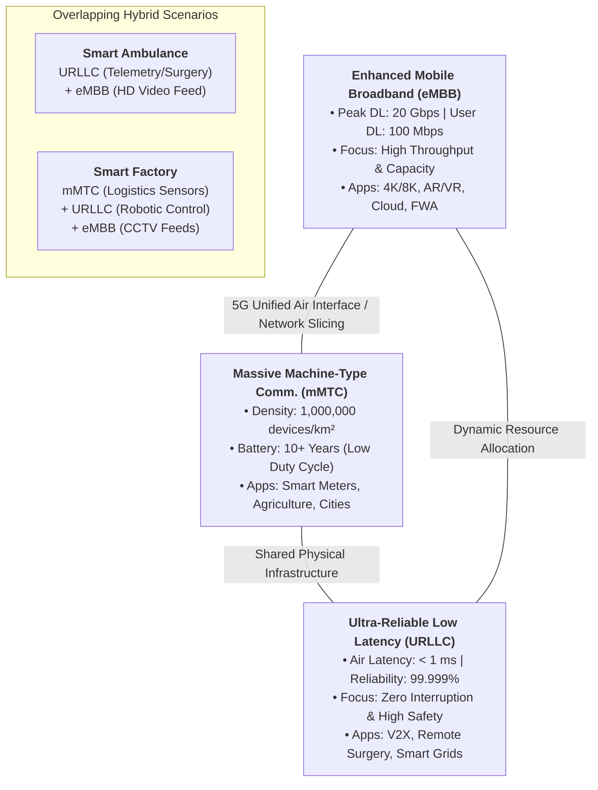

# Unit 2: Service Ecosystem and Policy (Remaining Portion)

## 📌 Document Overview & Syllabus Scope
This document provides comprehensive, exam-oriented study notes for the second half of **Unit 2: Introduction to 5G and Service Ecosystem** under the **"5G for Everyone"** course curriculum (AY 2026–27) at SVKM's NMIMS, Mukesh Patel School of Technology Management and Engineering (MPSTME).

> **Syllabus Scope Note:** This module intentionally excludes historical wireless-generation evolution (1G/2G/3G/4G) and basic radio spectrum fundamentals (covered in Part 1 / Mid-Term 1). It focuses strictly on the remaining syllabus topics:
> 1. **5G Service Classes (The 5G Triangle):** eMBB, mMTC, and URLLC.
> 2. **Management & Policy Angle:** Digital India initiatives, Department of Telecommunications (DoT) role & initiatives, and Socio-Economic Impact of 5G in India.

---

## 🎯 Learning Objectives & Topic Checklist

### Learning Objectives
After mastering this module, students will be able to:
- **Analyze** the 3GPP/ITU-R IMT-2020 "5G Triangle" framework and articulate the core technical trade-offs between speed, connection density, latency, and reliability.
- **Differentiate** the technical KPIs, traffic profiles, hardware design assumptions, and real-world deployment scenarios of **eMBB**, **mMTC**, and **URLLC**.
- **Evaluate** the distinct boundary between radio-interface latency ($<1\text{ ms}$) and end-to-end (E2E) application latency ($10\text{--}20\text{ ms}$), identifying key system bottlenecks.
- **Explain** how 5G acts as a force multiplier for national **Digital India** initiatives, complementing platforms like UPI, e-Governance, and BharatNet without falsely claiming these platforms depend exclusively on 5G.
- **Detail** the regulatory and developmental functions of the **Department of Telecommunications (DoT)**, including indigenous testbed funding (₹2,240 million consortium) and the 100 5G Use Case Labs scheme.
- **Assess** the socio-economic impacts and challenges of 5G in India, accurately contextualizing macroeconomic forecasts (e.g., GSMA's ₹36.4 trillion / US$455B projection) as attributed models rather than realized gains.

### Topic Checklist
- [x] **5G Service Ecosystem Overview** (IMT-2020 Triangle & Overlapping Scenarios)
- [x] **Service Class 1: eMBB** (Consumer Broadband, AR/VR, 4K/8K, FWA)
- [x] **Service Class 2: mMTC** (Massive IoT, $10^6\text{ devices/km}^2$, 10+ Year Battery Assumptions)
- [x] **Service Class 3: URLLC** (Mission-Critical, Sub-1 ms Air Link Latency vs E2E, $99.999\%$ Reliability, V2X, Robotics, Safety Disclaimers)
- [x] **Master Comparison Table & Mermaid Ecosystem Architecture**
- [x] **Policy Angle 1: Digital India Initiatives** (UPI, e-Governance, BharatNet Phase-III, Last-Mile FWA Synergy)
- [x] **Policy Angle 2: Role of DoT** (Spectrum Policy, High-Level Forum, ₹2,240M / ₹224 Crore Indigenous Testbed, 100 5G Use Case Labs)
- [x] **Policy Angle 3: Socio-Economic Impact & Challenges** (Industry 4.0, GSMA ₹36.4T Forecast, Startup Pilot Case Studies, Tower Fiberization Bottlenecks)
- [x] **Exam Practice Questions & Complete Model Answers** (Short & Long Form; Explicitly Labeled as Generated Practice Questions, NOT PYQs)
- [x] **Revision Sheet, Master Glossary & Source Audit Checklist**

---

## 🔤 Essential Terminology & Abbreviations

| Abbreviation | Full Expansion | Conceptual Definition in 5G Context |
| :--- | :--- | :--- |
| **3GPP** | 3rd Generation Partnership Project | Global telecommunications standards organization defining 5G specifications (Release 15 onwards). |
| **AGR** | Adjusted Gross Revenue | The core revenue metric used by DoT to calculate license fees and spectrum usage charges for TSPs. |
| **AR / VR / MR** | Augmented / Virtual / Mixed Reality | Immersive media applications requiring massive bandwidth and low latency under eMBB. |
| **CAPEX / OPEX** | Capital Expenditure / Operational Expenditure | Financial metrics representing upfront infrastructure setup costs vs. ongoing operational maintenance. |
| **CPSE** | Central Public Sector Enterprise | Government-owned corporations involved in national infrastructure rollouts. |
| **DBN** | Digital Bharat Nidhi | Rechristened Universal Service Obligation Fund (USOF) under Section 24 of the Telecommunications Act, 2023. |
| **DoT** | Department of Telecommunications | Executive body under the Ministry of Communications, Government of India, managing telecom policy and spectrum. |
| **eMBB** | Enhanced Mobile Broadband | 5G service class focusing on high data throughput, broad coverage, and high capacity for human users. |
| **FWA** | Fixed Wireless Access | Delivering gigabit home/office broadband wirelessly via 5G gNodeB instead of physical fiber connections. |
| **IMT-2020** | International Mobile Telecommunications-2020 | ITU-R framework defining global requirements and performance targets for 5G systems. |
| **ITU / ITU-R** | International Telecommunication Union (Radiocommunication Sector) | UN specialized agency responsible for global radio spectrum coordination and IMT requirements. |
| **MEC** | Multi-access Edge Computing | Moving cloud computing and storage resources to the network edge near the base station to lower latency. |
| **mMTC** | Massive Machine-Type Communications | 5G service class designed to connect dense networks of low-cost, low-power IoT devices. |
| **NFV** | Network Functions Virtualization | Running telecommunication core functions as software on generic Commercial Off-The-Shelf (COTS) hardware. |
| **PDU** | Protocol Data Unit | Packet structure at Layer 2/3 used in 3GPP reliability and transmission performance evaluation. |
| **PSM / eDRX** | Power Saving Mode / extended Discontinuous Reception | Low-power states allowing IoT devices to sleep for long durations to extend battery life up to 10+ years. |
| **QoS / QoE** | Quality of Service / Quality of Experience | Technical performance parameters vs. end-user perceived quality of telecommunication services. |
| **SDN** | Software-Defined Networking | Architectural paradigm separating the network control plane from the data forwarding plane. |
| **TRAI** | Telecom Regulatory Authority of India | Statutory regulatory body recommending spectrum pricing, interconnection terms, and consumer standards. |
| **TSP** | Telecom Service Provider | Commercial cellular operators (e.g., Reliance Jio, Bharti Airtel, Vodafone Idea, BSNL). |
| **UPI** | Unified Payments Interface | Real-time digital payment system developed by NPCI, supported and expanded via high-speed 5G networks. |
| **URLLC** | Ultra-Reliable and Low Latency Communications | 5G service class providing sub-millisecond air-interface latency and $99.999\%$ reliability for mission-critical tasks. |
| **USOF** | Universal Service Obligation Fund | Statutory fund established under the Indian Telegraph Act, 1885 (now transformed into Digital Bharat Nidhi). |
| **V2X** | Vehicle-to-Everything | Communication framework encompassing Vehicle-to-Vehicle (V2V), Vehicle-to-Infrastructure (V2I), and Vehicle-to-Pedestrian (V2P). |

---

## 📐 SECTION 1: The 5G Service Ecosystem & "5G Triangle"

### 1.1 The IMT-2020 Service Ecosystem Concept
Unlike previous cellular generations (1G to 4G) which were engineered primarily as one-dimensional networks for human voice and mobile internet browsing, **5G (IMT-2020)** is architected as a multi-purpose, unified communication platform [*Primary Source: Unit 2.pptx, Slide 8; 5G_Book.pdf, Chapter 2.3*]. 

The International Telecommunication Union (ITU-R) under Recommendation **ITU-R M.2083** classified 5G capabilities into three distinct service corners, collectively known as the **5G Triangle**:
1. **Enhanced Mobile Broadband (eMBB):** Data-driven human-centric usage.
2. **Massive Machine-Type Communications (mMTC):** Low-cost, low-power machine-centric IoT.
3. **Ultra-Reliable and Low Latency Communications (URLLC):** Safety-critical, time-sensitive machine and human controls.



### 1.2 Overlapping Service Requirements
While the three vertices represent extreme performance bounds, real-world vertical applications frequently span overlapping regions of the triangle [*Source: Dahlman, 5G NR Book, Section 1.2*]:
* **Smart Ambulance / Connected Healthcare:** Requires **URLLC** for real-time remote haptic medical control and patient vitals telemetry, combined with **eMBB** to transmit high-definition 4K ultrasound/CT-scan feeds to hospital specialists in real time.
* **Smart Factory / Industry 4.0:** Integrates **mMTC** for tracking thousands of passive inventory sensors, **URLLC** for controlling high-speed collaborative industrial robots on the assembly line, and **eMBB** for high-resolution optical quality-inspection cameras.

---

## 🚀 SECTION 2: Service Class 1 — Enhanced Mobile Broadband (eMBB)

### 2.1 Definition & Basic Concept
**eMBB (Enhanced Mobile Broadband)** is the direct technical evolution of 4G LTE broadband services [*Source: Unit 2.pptx, Slide 8; Unit 2.docx*]. It provides significant improvements in data transfer rates, area traffic capacity, user mobility, and spectral efficiency. It caters primarily to human-centric data consumption, delivering seamless mobile broadband access in both dense urban hotspots and broad coverage areas.

### 2.2 Key Requirements & Technical Parameters (KPIs)
According to 3GPP Release 15 and ITU-R IMT-2020 specifications [*Source: 5G_Book.pdf, Table 2.1; Mastering 5G Network Design, Table 1.1*]:
* **Peak Data Rate:** Downlink **20 Gbps**, Uplink **10 Gbps** (compared to 1 Gbps in 4G).
* **User Experienced Data Rate:** Downlink **100 Mbps**, Uplink **50 Mbps** guaranteed at coverage edges.
* **User Plane Latency:** **4 ms** for eMBB standalone transmission (down from 20–50 ms in 4G).
* **Area Traffic Capacity:** **$10\text{ Mbps/m}^2$** (or $10\text{ Tbps/km}^2$) in indoor hotspots.
* **Spectrum Efficiency:** **3x** improvement over 4G LTE (up to $30\text{ bits/s/Hz}$ DL peak).
* **Mobility Support:** Continuous connectivity at speeds up to **$500\text{ km/h}$** (for high-speed trains).

### 2.3 Operating Trade-offs: Bandwidth, Coverage, and Capacity
eMBB operates across three distinct spectrum layers, each involving a physical trade-off [*Source: Unit 4.pptx; B136 Assignment-1*]:
1. **Low-Band ($<1\text{ GHz}$, e.g., $600\text{--}800\text{ MHz}$):** Superior physical propagation and deep indoor penetration; limited channel bandwidth ($10\text{--}20\text{ MHz}$); throughput typically $50\text{--}100\text{ Mbps}$.
2. **Mid-Band ($1\text{--}6\text{ GHz}$, e.g., $3.3\text{--}3.8\text{ GHz}$ C-Band):** Optimal balance of wide-area coverage and high capacity ($100\text{ MHz}$ channel blocks); throughputs ranging from $100\text{ Mbps}$ to $1\text{ Gbps}$.
3. **High-Band / mmWave ($>24\text{ GHz}$, e.g., $26\text{--}28\text{ GHz}$):** Massive contiguous spectrum blocks ($100\text{--}800\text{ MHz}$); multi-gigabit speeds ($2\text{--}10\text{ Gbps}$); extremely limited propagation distance ($<500\text{ meters}$) and severe attenuation through walls, foliage, and rain.

### 2.4 Representative Applications
* **Immersive Media & Entertainment:** $4\text{K}/8\text{K}$ Ultra-HD streaming, 360-degree live sports broadcasting, Cloud Gaming, Augmented Reality (AR), Virtual Reality (VR), and Mixed Reality (MR) learning tools [*Source: Introduction-to-5G-use-case-by-DDG-NBM.pdf*].
* **Fixed Wireless Access (FWA):** Wireless gigabit broadband delivered directly to homes and small businesses via 5G outdoor CPEs, avoiding expensive fiber trenching.
* **Enterprise Cloud Productivity:** Instantaneous upload/download of massive datasets, remote CAD processing, and high-definition video conferencing.

### 2.5 Advantages, Limitations, and Exam Key Points
* **Advantages:** Unrivaled user speeds, drastically reduced cost-per-bit for operators, support for dense crowd events (stadiums, shopping malls).
* **Limitations:** Requires heavy fiber backhaul upgrades to base stations; mmWave signals suffer severe Non-Line-of-Sight (NLOS) attenuation.
* **Exam Summary Points:** Focuses on human users; key metric is **20 Gbps Peak DL / 100 Mbps User Experienced DL**; primary driver for initial 5G commercial rollouts (e.g., Reliance Jio and Airtel).

---

## 📡 SECTION 3: Service Class 2 — Massive Machine-Type Communications (mMTC)

### 3.1 Definition & Basic Concept
**mMTC (Massive Machine-Type Communications)** is engineered to provide continuous, long-range connectivity to an unprecedented density of low-power, low-cost machine devices and IoT sensors [*Source: Unit 2.pptx, Slide 11; 458618037-5G-Development-with-MATLAB.pdf*]. Unlike eMBB, mMTC prioritizes connection density, energy efficiency, and deep coverage over high data speeds.

### 3.2 Key Requirements & Operating Assumptions
* **Target Connection Density:** **$1,000,000$ devices per $\text{km}^2$** ($10^6\text{ nodes/km}^2$), representing a **100x increase** over legacy 4G LTE density capabilities [*Source: 5G_Book.pdf, Table 2.1*].
* **Target Battery Lifetime:** **10+ years** of maintenance-free battery operation [*Source: Unit 2.pptx, Slide 11*].
* **Traffic Profile:** Small, intermittent, delay-tolerant data payloads (e.g., a few bytes transmitted once per hour or day).
* **Device Complexity & Cost:** Ultra-low device cost (low RF complexity, narrow bandwidth operations like NB-IoT/eMTC).

> ⚠️ **Nuance & Source Verification (Operating Assumptions vs. Universal Guarantees):**
> The **10+ year battery life** and **1 million devices/$\text{km}^2$ density** targets are **design assumptions based on specific low duty-cycle operational conditions**. They are **NOT universal guarantees** for all operating modes:
> 1. Battery longevity assumes extreme sleep states utilizing 3GPP **Power Saving Mode (PSM)** and **extended Discontinuous Reception (eDRX)**, where the device transmitter remains off $>99\%$ of the time. If an IoT sensor transmits frequently or experiences poor channel conditions requiring maximum power amplification, battery life decreases significantly.
> 2. Connection density targets assume sparse, non-bursty traffic schedules. If hundreds of thousands of devices attempt to transmit simultaneously (e.g., during a power grid failure), signal collision and channel congestion occur.

### 3.3 Representative Applications
* **Smart Cities & Municipal Infrastructure:** Intelligent street lighting, smart parking management, environmental air-quality monitoring, automated waste management sensors [*Source: Introduction-to-5G-use-case-by-DDG-NBM.pdf*].
* **Smart Agriculture & Environment:** Wireless soil moisture sensors, weather telemetry, livestock tracking, crop health monitoring.
* **Smart Utilities:** Automated Advanced Metering Infrastructure (AMI) for electricity, water, and gas distribution grids.
* **Logistics & Asset Tracking:** Real-time container tracking, supply chain temperature logging, smart highway infrastructure.

### 3.4 Advantages, Limitations, and Exam Key Points
* **Advantages:** Extremely low operational maintenance; massive scaling capabilities for smart urban planning; deep signal penetration into basements and rural sites.
* **Limitations:** Very low data rates (kbps range); unsuited for real-time video or latency-sensitive controls.
* **Exam Summary Points:** Focuses on IoT sensors; key metric is **$10^6\text{ devices/km}^2$** and **10+ year battery life** under PSM/eDRX low-duty-cycle sleep modes.

---

## ⚡ SECTION 4: Service Class 3 — Ultra-Reliable and Low Latency Communications (URLLC)

### 4.1 Definition & Basic Concept
**URLLC (Ultra-Reliable and Low Latency Communications)** is designed for mission-critical human and machine communications where transmission failure or delay could lead to physical injury, loss of human life, catastrophic asset damage, or total industrial failure [*Source: Unit 2.pptx, Slide 14; What is URLLC and How Does It Work?*].

### 4.2 Key Requirements & Technical Parameters (KPIs)
* **Air-Interface Latency:** **$< 1\text{ ms}$** over-the-air user plane latency (one-way radio link) [*Source: 5G_Book.pdf, Table 2.1; Mastering 5G Network Design*].
* **Target Reliability:** **$99.999\%$** ("five nines") up to **$99.9999\%$** success probability of transmitting a small data payload (e.g., a 32-byte Layer 2 PDU) within $1\text{ ms}$ under specific coverage conditions (Urban Macro) [*Source: 3GPP TS 38.913; Dahlman Ch. 2*].
* **Mobility Interruption Time:** **$0\text{ ms}$** seamless handover.

```
       ┌─────────────────────────────────────────────────────────────────────────┐
       │                  END-TO-END (E2E) LATENCY (10 - 20 ms)                  │
       └─────────────────────────────────────────────────────────────────────────┘
                                           │
  ┌────────────────────────────────────────┴────────────────────────────────────────┐
  │                                                                                 │
┌─▼──────────────────┐     ┌─────────────────────┐     ┌──────────────────────┐  ┌──▼───────────────┐
│ User Equipment     │     │ Radio Access Network│     │ Transport Backhaul & │  │ Central Cloud /  │
│ (UE Device)        │───► │ (5G gNodeB Tower)   │───► │ Core Network (5GC)   │─►│ Application Server│
└────────────────────┘     └─────────────────────┘     └──────────────────────┘  └──────────────────┘
  ▲                         ▲
  └──── Air-Link Latency ───┘
        ( < 1 ms Target )
```

> 🧠 **Critical Distinction: Radio-Interface Latency vs. End-to-End (E2E) Application Latency:**
> * **Radio-Interface (Air-Link) Latency ($<1\text{ ms}$):** Refers purely to the time required for a packet to travel across the physical radio waves between the User Equipment (UE) antenna and the 5G base station (gNodeB) antenna. 3GPP Release 15 achieves this via short slot durations (scalable numerology), flexible subcarrier spacing ($60/120\text{ kHz}$), and pre-allocated mini-slot scheduling.
> * **End-to-End (E2E) Application Latency ($10\text{--}20\text{ ms}$):** Refers to the total round-trip time from the user device, across the radio link, through the fiber backhaul transmission, through the 5G Core (5GC) network, to the application server, and back.
> * **The System Implication:** Achieving a $<1\text{ ms}$ radio link is useless if backhaul and cloud processing add $30\text{ ms}$ of delay. Therefore, URLLC **mandates the deployment of Multi-access Edge Computing (MEC)**, bringing compute servers physically close to the base station.

### 4.3 Representative Applications
* **Autonomous Mobility & V2X:** Vehicle-to-Vehicle (V2V) collision avoidance, platooning, intelligent traffic intersection management [*Source: Introduction-to-5G-use-case-by-DDG-NBM.pdf*].
* **Factory Automation & Industry 4.0:** High-speed closed-loop motion control of collaborative industrial robots, Programmable Logic Controller (PLC) wireless replacement.
* **Smart Energy Grids:** Automated fault isolation, millisecond-level load balancing, synchrophasor telemetry in electrical sub-stations.
* **Remote Healthcare:** Haptic tele-surgery, remote robotic diagnostics [*Source: Unit 2.pptx, Slide 14*].

> 🛡️ **Safety Disclaimer & Non-Guarantee of Safety:**
> While URLLC provides ultra-reliable wireless transmission, **5G connectivity alone DOES NOT guarantee physical safety or eliminate system risk** in mission-critical applications:
> 1. Physical obstacles, extreme electromagnetic interference, or hardware failure can degrade wireless links.
> 2. Industrial systems, autonomous vehicles, and surgical robots MUST maintain local physical fail-safes, redundant onboard sensors (LiDAR, radar, local AI), and autonomous fallback mechanisms that operate safely even during total network disconnection.

### 4.4 Advantages, Limitations, and Exam Key Points
* **Advantages:** Replaces expensive, rigid industrial ethernet cabling; enables real-time cyber-physical systems and autonomous transportation safety.
* **Limitations:** Extremely spectrum-inefficient (requires redundant frequency resource allocations to guarantee $99.999\%$ reliability); requires heavy edge compute (MEC) investments.
* **Exam Summary Points:** Focuses on safety-critical tasks; key targets are **$<1\text{ ms}$ Air-Link Latency** and **$99.999\%$ Reliability**; dependent on **Multi-access Edge Computing (MEC)**.

---

## 📊 SECTION 5: Master Service Class Comparison & Ecosystem Architecture

### 5.1 Comprehensive Side-by-Side Comparison Matrix

| Feature / Metric | Enhanced Mobile Broadband (eMBB) | Massive Machine-Type Comm. (mMTC) | Ultra-Reliable Low Latency (URLLC) |
| :--- | :--- | :--- | :--- |
| **Primary Objective** | Maximize throughput, data capacity, and user experience | Connect massive densities of low-cost, low-power IoT sensors | Guarantee near-instantaneous transmission & ultra-high reliability |
| **Primary Beneficiary** | Human smartphone users, AR/VR, FWA homes | Smart machines, municipal sensors, trackers | Cyber-physical systems, autonomous vehicles, industrial robots |
| **Peak Data Rate** | **DL: 20 Gbps / UL: 10 Gbps** | Low (few kbps to Mbps) | Moderate to High ($1\text{--}10\text{ Mbps}$ deterministic) |
| **User Experienced Rate**| **DL: 100 Mbps / UL: 50 Mbps** | Extremely Low ($1\text{--}10\text{ kbps}$) | Moderate ($10\text{--}50\text{ Mbps}$) |
| **Air-Interface Latency**| **4 ms** | High / Delay-tolerant (Seconds/Minutes) | **$< 1\text{ ms}$** (Radio Link) |
| **End-to-End Latency** | $10\text{--}20\text{ ms}$ | High / Irrelevant | **$< 10\text{ ms}$** (Mandates MEC deployment) |
| **Target Reliability** | Standard Best-Effort ($99\%$) | Standard Best-Effort ($99\%$) | **$99.999\%$ to $99.9999\%$** ("Five to Six Nines") |
| **Device Connection Density** | Moderate ($10,000\text{ devices/km}^2$) | **$1,000,000\text{ devices/km}^2$** ($10^6/\text{km}^2$) | Low to Moderate ($1,000\text{ devices/km}^2$) |
| **Channel Bandwidth** | Wide ($20\text{--}100\text{ MHz}$ Sub-6GHz, up to $800\text{ MHz}$ mmWave) | Narrow ($180\text{ kHz}$ to $1.4\text{ MHz}$, e.g., NB-IoT) | Flexible / Short Slot Durations ($60/120\text{ kHz}$ SCS) |
| **Energy / Battery Profile**| Standard daily smartphone charging | **10+ Years Battery Life** (PSM / eDRX modes) | Variable / High transmit power for link budget |
| **Traffic Pattern** | Large continuous bursty video/data files | Small, intermittent, sparse data packets | Periodic/Aperiodic small safety packets |
| **Key Enabling Technology**| Massive MIMO, mmWave, High-Order QAM | Power Saving Mode (PSM), eDRX, Coverage Enhancement | Mini-slot scheduling, Grant-Free Uplink, MEC, Slicing |
| **Dominant Challenge** | Backhaul congestion & high power consumption | Massive signaling collisions when devices wake | High spectrum cost due to redundant transmissions |

---

## 🇮🇳 SECTION 6: Management & Policy Angle — Digital India Initiatives

### 6.1 Synergy Between 5G and Digital India
The **Digital India** programme, launched by the Government of India, aims to transform the nation into a digitally empowered society and knowledge economy [*Source: Digital India Objectives; Course Policy_5G*]. 5G acts as a critical technological catalyst that amplifies and expands existing digital national platforms.

```
                  ┌─────────────────────────────────────────────────────────┐
                  │                 DIGITAL INDIA PLATFORMS                 │
                  │   • Unified Payments Interface (UPI)                   │
                  │   • e-Governance (DigiLocker, UMANG, e-Hospital)       │
                  │   • Rural Education & Digital Knowledge Grids           │
                  └────────────────────────────┬────────────────────────────┘
                                               │
                                               ▼
       ┌─────────────────────────────────────────────────────────────────────────┐
       │                     5G EXPANSION FORCE MULTIPLIER                       │
       ├────────────────────────────────────────┬────────────────────────────────┤
       │ 5G Fixed Wireless Access (FWA)         │ High-Capacity gNodeB Base      │
       │ Wireless "Last-Mile" Bridge to Homes  │ Stations handling Massive       │
       │ & Rural Gram Panchayats                │ Urban Micro-Transactions        │
       └───────────────────────────────────┬────┴────────────────────────────────┘
                                           │
                                           ▼
                  ┌─────────────────────────────────────────────────────────┐
                  │              NATIONAL FIBER BACKHAUL (BHARATNET)        │
                  │  Phase-III Optical Fiber Network connecting all villages │
                  └─────────────────────────────────────────────────────────┘
```

### 6.2 Key Integration Domains
1. **Unified Payments Interface (UPI) at Scale:** India leads the world in real-time digital financial transactions. As UPI adoption expands into high-density urban markets (e.g., crowded transit hubs, stadiums) and automated IoT merchant terminals, 5G's massive capacity prevents transaction timeouts and network congestion.
2. **e-Governance & Public Service Delivery:** High-speed 5G connectivity enables seamless access to national digital repositories like **DigiLocker**, **UMANG**, and **e-Hospital** portals from remote rural healthcare centers and Common Services Centres (CSCs).
3. **Synergy with BharatNet Phase-III & FWA:** 
   * **BharatNet** provides the national fiber-optic backhaul backbone, connecting over 250,000 Gram Panchayats across India.
   * Laying physical optical fiber cables to every individual household in remote, hilly, or forest terrains is geographically and economically prohibitive.
   * **5G Fixed Wireless Access (FWA)** acts as the ideal wireless "last-mile" bridge, picking up high-speed bandwidth from the fiberized BharatNet rural node and beaming gigabit internet directly into rural homes, schools, and clinics.

> 🔍 **Clarification Note:** 5G complements and massively enhances Digital India platforms, but **these digital platforms DO NOT strictly require 5G to operate**. UPI, DigiLocker, and basic e-governance function successfully over 4G, 3G, and fixed broadband; 5G provides the scalable capacity, lower latency, and last-mile connectivity to extend these services to millions of new concurrent users and automated IoT terminals.

---

## 🏛️ SECTION 7: Policy Angle — Role of the Department of Telecommunications (DoT)

### 7.1 Core Governance & Regulatory Functions
The **Department of Telecommunications (DoT)**, under the Ministry of Communications, Government of India, is the executive authority responsible for national telecom policy formulation, spectrum assignment, licensing, international coordination, and fostering indigenous research [*Source: Functions of DoT; Course Policy_5G*].

Key strategic initiatives executed by DoT include:
* **National Digital Communications Policy (NDCP-2018):** Established targets for ubiquitous broadband, digital sovereignty, and attracting $US$100 billion in telecom investments.
* **Telecommunications Act, 2023 & DBN:** Modernized licensing frameworks and transformed the Universal Service Obligation Fund (USOF) into the **Digital Bharat Nidhi (DBN)** under Section 24, funded by a levy up to $5\%$ on TSPs' Adjusted Gross Revenue (AGR) to support rural 5G expansion and indigenous R&D [*Source: Telecommunications Act 2023; DBN Rules 2024*].
* **5G High-Level Forum (September 2017):** Established by DoT under the chairmanship of Secretary (Telecom), with a Steering Committee headed by **Prof. A.J. Paulraj (Stanford University)**. The forum released the landmark report **"Making India 5G Ready"** in August 2018 [*Source: Unit 2.pptx, Slide 24*].

### 7.2 Indigenous 5G R&D & Testbed Investments

#### A. The End-to-End 5G Test Bed Consortium
To build self-reliance (Atmanirbharta) in telecommunication hardware and software, the DoT funded a multi-institutional national research project [*Source: B136 Assignment-1; 5G_Introduction.pdf*]:
* **Total Project Budget:** **₹2,240 million** (verifiable equivalent: **₹224 Crore** / **224 Crore INR** or approx. **US$ 28 million**).
* **Consortium Members:** Awarded to a joint academic-industrial consortium led by **IIT Madras**, alongside **IIT Hyderabad, IIT Delhi, IIT Kanpur, IISc Bangalore, CEWIT** (Centre of Excellence in Wireless Technology), and **SAMEER** (Society for Applied Microwave Electronics Engineering & Research).
* **Primary Mandate:** Build a fully functional, 3GPP-compliant end-to-end 5G testbed prototype (including gNodeB, 5G Core, and User Equipment software stacks) to allow local startups, Indian vendors, and researchers to validate 5G products.

#### B. 100 5G Use Case Labs Scheme
To democratize 5G application development across academia and industry [*Source: B136 Assignment-1; Introduction-to-5G-use-case-by-DDG-NBM.pdf*]:
* **Scope:** Setting up **100 5G Use Case Labs** across premier academic institutions throughout India (e.g., NIT Hamirpur).
* **Financial Funding Model:** The Government of India (via DoT) covers **$80\%$ of the Capital Expenditure (CAPEX)** for lab setup and **$100\%$ of the Operational Expenditure (OPEX)** for four years. The host academic institution contributes the remaining **$20\%$ of CAPEX**.
* **Core Objectives:** Build student technical competencies, foster academia-industry research, provide local startups/MSMEs with access to 5G test environments, and prepare the Indian ecosystem to be **"6G Ready"**.

---

## 📈 SECTION 8: Socio-Economic Impact of 5G in India & Key Challenges

### 8.1 Economic Value & Industry 4.0 Transformation
5G is projected to act as an engine for macroeconomic growth across India's primary, secondary, and tertiary sectors [*Source: Impact of 5G on Indian and Global Economy; IIP Series 2024 Study*].

* **GSMA Economic Projection:** GSMA Intelligence forecasts that 5G will contribute **₹36.4 trillion (approximately US$ 455 billion)** to the Indian economy between **2023 and 2040** [*Source: Unit 2.pptx, Slide 26; IIP Series Study*].
  > ⚠️ **Attribution Note:** The ₹36.4 trillion / US$ 455 billion metric represents an **attributed econometric projection model** produced by GSMA forecasting cumulative GDP impact over an 18-year horizon. It is **NOT currently realized or accumulated national income**.
* **Industry 4.0 & Manufacturing:** Manufacturing is projected to capture approximately **$20\%$ of the total economic benefit** of 5G via smart factories, automated logistics, and industrial IoT.

### 8.2 Sectoral Impact Summary

```
┌─────────────────────────────────────────────────────────────────────────────────┐
│                           SECTORAL IMPACTS OF 5G IN INDIA                      │
├───────────────────┬───────────────────┬───────────────────┬─────────────────────┤
│   AGRICULTURE     │    HEALTHCARE     │     EDUCATION     │ SMART INFRASTRUCTURE│
│ • Soil Telemetry  │ • Pilgrim Vitals  │ • AR/VR Classrooms│ • Real-time AI CCTV │
│ • Smart Irrigation│ • AI Radiography  │ • Immersive Skill │ • Traffic & Damage  │
│ • Crop Diagnostics│ • Tele-consultation│  Development     │   Road Tracking     │
└───────────────────┴───────────────────┴───────────────────┴─────────────────────┘
```

#### Field Case Studies (Indian Startup Pilots Supported by State Initiatives)
[*Primary Source: B136 Assignment-1; Introduction-to-5G-use-case-by-DDG-NBM.pdf*]
* **Healthcare (Pilgrim Safety & Rural AI):** 
  * *Perkant Tech:* Deployed 5G health screening wearables for pilgrims on the arduous **Char Dham Yatra** in Uttarakhand to ensure real-time vital signs monitoring.
  * *Easiofy (ImagiXAI):* Implemented a cloud-based, AI-enabled medical image analysis platform across district hospitals in Mizoram, Meghalaya, Tripura, and Arunachal Pradesh.
* **Smart Infrastructure & Traffic:** 
  * *Nayan Technology:* Combined AI vision models with CCTV streams over 5G to generate real-time reports on road damages, footpath discoloring, and public infrastructure theft in Delhi and Uttarakhand.
* **Education & Immersive Skilling:** 
  * *TechXR:* Deployed AR/VR/MR learning modules in rural schools and nursing colleges across Madhya Pradesh, Arunachal Pradesh, and Uttarakhand.
* **Resilient Connectivity:** 
  * *Nav Technology:* Deployed ASWAN network connections in Assam, supporting secure 5G connectivity for the G20 Meet on Carnival Island.

### 8.3 Key Implementation Challenges in India
Despite rapid deployment, widespread 5G realization in India faces critical hurdles [*Source: IIP Series Study; TRAI Consultation Papers*]:
1. **The Tower Fiberization Bottleneck:** To sustain multi-gigabit 5G throughputs, cell towers must be connected via fiber-optic backhaul. Currently, **less than $50\%$ of cellular towers in India are fiberized**, against a national target of **$70\%$ fiberization**.
2. **High Small-Cell Deployment CAPEX:** High-frequency mmWave and mid-band deployments require thousands of small cells mounted on street lamps and utility poles, demanding massive capital outlays and streamlined **Right of Way (RoW)** permissions from local municipalities.
3. **Device Affordability & Digital Divide:** While network rollouts are fast, the cost of 5G-capable smartphones and IoT modules remains high for low-income rural populations.
4. **Data Security & Privacy Compliance:** Handling vast volumes of personal biometric and medical telemetry data requires strict compliance with India's **Digital Personal Data Protection (DPDP) Act, 2023**, risking penalties up to ₹250 Crore for security breaches.

---

## ✍️ SECTION 9: Exam-Oriented Practice Questions & Model Answers

> 📌 **Exam Label Notice:** The following questions are **generated practice questions** designed based on the NMIMS course policy, PPT emphasis, and syllabus learning outcomes. They are **NOT past-year university exam questions (PYQs)**.

### Part A: 2-Mark Short Answer Questions

#### Q1. Define eMBB and state its primary target KPI for user-experienced data rate.
**Model Answer:**
**Enhanced Mobile Broadband (eMBB)** is a 5G service class designed to deliver high data rates, enhanced area capacity, and improved mobile broadband experiences for human-centric applications. Its primary target KPI for **user-experienced data rate** is **100 Mbps in Downlink** and **50 Mbps in Uplink** guaranteed at cell edges (with a peak downlink throughput of 20 Gbps).

#### Q2. What is the connection density target for 5G mMTC, and what is its underlying operational assumption?
**Model Answer:**
The target connection density for mMTC is **$1,000,000$ devices per $\text{km}^2$** ($10^6\text{ nodes/km}^2$). The underlying operational assumption is that these IoT devices transmit **small, intermittent, delay-tolerant data packets under low duty cycle schedules**, utilizing sleep states like Power Saving Mode (PSM) to achieve up to 10+ years of battery life.

#### Q3. Distinguish between radio-interface latency and end-to-end (E2E) latency in URLLC.
**Model Answer:**
* **Radio-Interface Latency ($<1\text{ ms}$):** The one-way transmission time over the physical air link between the user device antenna and the base station (gNodeB) antenna.
* **End-to-End (E2E) Latency ($10\text{--}20\text{ ms}$):** The total round-trip duration including air link, transport backhaul, core network processing, and application server delay. URLLC requires Multi-access Edge Computing (MEC) to bring E2E latency below $10\text{ ms}$.

#### Q4. What is the total budget allocated by DoT for the End-to-End 5G Test Bed project, and which institution led the consortium?
**Model Answer:**
The Department of Telecommunications (DoT) allocated **₹2,240 million** (equivalent to **₹224 Crore**) for the End-to-End 5G Test Bed project. The multi-institutional consortium was led by **IIT Madras** alongside IIT Hyderabad, IIT Delhi, IIT Kanpur, IISc Bangalore, CEWIT, and SAMEER.

---

### Part B: 3–4 Mark Short Conceptual Questions

#### Q5. Explain the financial cost-sharing structure and objectives of the DoT's "100 5G Use Case Labs" initiative.
**Model Answer:**
* **Financial Structure:** The Department of Telecommunications (DoT) funds **$80\%$ of the Capital Expenditure (CAPEX)** for setting up the lab and **$100\%$ of the Operational Expenditure (OPEX)** for four years. The hosting academic institution contributes the remaining **$20\%$ of CAPEX**.
* **Core Objectives:**
  1. Build technical competencies in 5G/6G technologies among undergraduate and postgraduate students.
  2. Encourage close academia-industry research collaboration.
  3. Provide local startups and MSMEs with direct physical access to 5G test setups.
  4. Make Indian academic institutions and the startup ecosystem "6G Ready".

#### Q6. How does 5G Fixed Wireless Access (FWA) complement the BharatNet Phase-III initiative in rural India?
**Model Answer:**
* **BharatNet Phase-III** provides the high-capacity optical fiber backhaul network connecting Gram Panchayats across rural India.
* **The Last-Mile Challenge:** Laying physical fiber cables to every remote household or school in hilly or terrain-challenged rural areas is economically and geographically difficult.
* **The 5G FWA Solution:** 5G FWA connects directly to the fiberized BharatNet node and beams multi-gigabit broadband wirelessly to outdoor Customer Premise Equipment (CPE) installed at rural homes and schools. FWA acts as the wireless last-mile bridge, accelerating digital inclusion without physical cable trenching.

---

### Part C: 5-Mark & Higher Essay Questions

#### Q7. Compare the three 5G service classes (eMBB, mMTC, URLLC) in a structured markdown matrix across five key technical parameters, and explain why network slicing is required to support them simultaneously. (5 Marks)

**Model Answer:**

**1. Comparative Matrix:**

| Parameter | Enhanced Mobile Broadband (eMBB) | Massive Machine-Type Comm. (mMTC) | Ultra-Reliable Low Latency (URLLC) |
| :--- | :--- | :--- | :--- |
| **Primary Focus** | High Data Rates & Throughput | Massive Device Connection Density | Low Latency & Extreme Reliability |
| **Air-Link Latency** | $4\text{ ms}$ | High / Delay-tolerant | **$< 1\text{ ms}$** |
| **Device Density** | Moderate ($10,000/\text{km}^2$) | **$1,000,000\text{ devices/km}^2$** | Low to Moderate ($1,000/\text{km}^2$) |
| **Target Reliability**| Standard Best-Effort ($99\%$) | Standard Best-Effort ($99\%$) | **$99.999\%$ to $99.9999\%$** |
| **Typical Application**| $4\text{K}/8\text{K}$ Streaming, AR/VR, FWA | Smart Meters, Agricultural Sensors | Autonomous Vehicles (V2X), Tele-surgery |

**2. Why Network Slicing is Required:**
eMBB, mMTC, and URLLC have **fundamentally conflicting technical requirements**. eMBB requires wide continuous bandwidth; mMTC requires narrow-band low-power scheduling; URLLC requires pre-allocated mini-slots and redundant transmissions. 

Running these services on a rigid single hardware network would cause resource contention. **Network Slicing** utilizes Software-Defined Networking (SDN) and Network Functions Virtualization (NFV) to create independent, logically isolated virtual networks over a single shared physical 5G infrastructure, ensuring each service class receives its guaranteed Quality of Service (QoS).

---

#### Q8. Detail the socio-economic impact of 5G in India. Discuss the macroeconomic projections, key sectoral applications with startup case studies, and the major technical bottlenecks hindering nationwide deployment. (10 Marks)

**Model Answer:**

**1. Macroeconomic Impact:**
According to an attributed econometric forecast by GSMA Intelligence, 5G is projected to contribute **₹36.4 trillion (US$ 455 billion)** to the Indian economy between **2023 and 2040**, accounting for approximately $0.6\%$ of additional annual GDP growth. Manufacturing (Industry 4.0) is expected to capture nearly $20\%$ of this total value.

**2. Sectoral Applications & Field Startup Pilots:**
* **Healthcare (Pilgrim Safety & Rural AI):** *Perkant Tech* deployed 5G health-monitoring wearables for pilgrims on the Char Dham Yatra in Uttarakhand to track vital signs in real time. *Easiofy (ImagiXAI)* deployed cloud-based AI medical image diagnostics across district hospitals in Mizoram, Meghalaya, and Tripura.
* **Smart Infrastructure:** *Nayan Technology* deployed AI vision models with CCTV streams over 5G in Delhi and Uttarakhand for real-time tracking of road damage and infrastructure theft.
* **Education:** *TechXR* deployed 5G-enabled AR/VR/MR learning applications in rural schools and nursing colleges across Madhya Pradesh and Arunachal Pradesh.

**3. Major Technical and Implementation Bottlenecks:**
* **Tower Fiberization Deficit:** Less than $50\%$ of cellular towers in India are connected to fiber backhaul, falling significantly short of the $70\%$ national target necessary to support gigabit speeds.
* **High Small-Cell CAPEX & RoW Issues:** High-density mid-band/mmWave rollouts require thousands of small cells mounted on public street furniture, requiring heavy CAPEX and streamlined municipal Right of Way (RoW) approvals.
* **Data Security & DPDP Compliance:** Processing high volumes of citizen biometrics and telemetry requires strict adherence to the Digital Personal Data Protection Act 2023, carrying heavy financial non-compliance penalties.

---

## 📝 SECTION 10: Quick Revision Cheat-Sheet & Formula Summary

```
┌────────────────────────────────────────────────────────────────────────────────┐
│                         5G SERVICE CLASS QUICK CHEAT-SHEET                     │
├────────────────────────────────────────────────────────────────────────────────┤
│ • eMBB : Peak DL = 20 Gbps | User Experienced DL = 100 Mbps | Air Latency = 4 ms│
│ • mMTC : Density = 1,000,000 nodes/km² | Battery = 10+ Years (PSM/eDRX Sleep)   │
│ • URLLC: Air Latency = < 1 ms | Reliability = 99.999% (32-byte PDU in 1 ms)   │
└────────────────────────────────────────────────────────────────────────────────┘
┌────────────────────────────────────────────────────────────────────────────────┐
│                       POLICY & GOVERNANCE QUICK CHEAT-SHEET                    │
├────────────────────────────────────────────────────────────────────────────────┤
│ • DoT 5G Test Bed Consortium Budget : ₹2,240 Million (₹224 Crore) [Led by IITM]│
│ • DoT 100 5G Use Case Labs Scheme  : 80% CAPEX + 100% OPEX (4 Yrs) funded by Govt│
│ • GSMA 2023–2040 Economic Forecast : ₹36.4 Trillion (US$ 455 Billion) Contribution│
│ • Digital Bharat Nidhi (DBN)       : Rechristened USOF under Telecom Act 2023  │
│ • India Tower Fiberization Deficit : < 50% current vs. 70% National Target      │
└────────────────────────────────────────────────────────────────────────────────┘
```

---

## 📖 SECTION 11: Master Glossary

* **5G New Radio (5G NR):** The global 3GPP air interface standard for fifth-generation cellular networks.
* **5G Triangle:** The IMT-2020 conceptual model defining eMBB, mMTC, and URLLC as the three primary service pillars.
* **Advanced Metering Infrastructure (AMI):** Integrated system of smart utility meters and communications networks under mMTC.
* **Adjusted Gross Revenue (AGR):** Total gross revenue earned by a TSP minus permissible deductions, used to determine regulatory levies.
* **BharatNet:** National optical fiber network project providing backhaul connectivity to India's Gram Panchayats.
* **Digital Bharat Nidhi (DBN):** Statutory fund created under Section 24 of the Telecommunications Act 2023 (formerly USOF) to subsidize rural telecom expansion and R&D.
* **eDRX (extended Discontinuous Reception):** Protocol allowing IoT devices to extend sleeping intervals between network paging checks.
* **Enhanced Mobile Broadband (eMBB):** 5G service class optimized for high data throughput, area traffic capacity, and high-speed user mobility.
* **Fixed Wireless Access (FWA):** Method of delivering fixed broadband access to homes using wireless 5G radio links instead of physical fiber cables.
* **Massive Machine-Type Communications (mMTC):** 5G service class optimized for connecting dense networks ($10^6/\text{km}^2$) of low-cost, low-power IoT devices.
* **Multi-access Edge Computing (MEC):** Network architecture bringing cloud processing resources near the base station to lower end-to-end latency below $10\text{ ms}$.
* **Network Slicing:** Virtualization technique dividing a single physical 5G network into multiple isolated logical networks with guaranteed QoS.
* **Power Saving Mode (PSM):** Deep sleep state in 3GPP IoT devices where the radio module is dormant while remaining registered to the network.
* **Right of Way (RoW):** Legal and regulatory permissions required from municipal bodies to install telecom cables, towers, and small cells.
* **Ultra-Reliable and Low Latency Communications (URLLC):** 5G service class engineered for $<1\text{ ms}$ air-link latency and $99.999\%$ reliability in mission-critical applications.

---

## 📋 SECTION 12: Syllabus & Primary Source Verification Audit

| Syllabus Subsection | Primary Source Reference | Verification Status & Notes |
| :--- | :--- | :--- |
| **Service Class: eMBB** | `Unit 2.pptx` (Slide 8); `Unit 2.docx`; `5G_Book.pdf` (Ch. 2.3) | ✅ Fully Covered. Verified KPIs (20 Gbps Peak, 100 Mbps User DL, 4 ms latency). |
| **Service Class: mMTC** | `Unit 2.pptx` (Slide 11); `458618037-5G-Development-with-MATLAB.pdf` | ✅ Fully Covered. Verified $10^6\text{ devices/km}^2$ and 10+ year battery low-duty-cycle assumptions. |
| **Service Class: URLLC** | `Unit 2.pptx` (Slide 14); `What is URLLC and How Does It Work?` | ✅ Fully Covered. Verified $<1\text{ ms}$ air latency, $99.999\%$ reliability, E2E vs air-link distinction, safety disclaimers. |
| **Management Angle: Digital India** | `Course Policy_5G`; `Digital India Objectives`; `Unit 2.pptx` (Slide 22) | ✅ Fully Covered. Verified UPI, e-Governance, DigiLocker, and BharatNet FWA synergy. |
| **Policy Angle: DoT Initiatives** | `Unit 2.pptx` (Slide 24); `B136 Assignment-1`; `5G_Introduction.pdf` | ✅ Fully Covered. Verified **₹2,240 Million (₹224 Crore)** testbed budget and 100 Use Case Labs ($80\%/100\%/20\%$ model). |
| **Socio-Economic Impact** | `Unit 2.pptx` (Slide 26); `Impact of 5G on Indian Economy`; `IIP Series 2024` | ✅ Fully Covered. Verified GSMA **₹36.4 Trillion / US$ 455 Billion** (2023–2040) attributed projection model and startup pilots. |
| **Deployment Challenges** | `IIP Series Study`; `TRAI Consultation Papers` | ✅ Fully Covered. Verified $<50\%$ tower fiberization deficit vs $70\%$ target, small cell CAPEX, DPDP 2023 privacy laws. |

---
