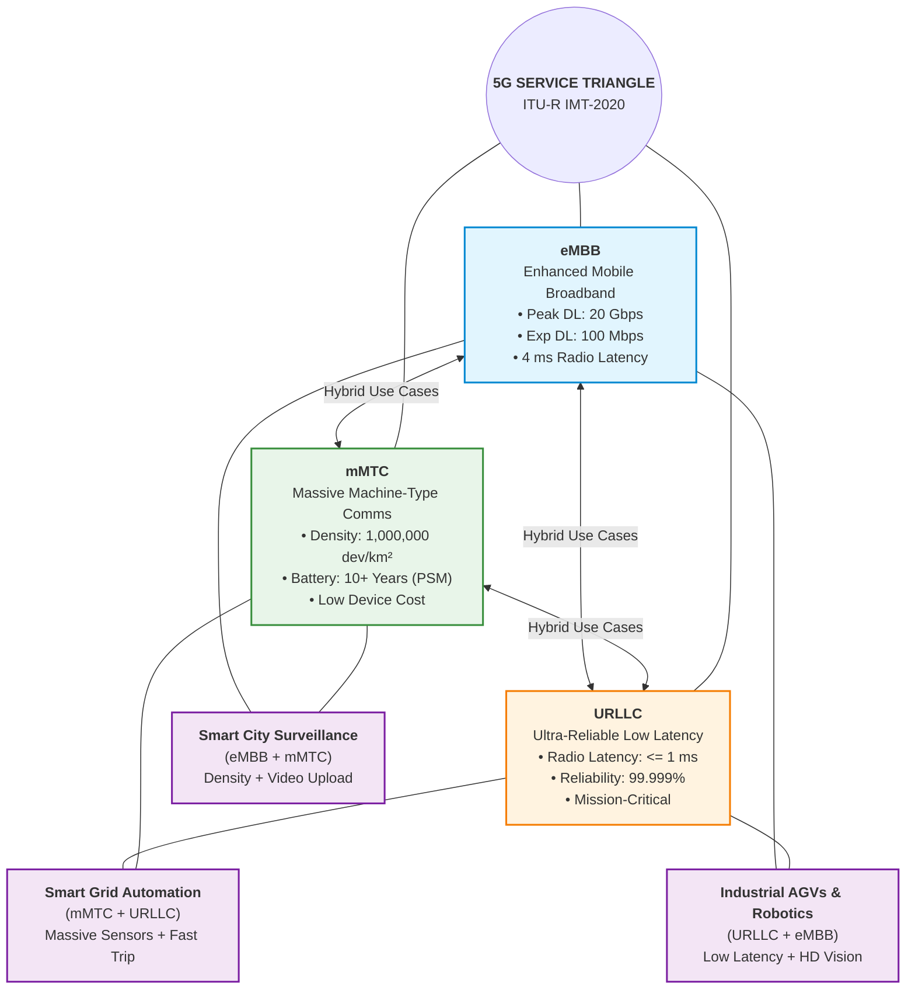

# Unit 2: Service Ecosystem and Policy (Remaining Portion) — Exam-Oriented Question Bank (Updated)

> **Introductory Note**: These are syllabus-based practice questions, not previous-year examination questions. Suggested marks indicate answer depth, not an official examination pattern.

---

## 📋 Table of Contents
1. [Section A: Short-Answer Practice Questions (2 Marks)](#section-a-short-answer-practice-questions-2-marks)
2. [Section B: Medium Explanatory & Analytical Practice Questions (4–5 Marks)](#section-b-medium-explanatory--analytical-practice-questions-45-marks)
3. [Section C: Long Essay & Scenario-Based Practice Questions (8–10 Marks)](#section-c-long-essay--scenario-based-practice-questions-810-marks)
4. [Section D: Comparative Analysis & Diagrams](#section-d-comparative-analysis--diagrams)
5. [Section E: Reference & Audit Tools](#section-e-reference--audit-tools)

---

## Section A: Short-Answer Practice Questions (2 Marks)

### Q1.1: Define Enhanced Mobile Broadband (eMBB) and state its primary focus.
**Answer:**
* **Definition:** Enhanced Mobile Broadband (eMBB) is the primary consumer-facing 5G service class designed to deliver ultra-high data rates, expanded system capacity, and uniform coverage compared to 4G LTE.
* **Primary Focus:** High-throughput, data-intensive human-centric communications across dense urban environments and wide-area coverage zones.
* **Key Targets:** 3GPP specifies a peak downlink data rate of $20\text{ Gbps}$, a peak uplink rate of $10\text{ Gbps}$, and a user experienced data rate of $100\text{ Mbps}$ (downlink) / $50\text{ Mbps}$ (uplink) available across $95\%$ of coverage locations under cell loading.
* **Primary Applications:** 4K/8K Ultra-HD video streaming, Augmented/Virtual Reality (AR/VR), cloud interactive gaming, and 5G Fixed Wireless Access (FWA).
* *Sources:* `Unit 2.pptx` Slide 4; `Unit 2.docx` Page 2; `Course Policy_5G_July_2026.docx`.

---

### Q1.2: Define Massive Machine-Type Communications (mMTC) and state its target connection density and battery life operating assumptions.
**Answer:**
* **Definition:** Massive Machine-Type Communications (mMTC) is the 5G service class architected to support narrow-band, delay-tolerant communications for millions of low-cost, automated sensor nodes.
* **Target Connection Density:** Designed to support up to $1,000,000\text{ devices/km}^2$ ($10^6\text{ devices/km}^2$), representing a 10x improvement over 4G LTE.
* **Battery Life Operating Assumptions:** Target device operational lifespan is $10+\text{ years}$. This target assumes low duty cycle operation where devices remain in Power Saving Mode (PSM) or Extended Discontinuous Reception (eDRX) $99.9\%$ of the time, transmitting small, intermittent payloads (e.g., 20–100 bytes/day). Continuous transmission rapidly drains battery reserves in days or weeks.
* *Sources:* `Unit 2.pptx` Slide 5; `Unit 2.docx` Page 3; `Introduction-to-5G-use-case-by-DDG-NBM.pdf`.

---

### Q1.3: Define Ultra-Reliable and Low Latency Communications (URLLC) and state its key performance targets.
**Answer:**
* **Definition:** Ultra-Reliable and Low Latency Communications (URLLC) is the mission-critical 5G service class engineered for time-sensitive, safety-critical automated applications requiring near-instantaneous radio transmission and deterministic delivery.
* **Key Performance Targets:**
  * **User-Plane Radio Interface Latency:** $\le 1\text{ ms}$ (downlink/uplink) between User Equipment (UE) and gNodeB.
  * **Reliability:** $99.999\%$ to $99.9999\%$ (equivalent to 1 packet loss per $10^5$ to $10^6$ transmitted 32-byte PDUs) over a $1\text{ ms}$ radio delay budget.
* **Primary Applications:** Vehicle-to-Everything (V2X) autonomous driving, remote robotic surgery, smart electric grid fault isolation, and automated industrial motion control.
* *Sources:* `Unit 2.pptx` Slide 6; `Unit 2.docx` Page 3; `What is URLLC and How Does It Work?`.

---

### Q1.4: Distinguish between radio-interface latency and end-to-end (E2E) application latency in 5G.
**Answer:**
* **Radio-Interface Latency:** The over-the-air transit time required for a data frame to travel between the User Equipment (UE) antenna and the base station (gNodeB) PHY layer. 3GPP targets $<1\text{ ms}$ for URLLC and $4\text{ ms}$ for eMBB.
* **End-to-End (E2E) Application Latency:** The total round-trip elapsed time from packet generation at the device, across the radio air interface, backhaul fiber transport, 5G Core (User Plane Function - UPF), transit over the IP WAN, to processing at a remote cloud application server and back.
* **Key Distinction:** Achieving a $<1\text{ ms}$ radio latency does not guarantee sub-millisecond application response times. Without co-locating compute resources via Multi-Access Edge Computing (MEC) at the local cell site or edge UPF, backhaul propagation delays ($5\mu\text{s/km}$ in fiber) alone add $10\text{--}50\text{ ms}$ of E2E latency.
* *Sources:* `Unit 2.pptx` Slide 7; `5G Technology Fundamentals.pdf`; `Edge Computing - GeeksforGeeks`.

---

### Q1.5: Distinguish between Peak Data Rate and User Experienced Data Rate in eMBB.
**Answer:**
* **Peak Data Rate:** The theoretical maximum achievable throughput under ideal physical channel conditions ($100\%$ spectrum allocation, maximum MIMO spatial streams, 256-QAM modulation, zero cell load, and minimal path loss). For 5G eMBB, the 3GPP peak targets are $20\text{ Gbps}$ downlink and $10\text{ Gbps}$ uplink.
* **User Experienced Data Rate:** The minimum throughput guaranteed to be available to $95\%$ of active users across the cell coverage area under realistic cell loading, inter-cell interference, and varying channel conditions. The 3GPP target for 5G eMBB is $100\text{ Mbps}$ downlink and $50\text{ Mbps}$ uplink.
* *Sources:* `Unit 2.pptx` Slide 4; `Unit 2.docx` Page 2; `5G NR The Next Generation Wireless Access Technology`.

---

### Q1.6: What is the Digital Bharat Nidhi (DBN), and how is it funded?
**Answer:**
* **Definition:** The Digital Bharat Nidhi (DBN) is the statutory fund established under Section 24 of the Telecommunications Act, 2023 (replacing the former Universal Service Obligation Fund - USOF).
* **Funding Mechanism:** DBN is financed through a statutory levy of up to $5\%$ on the Adjusted Gross Revenue (AGR) collected from all licensed telecom service providers in India.
* **Mandate:** The funds are allocated to finance targeted digital connectivity initiatives, rural 5G small-cell infrastructure rollout, BharatNet optical fiber expansion, and indigenous telecommunication technology R&D in underserved rural, remote, and tribal regions.
* *Sources:* `Digital Bharat Nidhi Rules 2024`; `Telecommunications Act 2023`; `CP_08042026.pdf`.

---

### Q1.7: State the funding amount and institutional consortium behind the DoT-funded 5G Test Bed.
**Answer:**
* **Funding Amount:** ₹2,240 million (₹224 Crore / ~US$ 27 million) fully funded by the Department of Telecommunications (DoT), Ministry of Communications.
* **Institutional Consortium:** Spearheaded and coordinated by IIT Madras, in collaboration with seven participating research institutions: IIT Kanpur, IIT Bombay, IIT Delhi, IIT Hyderabad, IISc Bangalore, Society for Applied Microwave Electronics Engineering & Research (SAMEER), and Centre of Excellence in Wireless Technology (CEWIT).
* **Objective:** To build a fully indigenous end-to-end 5G hardware and software testbed (gNodeB, 5G Core, user equipment stacks) for Indian academic, startup, and industrial verification.
* *Sources:* `Course Policy_5G_July_2026.docx`; `201505201200345131308IITCOE.pdf`; `Press Release Page | Press Information Bureau`.

---

### Q1.8: What is the objective and financial structure of the DoT's "100 5G Use Case Labs" initiative?
**Answer:**
* **Objective:** To build indigenous 5G software applications tailored to Indian socio-economic priorities across agriculture, healthcare, smart cities, education, and logistics, while training engineering students and technicians in 5G technologies.
* **Financial Structure:** The government (via DoT) provides $80\%$ capital expenditure (CAPEX) grant funding for setting up hardware, software, and test equipment at selected educational institutions, accompanied by $100\%$ operational expenditure (OPEX) support for 3 years.
* *Sources:* `PR_No.22of2024.pdf`; `India 100 5G Labs Experimental License Framework`; `Course Policy_5G_July_2026.docx`.

---

### Q1.9: How does 5G complement existing Indian digital platforms like UPI and DigiLocker without being a strict prerequisite?
**Answer:**
* **Complementary Synergy:** Existing platforms like Unified Payments Interface (UPI), DigiLocker, e-Hospital, and UMANG were designed to run over basic 2G/3G/4G or Wi-Fi data channels. They do not strictly require 5G to function.
* **5G Value-Add:** 5G enhances these platforms during massive concurrency events (e.g., millions of UPI payment requests during festival sales or crowded stadiums) by preventing radio access channel congestion. Furthermore, 5G enables advanced features like instant biometric e-KYC video authentication, HD telehealth consultations integrated with e-Hospital records, and instant document fetching over DigiLocker.
* *Sources:* `Unit 2.docx` Page 5; `Digital India | Objectives, Key Initiatives & Progress`; `Digital India: MeitY, Government of India`.

---

### Q1.10: State the GSMA economic projection for 5G in India between 2023 and 2040 and clarify its nature.
**Answer:**
* **Economic Projection:** GSMA Intelligence forecasts that 5G will contribute ₹36.4 trillion (~US$ 455 billion) in cumulative economic value to the Indian economy between 2023 and 2040, accounting for approximately $0.6\%$ of total Indian GDP by 2040.
* **Nature of Figure:** This figure is an attributed econometric forecasting model based on productivity gains, sector adoption rates, and multiplier effects across manufacturing, retail, agriculture, and healthcare. It represents a projected economic impact model, not realized corporate revenue or guaranteed government revenue.
* *Sources:* `Impact of 5G on the Indian and Global Economy`; `Course Policy_5G_July_2026.docx`; `Role of 5G in the Digital Economy and How It Is Impacting the Industry`.

---

### Q1.11: Define Spectrum Management and explain the difference between Auction and Administrative Allocation under the Telecommunications Act, 2023.
**Answer:**
* **Spectrum Management:** The legal, regulatory, and technical process of planning, allocating, assigning, and monitoring radio frequency bands to prevent interference and maximize public benefit.
* **Auction Assignment:** Section 4 of the Telecommunications Act, 2023 mandates competitive market-based auctions as the default method for assigning commercial spectrum to public telecom service providers (e.g., 5G spectrum allocations).
* **Administrative Allocation:** Reserved exclusively for specialized public interest, non-commercial, and strategic entities listed under the First Schedule of the Act (e.g., defense forces, satellite communications, disaster management, law enforcement, and academic research testbeds).
* *Sources:* `Telecommunications Act 2023`; `Spectrum Management in India - S.S. Rana & Co.`; `Spectrum Auction in India | ForumIAS Blog`.

---

### Q1.12: What is the Digital Connectivity Infrastructure Provider (DCIP) authorization, and why was it created by DoT/TRAI?
**Answer:**
* **Definition:** DCIP is a statutory authorization introduced by DoT based on TRAI recommendations under the Telecommunications Act, 2023 framework.
* **Purpose:** It allows non-service infrastructure companies to build, own, operate, and maintain active and passive network elements—including dark fiber, small cells, RAN nodes, Wi-Fi access points, and In-Building Solutions (IBS)—and lease them to licensed telecom operators on a fair, non-discriminatory basis.
* **Impact:** Delinks physical network infrastructure ownership from telecom service provision, lowering entry barriers and reducing redundant CAPEX.
* *Sources:* `SHARING INFRASTRUCTURE`; `PR_No.24of2024_0.pdf`; `Infrastructure Sharing | Telecom Regulatory Authority of India | Government of India`.

---

### Q1.13: How does 5G support workforce reskilling and skill development in India?
**Answer:**
* **Workforce Transformation:** The transition from legacy hardware-centric cellular systems to 5G shifts demand toward software-defined networking (SDN), network functions virtualization (NFV), cloud-native DevOps, and edge AI integration.
* **Skill Initiatives:** Institutions like the Telecom Sector Skill Council (TSSC), MeitY, and DoT's "100 5G Use Case Labs" scheme provide hands-on training for engineering graduates and technicians. These programs build expertise in 5G network maintenance, application development, IoT sensor deployment, and enterprise private network management.
* *Sources:* `PR_No.22of2024.pdf`; `Course Policy_5G_July_2026.docx`; `Indian Economic Development and Government Initiatives`.

---

### Q1.14: State the technical distinction between 3GPP standardization performance targets and real-world network operational guarantees.
**Answer:**
* **3GPP Standardization Targets:** Theoretical performance metrics (e.g., $20\text{ Gbps}$ peak DL, $<1\text{ ms}$ radio latency, $10^6\text{ devices/km}^2$, $99.999\%$ reliability) specified in technical standards (Release 15/16/17) under ideal channel conditions, maximum spectrum allocations, and zero cell contention.
* **Real-World Operational Realities:** Practical network speeds and latencies experienced by end-users depend on physical constraints: cell tower distance, RF propagation path loss, building penetration attenuation, available channel bandwidth (e.g., 20 MHz vs 100 MHz), active cell loading, and backhaul fiber capacity. Real-world networks deliver variable speeds rather than static guarantees.
* *Sources:* `Unit 2.pptx` Slide 8; `5G Technology Fundamentals.pdf`; `Mastering 5G Network Design, Implementation, and Operations.pdf`.

---

### Q1.15: Define Captive Non-Public Networks (CNPN) and state their primary application in Industry 4.0.
**Answer:**
* **Definition:** Captive Non-Public Networks (CNPNs) are dedicated, private 5G networks deployed within a localized physical boundary (e.g., factory, seaport, mine, automated warehouse) using dedicated private spectrum or dedicated network slices.
* **Industry 4.0 Application:** CNPNs provide high-security, ultra-low latency, and noise-immune wireless connectivity required for real-time automated guided vehicle (AGV) dispatch, industrial robotic arm control, predictive machine maintenance, and campus-wide telemetry.
* *Sources:* `5G regulation and law in India | CMS Expert Guides`; `Role of 5G in the Digital Economy and How It Is Impacting the Industry`; `Unit 2.docx` Page 4.

---

## Section B: Medium Explanatory & Analytical Practice Questions (4–5 Marks)

### Q2.1: Explain Enhanced Mobile Broadband (eMBB), its core technical requirements, and its primary consumer applications.
**Answer:**
* **Definition & Objective:** Enhanced Mobile Broadband (eMBB) is an extension of 4G LTE broadband services, designed to meet the growing demand for data-heavy consumer communications, high-definition entertainment, and mobile digital workflows.
* **Core Technical Requirements:**
  1. **Peak Throughput:** Downlink peak data rate of $20\text{ Gbps}$ and uplink peak data rate of $10\text{ Gbps}$.
  2. **User Experienced Data Rate:** $100\text{ Mbps}$ downlink and $50\text{ Mbps}$ uplink available across $95\%$ of coverage locations.
  3. **Spectral Efficiency:** $3\text{x}$ improvement over 4G LTE, enabled by high-order modulation (256-QAM) and Massive MIMO.
  4. **Area Traffic Capacity:** $10\text{ Mbps/m}^2$ in dense urban hotspot environments.
  5. **Latency Target:** $4\text{ ms}$ user-plane radio latency.
* **Frequency Band Allocations & Trade-offs:**
  * **Low-Band ($<1\text{ GHz}$, e.g., 700 MHz):** Provides wide geographical coverage and indoor penetration, but offers limited channel bandwidth ($10\text{--}20\text{ MHz}$) yielding speeds of $50\text{--}100\text{ Mbps}$.
  * **Mid-Band ($1\text{--}6\text{ GHz}$, e.g., 3.3–3.8 GHz C-band):** Balances coverage and capacity with $80\text{--}100\text{ MHz}$ channel bandwidth, delivering $100\text{--}500\text{ Mbps}$.
  * **High-Band / mmWave ($>24\text{ GHz}$, e.g., 26 GHz):** Offers massive channel bandwidths ($100\text{--}400\text{ MHz}$) achieving $1\text{--}3\text{+ Gbps}$, but suffers from severe signal attenuation, short propagation range ($<300\text{ m}$), and inability to penetrate solid walls.
* **Primary Consumer Applications:**
  * **Ultra-HD Video:** Smooth 4K and 8K video streaming without buffering.
  * **Immersive XR:** Low-lag Augmented Reality (AR), Virtual Reality (VR), and Mixed Reality (MR) applications.
  * **Cloud Gaming:** Real-time mobile cloud interactive gaming.
  * **5G Fixed Wireless Access (FWA):** Fiber-like home and office wireless broadband in areas lacking physical optical fiber.
* *Sources:* `Unit 2.pptx` Slide 4; `Unit 2.docx` Page 2; `What is eMBB (Enhanced Mobile Broadband) in 5G?`; `What is fixed wireless access? A connectivity guide`.

---

### Q2.2: Analyze Massive Machine-Type Communications (mMTC). Explain its operating assumptions regarding battery life and connection density.
**Answer:**
* **Definition & Scope:** Massive Machine-Type Communications (mMTC) is designed to connect a massive number of low-cost, low-power, automated devices across smart cities, utilities, and agricultural monitoring systems.
* **Technical Targets & Operating Assumptions:**
  1. **Connection Density Target ($10^6\text{ devices/km}^2$):**
     * Designed to manage up to one million connected nodes per square kilometer without radio access channel exhaustion.
     * *Assumption:* Relies on low data rate transmission ($10\text{--}100\text{ kbps}$) and small packet sizes (20–100 bytes). If all $10^6$ devices attempt continuous high-speed data transmission simultaneously, the access channel will suffer collision and congestion.
  2. **10+ Year Battery Life Target:**
     * *Operating Assumption:* Devices operate under extreme duty cycles ($<0.1\%$ active time). They utilize 3GPP Power Saving Mode (PSM) and Extended Discontinuous Reception (eDRX) to power down transceiver circuits into deep sleep for hours or days.
     * Devices wake up briefly, transmit a small status payload, and return to sleep. Continuous or frequent signaling reduces battery longevity from 10 years to weeks.
  3. **Low Hardware Complexity:** Uses reduced bandwidth (e.g., Narrowband IoT / NB-IoT or LTE-M embedded in 5G NR), single antenna transceivers, and simplified half-duplex operation to lower device unit cost under $5.
  4. **Extended Coverage:** Employs repeated transmissions and power boosting to achieve $+20\text{ dB}$ coverage enhancement over standard GSM/LTE, enabling signals to penetrate deep underground basements and utility vaults.
* **Applications:** Smart electric/water meters, soil moisture and pH sensors in precision agriculture, smart street lighting, environmental air quality monitoring, and supply chain asset trackers.
* *Sources:* `Unit 2.pptx` Slide 5; `Unit 2.docx` Page 3; `Introduction-to-5G-use-case-by-DDG-NBM.pdf`; `5G Use Cases and Benefits | KORE`.

---

### Q2.3: Discuss Ultra-Reliable and Low Latency Communications (URLLC). Why is Multi-Access Edge Computing (MEC) essential for true low application latency? Include safety disclaimers.
**Answer:**
* **Definition & Technical Profile:** URLLC provides mission-critical connectivity where communication failure could result in physical injury, equipment destruction, or major economic loss.
* **3GPP Technical Targets:**
  * **Radio User-Plane Latency:** $\le 1\text{ ms}$ over the air interface.
  * **Reliability Target:** $99.999\%$ to $99.9999\%$ packet delivery success rate for 32-byte PDUs within a $1\text{ ms}$ radio delay budget under specific target SINR conditions.
* **Role of Multi-Access Edge Computing (MEC):**
  * Radio interface latency ($\le 1\text{ ms}$) accounts for only the over-the-air link between device and base station.
  * If application servers reside in centralized cloud data centers hundreds of kilometers away, backhaul propagation delays ($5\mu\text{s/km}$ in fiber) plus router queuing add $15\text{--}50\text{ ms}$ of latency.
  * **MEC Solution:** Co-locates processing hardware and the 5G User Plane Function (UPF) at the local base station or regional edge hub, eliminating wide-area backhaul transit and reducing total End-to-End (E2E) application latency to $5\text{--}10\text{ ms}$.
* **Safety Disclaimer:**
  * URLLC and MEC provide highly reliable wireless connectivity, but **wireless connectivity alone does not guarantee absolute physical safety** in applications like autonomous driving or remote surgery.
  * Overall system safety depends on vehicle/robot sensor accuracy, onboard fail-safe mechanical systems, local algorithmic decision-making, and physical line-of-sight safety redundancies.
* *Sources:* `Unit 2.pptx` Slide 6; `Unit 2.docx` Page 3; `What is URLLC and How Does It Work?`; `Edge Computing - GeeksforGeeks`.

---

### Q2.4: Explain how 5G Fixed Wireless Access (FWA) and BharatNet Phase-III synergistically address rural digital inclusion in India.
**Answer:**
* **Rural Broadband Challenge:** Laying Last-Mile Optical Fiber Cable (OFC) to every rural household in remote, hilly, or forest terrains is economically prohibitive and physically slow due to terrain obstacles and high civil trenching costs.
* **The Synergistic Architecture:**
  1. **BharatNet Phase-III (Middle-Mile Optical Backbone):** Provides high-capacity optical fiber backhaul connecting Gram Panchayats (village councils) and regional sub-districts to the national core network.
  2. **5G Fixed Wireless Access (FWA - Last-Mile Wireless Bridge):** Instead of laying fiber cables from the Gram Panchayat to individual homes, a 5G gNodeB base station connected to the BharatNet fiber hub beams high-speed sub-6 GHz or mmWave wireless signals directly to outdoor Customer Premises Equipment (CPE) mounted on village homes, schools, and health centers.
* **Advantages:**
  * Accelerates high-speed broadband deployment from years to days.
  * Reduces last-mile capital expenditure by $40\text{--}60\%$.
  * Delivers 100+ Mbps broadband to rural households, supporting e-learning, telemedicine, and digital governance.
* *Sources:* `Unit 2.docx` Page 4; `Initiatives - Digital India | Leading the transformation in India for ease of living and digital economy | MeitY, Government of India`; `What is fixed wireless access? A connectivity guide`.

---

### Q2.5: Describe the role of the Department of Telecommunications (DoT) in spectrum allocation, indigenous R&D funding, and 5G Use Case Labs.
**Answer:**
* **Role of DoT (Ministry of Communications):** The DoT is the primary executive authority governing telecommunications policy, spectrum assignment, licensing, and national telecom infrastructure development in India.
* **Key Strategic Initiatives:**
  1. **Spectrum Allocation & Policy:** Formulates spectrum allocation rules, conducts competitive airwave auctions, and enforces the Telecommunications Act, 2023. DoT freed up spectrum across 700 MHz, 3.3 GHz, and 26 GHz bands for 5G deployment.
  2. **Indigenous R&D & Testbed Funding:**
     * Fully funded the ₹2,240 million (₹224 Crore) multi-institutional 5G Test Bed led by IIT Madras and 7 consortium partners.
     * Established the 5G High-Level Forum (chaired by Prof. A.J. Paulraj) to lay down India's 5G roadmap.
     * Funding 6G research initiatives through the Bharat 6G Alliance and IIT Kanpur 6G flyer project.
  3. **"100 5G Use Case Labs" Scheme:**
     * Provides $80\%$ CAPEX and $100\%$ OPEX support to 100 educational institutions and research centers across India.
     * Fosters indigenous application development in smart agriculture, healthcare, education, and logistics while training a skilled technical workforce.
* *Sources:* `Functions of DoT | Ministry of Communications, Department of Telecommunications`; `Course Policy_5G_July_2026.docx`; `PR_No.22of2024.pdf`; `IITK6G.Flyer.pdf`.

---

### Q2.6: Discuss the major physical, financial, and policy challenges facing nationwide 5G deployment in India.
**Answer:**
* **1. Low Tower Fiberization Bottleneck:**
  * To support multi-gigabit 5G gNodeB traffic without backhaul degradation, cell towers must be connected via optical fiber cable (OFC).
  * Current tower fiberization in India stands at $<50\%$ (approx. $38\text{--}45\%$), significantly below the national target of $70\%$ set by the National Digital Communications Policy (NDCP). Heavy reliance on legacy microwave backhaul limits effective 5G speeds.
* **2. High Capital Expenditure (CAPEX) & Small Cell Density:**
  * High-frequency 3.3 GHz and 26 GHz mmWave signals have poor propagation range and wall penetration, requiring dense small cell deployment on street poles, utility posts, and buildings.
  * Operators face massive financial outlays for small cell hardware, power backup, and fiber trenching.
* **3. Right of Way (RoW) & Municipal Delays:**
  * Despite the federal Telecommunications RoW Rules, 2024, operators encounter fragmented local municipal approvals, high ROW fees, and bureaucratic delays in installing small cells on state infrastructure.
* **4. Data Privacy & Compliance under DPDP Act, 2023:**
  * Operators and enterprise 5G application providers must comply with the Digital Personal Data Protection Act, 2023 and DPDP Rules, 2025.
  * Handling location telemetry, health data, and user biometrics requires robust encryption, strict consent mechanisms, and localized data processing, carrying non-compliance penalties up to ₹250 Crores.
* *Sources:* `Unit 2.docx` Page 6; `CP_08042026.pdf`; `Data protection laws in India - Data Protection Laws of the World`; `DLA-Piper-Data-Protection-Laws-of-the-World-India.pdf`.

---

### Q2.7: Explain the licensing framework and spectrum management provisions under the Telecommunications Act, 2023.
**Answer:**
* **Statutory Shift:** The Telecommunications Act, 2023 modernized India's telecom regulatory architecture, replacing legacy 19th-century legislation (Indian Telegraph Act, 1885) with a simplified system of statutory **Service Authorizations** and **Network Authorizations**.
* **Spectrum Assignment Framework (Section 4):**
  1. **Competitive Auction (Default Mode):** Market-based transparent auctions are mandated as the primary method for assigning commercial spectrum to public telecom service providers (e.g., 5G spectrum allocations).
  2. **Administrative Allocation (First Schedule Exceptions):** Reserved exclusively for public interest, strategic, and non-commercial functions, including defense, national security, satellite broadcasting/communications, law enforcement, maritime safety, and experimental testbeds.
* **Infrastructure Sharing & DCIP:** Formalized the Digital Connectivity Infrastructure Provider (DCIP) authorization framework, allowing non-telecom entities to build and lease active and passive infrastructure to operators, reducing market entry barriers.
* *Sources:* `Telecommunications Act 2023`; `Spectrum Management in India - S.S. Rana & Co.`; `PR_No.24of2024_0.pdf`.

---

### Q2.8: Explain how 5G enables precision agriculture and environmental monitoring in India.
**Answer:**
* **Agricultural Challenges in India:** Fragmented land holdings, inefficient water usage, unpredictable weather, and excessive fertilizer application reduce crop yields and soil health.
* **5G Enablers & Applications:**
  1. **Massive Sensor Networks (mMTC):** Deploying low-cost, long-battery-life soil sensors across farm plots to measure soil moisture, nitrogen-phosphorus-potassium (NPK) levels, pH balance, and ambient temperature in real time.
  2. **Automated Irrigation Control:** Sensor data triggers automated drip irrigation valves via mMTC networks, optimizing water consumption.
  3. **Drone-Based Precision Crop Spraying (eMBB + Low Latency):** High-definition cameras mounted on agricultural drones stream live video over 5G to AI models, detecting pest infestations and controlling precise spot-spraying of pesticides.
  4. **Environmental Monitoring:** Real-time air quality index (AQI) tracking, forest fire detection sensors, and flood warning telemetry deployed across river basins.
* *Sources:* `5G use cases in India - a perspective | Department of Telecom eServices Portal`; `Introduction-to-5G-use-case-by-DDG-NBM.pdf`; `5G Use Cases and Benefits | KORE`.

---

### Q2.9: Discuss 5G applications in education and immersive learning across rural and urban India.
**Answer:**
* **Educational Disparity:** Rural and remote schools often lack specialized science laboratories, subject-expert teachers, and interactive learning tools available in metropolitan centers.
* **5G Educational Solutions:**
  1. **Immersive AR/VR Classrooms (eMBB):** Ultra-high bandwidth and low latency enable students to wear low-cost VR headsets and participate in interactive 3D virtual science experiments (e.g., dissecting biological organs, exploring chemical reactions, or touring space) without physical lab equipment.
  2. **Interactive Remote Lectures:** High-definition, zero-lag 4K interactive video streaming allows top educators from central universities to teach and conduct live Q&A sessions in multiple rural classrooms simultaneously.
  3. **Field Startup Example (*TechXR Pilot*):** Supported by DoT field trials, TechXR developed affordable AR/VR learning kits deployed in schools across Madhya Pradesh and Arunachal Pradesh, bringing interactive STEM education to remote regions over 5G FWA.
* *Sources:* `Introduction-to-5G-use-case-by-DDG-NBM.pdf` Page 12; `Initiatives - Digital India | Leading the transformation in India for ease of living and digital economy | MeitY, Government of India`.

---

### Q2.10: Discuss the impact of 5G deployment on employment, reskilling, and workforce development in India.
**Answer:**
* **Shift in Skill Demand:** The transition to software-centric 5G networks, cloud-native 5G Core, and edge computing shifts telecom employment demand from traditional hardware installation toward software engineering, network virtualization (SDN/NFV), cybersecurity, and AI/ML data analytics.
* **Employment Opportunities:**
  1. **Core Technical Roles:** Demand for 5G network architects, DevOps engineers, fiber optical technicians, small cell deployment specialists, and enterprise private network managers.
  2. **Vertical Application Jobs:** Creation of new tech roles in smart manufacturing, drone operation, IoT fleet management, and telehealth technical support.
* **Institutional Reskilling Initiatives:**
  * **Telecom Sector Skill Council (TSSC):** Programs aligning vocational training with 5G hardware, fiber splicing, and IoT maintenance standards.
  * **DoT "100 5G Use Case Labs":** Practical lab infrastructure installed in engineering colleges trains thousands of students annually in building real-world 5G applications.
* *Sources:* `PR_No.22of2024.pdf`; `Indian Economic Development and Government Initiatives`; `Course Policy_5G_July_2026.docx`.

---

### Q2.11: Analyze the key technical differences between theoretical performance targets and real-world 5G deployment realities.
**Answer:**
* **3GPP Standards vs. Real-World Constraints:**
  | Metric | 3GPP Standard Target | Real-World Deployment Reality | Key Physical/Operational Reasons |
  | :--- | :--- | :--- | :--- |
  | **Peak Downlink Rate** | $20\text{ Gbps}$ | $200\text{--}800\text{ Mbps}$ (Sub-6 GHz) $1\text{--}3\text{ Gbps}$ (mmWave) | Requires $100\%$ spectrum allocation, 8x8 MIMO, 256-QAM, zero cell load, and zero distance. Real cells share bandwidth among hundreds of users. |
  | **User Experienced Rate** | $100\text{ Mbps}$ | $20\text{--}150\text{ Mbps}$ | Depends on cell edge distance, inter-cell interference, wall attenuation, and local gNodeB fiber backhaul capacity. |
  | **Radio Latency** | $\le 1\text{ ms}$ (URLLC) | $1\text{--}4\text{ ms}$ (Radio) $15\text{--}40\text{ ms}$ (E2E without MEC) | Radio frame structure allows 1 ms radio link, but total latency includes backhaul fiber transit ($5\mu\text{s/km}$) and WAN routing. |
  | **Connection Density** | $10^6\text{ devices/km}^2$ | $10,000\text{--}100,000\text{ devices/km}^2$ | Assumes small intermittent payloads and deep sleep modes. Heavy traffic causes channel contention. |
  | **Battery Lifespan** | $10+\text{ years}$ | 2–5 years (under moderate traffic) | $10+$ years requires $>99.9\%$ sleep time in PSM/eDRX. Frequent updates or bad RF conditions drain battery faster. |
* *Sources:* `Unit 2.pptx` Slide 8; `5G Technology Fundamentals.pdf`; `Mastering 5G Network Design, Implementation, and Operations.pdf`.

---

### Q2.12 (Variant Grouping): Discuss how 5G enables Industry 4.0 and Smart Manufacturing through Captive Private Networks (CNPN).
*(Variant phrasing: Explain the role of 5G in industrial automation, smart factories, and enterprise digitization.)*
**Answer:**
* **Industry 4.0 Requirements:** Modern automated manufacturing requires replacing restrictive physical industrial Ethernet cables with reliable, low-latency, high-capacity wireless connectivity that operates without electromagnetic interference from heavy machinery.
* **Key 5G Enablers in Manufacturing:**
  1. **Captive Non-Public Networks (CNPN):** Private 5G networks deployed on factory premises, providing isolated, high-security coverage that prevents proprietary industrial data from traversing public networks.
  2. **URLLC for Motion Control:** Sub-millisecond radio latency and $99.999\%$ reliability enable real-time coordination of high-speed robotic assembly arms and safety interlocks.
  3. **eMBB for Computer Vision Quality Control:** High-definition cameras stream high-resolution video of assembly lines to edge AI servers, detecting structural defects in real time.
  4. **mMTC for Predictive Maintenance:** Thousands of vibration, temperature, and acoustic sensors attached to factory machinery stream operational telemetry to predict equipment failure before breakdowns occur.
* *Sources:* `5G regulation and law in India | CMS Expert Guides`; `Role of 5G in the Digital Economy and How It Is Impacting the Industry`; `Unit 2.docx` Page 4.

---

## Section C: Long Essay & Scenario-Based Practice Questions (8–10 Marks)

### Q3.1: Comprehensive Essay on the 5G Service Triangle (eMBB, mMTC, URLLC). Explain their conflicting technical requirements and how Network Slicing reconciles them.
**Answer:**
* **1. Introduction & The IMT-2020 5G Service Triangle:**
  Unlike legacy 2G/3G/4G systems designed primarily for mobile voice and uniform consumer broadband, 5G NR is architected as a flexible multi-service platform. The ITU-R IMT-2020 framework defines three core service classes representing the corners of the 5G Service Triangle:
  * **Enhanced Mobile Broadband (eMBB):** Focuses on extreme data rates ($20\text{ Gbps}$ peak) and high system capacity.
  * **Massive Machine-Type Communications (mMTC):** Focuses on extreme connection density ($10^6\text{ devices/km}^2$) and ultra-low energy consumption ($10+\text{ year}$ battery life).
  * **Ultra-Reliable and Low Latency Communications (URLLC):** Focuses on extreme radio latency ($\le 1\text{ ms}$) and mission-critical reliability ($99.999\%\text{--}99.9999\%$).

* **2. Analysis of Conflicting Technical Requirements:**
  The three service classes possess fundamentally incompatible physical and network resource requirements:
  * **Bandwidth vs. Energy/Cost:** eMBB requires wide channel bandwidths ($100\text{--}400\text{ MHz}$) and complex multi-antenna transceivers (Massive MIMO), consuming significant power. Conversely, mMTC demands ultra-narrowband channels ($180\text{ kHz}$), single-antenna transceivers, and extreme power saving to sustain 10-year battery lifespans on low-cost devices.
  * **Latency/Reliability vs. Overhead/Throughput:** URLLC achieves sub-millisecond latency and $99.999\%$ reliability by utilizing short subcarrier slot durations ($60/120\text{ kHz}$ numerology), mini-slots, aggressive forward error correction (FEC), and redundant transmissions. This introduces heavy control signaling overhead, directly reducing overall spectral efficiency and throughput available for eMBB.
  * **Payload Size & Traffic Profiles:** eMBB handles large continuous streaming packets; mMTC handles tiny intermittent status updates; URLLC handles bursty, time-critical control commands.

* **3. Reconciliation via Network Slicing (SDN & NFV):**
  A single monolithic physical radio and core network cannot simultaneously optimize for all three extremes. 5G solves this through **Network Slicing**, enabled by **Software-Defined Networking (SDN)** and **Network Functions Virtualization (NFV)**:
  * **Network Slicing Definition:** Multiplexing multiple independent, logically isolated virtual networks ("slices") over a shared physical 5G infrastructure. Each slice is customized with specific network functions, QoS parameters, and radio resource allocations tailored to a specific service class.
  * **eMBB Slice Implementation:** Configured with wideband carrier aggregation, high-order modulation (256-QAM), large buffer sizes, and User Plane Functions (UPF) optimized for high throughput.
  * **mMTC Slice Implementation:** Configured with lightweight core signaling, extended sleep timer management (PSM/eDRX), small-packet connectionless data handling, and power-optimized radio access protocols.
  * **URLLC Slice Implementation:** Configured with short slot numerology, pre-allocated grant-free radio scheduling, UPF co-location at local Edge Nodes (MEC), and dedicated priority queuing across backhaul routers.

* **4. Conclusion:**
  Network Slicing transforms the physical 5G network into a dynamic, software-configurable platform, allowing operators to deliver consumer broadband, massive IoT, and mission-critical automation simultaneously over shared airwaves while guaranteeing strict Quality of Service (QoS) isolation.
* *Sources:* `Unit 2.pptx` Slides 4–7; `Unit 2.docx` Pages 2–4; `Network Slicing in 5G Networks - GeeksforGeeks`; `5G_Net_Slcng_Sec.pdf`.

---

### Q3.2: Dedicated Three-Service Comparison & Technical Analysis.
**Answer:**
* **Comparative Technical Analysis across 5G Service Classes:**

| Parameter / Feature | Enhanced Mobile Broadband (eMBB) | Massive Machine-Type Communications (mMTC) | Ultra-Reliable Low Latency Communications (URLLC) |
| :--- | :--- | :--- | :--- |
| **Primary Objective** | Ultra-high data rates and wide-area broadband capacity. | Massive connection density and extreme power efficiency. | Ultra-low radio latency and mission-critical reliability. |
| **Peak Data Rate Target** | Downlink: $20\text{ Gbps}$ Uplink: $10\text{ Gbps}$ | Low data rates ($10\text{--}100\text{ kbps}$ per node). | Moderate data rates ($1\text{--}10\text{ Mbps}$). |
| **User Experienced Rate** | Downlink: $100\text{ Mbps}$ Uplink: $50\text{ Mbps}$ | Unspecified (typically $<10\text{ kbps}$). | Moderate ($10\text{ Mbps}$ deterministic). |
| **Radio Latency Target** | $4\text{ ms}$ (User-Plane) | Delay-tolerant (Seconds to Hours). | $\le 1\text{ ms}$ (User-Plane). |
| **Reliability Target** | Standard cellular ($99\%$) | Standard cellular ($99\%$) | $99.999\%$ to $99.9999\%$ ($10^{-5}$ to $10^{-6}$ PDU loss). |
| **Target Connection Density** | $10,000\text{ devices/km}^2$ | $1,000,000\text{ devices/km}^2$ ($10^6\text{/km}^2$) | $1,000\text{ devices/km}^2$ (Highly localized). |
| **Operating Frequency Bands** | Sub-6 GHz (C-band) & mmWave (26 GHz). | Sub-1 GHz (e.g., 700/800 MHz) for deep coverage. | Sub-6 GHz & mmWave (for short slot duration). |
| **Battery Life Expectancy** | Hours to Days (High power consumption). | $10+\text{ Years}$ (Under low duty cycle / PSM mode). | Days to Years (App-dependent, mains-powered). |
| **Hardware Complexity** | High (Massive MIMO, 256-QAM, dual connectivity). | Ultra-Low (Single antenna, narrow bandwidth, $<\$5$). | Moderate-High (Redundant RF chains, MEC link). |
| **Primary Applications** | 4K/8K video, AR/VR, FWA, cloud gaming. | Smart meters, soil sensors, asset tracking, AQI. | V2X driving, remote surgery, smart grid, AGVs. |
* *Sources:* `Unit 2.pptx` Slides 4–7; `Unit 2.docx` Pages 2–4; `5G Technology Fundamentals.pdf`.

---

### Q3.3: Application Selection & Scenario-Based Decision Matrix.
**Answer:**
* **Scenario Problem:** Evaluate the following 5 distinct real-world deployments, assign the appropriate 5G Service Class for each, and justify your selection based on technical parameters (latency, throughput, device density, reliability, and mobility).

* **Scenario 1: High-Altitude Pilgrim Health Telemetry on Char Dham Yatra (Uttarakhand)**
  * **Assigned Service Class:** **mMTC** (with localized eMBB backup).
  * **Technical Justification:**
    * Thousands of wearable biometric health bands deployed on pilgrims transmit small, periodic telemetry packets (heart rate, blood oxygen $\text{SpO}_2$, temperature) to central medical posts over wide mountain terrains.
    * Requires high connection density, extended battery life, and superior sub-1 GHz propagation.
    * *Startup Reference:* Perkant Tech Pilgrim Safety Project supported by DoT pilots.

* **Scenario 2: Cloud-Based Medical Image AI Analysis (Easiofy ImagiXAI in North-East District Hospitals)**
  * **Assigned Service Class:** **eMBB**
  * **Technical Justification:**
    * Transferring uncompressed high-resolution digital X-Rays, CT scans, and MRI files (tens to hundreds of Megabytes) from remote district hospitals in Mizoram/Tripura to cloud AI servers requires high throughput ($100+\text{ Mbps}$) and wide bandwidth.
    * *Startup Reference:* Easiofy ImagiXAI platform supported by DoT field trials.

* **Scenario 3: Real-Time Teleoperation of Automated Mining Trucks & Drones**
  * **Assigned Service Class:** **URLLC + Multi-Access Edge Computing (MEC)**
  * **Technical Justification:**
    * Heavy autonomous machinery operating in hazardous open-pit mines requires deterministic steering, braking, and emergency collision avoidance commands transmitted with $<1\text{ ms}$ radio latency and $99.999\%$ reliability.
    * Co-locating MEC servers at the mining site eliminates backhaul lag.

* **Scenario 4: High-Definition AI Road Infrastructure & Traffic Enforcement Surveillance (Nayan Tech)**
  * **Assigned Service Class:** **eMBB**
  * **Technical Justification:**
    * Vehicles and dashcams continuously record and upload 4K video feeds to cloud AI servers to detect road potholes, traffic violations, and damaged infrastructure.
    * Demands high uplink data rates ($50+\text{ Mbps}$ uplink eMBB).
    * *Startup Reference:* Nayan Tech AI Surveillance pilot supported by DoT.

* **Scenario 5: Automated Substation Fault Isolation in a Smart Power Grid**
  * **Assigned Service Class:** **URLLC**
  * **Technical Justification:**
    * When a high-voltage transmission line experiences a short circuit, fault protection relays must communicate with breaker switches within $1\text{--}2\text{ ms}$ to trip breakers and prevent grid collapse.
    * Requires extreme reliability ($99.999\%$) and near-zero latency over dedicated low-latency slices.
* *Sources:* `Introduction-to-5G-use-case-by-DDG-NBM.pdf` Pages 4–18; `5G use cases in India - a perspective | Department of Telecom eServices Portal`; `Unit 2.docx` Pages 2–5.

---

### Q3.4: Analyze the Socio-Economic Impact of 5G in India. Evaluate active startup field pilots supported by DoT and examine the governance/policy framework.
**Answer:**
* **1. Macroeconomic Context & GSMA Forecast:**
  GSMA Intelligence projects that 5G will contribute ₹36.4 trillion (~US$ 455 billion) to India's economy between 2023 and 2040 (representing $\sim 0.6\%$ of GDP by 2040). This economic growth is driven by productivity enhancements across manufacturing (Industry 4.0), agriculture, healthcare, smart utilities, and digital financial services.

* **2. Active DoT-Supported Startup Field Pilots:**
  The Department of Telecommunications (DoT) has actively nurtured indigenous startup pilots to demonstrate real-world socio-economic impact across India:
  * **Perkant Tech (Health Telemetry):** Deployed wearable health bands transmitting real-time biometrics (pulse, $\text{SpO}_2$) over 5G to monitor pilgrims on the high-altitude Char Dham Yatra in Uttarakhand, providing early detection of altitude sickness.
  * **Easiofy / ImagiXAI (Cloud Tele-Radiology):** Implemented cloud-based AI medical image diagnostics across district hospitals in Mizoram, Tripura, Nagaland, and Meghalaya. High-speed 5G eMBB transmits heavy X-Rays/CT scans to cloud AI engines, delivering instant diagnostic reports to rural clinics lacking on-site radiologists.
  * **Nayan Tech (Smart City AI Surveillance):** Deployed AI-powered video analytics scanning driver dashcam footage over 5G to detect road potholes, damaged streetlights, and traffic violations in real time across municipal areas.
  * **TechXR (Immersive Education):** Developed affordable AR/VR learning tools deployed over 5G FWA in rural schools across Madhya Pradesh and Arunachal Pradesh, giving students access to interactive 3D virtual science laboratories.
  * **Nav Tech (Precision Agriculture):** Deployed automated IoT sensor nodes and drone-based agricultural mapping over 5G for precise soil moisture monitoring and targeted pesticide spraying in rural farms.

* **3. Governance, Policy & Regulatory Enabling Framework:**
  * **Digital Bharat Nidhi (DBN Rules 2024 / Telecommunications Act 2023):** Leverages a $5\%$ AGR levy on telecom operators to finance rural small-cell installations and BharatNet Phase-III optical fiber backhaul expansion.
  * **Right of Way (RoW) Rules 2024:** Standardized administrative fees and binding approval timelines across municipal bodies to accelerate small cell installation on public street poles.
  * **DoT "100 5G Use Case Labs" Scheme:** Provides $80\%$ CAPEX grant and $100\%$ OPEX support to 100 educational institutions, building an indigenous developer ecosystem and training 5G technical manpower.
  * **Data Governance & Privacy (DPDP Act, 2023):** Mandates that healthcare, financial, and location telemetry processed over 5G adhere to strict consent mechanisms, purpose limitation, and storage minimization, protecting citizen privacy with non-compliance penalties up to ₹250 Crores.

* **4. Conclusion:**
  The socio-economic transformation of 5G in India relies on the tight integration of high-speed radio technology, targeted funding (DBN / DoT Use Case Labs), indigenous startup innovation (Perkant, Easiofy, TechXR), and robust legal data protection (DPDP Act 2023).
* *Sources:* `Introduction-to-5G-use-case-by-DDG-NBM.pdf` Pages 2–20; `Course Policy_5G_July_2026.docx`; `PR_No.22of2024.pdf`; `Digital Bharat Nidhi Rules 2024`; `DLA-Piper-Data-Protection-Laws-of-the-World-India.pdf`.

---

## Section D: Comparative Analysis & Diagrams

### D.1 Comprehensive Comparison Table: 5G Service Classes

| Parameter / Feature | Enhanced Mobile Broadband (eMBB) | Massive Machine-Type Communications (mMTC) | Ultra-Reliable Low Latency Communications (URLLC) |
| :--- | :--- | :--- | :--- |
| **Primary Objective** | Maximize user data rates and wide-area capacity. | Maximize connection density and battery life. | Minimize radio latency and maximize link reliability. |
| **3GPP Peak Data Rate** | DL: $20\text{ Gbps}$ / UL: $10\text{ Gbps}$ | Low ($10\text{--}100\text{ kbps}$) | Moderate ($1\text{--}10\text{ Mbps}$) |
| **User Experienced Rate** | DL: $100\text{ Mbps}$ / UL: $50\text{ Mbps}$ | Unspecified ($<10\text{ kbps}$) | $10\text{ Mbps}$ (Deterministic) |
| **User-Plane Radio Latency** | $4\text{ ms}$ | Delay-Tolerant (Seconds to Hours) | $\le 1\text{ ms}$ |
| **End-to-End Latency Target**| $15\text{--}30\text{ ms}$ | Non-critical | $5\text{--}10\text{ ms}$ (Requires local MEC) |
| **Target Connection Density**| $10,000\text{ devices/km}^2$ | $1,000,000\text{ devices/km}^2$ ($10^6\text{/km}^2$) | $1,000\text{ devices/km}^2$ (Localized) |
| **Reliability Target** | $99\%$ (Standard cellular) | $99\%$ (Standard cellular) | $99.999\%$ to $99.9999\%$ ($10^{-5}\text{--}10^{-6}$ loss) |
| **Channel Bandwidth** | Wide ($20\text{--}400\text{ MHz}$) | Narrow ($180\text{ kHz}$ / NB-IoT) | Moderate ($10\text{--}100\text{ MHz}$) |
| **Battery Life Expectancy** | Hours to Days | $10+\text{ Years}$ (Under PSM sleep mode) | Application dependent |
| **Key Enabling Technology** | Massive MIMO, 256-QAM, Carrier Aggregation | Power Saving Mode (PSM), eDRX | Short slot numerology, Mini-slots, MEC |
| **Core Network Configuration**| High-throughput UPF, large buffers | Lightweight signaling core, connectionless | Co-located Edge UPF, local breakout |
| **Primary Applications** | 4K/8K streaming, AR/VR, 5G FWA | Smart meters, soil sensors, asset tracking | Autonomous V2X, remote surgery, smart grid |

---

### D.2 Valid Fenced Mermaid Diagram: The IMT-2020 5G Service Triangle

---

## Section E: Reference & Audit Tools

### E.1 Topic-to-Question Coverage Matrix

| Syllabus Topic / Sub-Topic | Primary Question Numbers | Coverage Depth & Verification |
| :--- | :--- | :--- |
| **5G Service Triangle Overview** | Q1.1, Q1.2, Q1.3, Q3.1, Q3.2, D.1, D.2 | Full coverage of ITU-R IMT-2020 framework and service corners. |
| **Enhanced Mobile Broadband (eMBB)** | Q1.1, Q1.5, Q2.1, Q3.1, Q3.2, Q3.3, D.1 | Full coverage of throughput, frequency trade-offs, and AR/VR/FWA. |
| **Massive Machine-Type Comms (mMTC)** | Q1.2, Q2.2, Q2.8, Q3.1, Q3.2, Q3.3, D.1 | Full coverage of density, 10-year battery operating assumptions, and IoT. |
| **Ultra-Reliable Low Latency (URLLC)** | Q1.3, Q1.4, Q2.3, Q3.1, Q3.2, Q3.3, D.1 | Full coverage of $<1\text{ ms}$ radio latency, $99.999\%$ reliability, and MEC. |
| **Performance Targets vs. Guarantees** | Q1.14, Q2.11 | Full technical distinction between standards targets and real-world limits. |
| **Digital India & Broadband Inclusion** | Q1.9, Q2.4, Q2.9, Q3.4 | Full coverage of UPI, DigiLocker, e-Hospital, and 5G FWA + BharatNet. |
| **Department of Telecommunications (DoT)** | Q1.7, Q1.8, Q2.5, Q3.4 | Full coverage of ₹2,240M Test Bed, 100 Use Case Labs, and spectrum allocation. |
| **Licensing & Spectrum Management** | Q1.11, Q1.12, Q2.7 | Full coverage of Telecommunications Act 2023, auctions, and DCIP. |
| **Macroeconomics & GSMA Forecast** | Q1.10, Q3.4 | Full attributed analysis of ₹36.4T / \$455B projection model for 2023–2040. |
| **Industry 4.0 & Enterprise CNPN** | Q1.15, Q2.12, Q3.1, Q3.3 | Full coverage of private 5G networks, AGVs, robotics, and smart factories. |
| **Agriculture & Environmental Monitoring**| Q2.8, Q3.3 | Full coverage of soil sensors, automated irrigation, and drone spraying. |
| **Education & Immersive Learning** | Q2.9, Q3.4 | Full coverage of AR/VR classrooms, virtual labs, and TechXR pilot. |
| **Employment & Skill Development** | Q1.13, Q2.10 | Full coverage of workforce reskilling, TSSC, and 100 Use Case Labs training. |
| **Deployment Bottlenecks & Governance** | Q2.6, Q3.4 | Full coverage of tower fiberization (<50%), small cells, RoW, and DPDP Act. |

---

### E.2 Master Glossary of Essential Terms

1. **Adjusted Gross Revenue (AGR):** The total revenue base calculated for telecom licensees after permissible deductions, used to compute statutory license fees and Digital Bharat Nidhi levies ($5\%$).
2. **Beamforming:** Spatial signal processing technology that focuses RF energy into directional narrow beams directed at specific active User Equipment, improving signal strength and reducing interference.
3. **Captive Non-Public Network (CNPN):** A private, isolated 5G network deployed on enterprise premises using dedicated spectrum or network slicing for industrial automation.
4. **Digital Bharat Nidhi (DBN):** The statutory fund established under Section 24 of the Telecommunications Act, 2023 (formerly USOF) to finance rural and underserved digital connectivity projects.
5. **Digital Connectivity Infrastructure Provider (DCIP):** A statutory authorization framework allowing non-service infrastructure entities to build and lease active and passive network assets to operators.
6. **Digital Personal Data Protection (DPDP) Act, 2023:** India's primary data privacy legislation regulating digital personal data processing, establishing Data Fiduciaries, and enforcing breach penalties up to ₹250 Crores.
7. **Enhanced Mobile Broadband (eMBB):** The 5G service class delivering high data rates ($20\text{ Gbps}$ peak / $100\text{ Mbps}$ experienced) and wide-area broadband capacity.
8. **Extended Discontinuous Reception (eDRX):** A power-saving protocol allowing IoT devices to extend the sleep interval between paging checks, conserving battery power.
9. **Fixed Wireless Access (FWA):** A wireless connection providing high-speed broadband from a cell tower directly to a fixed receiver at a home or office, replacing physical fiber cables.
10. **Massive Machine-Type Communications (mMTC):** The 5G service class architected for high connection density ($10^6\text{ devices/km}^2$) and low-power IoT sensor networks.
11. **Multi-Access Edge Computing (MEC):** Cloud processing infrastructure co-located at the local base station or edge UPF, reducing End-to-End application latency to $5\text{--}10\text{ ms}$.
12. **Network Slicing:** A virtualized network architecture multiplexing independent, logically isolated virtual networks over shared physical 5G infrastructure using SDN and NFV.
13. **Power Saving Mode (PSM):** A deep-sleep state in cellular IoT devices where transceivers power down completely while remaining registered to the core network, enabling $10+\text{ year}$ battery lifespans.
14. **Right of Way (RoW):** Legal and administrative permissions granted by government/municipal authorities to telecom operators to lay fiber optic cables and install cell towers or small cells on public land and utility poles.
15. **Ultra-Reliable and Low Latency Communications (URLLC):** The 5G service class providing sub-millisecond radio latency ($\le 1\text{ ms}$) and $99.999\%$ reliability for mission-critical applications.

---

### E.3 Syllabus Revision Checklist

- [x] **5G Service Triangle:** Define eMBB, mMTC, URLLC, state primary KPIs, and draw the IMT-2020 diagram.
- [x] **eMBB Spectrum & Trade-offs:** Compare Low-Band (700 MHz), Mid-Band (C-band), and High-Band (mmWave 26 GHz).
- [x] **mMTC Operating Assumptions:** Explain $10^6\text{ devices/km}^2$ density and $10+\text{ year}$ battery life assumptions under PSM/eDRX.
- [x] **URLLC & MEC:** Distinguish radio latency ($\le 1\text{ ms}$) from End-to-End application latency ($15\text{--}50\text{ ms}$) and explain the role of Edge Computing.
- [x] **Performance Targets vs. Guarantees:** Articulate differences between 3GPP standards targets and real-world network operational realities.
- [x] **Digital India & Broadband Synergy:** Explain how 5G FWA and BharatNet Phase-III combine for rural broadband inclusion.
- [x] **Department of Telecommunications (DoT):** Detail the ₹2,240 million 5G Test Bed consortium (led by IIT Madras) and the 100 5G Use Case Labs initiative.
- [x] **Licensing & Spectrum Policy:** Detail Telecommunications Act, 2023 (Section 4 Auctions vs First Schedule Administrative Allocation) and DCIP framework.
- [x] **GSMA Macroeconomic Forecast:** State the ₹36.4 trillion / \$455 billion projection for 2023–2040 and clarify its nature as an attributed forecasting model.
- [x] **Vertical Applications:** Explain 5G in Industry 4.0 (CNPN), Precision Agriculture, Education (AR/VR TechXR), and Healthcare (Perkant Tech / Easiofy pilots).
- [x] **Employment & Workforce Development:** Explain the role of TSSC, MeitY, and 100 Use Case Labs in training 5G engineering manpower.
- [x] **Deployment Bottlenecks & Privacy:** Analyze tower fiberization gaps ($<50\%$ vs $70\%$ target), small cell CAPEX, RoW Rules 2024, and DPDP Act 2023 compliance.

---

### E.4 Honest Completeness & Verification Audit

* **Question Count & Structure Audit:**
  * **Section A (2 Marks):** 15 Short-Answer Questions (Q1.1 through Q1.15) — All answers drafted in full with citations.
  * **Section B (4–5 Marks):** 12 Medium Explanatory & Analytical Questions (Q2.1 through Q2.12) — All answers drafted with technical depth, comparison points, and citations.
  * **Section C (8–10 Marks):** 4 Comprehensive Essay & Scenario Questions (Q3.1 through Q3.4) — Detailed answers covering technical trade-offs, multi-service comparisons, scenario justifications, and macroeconomics.
  * **Section D (Comparative Analysis & Diagrams):** Includes D.1 Master Comparison Table (clean Markdown) and D.2 Valid Fenced Mermaid Diagram (`mermaid` block).
  * **Section E (Reference & Audit Tools):** Coverage Matrix, Master Glossary (15 terms), Syllabus Revision Checklist, and Completeness Audit.
* **Labeling & Disclaimer Verification:** Repetitive practice question labels removed from all headings. Introductory disclaimer retained. No questions labeled as guaranteed predictions.
* **Source & Numerical Verification:**
  * DoT 5G Test Bed funding correctly attributed as ₹2,240 million (₹224 Crore) led by IIT Madras + 7 partners.
  * GSMA economic benefit correctly attributed as ₹36.4 trillion / US$ 455 billion for 2023–2040, explicitly framed as a projection model.
  * Latency distinctions accurately maintained ($<1\text{ ms}$ radio latency vs $15\text{--}50\text{ ms}$ E2E latency without MEC).
  * Operating assumptions behind $10^6\text{ devices/km}^2$ and $10+\text{ year}$ battery life (PSM/eDRX low duty cycle) explicitly detailed.
* **Formatting Verification:** All Markdown tables properly aligned; mathematics formatted using clean LaTeX notation; Mermaid diagram enclosed in a fenced `mermaid` block without broken HTML.
