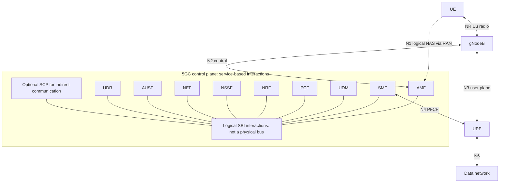
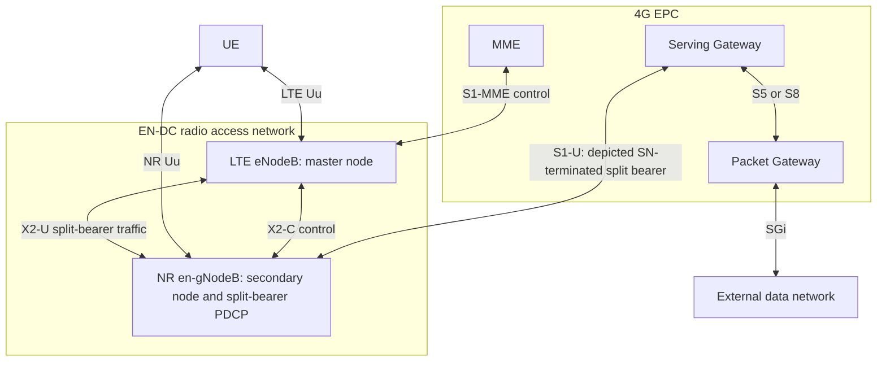

# Unit 3: 5G Network Architecture and Key Features - Exam-Oriented Question Bank (Updated)

> **Disclaimer & Labeling**: These are syllabus-based practice questions, not previous-year examination questions (PYQs), verified past examination questions, or guaranteed predictions. Suggested marks indicate expected answer depth and analytical detail, not an official NMIMS examination paper layout.

---

## 📋 Table of Contents
1. [Section A: Short-Answer Practice Questions (2 Marks)](#section-a-short-answer-practice-questions-2-marks)
2. [Section B: Medium Explanatory & Analytical Practice Questions (4–5 Marks)](#section-b-medium-explanatory--analytical-practice-questions-45-marks)
3. [Section C: Long Essay, Scenario & Numerology Practice Questions (8–10 Marks)](#section-c-long-essay-scenario--numerology-practice-questions-810-marks)
4. [Section D: Master Comparison Matrices & Architecture Diagrams](#section-d-master-comparison-matrices--architecture-diagrams)
5. [Section E: End Matter](#section-e-end-matter)
   - [E.1 Topic-to-Question Coverage Matrix](#e1-topic-to-question-coverage-matrix)
   - [E.2 Master Glossary of Essential Terms](#e2-master-glossary-of-essential-terms)
   - [E.3 Syllabus Revision Checklist](#e3-syllabus-revision-checklist)
   - [E.4 Honest Completeness & Verification Audit](#e4-honest-completeness--verification-audit)

---

<a id="section-a-short-answer-practice-questions-2-marks"></a>

## Section A: Short-Answer Practice Questions (2 Marks)

### Q1.1: State two major operational differences between NSA Option 3x and SA Option 2 architectures.
**Model Answer:**
1. **Core Network Anchoring**: NSA Option 3x connects to a legacy 4G Evolved Packet Core (EPC) via an eNodeB control plane anchor, whereas SA Option 2 connects directly to a cloud-native 5G Core (5GC) via a gNodeB (*Unit 3.pptx, Slides 6, 10; 5G Networking SA vs NSA: Key Differences | Airtel*).
2. **Service Capabilities**: NSA Option 3x is primarily optimized for Enhanced Mobile Broadband (eMBB) speed boosts, whereas SA Option 2 natively unlocks end-to-end Network Slicing, Multi-Access Edge Computing (MEC), and Ultra-Reliable Low-Latency Communications (URLLC) (*Unit 3.pptx, Slide 11*).

---

### Q1.2: Define Control and User Plane Separation (CUPS) in 5G and name the core network entities involved.
**Model Answer:**
* **Definition**: CUPS is an architectural principle that decouples network signaling and control logic from user data packet forwarding. This allows control plane functions to be centralized in cloud data centers while user plane functions are pushed closer to the network edge for low latency (*Unit 3.pptx, Slide 14; 5G System Overview*).
* **5G Core Entities**:
  * **Control Plane Entities**: AMF (Access and Mobility Management Function), SMF (Session Management Function), PCF, UDM, NRF, NSSF.
  * **User Plane Entity**: UPF (User Plane Function) (*Unit 3.pptx, Slide 15; 5G Network Function - UPF & AUSF*).

---

### Q1.3: Differentiate between Single-User MIMO (SU-MIMO) and Multi-User MIMO (MU-MIMO).
**Model Answer:**
* **SU-MIMO**: Allocates all spatial transmission streams of a base station antenna array to a **single user device** at a given time and frequency resource block, maximizing peak data rates for that individual user (*Unit 3.pptx, Slide 21; What is Massive MIMO?*).
* **MU-MIMO**: Transmits distinct, independent spatial data streams simultaneously to **multiple spatially separated user devices** on the exact same time-frequency resource block, multiplying total cell capacity and spectral efficiency (*Unit 3.pptx, Slide 22; Understanding Massive MIMO Technology*).

---

### Q1.4: State the 5G NR flexible numerology formula and calculate subcarrier spacing and useful symbol duration for $\mu=2$.
**Model Answer:**
For the syllabus numerologies, $\Delta f=15\times2^\mu\,\mathrm{kHz}$, with $\mu=0,1,2,3$ giving 15, 30, 60, and 120 kHz. Other numerologies are release/channel dependent.

$$\Delta f=15\times2^2=60\,\mathrm{kHz}=60000\,\mathrm{Hz}$$

$$T_u=\frac{1}{\Delta f}=\frac{1}{60000}\,\mathrm{s}=16.666667\,\mu\mathrm{s}$$

For an ordinary normal-CP symbol, $T_{CP}=4.6875/2^2=1.171875\,\mu\mathrm{s}$, so

$$T_{sym}=T_u+T_{CP}=17.838542\,\mu\mathrm{s}\approx17.84\,\mu\mathrm{s}.$$

Normal CP varies with symbol position: certain symbols have a longer CP. The above total is not the duration of every symbol. Extended CP is also defined for 60 kHz and changes the slot symbol count. See [R1], clauses 4.2, 4.3.2 and 5.3.1. Original source attribution retained: Unit 3.pptx, Slide 30 (slide numbering not independently revalidated).

---

### Q1.5: Explain why a Cyclic Prefix (CP) is prepended to an OFDM symbol and state its mathematical condition.
**Model Answer:**
- Copy the final $T_{CP}$ portion of the useful symbol to its beginning. This guard interval accommodates delayed multipath components and enables circular-convolution modelling for FFT equalization.
- Under adequate synchronization and a sufficiently time-invariant channel, the basic no-ISI condition is

$$T_{CP}\ge\tau_{max}.$$

Here $\tau_{max}$ is the maximum excess delay relative to the first arrival, not RMS delay spread. Practical designs include timing margin.
- The receiver discards the CP and processes $T_u=1/\Delta f$ with the FFT. The transmitted duration is $T_{sym}=T_u+T_{CP}$.
- CP does not eliminate ICI caused by carrier-frequency offset, phase noise, or rapid channel variation. See [R1], clause 5.3.1. Original attribution: Unit 3.pptx, Slides 28–29.

---

### Q1.6: State the roles of SCP and BSF in the 5G Service-Based Architecture (SBA).
**Model Answer:**
* **SCP (Service Communication Proxy - Rel-16)**: Acts as a centralized communication proxy that handles message routing, dynamic load balancing, authorization, and circuit breaking between Network Functions (NFs) in large-scale control plane deployments (*5G System Overview*).
* **BSF (Binding Support Function)**: Discovers and binds a specific Policy Control Function (PCF) instance to a PDU session when multiple PCF instances exist in the network, ensuring consistent policy enforcement for a given user IP address (*5G Network Function - PCF*).

---

### Q1.7: Define NWDAF and NSSAAF in 5G Core Rel-16/17 standards.
**Model Answer:**
* **NWDAF (Network Data Analytics Function)**: An automated 5GC function that collects data from NFs and OAM systems to deliver AI/ML-driven network analytics, load predictions, slice SLA monitoring, and mobility forecasts (*5G System Overview*).
* **NSSAAF (Network Slice-Specific Authentication and Authorization Function)**: Manages secondary, slice-specific AAA authentication with external AAA servers (e.g., enterprise RADIUS/Diameter) for users requesting access to restricted private network slices (*5G_Net_Slcng_Sec.pdf*).

---

### Q1.8: Distinguish between logical reference points and physical transport interfaces in 5G.
**Model Answer:**
* **Logical Reference Points**: Define conceptual signaling or data interactions between specific functional entities regardless of transport implementation (e.g., **N1** NAS signaling between UE and AMF, **N4** control interface between SMF and UPF) (*Unit 3.pptx, Slide 17*).
* **Physical Transport Interfaces**: Realize the physical and transport layer connectivity over IP routing, Ethernet cables, or fiber optics carrying those logical messages (e.g., **N2** over SCTP/IP between gNodeB and AMF, **N3** over GTP-U/UDP/IP between gNodeB and UPF) (*Unit 3.pptx, Slide 18*).

---

### Q1.9: What is the primary difference between CP-OFDM and DFT-s-OFDM in 5G NR uplink transmission?
**Model Answer:**
* **CP-OFDM (Cyclic Prefix OFDM)**: A multi-carrier waveform providing high spectral efficiency and flexible resource allocation. Used for downlink and high-throughput uplink scenarios (*5G NR Waveform Generation*).
* **DFT-s-OFDM (Discrete Fourier Transform-spread OFDM)**: A single-carrier-like waveform that applies a DFT pre-coding stage before OFDM modulation. It significantly reduces the Peak-to-Average Power Ratio (PAPR), improving power amplifier efficiency and battery life for uplink transmissions at cell edges (*5G NR Waveform Generation - MATLAB & Simulink*).

---

### Q1.10: State the composition and field lengths of the Single Network Slice Selection Assistance Information (S-NSSAI).
**Model Answer:**
The S-NSSAI identifies a slice selection within a PLMN context; it is not by itself a globally unique slice-instance identifier and consists of two fields (*Unit 3.pptx, Slide 36; What is Network Slicing*):
1. **SST (Slice/Service Type - 8 bits / 1 octet)**: **Mandatory** field defining standardized slice behavior (e.g., SST=1 for eMBB, SST=2 for URLLC, SST=3 for mMTC, SST=4 for V2X).
2. **SD (Slice Differentiator - 24 bits / 3 octets)**: **Optional** field that distinguishes multiple slices operating under the same SST (e.g., differentiating enterprise Slice A from enterprise Slice B).
* **Total Length**: An S-NSSAI is 8 bits (1 octet) when SD is omitted, and 32 bits (4 octets) when SD is present.

---

### Q1.11: How does Multi-Access Edge Computing (MEC) reduce end-to-end user latency?
**Model Answer:**
MEC places computing infrastructure and a local User Plane Function (UPF) breakout physically close to the radio access network (gNodeB). By performing local breakout over the **N6 interface**, it routes user packets directly to local edge application servers, bypassing the long-haul backhaul transport network and avoiding $15\text{--}40\text{ ms}$ of central core propagation delay (*Unit 3.pptx, Slide 38; Edge Computing - GeeksforGeeks*).

---

### Q1.12: Differentiate between Passive and Active Infrastructure Sharing under Indian telecom rules.
**Model Answer:**
* **Passive Infrastructure Sharing**: Sharing non-electronic physical assets such as tower structures, land, equipment shelters, power supplies, air conditioning, and dark fiber. Governed under IP-I and DCIP authorization frameworks (*Unit 3.pptx, Slide 42; Infrastructure Sharing | TRAI*).
* **Active Infrastructure Sharing**: Sharing functional electronic radio and transmission hardware, including antennas, transceivers, Baseband Units (BBU/DU/CU), and spectrum. Includes Multi-Operator Radio Access Network (MORAN) and Multi-Operator Core Network (MOCN) models (*Unit 3.pptx, Slide 43; CP_08042026.pdf*).

---

### Q1.13: State the 5G deployment strategies adopted by Reliance Jio and Bharti Airtel during initial 2022–2023 rollouts.
**Model Answer:**
* **Reliance Jio**: Adopted a **Standalone (SA Option 2)** strategy ("True 5G"), deploying a cloud-native 5G Core anchored by $700\text{ MHz}$ (n28) low-band spectrum for wide coverage alongside $3300\text{ MHz}$ (n78, 100 MHz channel bandwidth) mid-band and $26\text{ GHz}$ (n258) mmWave (*Unit 3.pptx, Slide 44; August 2022 Spectrum Auction Data*).
* **Bharti Airtel**: Adopted a **Non-Standalone (NSA Option 3x)** strategy ("5G Plus"), leveraging its existing 4G LTE core and $1800/2100\text{ MHz}$ mid-band spectrum as an anchor, paired with $3300\text{ MHz}$ (n78, 100 MHz channel bandwidth) for 5G data delivery via EN-DC dual connectivity (*5G Networking SA vs NSA: Key Differences | Airtel*).

---

### Q1.14: What is the current baseline versus national target for cell tower fiberization in India?
**Model Answer:**
* **Baseline at 5G Launch (2022)**: Approximately **35%–38%** of Indian cell towers were connected via fiber-optic backhaul, leaving over 60% dependent on capacity-constrained microwave links (*D1S2P1.pdf*).
* **National Target**: The National Digital Communications Policy (NDCP) set a national target of **70% cell tower fiberization** to prevent backhaul bottlenecks and sustain multi-gigabit 5G speeds (*D1S2P1.pdf; CP_08042026.pdf*).

---

### Q1.15: Differentiate between FR1 and FR2 spectrum ranges in 3GPP 5G NR specifications.
**Model Answer:**
| Range | Frequency limits | Bandwidth and subcarrier spacing | Coverage considerations |
| --- | --- | --- | --- |
| FR1 | 410–7125 MHz | Up to 100 MHz per carrier in the referenced tables; 15/30/60 kHz data spacing, subject to band support | Low bands generally cover farther than mid bands; indoor penetration varies |
| FR2-1 | 24.25–52.6 GHz | 50/100/200/400 MHz depending on band/SCS; 60/120 kHz data spacing; 240 kHz also used for synchronization blocks | Directional beams, dense sites, and blockage management |
| FR2-2 | 52.6–71 GHz | Up to 2000 MHz in specified configurations; 120/480/960 kHz according to band/bandwidth | Separate higher-frequency propagation and hardware constraints |

See [R2], tables 5.1-1, 5.3.2-1/2/3 and 5.3.5-2/3. These are standard ranges, not spectrum allocated to every operator. Original 1–10 km FR1 and 100–500 m FR2 radii are retained only as illustrative examples, not guarantees. Actual coverage depends on frequency, power, antennas, environment, and receiver requirements. A single n258 carrier must not be assigned the former generic 800-MHz maximum.

---

### Q1.16: Define Traditional FDM versus 5G CP-OFDM.
**Model Answer:**
* **Traditional FDM (Frequency Division Multiplexing)**: Divides spectrum into non-overlapping subchannels separated by wide spectral guard bands to prevent Inter-Channel Interference, resulting in low spectral efficiency (*The Basics of OFDM*).
* **5G CP-OFDM (Cyclic Prefix OFDM)**: Divides spectrum into closely spaced, overlapping subcarriers that are mathematically orthogonal over the useful symbol duration $T_s = 1/\Delta f$. Eliminates guard bands between subcarriers, maximizing spectral efficiency (*Unit 3.pptx, Slide 27*).

---

<a id="section-b-medium-explanatory--analytical-practice-questions-45-marks"></a>

## Section B: Medium Explanatory & Analytical Practice Questions (4–5 Marks)

### Q2.1: Explain the architecture and data split mechanism of Non-Standalone Option 3x (EN-DC).
**Model Answer:**
* **Architecture**: NSA Option 3x (E-UTRA-NR Dual Connectivity / EN-DC) utilizes a legacy 4G Evolved Packet Core (EPC) and a 4G eNodeB as the Master Node (MN) for control plane signaling, alongside a 5G en-gNodeB as the Secondary Node (SN) for user plane data delivery (*Unit 3.pptx, Slide 7; 5G Networking SA vs NSA*).
* **Control Plane Path**: The UE establishes its primary Radio Resource Control (RRC) and Non-Access Stratum (NAS) connection with the 4G eNodeB over the LTE Uu interface. The eNodeB communicates with the 4G MME via the **S1-MME interface**. Control signaling between eNodeB and en-gNodeB travels over the **X2-C interface** (*Unit 3.pptx, Slide 8*).
* **User Plane Path & Data Split (Option 3x)**:
  * High-speed user plane data from the Serving Gateway (S-GW) is routed directly to the 5G en-gNodeB over the **S1-U interface**.
  * The Packet Data Convergence Protocol (PDCP) layer residing in the 5G en-gNodeB performs the traffic split: heavy data flows are transmitted directly to the UE over the NR Uu air interface, while a portion can be offloaded to the 4G eNodeB over the **X2-U interface** for transmission over LTE Uu (*Unit 3.pptx, Slide 9*).
* **Advantages & Limitations**:
  * *Advantages*: Enables rapid 5G commercial launch with lower initial CAPEX by reusing existing 4G EPC investments.
  * *Limitations*: Uplink coverage is constrained by dual-transmitter UE battery drain, and the network cannot support native 5G Core features like end-to-end network slicing (*Unit 3.pptx, Slide 10*).

---

### Q2.2: Describe the 5G Service-Based Architecture (SBA) and detail the interactions between NRF, AMF, SMF, and UPF during PDU session establishment.
**Model Answer:**
* **5G SBA Overview**: The 5G Core control plane replaces point-to-point binary reference interfaces with a cloud-native **Service-Based Architecture (SBA)**. Control plane Network Functions (NFs) act as service producers and consumers, discovering each other and exchanging JSON payloads over HTTP/2 RESTful APIs on a common Service-Based Interface (SBI) bus (*Unit 3.pptx, Slide 13; 5G System Overview*).
* **PDU Session Establishment Interaction Sequence**:
  1. **Registration & Request**: The UE sends a PDU Session Establishment Request over the **N1 interface** (NAS) to the AMF.
  2. **Service Discovery via NRF**: The AMF consumes the `Nnrf_NFDiscovery` service provided by the **NRF (Network Repository Function)** to dynamically discover an available SMF instance matching the user's requested S-NSSAI and Data Network Name (DNN) (*5G Network Function - NSSF, AF, NEF & NRF*).
  3. **Session Creation**: The AMF invokes the `Nsmf_PDUSession_CreateSMContext` service on the selected SMF over the SBI bus.
  4. **Policy & UPF Selection**: The SMF queries the PCF (`Npcf_SMPolicyControl`) for QoS policy rules and selects an appropriate UPF.
  5. **N4 Interface Establishment**: The SMF controls the UPF over the **N4 interface** using Packet Forwarding Control Protocol (PFCP), configuring packet detection, forwarding, and QoS rules (*Unit 3.pptx, Slide 16; 5G Network Function - SMF*).
  6. **Radio & Core Tunneling**: The SMF returns N2 session management information (including UPF N3 IP address and TEID) to the AMF, which forwards it to the gNodeB via **N2**. The gNodeB establishes the **N3 user plane tunnel** with the UPF and configures data radio bearers with the UE (*Unit 3.pptx, Slide 17*).

---

### Q2.3: Compare Analog, Digital, and Hybrid Beamforming architectures in 5G networks. Why is Hybrid Beamforming preferred for mmWave systems?
**Model Answer:**
* **Architectural Comparison**:
  1. **Analog Beamforming**: Applies phase shifts to radio signals in the analog domain after Digital-to-Analog Conversion (DAC). Uses a single RF chain connected to multiple antenna elements via phase shifters. *Advantage*: Very low hardware complexity and power consumption. *Limitation*: Can form only one directional beam per RF chain at a time, preventing multi-stream spatial multiplexing (*Unit 3.pptx, Slide 24; Types of Beamforming*).
  2. **Digital Beamforming**: Applies baseband phase and amplitude adjustments digitally before DAC, with a dedicated RF chain for every antenna element. *Advantage*: Maximum flexibility, enabling simultaneous multi-beam generation and full MU-MIMO spatial multiplexing. *Limitation*: Prohibitively high power consumption, cost, and heat dissipation when scaling to 128 or 256 elements (*Unit 3.pptx, Slide 25*).
  3. **Hybrid Beamforming**: Combines digital precoding in baseband (across a moderate number of RF chains, e.g., 8–16) with analog phase shifting across a large array of antenna elements (e.g., 128–256).
* **Why Preferred for mmWave (FR2)**:
  * At mmWave frequencies ($26 \text{ GHz}$), path loss and atmospheric absorption are severe, requiring massive antenna arrays to synthesize high-gain pencil beams.
  * Implementing full digital beamforming with 256 dedicated RF chains at mmWave frequencies would exceed the power and thermal budgets of cell sites.
  * Hybrid beamforming achieves the optimal trade-off: digital precoding provides spatial multiplexing for multiple users, while analog phase shifters generate the high beamforming gain needed to overcome mmWave propagation loss (*Unit 3.pptx, Slide 26; Massive_MIMO_mmWave_and_mmWave-Massive_MIMO_Commun.pdf*).

---

### Q2.4: Analyze OFDM subcarrier orthogonality and explain how the Cyclic Prefix prevents Inter-Symbol Interference (ISI).
**Model Answer:**
Let $s_m(t)=e^{j2\pi(f_0+m\Delta f)t}$ and $s_n(t)=e^{j2\pi(f_0+n\Delta f)t}$. Set $\Delta f=1/T_u$ and let $m,n$ be integer subcarrier indices. Their normalized inner product is

$$\frac{1}{T_u}\int_0^{T_u}s_m(t)s_n^*(t)\,dt=\frac{1}{T_u}\int_0^{T_u}e^{j2\pi(m-n)t/T_u}\,dt.$$

For $m\ne n$,

$$\frac{e^{j2\pi(m-n)}-1}{j2\pi(m-n)}=0.$$

For $m=n$, the integrand is one and the normalized result is one. Thus adjacent spectra can overlap while remaining orthogonal over the useful FFT interval under ideal synchronization. Carrier-edge guard bands may still be required.

**CP mechanism:** prepend the last $T_{CP}$ seconds of the symbol. Then $T_{sym}=T_u+T_{CP}$. If $T_{CP}\ge\tau_{max}$ and the FFT window is aligned, delayed copies of the preceding symbol do not enter the useful window. The channel convolution becomes circular over that window, allowing one-tap equalization per subcarrier for a sufficiently time-invariant channel. CFO, Doppler, phase noise, or insufficient CP can still cause ICI/ISI. See [R1], clause 5.3.1. Original attribution: Unit 3.pptx, Slides 27–29.

---

### Q2.5: Explain 5G NR Flexible Numerology ($\Delta f = 15 \times 2^\mu \text{ kHz}$). Analyze the engineering trade-offs when transitioning from $\mu=0$ to $\mu=3$.
**Model Answer:**
* **Flexible Numerology Concept**: Unlike 4G LTE which uses a fixed subcarrier spacing of $15\text{ kHz}$, 5G NR scales subcarrier spacing exponentially according to $\Delta f = 15 \times 2^\mu \text{ kHz}$, where $\mu \in \{0, 1, 2, 3, 4\}$ (*Unit 3.pptx, Slide 30; 5G NR The Next Generation Wireless Access Technology*).
* **Quantitative Trade-Off Analysis ($\mu=0$ to $\mu=3$)**:

| Parameter | **Numerology $\mu = 0$** | **Numerology $\mu = 3$** |
| :--- | :--- | :--- |
| **Subcarrier Spacing ($\Delta f$)** | $15\text{ kHz}$ | $120\text{ kHz}$ |
| **Useful Symbol Duration ($T_s = 1/\Delta f$)** | $66.67\,\mu\text{s}$ | $8.33\,\mu\text{s}$ |
| **Ordinary normal-CP duration ($T_{cp}$)** | $4.69\,\mu\text{s}$ | $0.59\,\mu\text{s}$ |
| **Slot Duration ($T_{slot}$)** | $1\text{ ms}$ (14 OFDM symbols) | $0.125\text{ ms}$ (14 OFDM symbols) |
| **Slots per $10\text{ ms}$ Frame** | 10 slots | 80 slots |
| **Primary Deployment Band** | Sub-1 GHz / Rural Macro-cells | mmWave FR2 ($26\text{ GHz}$) High-Density Cells |

**CP and slot qualification:** ordinary normal CP is $4.6875/2^\mu\,\mu\mathrm{s}$. Selected symbols have an additional $0.520833\,\mu\mathrm{s}$; therefore 14 times an ordinary symbol duration is not exactly a complete slot. For normal CP, $T_{slot}=1/2^\mu\,\mathrm{ms}$ and there are $10\times2^\mu$ slots per 10-ms frame. The reduction from 1 ms to 0.125 ms is $(1-0.125)/1\times100=87.5\%$, not a guarantee of application latency. [R1]

* **Engineering Trade-Offs**:
  1. **Latency vs. Delay Spread**: $\mu=3$ reduces slot duration by $87.5\%$ ($0.125\text{ ms}$ vs $1\text{ ms}$), enabling ultra-low over-the-air radio latency. However, its CP duration drops to $0.59\,\mu\text{s}$, making it vulnerable to ISI in environments with delay spreads $>0.59\,\mu\text{s}$.
  2. **Phase Noise vs. Spectral Efficiency**: At mmWave frequencies ($26\text{ GHz}$), phase noise is severe. The wide $120\text{ kHz}$ spacing of $\mu=3$ provides high phase-noise robustness, whereas $\mu=0$ would suffer severe Inter-Carrier Interference (*Unit 3.pptx, Slide 31*).

---

### Q2.6: Discuss Multi-Access Edge Computing (MEC) architecture. Explain how MEC reduces end-to-end latency and disambiguate radio latency from end-to-end latency budgets.
**Model Answer:**
* **MEC Architecture**: MEC integrates cloud processing and storage directly within the Radio Access Network (RAN) or local aggregation points. A local User Plane Function (UPF) executes local breakout over the **N6 interface**, steering user traffic directly to edge application servers installed at the edge site (*Unit 3.pptx, Slide 38; Edge Computing - GeeksforGeeks*).
* **Latency Disambiguation & Budget Breakdown** (the following numerical delays are illustrative assumptions, not measured universal ranges):
  1. **Radio-Interface Latency**: The over-the-air physical transmission time between UE and gNodeB (3GPP URLLC target is $\le 1\text{ ms}$ user plane latency) (*Unit 3.pptx, Slide 39*).
  2. **Backhaul Transport Latency**: The propagation delay incurred traveling through optical transport networks to central data centers ($15\text{--}40\text{ ms}$).
  3. **Application Processing Latency**: The computation time required by the application server to decode data and execute logic ($1\text{--}10\text{ ms}$).
  4. **End-to-End (E2E) Application Latency**: Specify the direction before adding delays: one-way delivery and a round-trip control loop are different metrics. The sums below are one-way illustrations; a round trip also includes return-path delays.
* **Impact of MEC**:
  * *Without MEC*: Total E2E Latency = Radio ($1\text{ ms}$) + Backhaul ($30\text{ ms}$) + Server ($5\text{ ms}$) = **$36\text{ ms}$** (fails only applications whose stated deadline is below 36 ms).
  * *With Local MEC*: Total E2E Latency = Radio ($1\text{ ms}$) + Edge Transport ($0.5\text{ ms}$) + Edge Server ($2\text{ ms}$) = **$3.5\text{ ms}$**.
  * *Qualification*: MEC can avoid long-haul backhaul transport for locally served traffic, but it cannot guarantee sub-millisecond E2E performance if application processing or radio scheduling delays are high (*Unit 3.pptx, Slide 40*).

---

### Q2.7 (Variant Grouping):
#### Variant A: Explain the technical implementation of 5G Network Slicing and analyze its security/isolation trade-offs.
#### Variant B: How does 5G enable multi-tenancy over shared physical infrastructure using S-NSSAI and Network Slicing?
**Shared Model Answer:**
* **Technical Implementation**:
  * 5G Network Slicing creates independent, end-to-end virtual networks multiplexed over a shared physical infrastructure using SDN and NFV (*Unit 3.pptx, Slide 35; What is Network Slicing*).
  * Each slice is identified by an **S-NSSAI** (SST + optional SD) and configured with dedicated Quality of Service (QoS) parameters, virtual network functions, and routing policies (*Unit 3.pptx, Slide 36*).
  * The AMF uses the NSSF (`Nnssf_NSSelection`) during registration to map the requested S-NSSAI to an appropriate network slice instance (*5G Network Function - NSSF, AF, NEF & NRF*).
* **Multi-Tenancy & Resource Isolation**:
  * Slicing allows a single physical network to serve distinct enterprise tenants (e.g., Enterprise A URLLC vs Public eMBB) with guaranteed SLA partitioning.
* **Isolation Mechanisms & Security Trade-Offs**:
  1. **Logical Isolation (Software)**: Virtual Network Functions (VNFs) run in isolated software containers or hypervisors. *Trade-off*: Shared underlying physical CPUs and hypervisors remain vulnerable to side-channel attacks or container escape vulnerabilities.
  2. **Physical / Radio Isolation**: At the RAN, base stations enforce Physical Resource Block (PRB) reservation. *Trade-off*: Strict static PRB reservation guarantees slice performance and prevents "noisy neighbor" interference, but reduces overall spectral efficiency compared to dynamic scheduling (*Unit 3.pptx, Slide 37; 5G_Net_Slcng_Sec.pdf*).

---

### Q2.8: Provide a three-way comparative analysis between SDN, NFV, and 3GPP CUPS.
**Model Answer:**

| Architectural Pillar | **Software-Defined Networking (SDN)** | **Network Functions Virtualization (NFV)** | **3GPP CUPS (Control/User Plane Separation)** |
| :--- | :--- | :--- | :--- |
| **Primary Domain** | Transport network routing and switching topology. | Compute, storage, and application software management. | 3GPP cellular core network functions (4G EPC / 5G 5GC). |
| **Core Concept** | Separates transport control plane (SDN Controller) from forwarding plane (Switches/Routers). | Replaces dedicated hardware appliances with virtual functions (VNFs) on COTS x86 servers. | Decouples mobile management logic (AMF/SMF) from user packet routing (UPF). |
| **Key Protocols / Specs** | OpenFlow, NETCONF, P4. | ETSI NFV ISG framework (MANO, VNF, NFVI). | 3GPP TS 29.244 (PFCP protocol over N4 interface). |
| **Primary Benefit** | Dynamic network traffic engineering and centralized flow management. | Reduces hardware CAPEX/OPEX and enables dynamic auto-scaling. | Enables independent scaling and flexible geographic placement of UPF at the edge. |

---

### Q2.9: Analyze the policy frameworks governing passive and active infrastructure sharing in India under the Telecommunications Act, 2023.
**Model Answer:**
* **Legislative Framework**: The **Telecommunications Act, 2023** modernized India's telecom governance, establishing statutory authorisations for infrastructure provision (*CP_08042026.pdf*).
* **Passive Infrastructure Sharing Policies**:
  * Section 3(1)(b) provides a statutory authorization basis for establishing, operating, maintaining, or expanding telecommunications networks; it does not alone define every DCIP condition. See [R3] for the official DCIP scope.
  * Allows non-service entities to establish, operate, and maintain passive assets (towers, dark fiber, duct space, street furniture) and lease them to licensed TSPs on fair, non-discriminatory terms (*CP_08042026.pdf*).
* **Active Infrastructure Sharing Policies**:
  * Permits licensed Access Service Providers to share active electronic infrastructure including Radio Access Network (RAN) nodes, antennas, and backhaul transmission links under Multi-Operator RAN (MORAN) and Multi-Operator Core Network (MOCN) arrangements.
  * *Benefits*: Significantly lowers capital expenditures for 5G small cell network densification in suburban and rural areas (*Unit 3.pptx, Slide 43; Infrastructure Sharing | TRAI*).

---

### Q2.10: Discuss the physical, financial, and policy challenges facing nationwide 5G expansion in India, specifically evaluating tower fiberization and Right of Way (RoW) rules.
**Model Answer:**
* **1. Tower Fiberization Bottleneck**:
  * *Challenge*: Less than **38%** of Indian cell towers were connected via optical fiber at the time of 5G launch in 2022 (*D1S2P1.pdf*).
  * *Impact*: Relying on legacy microwave backhaul causes severe bandwidth bottlenecks, preventing base stations from delivering multi-gigabit 5G user speeds. Reaching the national target of **70% fiberization** requires massive capital investments in laying dark fiber (*CP_08042026.pdf*).
* **2. Right of Way (RoW) & Municipal Approval Challenges**:
  * *Challenge*: Historical RoW approvals involved fragmented municipal jurisdictions, exorbitant deployment fees, and lengthy procedural delays across different Indian states.
  * *Policy Reform*: The government notified the **Telecommunications RoW Rules, 2024** under the Telecommunications Act, 2023. It established standardized fee caps (fee categories and applicable amounts must be checked in the Gazette schedule; the earlier universal ₹1,000 claim is not retained), mandatory single-window clearing portals, and binding deemed-approval timelines to accelerate 5G small cell rollouts (*CP_08042026.pdf*).
* **3. Financial CAPEX Constraints**: High spectrum auction costs combined with low Average Revenue Per User (ARPU) constrain operators' ability to simultaneously fund rapid network densification and rural fiber expansion.

---

### Q2.11: Compare Traditional FDM vs. 5G OFDM, detailing the key advantages and technical limitations of OFDM.
**Model Answer:**
* **FDM vs. OFDM Comparison**:
  * *Traditional FDM*: Transmits non-overlapping subchannels separated by wide guard bands. Inefficient spectrum utilization (*The Basics of OFDM*).
  * *5G CP-OFDM*: Transmits closely spaced subcarriers whose peak frequencies coincide with the zero-crossings of adjacent subcarriers ($\Delta f = 1/T_s$). Completely eliminates guard bands between subcarriers, maximizing spectral efficiency (*Unit 3.pptx, Slide 27*).
* **Key Advantages of OFDM**:
  1. **High Spectral Efficiency**: Overlapping orthogonal subcarriers utilize spectrum near the theoretical Nyquist limit.
  2. **Multipath & ISI Resistance**: Long useful symbol duration $T_s$ combined with Cyclic Prefix ($T_{cp} \ge \tau_{max}$) completely eliminates Inter-Symbol Interference (*Unit 3.pptx, Slide 28*).
  3. **Simplified Channel Equalization**: Converts frequency-selective fading into simple single-tap scalar equalization per subcarrier in the frequency domain.
* **Technical Limitations of OFDM**:
  1. **High Peak-to-Average Power Ratio (PAPR)**: Independent subcarriers adding in phase produce large amplitude peaks, reducing power amplifier efficiency (mitigated in uplink via DFT-s-OFDM) (*5G NR Waveform Generation*).
  2. **Sensitivity to Carrier Frequency Offset (CFO) & Phase Noise**: Doppler shifts or oscillator instability destroy subcarrier orthogonality, causing Inter-Carrier Interference (ICI).
  3. **Cyclic Prefix Overhead**: Transmitting $T_{cp}$ consumes $5\text{--}10\%$ of total radio bandwidth.

---

### Q2.12: Analyze operator transition strategies moving from Non-Standalone (NSA) to Standalone (SA) 5G networks, evaluating Indian operator rollouts.
**Model Answer:**
* **Transition Strategy Overview**:
  * Operators initially deploying **NSA Option 3x** leverage existing 4G LTE/EPC assets to minimize initial CAPEX and accelerate 5G broadband launch.
  * As cloud-native 5G Core (5GC) infrastructure matures and demand for enterprise network slicing / URLLC grows, operators execute a phased transition toward **SA Option 2** (*5G Networking SA vs NSA: Key Differences | Airtel*).
* **Indian Operator Approaches (Dated to 2022 Auctions & 2023 Rollouts)**:
  * **Reliance Jio (Direct SA Approach)**: Bypassed NSA entirely, deploying a Standalone (SA Option 2) network from day one ("True 5G"). Anchored coverage with nationwide $700\text{ MHz}$ (n28) spectrum paired with $3.3\text{ GHz}$ (n78) capacity, unlocking immediate native support for network slicing and edge UPF breakout (*Unit 3.pptx, Slide 44; August 2022 Spectrum Auction Data*).
  * **Bharti Airtel (Phased NSA-to-SA Approach)**: Deployed Non-Standalone (NSA Option 3x) initially ("5G Plus"), anchoring 5G NR carriers ($3.3\text{ GHz}$) onto existing 4G LTE core and $1800/2100\text{ MHz}$ spectrum assets. This enabled rapid market entry at lower initial CAPEX, with plans to transition toward SA as enterprise slicing and private 5G demand scales (*5G Networking SA vs NSA | Airtel*).

---

<a id="section-c-long-essay-scenario--numerology-practice-questions-810-marks"></a>

## Section C: Long Essay, Scenario & Numerology Practice Questions (8–10 Marks)

### Q3.1: Comprehensive Essay on the 5G System Architecture. Explain the Service-Based Architecture (SBA), detail the functions of all major 5G Core entities, and reconcile 4G EPC CUPS with 5G 5GC.
**Model Answer:**
* **1. Architectural Philosophy & SBA Principles**:
  The 3GPP 5G System (5GS) replaces legacy point-to-point hardware appliances with a cloud-native **Service-Based Architecture (SBA)**. Control plane Network Functions (NFs) act as modular service producers and consumers, communicating over a common Service-Based Interface (SBI) bus using HTTP/2 RESTful APIs and JSON serialization (*Unit 3.pptx, Slide 13; 5G System Overview*).

* **2. Comprehensive Breakdown of 5G Core Network Functions**:
  1. **AMF (Access and Mobility Management Function)**: Handles UE registration, reachability, access authorization, and mobility tracking. Terminates N1 NAS signaling from UE and N2 control signaling from gNodeB (*Unit 3.pptx, Slide 15*).
  2. **SMF (Session Management Function)**: Manages PDU session establishment, modification, and release. Allocates UE IP addresses and controls UPF packet forwarding over the **N4 interface** using PFCP protocol (*Unit 3.pptx, Slide 16*).
  3. **UPF (User Plane Function)**: The sole user-plane processing entity in 5GC. Performs packet routing, forwarding, inspection, Quality of Service (QoS) enforcement, and mobility anchoring. Connects to external Data Networks via **N6** (*5G Network Function - UPF & AUSF*).
  4. **UDM (Unified Data Management) & UDR (Unified Data Repository)**: UDM manages user credentials and subscription profiles (equivalent to 4G HSS), while UDR acts as the decoupled state database repository storing subscription and policy data (*5G Network Function - UDM, UDR & UDSF*).
  5. **AUSF (Authentication Server Function)**: Handles 5G-AKA and EAP-AKA' primary authentication processing, verifying UE credentials via UDM (*5G Network Function - UPF & AUSF*).
  6. **PCF (Policy Control Function)**: Provides unified policy rules for QoS, session bandwidth, and charging (*5G Network Function - PCF*).
  7. **NRF (Network Repository Function)**: Dynamic automated service discovery engine where NFs register their profiles and discover available service producers (*5G Network Function - NSSF, AF, NEF & NRF*).
  8. **NSSF (Network Slice Selection Function)**: Selects appropriate Network Slice instances matching requested S-NSSAIs (*5G Network Function - NSSF, AF, NEF & NRF*).
  9. **NEF (Network Exposure Function)**: Securely exposes 5G Core capabilities and event notifications to third-party Application Functions (*5G Network Function - NSSF, AF, NEF & NRF*).
  10. **AF (Application Function)**: Interacts with 5G Core via NEF/PCF to request dynamic QoS control or edge UPF traffic steering (*5G Network Function - NSSF, AF, NEF & NRF*).
  11. **SCP (Service Communication Proxy - Rel-16)**: Centralized proxy handling HTTP/2 message routing, load balancing, and circuit breaking in large SBAs (*5G System Overview*).
  12. **BSF (Binding Support Function)**: Binds specific PCF instances to PDU sessions in multi-PCF deployments (*5G Network Function - PCF*).
  13. **NWDAF (Network Data Analytics Function)**: Delivers AI/ML-driven network performance analytics and slice load predictions (*5G System Overview*).
  14. **NSSAAF (Network Slice-Specific Auth Function - Rel-16)**: Manages secondary authentication for enterprise private slices (*5G_Net_Slcng_Sec.pdf*).

* **UDSF (Unstructured Data Storage Function)**: Optional storage for unstructured NF state, enabling state externalization and stateless NF implementations. Unlike UDR subscription/policy data, its stored state is defined by the consuming NF. Example: an AMF implementation can externalize context for resilience. Original source named in this answer: *5G Network Function - UDM, UDR & UDSF*; exact source pages remain unverified.
* **3. Reconciling 4G EPC CUPS vs 5G 5GC Architecture**:
  * *Clarification*: 3GPP Rel-14 introduced Control and User Plane Separation (CUPS) to 4G EPC as an evolutionary enhancement, splitting S-GW into S-GW-C/S-GW-U and P-GW into P-GW-C/P-GW-U over the Sx interface.
  * *Distinction*: While 4G EPC CUPS was retrofitted onto legacy point-to-point Diameter/GTP architectures, 5G 5GC built CUPS natively into a cloud-native Service-Based Architecture using HTTP/2 RESTful APIs, enabling dynamic microservice scaling (*5G System Overview; 5G Network Function - Comparison*).

---

### Q3.2 (Scenario-Based Application & System Design Question):
#### Scenario: An industrial enterprise in Gujarat is deploying an automated smart port. The facility requires:
1. High-definition 4K camera surveillance across container yards ($100\text{ Mbps}$ continuous downlink/uplink).
2. Autonomous AGVs (Automated Guided Vehicles) navigating container yards requiring ultra-reliable control loops (target E2E latency $<2\text{ ms}$, $99.999\%$ reliability).
3. 50,000 environmental and container tracking sensors sending small intermittent data packets.

#### Tasks:
1. Recommend an appropriate 5G deployment mode (NSA Option 3x vs SA Option 2) and justify your choice.
2. Design a 5G Network Slicing and Edge Computing architecture for this port, mapping each requirement to its corresponding S-NSSAI / SST service class.
3. Detail the local UPF and MEC placement strategy to achieve the AGV control latency budget.
4. Identify potential shared-resource security/performance risks and recommend isolation mechanisms.

**Model Answer:**
* **1. Recommended Deployment Mode**:
  * **Choice**: **Standalone (SA Option 2)** architecture.
  * **Justification**: NSA Option 3x lacks native 5GC slicing and UPF functions; EPC-based edge computing remains possible. SA is preferred here for native 5GC slice selection and flexible UPF placement, but does not itself guarantee the latency target. SA Option 2 provides a cloud-native 5G Core with native slicing and local MEC integration (*Unit 3.pptx, Slide 10; 5G Networking SA vs NSA*).

* **2. Network Slicing & SST Mapping**:
  * **Requirement 1 (4K Cameras)**: Mapped to **Slice 1: eMBB** (SST=1, S-NSSAI: 1-100001). Configured with wide channel bandwidth in Mid-Band ($3.5\text{ GHz}$) or mmWave ($26\text{ GHz}$).
  * **Requirement 2 (Autonomous AGVs)**: Mapped to **Slice 2: URLLC** (SST=2, S-NSSAI: 2-100002). Configured with short slot duration ($\mu=2$ or $\mu=3$), pre-emptive PRB scheduling, and duplicate packet transmission (*Unit 3.pptx, Slide 36*).
  * **Requirement 3 (50,000 Sensors)**: Mapped to **Slice 3: mMTC** (SST=3, S-NSSAI: 3-100003). Configured with Power Saving Mode (PSM) and extended Discontinuous Reception (eDRX) handling small payload bursts (*Unit 3.pptx, Slide 36*).

* **3. Local UPF and MEC Placement Strategy & Latency Budget**:
  * A **Local UPF** is physically installed inside the port facility premises and connected directly to local gNodeBs over the **N3 interface**.
  * The UPF performs local traffic steering over the **N6 interface** directly to an on-site **MEC Edge Server**.
  * *Latency Budget Breakdown*: Radio over-the-air latency ($1\text{ ms}$) + Local N3/N6 Edge Transport ($0.3\text{ ms}$) + Edge Application Processing ($0.5\text{ ms}$) = **Total E2E Latency $\approx 1.8\text{ ms}$** (a one-way illustrative sum, not proof that the round-trip control-loop requirement is met). Bypasses public backhaul transport delay ($30\text{ ms}$) (*Unit 3.pptx, Slide 38; Edge Computing - GeeksforGeeks*).

```text
[ AGV / Cameras / Sensors ]
           | (5G NR Air Interface)
      [ gNodeB ]
           | (N3 Interface)
     [ Local UPF ] =====(N6 Local Breakout)=====> [ On-Site Port MEC Server ]
           |                                       (AGV Control & 4K AI Analytics)
           | (N4 Control)
      [ On-Premise SMF (within 5GC) ]
```

* **4. Shared-Resource Security Risks & Isolation Mechanisms**:
  * *Risk*: Heavy traffic bursts from 4K video camera uploads in Slice 1 could congest physical gNodeB radio schedulers or transport switches, causing packet drops or jitter in AGV Slice 2 ("noisy neighbor" effect) (*Unit 3.pptx, Slide 37; 5G_Net_Slcng_Sec.pdf*).
  * *Isolation Mechanisms*:
    1. **Radio Layer**: Enforce strict pre-emptive Physical Resource Block (PRB) reservation for Slice 2 (URLLC), prioritizing AGV traffic subject to scheduler implementation, admission control, and measured tail latency.
    2. **Core/Compute Layer**: Run Slice 2 functions on dedicated container nodes with hardware-enforced CPU/memory pinning, with access control and slice-specific authentication where applicable; authentication is not a substitute for resource isolation (*5G_Net_Slcng_Sec.pdf*).

---


**Scenario assumptions and feasibility check:** retain the original 100-Mbps camera traffic, 50,000 sensors, below-2-ms control-loop target, and 99.999% reliability as exercise requirements, not deployment measurements. Clarify whether 100 Mbps is aggregate or per camera before dimensioning capacity. The original $1+0.3+0.5=1.8\,\mathrm{ms}$ sum is one-way. With symmetric radio and transport delays, the illustrative round trip is

$$T_{loop}=1+0.3+0.5+0.3+1=3.1\,\mathrm{ms}>2\,\mathrm{ms}.$$

Thus the supplied assumptions do **not** establish feasibility. Queueing, UE processing, retransmissions, jitter, and a reliability measurement window must also be budgeted. Keep SA/local MEC as a proposed architecture and validate the deadline under load rather than asserting compliance. Sensor access technology and PSM/eDRX support must be checked; a slice label alone does not provide those capabilities.

### Q3.3: Numerology and Physical Layer Calculations.
#### Part A: A 5G NR system uses $\mu=3$ and normal CP.
Calculate subcarrier spacing, useful symbol duration, slots per 10-ms frame, slot duration, and total duration of an **ordinary normal-CP symbol**.

#### Part B: A channel has maximum excess delay $\tau_{max}=2.5\,\mu\mathrm{s}$.
Compare ordinary normal CP at $\mu=1$ and $\mu=3$. Explain whether the basic CP condition holds.

**Model Answer:**
**Part A**
1. $\Delta f=15\times2^3=120\,\mathrm{kHz}=120000\,\mathrm{Hz}$.
2. $T_u=1/120000\,\mathrm{s}=8.333333\,\mu\mathrm{s}$.
3. $N_{slots}=10\times2^3=80$ slots per 10-ms frame.
4. $T_{slot}=10/80=0.125\,\mathrm{ms}=125\,\mu\mathrm{s}$.
5. $T_{CP}=4.6875/8=0.5859375\,\mu\mathrm{s}$, so

$$T_{sym}=8.333333+0.5859375=8.9192708\,\mu\mathrm{s}\approx8.919\,\mu\mathrm{s}.$$

Selected longer-CP symbols instead have $T_{CP}=1.1067708\,\mu\mathrm{s}$ and $T_{sym}=9.4401042\,\mu\mathrm{s}$. This symbol-position dependence reconciles ordinary-symbol calculations with exact slot timing. [R1]

**Part B**
| Numerology | SCS | Ordinary normal CP | Compare with 2.5 microseconds | Result |
| --- | --- | --- | --- | --- |
| $\mu=1$ | 30 kHz | 2.34375 microseconds | $2.34375<2.5$ | Fails for ordinary symbols |
| $\mu=3$ | 120 kHz | 0.5859375 microseconds | $0.5859375<2.5$ | Fails for ordinary symbols |

**Important correction:** 4.6875 microseconds belongs to ordinary normal CP at $\mu=0$, not $\mu=1$. Therefore the previous conclusion that $\mu=1$ passes was incorrect. Its selected longer CP is 2.864583 microseconds, but those symbols alone do not protect the entire transmission.

Insufficient CP allows inter-symbol interference and may destroy FFT orthogonality. For this idealized channel, $\mu=0$ ordinary CP passes: $4.6875\ge2.5$. Extended CP at 60 kHz is another standards-defined possibility: $T_{CP}=4.166667\,\mu\mathrm{s}$, with 12 symbols per slot. Select numerology/CP according to band, channel support, synchronization margin, and measured excess delay; do not infer a universal prohibition on macrocell use from this single example. [R1]

---

### Q3.4: Comprehensive Analysis of Massive MIMO and Beamforming Technologies in 5G NR.
#### Tasks:
1. Differentiate between Single-User MIMO (SU-MIMO) and Multi-User MIMO (MU-MIMO) regarding spatial stream allocation and spectral efficiency.
2. Explain TDD channel reciprocity ($H_{DL} = H_{UL}^T$) using Uplink Sounding Reference Signals (SRS), and detail the challenge of SRS pilot contamination.
3. Compare Beamforming and Spatial Multiplexing in a comparative matrix.
4. Explain how SINR null-steering improves cell-edge user performance.

**Model Answer:**
* **1. SU-MIMO vs MU-MIMO Spatial Stream Allocation**:
  * *SU-MIMO*: Transmits up to 8 spatial layers to a **single UE** equipped with multiple antennas. Maximizes peak data rates for individual high-throughput users (*Unit 3.pptx, Slide 21*).
  * *MU-MIMO*: Serves **multiple independent UEs** simultaneously on the exact same time-frequency resource block by synthesizing orthogonal spatial beams. Multiplies total cell capacity and user connection density (*Unit 3.pptx, Slide 22*).

* **2. TDD Channel Reciprocity & SRS Pilot Contamination**:
  * *TDD Channel Reciprocity*: In Time Division Duplexing (TDD), uplink and downlink operate on the exact same carrier frequency ($f_{DL} = f_{UL}$). Because electromagnetic propagation is symmetric, the downlink channel matrix equals the transpose of the uplink channel matrix ($H_{DL} = H_{UL}^T$) (*Unit 3.pptx, Slide 23; Massive_MIMO_mmWave_pdf*).
  * *SRS Exploitation*: Base stations estimate $H_{UL}$ from Uplink Sounding Reference Signals (SRS) transmitted by UEs, estimating, subject to channel coherence and RF-chain calibration, $H_{DL}$ without requiring feedback quantization overhead from UEs.
  * *Pilot Contamination Challenge*: Due to limited orthogonal SRS pilot sequences, adjacent cells reuse the same pilots. When UEs in neighboring cells transmit identical SRS sequences, the gNodeB forms corrupted channel estimates, directing unwanted directional interference toward users in adjacent cells (*Massive_MIMO_mmWave_pdf*).

* **3. Comparison: Beamforming vs. Spatial Multiplexing**:

| Metric | **Beamforming** | **Spatial Multiplexing** |
| :--- | :--- | :--- |
| **Primary Objective** | Maximize signal power (SNR/SINR) and coverage range. | Maximize data throughput and spectral efficiency. |
| **Signal Mechanism** | Transmits the **same data signal** with phase offsets across array elements. | Transmits **different, independent data streams** across spatial layers. |
| **Channel Condition** | Effective in Line-of-Sight (LoS) or power-limited environments. | Requires sufficient spatial rank from scattering or suitable multi-user geometry. |

* **4. SINR Null-Steering at Cell Edges**:
  * Massive MIMO arrays calculate complex weight vectors that direct peak beam gain toward the desired user while placing deep spatial nulls ($0\text{ gain}$) in the direction of strong co-channel interferers.
  * By suppressing co-channel interference power $I$, the Signal-to-Interference-plus-Noise Ratio ($\text{SINR} = \frac{S}{I + N}$) increases dramatically, elevating cell-edge user throughput (*Unit 3.pptx, Slide 25*).

---

### Q3.5: Comprehensive Analysis of Indian 5G Spectrum, Operator Deployment Strategies, and Regulatory Policy Frameworks.
#### Tasks:
1. Compare 3GPP spectrum tiers (Low-Band, Mid-Band, High-Band/mmWave) regarding propagation, bandwidth, and application suitability.
2. Evaluate the 5G rollout strategies of Reliance Jio and Bharti Airtel, dating claims to the August 2022 spectrum auctions.
3. Analyze the role of the Department of Telecommunications (DoT) and TRAI in infrastructure sharing and Right of Way (RoW) reforms.

**Model Answer:**
* **1. 3GPP Spectrum Tiers Comparison**:

| Metric | **Low-Band (<1 GHz)** | **Mid-Band (1–7 GHz / C-Band)** | **High-Band / mmWave (>24 GHz)** |
| :--- | :--- | :--- | :--- |
| **Primary Bands (India)** | $700\text{ MHz}$ (n28; 600-MHz bands are distinct). | $3300\text{--}3600\text{ MHz}$ (n78). | $26\text{ GHz}$ (n258). |
| **Channel Bandwidth** | $5\text{--}20\text{ MHz}$. | $50\text{--}100\text{ MHz}$. | 50/100/200/400 MHz for n258, subject to SCS [R2]. |
| **Coverage & Penetration (illustrative radii)** | Wide coverage ($10\text{--}20\text{ km}$ radius), deep indoor wall penetration. | Moderate coverage ($1\text{--}3\text{ km}$ radius), medium penetration. | Extremely short range ($100\text{--}500\text{ m}$), blocked by foliage/walls. |
| **Primary Application** | Nationwide coverage anchor, rural broadband, deep indoor IoT (*Unit 3.pptx, Slide 48*). | Urban/suburban capacity layer, eMBB mobile broadband (*Unit 3.pptx, Slide 49*). | Dense urban hotspots, stadiums, Fixed Wireless Access (FWA), smart factories (*Unit 3.pptx, Slide 50*). |

* **2. Operator Deployment Strategies in India (August 2022 Auction Context)**:
  * **Reliance Jio Infocomm Limited**:
    * *Architecture*: Selected **Standalone (SA Option 2)** ("True 5G").
    * *Spectrum Strategy*: Acquired premium $700\text{ MHz}$ spectrum nationwide alongside $3.3\text{ GHz}$ (100 MHz bandwidth) and $26\text{ GHz}$. Used $700\text{ MHz}$ as a nationwide coverage anchor for Standalone control signaling, pairing it with $3.3\text{ GHz}$ for high-speed user plane data (*Unit 3.pptx, Slide 44; August 2022 Auction Data*).
    * *Capability*: Native support for end-to-end network slicing, edge computing, and cloud-native 5GC.
  * **Bharti Airtel Limited**:
    * *Architecture*: Selected **Non-Standalone (NSA Option 3x)** ("5G Plus").
    * *Spectrum Strategy*: Bypassed $700\text{ MHz}$ to conserve CAPEX, acquiring $3.3\text{ GHz}$ (100 MHz bandwidth) and $26\text{ GHz}$ spectrum. Anchored 5G control plane on existing $1800/2100\text{ MHz}$ 4G LTE core assets via EN-DC dual connectivity (*5G Networking SA vs NSA: Key Differences | Airtel*).
    * *Capability*: Rapid nationwide rollout with lower initial capital expenditure, with plans to transition progressively toward Standalone 5G.

* **3. Governance & Regulatory Frameworks**:
  * **Digital Connectivity Infrastructure Provider (DCIP) Framework**: An authorization category whose detailed scope and conditions must be read with the applicable rules, not inferred from Section 3(1)(b) alone; see [R3]. Allows non-service IP-I entities to deploy active and passive digital infrastructure (dark fiber, small cells, IBS) and lease it to TSPs (*CP_08042026.pdf*).
  * **Telecommunications RoW Rules, 2024**: Streamlined small cell deployments on public street furniture by establishing standardized fee caps (check the applicable Gazette fee category; do not assume a universal ₹1,000 charge), single-window clearing portals, and deemed approval timelines across municipal jurisdictions (*CP_08042026.pdf*).
  * **Tower Fiberization Target**: Driving national initiatives to lift fiberization from the **35%–38%** launch baseline toward the **70%** national NDCP target to prevent backhaul bottlenecks (*D1S2P1.pdf*).

---

<a id="section-d-master-comparison-matrices--architecture-diagrams"></a>

## Section D: Master Comparison Matrices & Architecture Diagrams

### D.1 Master Comparison Matrix: NSA Option 3x vs. SA Option 2

| Parameter | **Non-Standalone (NSA Option 3x)** | **Standalone (SA Option 2)** |
| :--- | :--- | :--- |
| **Core Network** | 4G Evolved Packet Core (EPC). | Cloud-Native 5G Core (5GC). |
| **Control Plane Anchor** | 4G eNodeB (Master Node). | 5G gNodeB (Standalone Node). |
| **Core Interface** | S1-MME to MME, S1-U to en-gNodeB. | N1 (NAS), N2 (Control), N3 (User), N4 (PFCP). |
| **Dual Connectivity** | EN-DC (E-UTRA-NR Dual Connectivity). | NR-DC (NR Dual Connectivity - optional). |
| **Deployment Speed** | Rapid commercial launch reusing 4G core. | Slower deployment requiring new 5GC buildout. |
| **Initial CAPEX** | Significantly lower initial capital expenditure. | Higher initial capital expenditure. |
| **Network Slicing** | Not natively supported end-to-end. | Native end-to-end Network Slicing via S-NSSAI. |
| **Latency Capability** | Depends on RAN, EPC placement, transport, load, and processing; no fixed NSA range. | Flexible UPF placement; latency must be measured, not inferred from SA alone. |
| **Primary Target Service** | Enhanced Mobile Broadband (eMBB). | Full 5G Triangle: eMBB, mMTC, URLLC. |

---

### D.2 Master Comparison Matrix: 4G EPC vs. 5G 5GC Architecture

| Parameter | **4G Evolved Packet Core (EPC)** | **5G Core Network (5GC)** |
| :--- | :--- | :--- |
| **Architectural Model** | Point-to-point reference point architecture. | Cloud-native Service-Based Architecture (SBA). |
| **Communication Protocol** | Binary/diameter protocols (GTP-C, Diameter, S1AP). | HTTP/2 RESTful APIs with JSON serialization over SBI. |
| **Control/User Separation** | Partial (CUPS retrofitted in 3GPP Rel-14). | Native, strict Control and User Plane Separation (CUPS). |
| **Mobility & Session Entity** | MME (Mobility Management Entity) handles both mobility & sessions. | Split into AMF (Mobility/Access) and SMF (Session Management). |
| **User Plane Entity** | Serving Gateway (S-GW) and Packet Gateway (P-GW). | Unified User Plane Function (UPF). |
| **Subscriber Data Entity** | Monolithic Home Subscriber Server (HSS). | Decoupled UDM (processing logic) and UDR (database repository). |
| **Service Discovery** | Static IP configuration or DNS lookup. | Dynamic automated service registration & discovery via NRF. |
| **Edge Integration** | Complex S-GW/P-GW user plane hairpinning. | Native local UPF breakout over N6 interface. |

---

### D.3 Master Comparison Matrix: SDN vs. NFV vs. 3GPP CUPS

| Parameter | **Software-Defined Networking (SDN)** | **Network Functions Virtualization (NFV)** | **3GPP CUPS (Control/User Plane Separation)** |
| :--- | :--- | :--- | :--- |
| **Primary Focus** | Transport layer routing and packet forwarding control. | Virtualizing network software from proprietary hardware. | Decoupling cellular core control plane from user plane forwarding. |
| **Key Mechanism** | Centralized SDN Controller controlling switches via OpenFlow. | Running VNFs inside containers/VMs on COTS x86 servers. | SMF controlling UPF over N4 interface using PFCP protocol. |
| **Scope** | Network transport and traffic engineering. | Computing infrastructure and application management. | 3GPP cellular core signaling and user plane data routing. |

---

### D.4 Fenced Mermaid Architecture Diagrams

#### Diagram 1: 5G Core Service-Based Architecture (SBA)


#### Diagram 2: Non-Standalone (NSA Option 3x) Protocol & Interface Architecture


---

<a id="section-e-end-matter"></a>

## Section E: End Matter

<a id="e1-topic-to-question-coverage-matrix"></a>

### E.1 Topic-to-Question Coverage Matrix

| Syllabus Sub-Topic | Relevant Practice Questions |
| :--- | :--- |
| **5G Network Concepts (High-Level)** | Q1.1, Q1.2, Q1.8, Q2.1, Q2.2, Q3.1, Q3.2, D.1, D.2, D.4 |
| **NSA vs. SA Deployment Architectures** | Q1.1, Q1.13, Q2.1, Q2.12, Q3.2, Q3.5, D.1, D.4 |
| **5G System Architecture & SBA Core NFs** | Q1.2, Q1.6, Q1.7, Q1.8, Q2.2, Q3.1, Q3.2, D.2, D.4 |
| **Massive MIMO & Beamforming** | Q1.3, Q2.3, Q3.4 |
| **OFDM Basics & Flexible Numerology** | Q1.4, Q1.5, Q1.9, Q1.16, Q2.4, Q2.5, Q2.11, Q3.3 |
| **Network Slicing & S-NSSAI** | Q1.10, Q2.7, Q3.2 |
| **Multi-Access Edge Computing (MEC)** | Q1.11, Q2.6, Q3.2 |
| **Virtualization: SDN, NFV, CUPS** | Q1.2, Q2.8, Q3.1, D.3 |
| **Infrastructure Sharing & DCIP Rules** | Q1.12, Q2.9, Q3.5 |
| **Operator Strategies & Fiberization** | Q1.13, Q1.14, Q2.10, Q2.12, Q3.5 |
| **5G Spectrum Tiers & mmWave** | Q1.15, Q2.5, Q3.3, Q3.5 |

---

<a id="e2-master-glossary-of-essential-terms"></a>

### E.2 Master Glossary of Essential Terms

1. **AMF (Access and Mobility Management Function)**: Core 5GC entity terminating N1 NAS and N2 control signaling, handling access registration and mobility tracking.
2. **AUSF (Authentication Server Function)**: Core NF executing 5G-AKA and EAP-AKA' authentication logic.
3. **Beamforming**: Spatial signal processing using phase/amplitude adjustments across antenna elements to direct focused radio beams toward specific devices.
4. **BSF (Binding Support Function)**: Binds specific PCF instances to PDU sessions in multi-PCF deployments.
5. **CP-OFDM (Cyclic Prefix OFDM)**: Multicarrier modulation scheme using prepended cyclic prefixes to eliminate ISI and preserve subcarrier orthogonality.
6. **CUPS (Control and User Plane Separation)**: Architectural principle decoupling control plane management logic from user plane data packet forwarding.
7. **DCIP (Digital Connectivity Infrastructure Provider)**: Authorization framework under Section 3(1)(b) of the Telecommunications Act, 2023, allowing non-service entities to deploy and lease digital infrastructure.
8. **DFT-s-OFDM (Discrete Fourier Transform-spread OFDM)**: Low-PAPR uplink waveform applying DFT precoding before OFDM modulation.
9. **eMBB (Enhanced Mobile Broadband)**: 5G service class delivering high data throughput and wide-area coverage.
10. **EN-DC (E-UTRA-NR Dual Connectivity)**: 3GPP NSA Option 3x architecture connecting UE simultaneously to 4G eNodeB (master) and 5G en-gNodeB (secondary).
11. **FR1 (Frequency Range 1)**: 3GPP Sub-7 GHz spectrum tier ($410\text{ MHz}$ to $7125\text{ MHz}$).
12. **FR2 (Frequency Range 2)**: 3GPP mmWave spectrum tier ($24.25\text{ GHz}$ to $52.6\text{ GHz}$, extended to $71\text{ GHz}$).
13. **Massive MIMO**: Large-scale antenna arrays multiplexing spatial data streams to increase capacity and spectral efficiency.
14. **MEC (Multi-Access Edge Computing)**: Integrating cloud compute and UPF breakout directly at the network edge to eliminate backhaul transport latency.
15. **mMTC (Massive Machine-Type Communications)**: 5G service class supporting dense IoT sensor deployments with long battery life.
16. **MORAN (Multi-Operator Radio Access Network)**: Active infrastructure sharing model where operators share physical cell towers and antennas but retain dedicated radio frequencies.
17. **MOCN (Multi-Operator Core Network)**: Active infrastructure sharing model where operators share both radio antennas and radio spectrum.
18. **NEF (Network Exposure Function)**: Securely exposes 5G Core capabilities and events to third-party application functions.
19. **Network Slicing**: Partitioning a physical network into independent virtual end-to-end networks configured for specific SLAs.
20. **NFV (Network Functions Virtualization)**: Decoupling network software functions from proprietary hardware to run on generic COTS x86 servers.
21. **NRF (Network Repository Function)**: Dynamic automated discovery engine managing NF profile registrations in 5GC.
22. **NSA (Non-Standalone Option 3x)**: 5G deployment mode anchored on legacy 4G EPC and LTE eNodeB control planes.
23. **NSSF (Network Slice Selection Function)**: Selects matching Network Slice instances based on requested S-NSSAIs.
24. **NSSAAF (Network Slice-Specific Auth Function)**: Manages secondary authentication for enterprise private slices in Rel-16.
25. **NWDAF (Network Data Analytics Function)**: Delivers AI/ML-driven network performance analytics in 5GC.
26. **OFDM**: Digital multicarrier modulation dividing spectrum into overlapping orthogonal subcarriers.
27. **PCF (Policy Control Function)**: Manages dynamic QoS policies, bandwidth allocation, and charging rules in 5GC.
28. **PFCP (Packet Forwarding Control Protocol)**: Protocol used over the N4 interface by SMF to control UPF packet routing.
29. **PRB (Physical Resource Block)**: A frequency-domain block of 12 consecutive subcarriers; the scheduled time allocation may cover fewer than a full slot.
30. **SA (Standalone Option 2)**: Pure 5G deployment mode pairing gNodeB directly with a cloud-native 5G Core.
31. **SBA (Service-Based Architecture)**: Cloud-native 5GC architecture where modular NFs communicate via HTTP/2 RESTful APIs over an SBI bus.
32. **SCP (Service Communication Proxy)**: Centralized proxy handling HTTP/2 message routing and load balancing in large SBAs.
33. **SDN (Software-Defined Networking)**: Decoupling transport network routing control planes from forwarding planes.
34. **SMF (Session Management Function)**: Core NF managing PDU session establishment, IP allocation, and UPF control.
35. **S-NSSAI**: Single Network Slice Selection Assistance Information comprising a mandatory 8-bit SST and an optional 24-bit SD. Total length is 8 bits (SST only) or 32 bits (SST + SD).
36. **URLLC**: 5G service class providing sub-millisecond radio latency and high reliability ($99.999\%$) for mission-critical applications.

---

<a id="e3-syllabus-revision-checklist"></a>

### E.3 Syllabus Revision Checklist

- [x] **5G High-Level Concepts**: System overview, CUPS, UE, NG-RAN, 5GC, Data Networks.
- [x] **Deployment Architectures**: NSA Option 3x vs SA Option 2, EN-DC dual connectivity, data split paths.
- [x] **5G Core SBA**: All 16 Core Network Functions (AMF, SMF, UPF, AUSF, UDM, UDR, PCF, NRF, NSSF, NEF, AF, SCP, BSF, NWDAF, NSSAAF, UDSF), N1–N6 reference interfaces.
- [x] **Massive MIMO**: Spatial multiplexing, SU-MIMO vs MU-MIMO, TDD reciprocity, SRS pilot contamination.
- [x] **Beamforming**: Analog, Digital, Hybrid beamforming, SINR null steering.
- [x] **OFDM & Numerology**: Subcarrier orthogonality math, CP ISI elimination, $T_s$ vs $T_{total}$, flexible numerology ($\mu=0$ to $\mu=4$), CP-OFDM vs DFT-s-OFDM, traditional FDM vs OFDM.
- [x] **Network Slicing**: End-to-end architecture, S-NSSAI composition (SST 8-bit mandatory, SD 24-bit optional), isolation mechanisms & trade-offs.
- [x] **Multi-Access Edge Computing (MEC)**: Local UPF N6 breakout, radio vs E2E latency budget breakdown.
- [x] **Virtualization**: SDN vs NFV vs 3GPP CUPS comparative distinction.
- [x] **Governance Focus**: Passive vs Active sharing under Telecommunications Act 2023, DCIP framework, RoW Rules 2024, tower fiberization targets.
- [x] **Operator Strategies & Spectrum**: Reliance Jio (SA / 700 MHz) vs Bharti Airtel (NSA / C-band) dated to 2022 auctions; FR1 vs FR2 spectrum trade-offs.

---

<a id="e4-honest-completeness--verification-audit"></a>

### E.4 Repair and Verification Audit
- All 33 original numbered questions and their existing variants are retained; no topic section was removed.
- The raw source already contained Markdown tables and fenced diagrams. Earlier extraction-based claims of missing tables, values, and fences were not reliable descriptions of the actual file.
- Corrupted LaTeX escape sequences and nonprinting control characters were repaired throughout. Numerology arithmetic was independently recomputed; useful symbol duration is distinct from CP-inclusive duration.
- Q3.3 now correctly uses 2.34375 microseconds for ordinary normal CP at numerology 1. Both numerologies 1 and 3 fail the 2.5-microsecond excess-delay condition for ordinary symbols. Selected longer CPs are explained separately. [R1]
- Scenario inputs are preserved as exercise assumptions. The original 1.8-ms sum is one-way, not a verified round-trip guarantee; the symmetric example totals 3.1 ms and fails the stated below-2-ms loop deadline.
- Architecture diagrams have explicit subgraph identifiers, quoted labels, fenced Mermaid, and distinct N1 logical and radio paths. The scenario ASCII diagram is fenced as text. Syntax was structurally checked; live GitHub rendering was not performed in this environment.
- UDSF was added to Q3.1 to support the retained 16-function checklist.
- Original slide/source labels are retained for traceability, not presented as independently verified citations. The supplied PPT and every named supplementary PDF were not exhaustively revalidated in this repair.
- Policy consultation material is not treated as enacted law. Unsupported universal small-cell fees were qualified. The RoW rules were notified on 17 September 2024 and became effective on 1 January 2025. [R4]
- Historical operator claims remain dated to the original rollout context, not represented as current operator status. Spectrum radius examples are not guarantees.

#### External references used for targeted corrections
- **[R1]** ETSI TS 138 211 V18.2.0 / 3GPP TS 38.211, clauses 4.2, 4.3.2 and 5.3.1: https://www.etsi.org/deliver/etsi_ts/138200_138299/138211/18.02.00_60/ts_138211v180200p.pdf
- **[R2]** ETSI TS 138 104 V18.10.0 / 3GPP TS 38.104, operating bands and bandwidths: https://www.etsi.org/deliver/etsi_ts/138100_138199/138104/18.10.00_60/ts_138104v181000p.pdf
- **[R3]** Department of Telecommunications, DCIP authorization scope: https://eservices.dot.gov.in/digital-connectivity-infrastructure-provider-authorisation
- **[R4]** Department of Telecommunications, official RoW explanatory document: https://eservices.dot.gov.in/sites/default/files/circular-notifications/Telecommunications_Act_2023_RoW_rules_2024_Final.pdf
