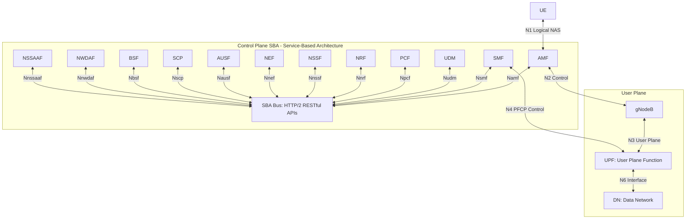
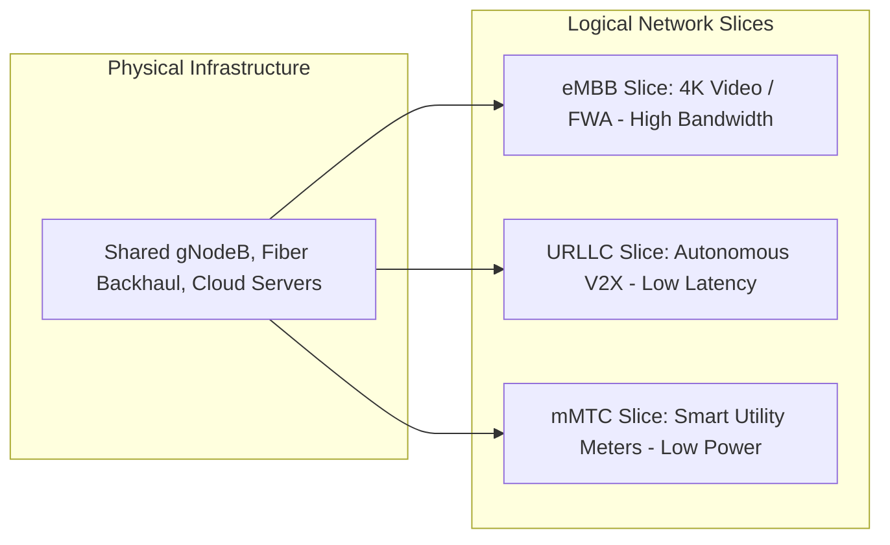

# Unit 3: 5G Network Architecture and Key Features — Comprehensive Study Notes (Updated)

> **SVKM's NMIMS MPSTME — Department of Electronics & Telecommunication Engineering**  
> **Course**: 5G for Everyone (AY 2026–27) | **Target Exam**: Mid-Term 2 (M2) & Final Examinations  
> **Source Grounding**: Aligned with `Unit 3.pptx`, 3GPP Release 15/16/17 Specifications, DoT Guidelines, and Telecom Regulatory Frameworks.

---

## 📋 Table of Contents
1. [Learning Objectives & Syllabus Coverage](#1-learning-objectives--syllabus-coverage)
2. [Master Terminology & Abbreviations](#2-master-terminology--abbreviations)
3. [Module 1: High-Level 5G Network Concepts & System Architecture](#module-1-high-level-5g-network-concepts--system-architecture)
4. [Module 2: Deployment Architectures — Non-Standalone (NSA) vs. Standalone (SA)](#module-2-deployment-architectures--non-standalone-nsa-vs-standalone-sa)
5. [Module 3: The 5G System & Service-Based Architecture (SBA)](#module-3-the-5g-system--service-based-architecture-sba)
6. [Module 4: Key Enabling Technology 1 — Massive MIMO](#module-4-key-enabling-technology-1--massive-mimo)
7. [Module 5: Key Enabling Technology 2 — Beamforming](#module-5-key-enabling-technology-2--beamforming)
8. [Module 6: Key Enabling Technology 3 — OFDM Basics & Flexible Numerology](#module-6-key-enabling-technology-3--ofdm-basics--flexible-numerology)
9. [Module 7: Virtualization & Advanced Concepts — Network Slicing, MEC, SDN, and NFV](#module-7-virtualization--advanced-concepts--network-slicing-mec-sdn-and-nfv)
10. [Module 8: Governance Focus — Infrastructure Sharing, Operator Strategies, and Deployment Challenges](#module-8-governance-focus--infrastructure-sharing-operator-strategies-and-deployment-challenges)
11. [Module 9: 5G Spectrum Bands — Coverage vs. Capacity Trade-Offs](#module-9-5g-spectrum-bands--coverage-vs-capacity-trade-offs)
12. [Section 10: Practice Questions & Complete Model Answers](#section-10-practice-questions--complete-model-answers)
13. [Section 11: Master Glossary](#section-11-master-glossary)
14. [Section 12: Quick Revision Sheet (Exam Cheat-Sheet)](#section-12-quick-revision-sheet-exam-cheat-sheet)
15. [Section 13: Topic-to-Source Coverage Matrix](#section-13-topic-to-source-coverage-matrix)
16. [Section 14: Honest Completeness & Verification Audit](#section-14-honest-completeness--verification-audit)

---

## 1. Learning Objectives & Syllabus Coverage

### 🎯 Learning Objectives (Bloom's Taxonomy Aligned)
Upon studying this module, undergraduate students will be able to:
1. **Analyze (Level 4)** the structural differences between Non-Standalone (NSA Option 3x) and Standalone (SA Option 2) deployment architectures, evaluating control-plane and user-plane split paths.
2. **Explain (Level 2)** the 5G Service-Based Architecture (SBA) and evaluate the individual roles of all 16 Core Network Functions (AMF, SMF, UPF, AUSF, UDM, UDR, UDSF, PCF, NRF, NSSF, NEF, AF, SCP, BSF, NWDAF, NSSAAF) alongside reference point interfaces (N1, N2, N3, N4, N6).
3. **Evaluate (Level 5)** physical layer enabling technologies—Massive MIMO, digital/analog beamforming, and CP-OFDM with flexible numerology ($\Delta f = 15 	imes 2^\mu 	ext{ kHz}$)—calculating slot durations and symbol timings.
4. **Distinguish (Level 4)** between transport-layer SDN, software-virtualized NFV, cellular CUPS, multi-access edge computing (MEC), and end-to-end network slicing.
5. **Appraise (Level 5)** Indian 5G governance, comparing operator deployment strategies (Jio SA 700 MHz vs. Airtel NSA/SA C-band), passive/active infrastructure sharing policies under the Telecommunications Act 2023, and tower fiberization constraints.

---

### 📜 Syllabus Topic Checklist
| Syllabus Topic | Status | Primary Source Reference |
| :--- | :--- | :--- |
| **5G Network Concepts (High-Level)** | Covered | `Unit 3.pptx` (Slides 3–6) |
| **Non-Standalone (NSA) vs. Standalone (SA) Architectures** | Covered | `Unit 3.pptx` (Slides 7–12) |
| **Massive MIMO (Conceptual)** | Covered | `Unit 3.pptx` (Slides 13–16) |
| **Beamforming (Use-Case Driven)** | Covered | `Unit 3.pptx` (Slides 17–20) |
| **OFDM Basics & Flexible Numerology** | Covered | `Unit 3.pptx` (Slides 21–25) |
| **Network Slicing** | Covered | `Unit 3.pptx` (Slides 26–29) |
| **Edge Computing (MEC)** | Covered | `Unit 3.pptx` (Slides 30–32) |
| **Virtualization (SDN & NFV Concepts)** | Covered | `Unit 3.pptx` (Slides 33–36) |
| **Infrastructure Sharing Policies** | Covered | `Unit 3.pptx` (Slides 37–40) |
| **Role of Telecom Operators (Jio, Airtel)** | Covered | `Unit 3.pptx` (Slides 41–44) |
| **Regulatory Challenges & Fiberization** | Covered | `Unit 3.pptx` (Slides 45–48) |
| **5G Spectrum Bands (FR1 vs. FR2 mmWave)** | Covered | `Unit 3.pptx` (Slides 49–52) |

---

## 2. Master Terminology & Abbreviations

| Abbreviation | Expanded Name | Core Function / Significance |
| :--- | :--- | :--- |
| **5GC** | 5G Core Network | Cloud-native, service-based core network for 5G systems. |
| **AF** | Application Function | Interacts with 5GC to request policy, QoS, and routing rules. |
| **AMF** | Access and Mobility Management Function | Replaces 4G MME for registration, connection, and mobility management. |
| **AUSF** | Authentication Server Function | Performs primary security authentication via 3GPP AKA credentials. |
| **BSF** | Binding Support Function | Binds UE IP address to specific PCF instance in multi-PCF networks. |
| **CP-OFDM** | Cyclic Prefix Orthogonal Frequency Division Multiplexing | Baseline downlink/uplink waveform in 5G NR. |
| **CUPS** | Control and User Plane Separation | Architectural decoupling of control signaling from user data packet forwarding. |
| **DCIP** | Digital Connectivity Infrastructure Provider | License category authorizing non-service entities to deploy active/passive infrastructure. |
| **DFT-s-OFDM** | Discrete Fourier Transform-spread-OFDM | Low PAPR uplink waveform optimized for cell-edge power efficiency. |
| **eNodeB** | Evolved Node B | 4G LTE base station. |
| **gNodeB** | Next Generation Node B | 5G New Radio base station. |
| **MEC** | Multi-Access Edge Computing | Moves processing and storage closer to the RAN edge to reduce backhaul latency. |
| **NEF** | Network Exposure Function | Securely exposes 5GC capabilities and events to 3rd-party AFs. |
| **NFV** | Network Functions Virtualization | Decouples network software functions from proprietary hardware onto COTS servers. |
| **NR** | 5G New Radio | The global 3GPP standard for 5G physical air interface. |
| **NRF** | Network Repository Function | Centralized service registry maintaining NF profile discovery in SBA. |
| **NSSAAF** | Network Slice-Specific Authentication & Authorization Function | Handles secondary authentication for enterprise private network slices. |
| **NSSF** | Network Slice Selection Function | Selects appropriate network slice instances for registering UEs. |
| **NWDAF** | Network Data Analytics Function | Collects telemetry to provide AI/ML-driven network analytics and slice predictions. |
| **PCF** | Policy Control Function | Governs unified policy rules, QoS authorization, and charging parameters. |
| **PFCP** | Packet Forwarding Control Protocol | N4 interface protocol used by SMF to control packet handling in UPF. |
| **RAN** | Radio Access Network | Base station infrastructure connecting user devices to the core network. |
| **SA** | Standalone Architecture | Pure 5G architecture pairing gNodeB directly with 5G Core (Option 2). |
| **SBA** | Service-Based Architecture | Modular 5G control plane communicating via HTTP/2 RESTful APIs. |
| **SCP** | Service Communication Proxy | Mediates indirect communication, load balancing, and routing between NFs (Rel-16). |
| **SDN** | Software-Defined Networking | Network architecture separating control plane routing logic from forwarding hardware. |
| **SMF** | Session Management Function | Manages PDU sessions, IP address allocation, and controls UPF via N4. |
| **UDM** | Unified Data Management | Manages subscription profiles, user identity, and authentication credentials. |
| **UDR** | Unified Data Repository | Central database storing structured subscription, policy, and state data. |
| **UDSF** | Unstructured Data Storage Function | Stores dynamic, unstructured operational state data for stateless NFs. |
| **UPF** | User Plane Function | Sole user-plane entity handling packet routing, forwarding, inspection, and QoS. |

---

## Module 1: High-Level 5G Network Concepts & System Architecture

### 1.1 Definition & System Overview
The **5G System (5GS)** is defined by 3GPP (Release 15 and beyond) as an end-to-end telecommunication system comprising the **User Equipment (UE)**, the **Next-Generation Radio Access Network (NG-RAN)**, and the **5G Core Network (5GC)**. 

Unlike legacy 2G/3G/4G networks designed around fixed hardware nodes and circuit/packet switches, the 5G system is architected as a **cloud-native, software-defined, service-based ecosystem**.

```
+-----------------------------------------------------------------------------------+
|                                 5G SYSTEM OVERVIEW                                |
+------------------+----------------------------------+-----------------------------+
| User Equipment   | NG-RAN (Radio Access)            | 5G Core Network (5GC)       |
| (UE)             | - gNodeB (Native 5G NR)          | - Control Plane (SBA NFs)   |
|                  | - ng-eNodeB (Upgraded 4G)        | - User Plane (UPF)          |
+------------------+----------------------------------+-----------------------------+
                            |                                        |
                  Air Interface (Uu)                         Data Network (DN)
```

---

### 1.2 Core Architectural Pillars
1. **Control and User Plane Separation (CUPS)**: Complete functional decoupling of control plane signaling (handled by AMF/SMF) from user plane data transport (handled by UPF). This enables independent scaling and flexible UPF edge placement.
2. **Service-Based Architecture (SBA)**: Control plane functions interact as modular, loosely coupled Service Producers and Consumers over a unified HTTP/2 Service-Based Interface (SBI) bus using JSON serialization.
3. **Access Agnosticism**: The 5GC provides a unified core capable of terminating connections from 3GPP 5G NR, 4G LTE, non-3GPP Wi-Fi (via N3IWF), and Fixed Wireless Access (FWA).
4. **Native Virtualization & Slicing**: Abstracting physical hardware allows the network to be logically partitioned into dynamic, isolated virtual slices customized for eMBB, mMTC, or URLLC.

---

### 1.3 Key Architectural Components
* **User Equipment (UE)**: Mobile devices, IoT sensors, FWA customer premises equipment (CPE), or autonomous vehicle transceivers.
* **NG-RAN**: Consists of **gNodeBs** (providing 5G NR user-plane and control-plane terminations) and **ng-eNodeBs** (upgraded 4G LTE base stations connecting to 5GC).
* **5G Core (5GC)**: The central brain managing access, mobility, session state, security, policy, and data routing.
* **Data Network (DN)**: External or internal networks including the Internet, IP Multimedia Subsystem (IMS), corporate intranets, or local edge computing servers.

---

### 📝 Exam-Answer Key Points: Module 1
* **Definition**: 5GS comprises UE, NG-RAN (gNodeB), and 5GC, operating as a cloud-native, access-agnostic ecosystem.
* **Core Pillars**: CUPS, Service-Based Architecture (SBA), Access Agnosticism, and Native Network Slicing.
* **Interface Split**: Control plane uses RESTful HTTP/2 APIs; user plane uses high-speed GTP-U/IP packet forwarding.

---

## Module 2: Deployment Architectures — Non-Standalone (NSA) vs. Standalone (SA)

To transition from legacy 4G LTE to 5G New Radio, 3GPP defined multiple deployment options. Commercial networks primarily deploy **NSA Option 3x** (for rapid initial rollout) and **SA Option 2** (for full 5G capabilities).

### 2.1 Non-Standalone Architecture (NSA Option 3x)

#### 2.1.1 Working Principle & Protocol Structure
In **NSA Option 3x (EN-DC: E-UTRA-NR Dual Connectivity)**, the network relies on the existing **4G Evolved Packet Core (EPC)** and **4G eNodeB** as the Master Node (MN) for control-plane signaling, while using a **5G en-gNodeB** as the Secondary Node (SN) to accelerate user-plane data throughput.

```
+-----------------------------------------------------------------------------------+
|                        NSA OPTION 3x ARCHITECTURE (EN-DC)                         |
+-----------------------------------------------------------------------------------+

                          +-----------------------+
                          |   4G Core (EPC/MME)   |
                          +-----------------------+
                            /                   \
             Control (S1-MME)                    User Plane (S1-U)
                          /                       \
                         v                         v
               +------------------+  X2-U Split  +------------------+
               | 4G eNodeB (MN)   |<------------->| 5G en-gNodeB(SN) |
               +------------------+               +------------------+
                        \                          /
                LTE Uu   \                        /  NR Uu
                          v                      v
                        +--------------------------+
                        |   Dual-Connected UE      |
                        +--------------------------+
```

#### 2.1.2 Data Path & Traffic Split
* **Control Plane Anchor**: All signaling (RRC, NAS connection, mobility management) routes through the 4G eNodeB to the 4G MME over the **S1-MME** interface.
* **User Plane Split**: High-speed user data arrives from the 4G S-GW directly at the **5G en-gNodeB** over **S1-U**. The 5G en-gNodeB processes packet headers at its PDCP (Packet Data Convergence Protocol) layer and can either transmit data directly to the UE over the NR Uu air interface or route a portion over the **X2-U** interface to the 4G eNodeB for secondary transmission over LTE Uu.

#### 2.1.3 Advantages & Limitations of NSA Option 3x
* **Advantages**:
  1. **Low Initial CAPEX**: Reuses existing 4G EPC core and fiber backhaul investments.
  2. **Fast Market Rollout**: Enables operators to advertise "5G speeds" without waiting for 5GC deployment.
  3. **Seamless Fallback**: Robust coverage maintained by legacy 4G anchor layer.
* **Limitations**:
  1. **No True 5G Core Features**: Cannot support native network slicing, edge UPF placement, or URLLC sub-millisecond core processing.
  2. **Device Battery Drain**: UEs must maintain active dual radio transceivers (LTE + NR simultaneously).
  3. **Complex Signaling**: High inter-node X2 signaling traffic between eNodeB and gNodeB.

---

### 2.2 Standalone Architecture (SA Option 2)

#### 2.2.1 Working Principle & Architecture
In **SA Option 2**, 5G gNodeBs connect directly to a cloud-native **5G Core Network (5GC)**. There is zero dependency on legacy 4G eNodeBs or EPC.

```
+-----------------------------------------------------------------------------------+
|                           SA OPTION 2 ARCHITECTURE                                |
+-----------------------------------------------------------------------------------+

                          +-----------------------+
                          |   5G Core (5GC)       |
                          +-----------------------+
                            /                   \
                     Control (N2)                User Plane (N3)
                          /                       \
                         v                         v
               +------------------+  Xn Interface +------------------+
               |   5G gNodeB      |<------------->|   5G gNodeB      |
               +------------------+               +------------------+
                         \                        /
                          \                      /  NR Uu
                           v                    v
                        +--------------------------+
                        |        5G UE             |
                        +--------------------------+
```

#### 2.2.2 Key Features & Capabilities
* **Native Network Slicing**: End-to-end virtual network partitioning across gNodeB and 5GC.
* **Ultra-Low Latency**: Direct N3 user-plane connection to local UPF and MEC edge servers.
* **Massive IoT (mMTC)**: Direct support for NB-IoT and NR-Light (RedCap) via 5GC signaling.
* **Reduced Energy Consumption**: Eliminates dual-radio UE transmitter drain; gNodeB supports deep sleep modes.

---

### 2.3 Comprehensive Comparison Matrix: NSA vs. SA

| Parameter / Feature | NSA Option 3x (EN-DC) | SA Option 2 |
| :--- | :--- | :--- |
| **Core Network Anchor** | 4G EPC (MME / S-GW / P-GW) | 5G Core (AMF / SMF / UPF) |
| **Master Radio Node** | 4G eNodeB (LTE) | 5G gNodeB (NR) |
| **Control Plane Path** | UE $
ightarrow$ eNodeB $
ightarrow$ S1-MME $
ightarrow$ MME | UE $
ightarrow$ gNodeB $
ightarrow$ N2 $
ightarrow$ AMF |
| **User Plane Path** | S-GW $
ightarrow$ S1-U $
ightarrow$ en-gNodeB (split over X2-U) | UPF $
ightarrow$ N3 $
ightarrow$ gNodeB $
ightarrow$ NR Uu $
ightarrow$ UE |
| **Network Slicing** | Not Supported (Single EPC pipeline) | Supported (End-to-End native slicing) |
| **Latency Performance** | Moderate ($15	ext{--}30	ext{ ms}$ due to EPC & X2 transport) | Ultra-Low ($1	ext{--}5	ext{ ms}$ air-interface + MEC UPF) |
| **UE Battery Drain** | High (Simultaneous LTE + NR dual radio active) | Low (Single active NR radio + DRX sleep) |
| **CAPEX / Deployment** | Low initial cost; fast market rollout | High initial cost; requires full 5GC installation |
| **Primary Target Services** | High-speed eMBB broadband consumer data | Full 5G triangle: eMBB, mMTC, URLLC, FWA, Enterprise |

---

### 📝 Exam-Answer Key Points: Module 2
* **NSA Option 3x**: LTE eNodeB is Control Plane Master; en-gNodeB is User Plane Secondary; anchored to 4G EPC.
* **SA Option 2**: Pure 5G NR gNodeB connected directly to 5G Core (5GC) via N2/N3; unlocks slicing and MEC.
* **Trade-off**: NSA minimizes short-term CAPEX; SA unlocks URLLC, mMTC, and enterprise revenue.

---

## Module 3: The 5G System & Service-Based Architecture (SBA)

### 3.1 5G Core Network Functions (NFs)
The 5G Core Network replaces legacy hardware appliances with modular, virtualized **Network Functions (NFs)** communicating over HTTP/2 RESTful APIs.



#### Detailed Breakdown of Core Functions:

1. **AMF (Access and Mobility Management Function)**:
   * **Purpose**: Replaces the 4G MME for registration, connection, reachability, and mobility management.
   * **Interactions**: Terminates N1 NAS signaling from UE and N2 control signaling from gNodeB. Interacts with SMF, UDM, and PCF.
   * **Example**: When a user turns on their 5G phone, AMF validates security, registers the device, and tracks handovers between cell towers.

2. **SMF (Session Management Function)**:
   * **Purpose**: Handles PDU (Packet Data Unit) session establishment, modification, and release. Allocates UE IP addresses.
   * **Interactions**: Controls UPF packet routing via **N4 (PFCP)**; queries PCF for QoS policy rules.
   * **Example**: When launching a video stream, SMF establishes an active data pipe, assigns an IP address, and programs UPF QoS parameters.

3. **UPF (User Plane Function)**:
   * **Purpose**: The sole user-plane processing entity in 5GC. Performs packet routing, forwarding, inspection, traffic marking, and QoS enforcement.
   * **Interactions**: Connects to gNodeB over **N3**, external Data Networks over **N6**, and SMF over **N4**.
   * **Example**: Routes user web traffic to the Internet while enforcing bandwidth caps (e.g., throttling to 100 Mbps).

4. **AUSF (Authentication Server Function)**:
   * **Purpose**: Acts as the security authentication server executing 3GPP AKA (Authentication and Key Agreement) algorithms.
   * **Interactions**: Receives authentication requests from AMF and fetches security vectors from UDM.
   * **Example**: Verifies SIM card credentials before allowing device attachment to the network.

5. **UDM (Unified Data Management) & UDR (Unified Data Repository)**:
   * **Purpose**: **UDM** processes user credentials, subscription profiles, and access authorization. **UDR** is the decoupled database backend storing subscription data, policy schemas, and state records.
   * **Interactions**: UDM fetches raw data from UDR and serves AMF, SMF, and AUSF.
   * **Example**: Stores whether a subscriber has 5G roaming enabled or a 50 GB monthly data plan limit.

6. **UDSF (Unstructured Data Storage Function)**:
   * **Purpose**: Stores dynamic, unstructured operational state data for stateless NFs, allowing NFs to restart without losing active session state.
   * **Interactions**: Interacts with stateless instances of AMF, SMF, or PCF.

7. **PCF (Policy Control Function)**:
   * **Purpose**: Governs unified policy rules, QoS flow authorization, charging parameters, and slice selection policy (replaces 4G PCRF).
   * **Interactions**: Provides policy decisions to AMF and SMF based on subscription data from UDM.
   * **Example**: Grants a gaming app high-priority scheduling (QoS Flow Indicator 1) when the user subscribes to a gaming pack.

8. **NRF (Network Repository Function)**:
   * **Purpose**: Central service registry providing automated service discovery and status tracking in the SBA.
   * **Interactions**: NFs register their profiles (IP, supported services) with NRF; consumer NFs query NRF to discover available producer NFs.
   * **Example**: When SMF needs a policy decision, it queries NRF to find the IP address of the nearest available PCF instance.

9. **NSSF (Network Slice Selection Function)**:
   * **Purpose**: Selects the specific Network Slice Instances (NSIs) and AMF set to serve a registering UE.
   * **Interactions**: Consulted by AMF during UE registration based on requested S-NSSAI parameters.
   * **Example**: Routes a smart meter connection request to an mMTC slice and an autonomous car request to a URLLC slice.

10. **NEF (Network Exposure Function)**:
    * **Purpose**: Securely exposes 5GC capabilities, event notifications, and analytical insights to authorized third-party Application Functions (AFs).
    * **Interactions**: Translates internal 5GC parameters into external RESTful APIs for enterprise customers.
    * **Example**: Allows a logistics company's app to query the real-time location of a connected delivery truck.

11. **AF (Application Function)**:
    * **Purpose**: Represents internal or external application servers requesting custom network behavior (e.g., dynamic QoS or traffic steering).
    * **Interactions**: Interacts with PCF directly (if trusted) or via NEF (if third-party).
    * **Example**: A video conferencing server requests temporary low-latency scheduling during a high-priority video call.

12. **SCP (Service Communication Proxy) — [3GPP Rel-16]**:
    * **Purpose**: Provides indirect communication, message routing, load balancing, rate limiting, and circuit breaking between NFs in large-scale SBAs.
    * **Interactions**: Mediates all SBI traffic between NF consumers and NF producers, offloading discovery from NRF.
    * **Example**: Prevents network collapse during traffic spikes by load-balancing millions of HTTP/2 requests across a pool of 20 AMF instances.

13. **BSF (Binding Support Function) — [3GPP Rel-15/16]**:
    * **Purpose**: Discovers and binds the specific PCF instance managing a given PDU session / UE IP address in multi-PCF deployments.
    * **Interactions**: Consulted by AF, NEF, or SMF to locate the exact PCF instance handling a specific user IP session.
    * **Example**: When an enterprise AF wants to apply a QoS policy to UE IP `10.240.1.50`, it queries BSF to find which PCF instance owns that session.

14. **NWDAF (Network Data Analytics Function) — [3GPP Rel-15/16/17]**:
    * **Purpose**: Provides operational data analytics, AI/ML-driven network performance insights, slice load predictions, and user mobility forecasts.
    * **Interactions**: Collects telemetry from AMF, SMF, UPF, and OAM; exposes predictions to PCF, NSSF, and AMF.
    * **Example**: Predicts cell congestion at a stadium 30 minutes in advance and instructs PCF to rebalance slice capacity.

15. **NSSAAF (Network Slice-Specific Authentication & Authorization Function) — [3GPP Rel-16]**:
    * **Purpose**: Handles secondary, slice-specific authentication and authorization for enterprise private slices requiring credentials beyond primary 3GPP AKA.
    * **Interactions**: Interacts with enterprise AAA (Authentication, Authorization, Accounting) servers, AMF, and UDM.
    * **Example**: An employee connecting to a corporate bank slice must pass secondary 802.1X/EAP credential checks via NSSAAF and the bank's internal AAA server.

> **Deployment Note**: While AMF, SMF, UPF, UDM, AUSF, and PCF form the mandatory Rel-15 baseline for any commercial 5GC, advanced functions like SCP, BSF, NWDAF, and NSSAAF are optional modules deployed progressively based on network scale and enterprise slicing requirements.

---

### 3.2 Reference Point Interfaces in 5G

```
+-----------------------------------------------------------------------------------+
|                     5G CORE REFERENCE POINT INTERFACES                            |
+-----------------------------------------------------------------------------------+

   UE ---------- (N1: Logical NAS) -----------> AMF
   |                                             |
   +--- (Uu Air) ---> gNodeB --- (N2 Control) ---+
                        |
                     (N3 User)
                        |
                        v
                       UPF <--- (N4 PFCP) ---> SMF
                        |
                     (N6 User)
                        |
                        v
                  Data Network (DN)
```

* **N1**: **Logical** reference point between **UE and AMF** for Non-Access Stratum (NAS) signaling (Registration, Mobility, Connection Management). It is transported transparently over the air (Uu) to gNodeB and encapsulated over N2 to AMF.
* **N2**: Reference point between **NG-RAN (gNodeB)** and **AMF** for Control Plane signaling (NGAP over SCTP/IP).
* **N3**: Reference point between **NG-RAN (gNodeB)** and **UPF** for User Plane data transport (GTP-U encapsulation over UDP/IP).
* **N4**: Reference point between **SMF and UPF** for session control (PFCP - Packet Forwarding Control Protocol over UDP/IP).
* **N6**: Reference point between **UPF and Data Network (DN)** for user-plane IP packet routing.

---

### 3.3 Architecture Evolution: 4G EPC vs. 5G 5GC

| Feature / Aspect | 4G Evolved Packet Core (EPC) | 5G Core Network (5GC) |
| :--- | :--- | :--- |
| **Control Plane Design** | Point-to-point Diameter / GTP-C interfaces | Service-Based Architecture (SBA) via HTTP/2 REST APIs |
| **Mobility & Control Entity** | MME (Monolithic MME node) | AMF (Access/Mobility) & SMF (Session) split |
| **User Plane Entity** | S-GW and P-GW | Single unified UPF (User Plane Function) |
| **Database Architecture** | Monolithic HSS (Credentials + State) | Decoupled UDM (Logic) & UDR (Storage Repository) |
| **Policy Control** | PCRF (Hardware-bound policy engine) | PCF (Cloud-native policy control function) |
| **Core Virtualization** | Hardware appliances or basic VMs | Cloud-native microservices (Containers / Kubernetes) |

---

### 📝 Exam-Answer Key Points: Module 3
* **AMF vs. SMF**: AMF handles registration/mobility (N1/N2); SMF handles IP allocation/session control (N4).
* **UPF**: Sole user plane entity connecting gNodeB (N3) to Data Network (N6).
* **SBA Interface**: NFs communicate over HTTP/2 RESTful APIs with automated discovery via NRF.
* **Interfaces**: N1 (UE-AMF NAS), N2 (RAN-AMF Control), N3 (RAN-UPF User), N4 (SMF-UPF PFCP), N6 (UPF-DN User).

---

## Module 4: Key Enabling Technology 1 — Massive MIMO

### 4.1 Definition & Fundamental Concept
**Massive MIMO (Multiple-Input Multiple-Output)** is an advanced wireless transmit/receive technology where base stations are equipped with a very large array of phase-controlled antenna elements (typically 32T32R, 64T64R, or 128T128R) operating simultaneously on the same frequency channel.

```
Traditional MIMO (4x4)                Massive MIMO (64x64)
   +---+                                +-------------------+
   | | | 4 Antennas                     | | | | | | | | | | | 64 Antennas
   +---+                                | | | | | | | | | | | Array Panel
     |                                  +-------------------+
     v                                    /       |       \
 Broad Sector Coverage               Focused 3D Targeted Beams to Users
```

---

### 4.2 Key Features & Working Principles
1. **Spatial Multiplexing**: Transmits multiple independent data streams simultaneously over the same frequency resource by exploiting distinct spatial propagation paths.
2. **SU-MIMO vs. MU-MIMO**:
   * **Single-User MIMO (SU-MIMO)**: All spatial streams are directed to a single high-capability UE to boost its individual peak data rate.
   * **Multi-User MIMO (MU-MIMO)**: The gNodeB allocates distinct spatial beams to serve multiple separate UEs simultaneously on the exact same time-frequency resource block.
3. **Channel Reciprocity in TDD**:
   * In **Time Division Duplexing (TDD)**, uplink and downlink share the exact same radio frequency. Because the radio channel is symmetric (reciprocal), the gNodeB estimates downlink channel state information (CSI) directly from uplink **Sounding Reference Signals (SRS)** transmitted by the UE, eliminating massive CSI feedback overhead.
4. **Pilot Contamination**:
   * A primary physical limit in multi-cell Massive MIMO. Because the number of orthogonal pilot sequences is limited, neighboring cells reuse identical pilots. Interference from adjacent cell UEs distorts channel estimation, creating inter-cell beam interference.

---

### 4.3 Advantages & Limitations
* **Advantages**:
  * **Capacity Multiplication**: Boosts cell throughput by 3x–10x without acquiring additional spectrum.
  * **Array Gain & Range**: Concentrates RF energy into narrow beams, extending cell-edge coverage.
  * **Interference Rejection**: Null-steering cancels interfering signals from unwanted directions.
* **Limitations**:
  * **Hardware Cost & Weight**: Active Antenna Units (AAUs) require 64 power amplifiers and transceiver chains, increasing tower wind-load and power consumption.
  * **Computational Complexity**: Requires high-performance Digital Signal Processors (DSPs) for real-time matrix inversion ($H^H H)^{-1}$.

---

### 📝 Exam-Answer Key Points: Module 4
* **Massive MIMO**: Uses 32T32R/64T64R active antenna arrays for spatial multiplexing.
* **MU-MIMO**: Serves multiple users concurrently on identical time-frequency resources.
* **TDD Reciprocity**: Uses uplink SRS signals for channel estimation, avoiding CSI feedback overhead.
* **Limitation**: Pilot contamination caused by pilot reuse in neighboring cells.

---

## Module 5: Key Enabling Technology 2 — Beamforming

### 5.1 Definition & Conceptual Distinction
**Beamforming** is a spatial signal processing technique that uses phase and amplitude control across an array of antenna elements to create constructive interference in desired directions and destructive interference (nulls) in unwanted directions.

```
+-----------------------------------------------------------------------------------+
|                        BEAMFORMING VS. SPATIAL MULTIPLEXING                       |
+-----------------------------------------------------------------------------------+

 Beamforming (Signal Energy Focus)          Spatial Multiplexing (Data Parallelism)
        Main Lobe                                    Stream 1 (User A)
          /---\                                          =========>
         /     \                                     Stream 2 (User B)
 gNB ===>| Target|                               gNB ====>=========>
         \     /                                     Stream 3 (User C)
          \---/                                          =========>
      Focuses Power (SINR Boost)                Multiplies Data Throughput
```

* **Conceptual Distinction**:
  * **Beamforming** improves **Signal-to-Interference-plus-Noise Ratio (SINR)** and coverage range by focusing energy toward a specific point.
  * **Spatial Multiplexing** increases **data rate** by transmitting multiple parallel data streams over separate spatial paths.

---

### 5.2 Beamforming Architectures

1. **Digital Beamforming**:
   * Baseband digital processing applies unique phase and amplitude weights to every individual antenna element.
   * *Pros*: Maximum flexibility, supports full MU-MIMO spatial streams.
   * *Cons*: High power consumption and cost (requires one dedicated Digital-to-Analog Converter / ADC per antenna).
2. **Analog Beamforming**:
   * Phase shifters apply phase adjustments in the RF domain after a single DAC/power amplifier chain.
   * *Pros*: Low cost and low power consumption; ideal for millimeter-wave (mmWave) phase arrays.
   * *Cons*: Can only form a single directional beam per RF chain at any given moment.
3. **Hybrid Beamforming**:
   * Combines digital baseband processing (for multi-stream MU-MIMO) with analog RF phase shifters (for narrow mmWave pencil beams). This is the standard architecture for 5G mmWave gNodeBs.

---

### 5.3 Use Cases & Performance Benefits
* **Use Case 1: mmWave Path Loss Compensation**: High-frequency mmWave signals (26 GHz) suffer extreme free-space path loss and rain attenuation. Narrow grid-of-beams focusing restores link budget.
* **Use Case 2: High-Speed Train Tracking**: Dynamic digital beam-tracking continuously sweeps beams to follow moving vehicles at 300 km/h.
* **Use Case 3: Null Steering for Interference Cancellation**: Creates radiation nulls (zero energy) in the direction of known co-channel interferences.

---

### 📝 Exam-Answer Key Points: Module 5
* **Beamforming**: Directional energy focusing via antenna phase control; boosts SINR.
* **Hybrid Beamforming**: Digital baseband precoding + analog RF phase shifting (standard for mmWave).
* **Key Difference**: Beamforming improves signal quality (SINR); spatial multiplexing multiplies capacity (bits/s/Hz).

---

## Module 6: Key Enabling Technology 3 — OFDM Basics & Flexible Numerology

### 6.1 OFDM Working Principle & Orthogonality
**Orthogonal Frequency Division Multiplexing (OFDM)** is a multicarrier digital modulation scheme that divides a wideband channel into multiple closely spaced, orthogonal narrowband subcarriers.

```
Frequency Domain View of Orthogonal Subcarriers:
Peak of Subcarrier 1 aligns with Nulls of Subcarrier 2 and 3

        Subcarrier 1       Subcarrier 2       Subcarrier 3
           /\                 /\                 /\
          /  \               /  \               /  \
  _______/____\_____________/____\_____________/____\_______ Frequency
         | Zero               | Zero               | Zero
```

* **Mathematical Condition for Orthogonality**: Two subcarriers with spacing $\Delta f$ are mathematically orthogonal over a symbol period $T_{symbol} = 1/\Delta f$ if:
  $$\int_{0}^{T_{symbol}} e^{j 2 \pi f_m t} \cdot e^{-j 2 \pi f_n t} \, dt = 0 \quad (	ext{for } m 
eq n)$$
  Because subcarrier spectral peaks coincide precisely with the zero-crossing nulls of adjacent subcarriers, they overlap closely without Inter-Carrier Interference (ICI).

---

### 6.2 The Cyclic Prefix (CP) & Multipath Mitigation
In wireless channels, radio signals reflect off obstacles, creating delayed multipath echoes that cause **Inter-Symbol Interference (ISI)**.

```
Cyclic Prefix Insertion:
Original OFDM Symbol Duration (Tsymbol)
[==========================================]
                \                         /
                 \                       /  Copy end of symbol
                  v                     v   and prepend to front
[ Cyclic Prefix (Tcp) | Original Symbol Duration (Tsymbol) ]
|<-------------- Total Symbol Duration (Ttotal) ------>|
```

* **Role of Cyclic Prefix**: A copy of the tail end of the OFDM symbol (duration $T_{cp}$) is prepended to the front of the symbol.
* **Protection Condition**: To completely eliminate ISI and preserve subcarrier orthogonality, the cyclic prefix duration must exceed the maximum multipath delay spread of the physical channel:
  $$	au_{max} \le T_{cp}$$
* **Symbol Timings**:
  * Useful Symbol Duration: $T_{symbol} = rac{1}{\Delta f}$
  * Total Symbol Duration: $T_{total} = T_{symbol} + T_{cp}$

---

### 6.3 5G NR Flexible Numerology ($\Delta f = 15 	imes 2^\mu 	ext{ kHz}$)
Unlike 4G LTE, which fixed subcarrier spacing at $15	ext{ kHz}$, 5G New Radio introduces **flexible numerology** defined by the parameter $\mu \in \{0, 1, 2, 3, 4\}$.

$$\Delta f = 15 	imes 2^\mu 	ext{ kHz}$$

#### Worked Example Table: 5G NR Numerologies

| Numerology ($\mu$) | Subcarrier Spacing ($\Delta f$) | Useful Symbol Duration ($T_{symbol}$) | Slots per Subframe ($1	ext{ ms}$) | Slot Duration | Frequency Band & Typical Application |
| :---: | :---: | :---: | :---: | :---: | :--- |
| **0** | **$15	ext{ kHz}$** | $66.67\ \mu	ext{s}$ | 1 slot | $1	ext{ ms}$ | **FR1 (<1 GHz)**: Macro-cells, wide area rural coverage, deep penetration. |
| **1** | **$30	ext{ kHz}$** | $33.33\ \mu	ext{s}$ | 2 slots | $0.5	ext{ ms}$ | **FR1 (1–6 GHz)**: C-band (3.5 GHz) urban coverage, eMBB default. |
| **2** | **$60	ext{ kHz}$** | $16.67\ \mu	ext{s}$ | 4 slots | $0.25	ext{ ms}$ | **FR1 & FR2**: Dense urban hotspots, URLLC low-latency slots. |
| **3** | **$120	ext{ kHz}$** | $8.33\ \mu	ext{s}$ | 8 slots | $0.125	ext{ ms}$ | **FR2 (26/28 GHz mmWave)**: Multi-gigabit extreme capacity. |
| **4** | **$240	ext{ kHz}$** | $4.17\ \mu	ext{s}$ | 16 slots | $0.0625	ext{ ms}$ | **FR2 (mmWave)**: SS/PBCH beam-sweeping synchronization blocks. |

*Note*: Each standard 5G slot contains **14 OFDM symbols** for normal Cyclic Prefix.

#### 6.3.1 Engineering Trade-Offs in Subcarrier Spacing
1. **Higher Subcarrier Spacing ($\Delta f = 120	ext{ kHz}$)**:
   * *Advantage*: Extremely short symbol duration ($8.33\ \mu	ext{s}$) enables low latency and combats Phase Noise in high-frequency mmWave bands.
   * *Disadvantage*: Shorter $T_{cp}$ duration makes the signal vulnerable to ISI in large macro-cells with high delay spreads.
2. **Lower Subcarrier Spacing ($\Delta f = 15	ext{ kHz}$)**:
   * *Advantage*: Long symbol duration ($66.67\ \mu	ext{s}$) and long $T_{cp}$ absorb large multipath delays in rural macro-cells.
   * *Disadvantage*: Longer slot duration increases air-interface latency; highly sensitive to Doppler shift at high speeds.

---

### 6.4 Uplink Waveforms: CP-OFDM vs. DFT-s-OFDM
* **CP-OFDM (Cyclic Prefix OFDM)**: Default waveform for downlink and high-throughput uplink. High spectral efficiency, supports MIMO spatial multiplexing, but suffers from high **Peak-to-Average Power Ratio (PAPR)**.
* **DFT-s-OFDM (Discrete Fourier Transform-spread OFDM)**: Optional uplink waveform (similar to 4G SC-FDMA). Pre-codes symbols with a DFT matrix to generate a single-carrier signal.
  * *Advantage*: Significantly lower PAPR, allowing mobile power amplifiers to run efficiently, extending battery life and cell-edge coverage.

---

### 6.5 Traditional FDM vs. 5G CP-OFDM

| Feature | Traditional FDM | 5G CP-OFDM |
| :--- | :--- | :--- |
| **Subcarrier Spacing** | Wide guard bands required between channels | Overlapping orthogonal subcarriers (Zero guard bands) |
| **Spectral Efficiency** | Low (Bandwidth wasted on guard bands) | High (Maximizes bits/s/Hz) |
| **Multipath Mitigation** | Requires complex time-domain equalizers | Prepend Cyclic Prefix ($T_{cp} \ge 	au_{max}$) |
| **Hardware Realization** | Individual analog RF tuners per band | Single IFFT/FFT digital processing block |

---

### 📝 Exam-Answer Key Points: Module 6
* **Orthogonality**: Subcarriers spaced at $\Delta f = 1/T_{symbol}$; peaks match zero-crossings of adjacent subcarriers.
* **CP Condition**: $T_{cp} \ge 	au_{max}$ prevents ISI caused by multipath delay spread.
* **Flexible Numerology**: $\Delta f = 15 	imes 2^\mu 	ext{ kHz}$; higher $\mu$ reduces slot time for URLLC/mmWave.
* **DFT-s-OFDM**: Low PAPR uplink waveform used at cell edges to save battery power.

---

## Module 7: Virtualization & Advanced Concepts — Network Slicing, MEC, SDN, and NFV

### 7.1 5G Network Slicing

#### 7.1.1 Concept & Architecture
**Network Slicing** is a technique that logically partitions a single shared physical 5G network infrastructure into multiple isolated, end-to-end virtual networks tailored to specific Quality of Service (QoS) requirements.



#### 7.1.2 Identification & Isolation Mechanisms
* **S-NSSAI (Single Network Slice Selection Assistance Information)**: Identifies a network slice. It consists of:
  1. **SST (Slice/Service Type)**: 8-bit integer defining standardized slice behavior:
     * **SST = 1**: eMBB (Enhanced Mobile Broadband)
     * **SST = 2**: URLLC (Ultra-Reliable Low Latency Communications)
     * **SST = 3**: mMTC (Massive IoT)
     * **SST = 4**: V2X (Vehicle-to-Everything)
  2. **SD (Slice Differentiator)**: Optional 24-bit field separating tenant slices (e.g., distinguishing Airtel's public eMBB slice from a private enterprise slice).
* **Slice Isolation Realities**: While slices provide logical isolation, true physical isolation requires dedicated Radio Resource Management (RRM) scheduling at the gNodeB and container/hypervisor security boundaries at the core server level.

---

### 7.2 Multi-Access Edge Computing (MEC)

#### 7.2.1 Working Principle
**Multi-Access Edge Computing (MEC)** relocates cloud computing, storage, and application processing from centralized national data centers to edge nodes directly adjacent to the gNodeB base station.

```
Centralized Cloud Processing (Legacy 4G)
UE <---> gNB <---> Fiber Backhaul (100km+) <---> Core <---> Central Cloud (Latency: 30-50ms)

Edge Computing Processing (5G MEC)
UE <---> gNB <---> Local UPF + Local MEC Server (Latency: 1-5ms)
```

#### 7.2.2 Latency Disambiguation
* **Air-Interface Latency**: Over-the-air radio transmission delay between UE and gNodeB ($\le 1	ext{ ms}$ target for URLLC short slots).
* **End-to-End (E2E) Application Latency**: Total round-trip time from UE through RAN, backhaul, core, and application server. 
* **Role of MEC**: Without MEC, backhaul transport adds $15	ext{--}40	ext{ ms}$ delay regardless of air-interface speed. MEC reduces E2E latency to $2	ext{--}5	ext{ ms}$ by terminating user plane data locally via a local **User Plane Function (UPF)** over interface **N6**.

---

### 7.3 Virtualization: SDN vs. NFV vs. CUPS

| Technology | Core Definition & Primary Layer | Primary Function / Purpose | Mobile Network Context |
| :--- | :--- | :--- | :--- |
| **SDN** *(Software-Defined Networking)* | **Transport Layer**: Architectural framework separating the Control Plane (routing decisions) from Data Forwarding Hardware. | Centralized software controller dynamically programs IP routers and Ethernet switches (e.g., via OpenFlow). | Automates optical backhaul routing and dynamic transport slice configuration. |
| **NFV** *(Network Functions Virtualization)* | **Infrastructure Layer**: Decoupling network software functions from proprietary middlebox hardware. | Runs network functions as virtual machines (VMs) or cloud-native microservices on COTS x86 servers. | Replaces proprietary hardware nodes with virtualized AMF, SMF, and UPF container instances. |
| **CUPS** *(Control & User Plane Split)* | **3GPP Cellular Architecture**: Decoupling mobile control signaling from packet payload forwarding. | Allows independent placement and scaling of control nodes (AMF/SMF) and user nodes (UPF). | Enables local UPF placement at edge MEC sites while keeping AMF/SMF centralized. |

---

### 📝 Exam-Answer Key Points: Module 7
* **Network Slicing**: Logical virtual networks over shared hardware identified by S-NSSAI (SST + SD).
* **MEC**: Local UPF placement near gNodeB; eliminates $20	ext{--}40	ext{ ms}$ backhaul propagation delay.
* **SDN vs. NFV**: SDN decouples transport routing from switches; NFV turns hardware nodes into software virtual instances on COTS servers.

---

## Module 8: Governance Focus — Infrastructure Sharing, Operator Strategies, and Deployment Challenges

### 8.1 Infrastructure Sharing Policies in India

Infrastructure sharing reduces capital expenditure (CAPEX) and operational expenditure (OPEX), accelerating coverage expansion in low-ARPU rural regions. Indian policy under the **Telecommunications Act, 2023** explicitly demarcates infrastructure sharing:

#### 8.1.1 Passive Infrastructure Sharing
* **Definition**: Sharing non-electronic physical assets including tower structures, dark fiber, duct space, equipment shelters, battery power plants, and street utility poles.
* **Licensing**: Allowed under **Infrastructure Provider Category-I (IP-I)** registration and expanded under the new **Digital Connectivity Infrastructure Provider (DCIP)** authorization framework.

#### 8.1.2 Active Infrastructure Sharing
* **Definition**: Sharing functional radio frequency electronic hardware, including active transceivers, gNodeB radio units, backhaul links, and antenna arrays.
* **Architectural Models**:
  1. **MORAN (Multi-Operator Radio Access Network)**: Operators share physical gNodeB antenna arrays and towers, but maintain separate dedicated RF carrier frequencies and core networks.
  2. **MOCN (Multi-Operator Core Network)**: Operators share physical radio towers, antenna arrays, **AND the same RF spectrum band**, routing traffic back to separate core networks.

---

### 8.2 Operator Deployment Strategies in India

The Indian 5G market landscape reflects distinct architectural choices made during the August 2022 spectrum auctions:

* **Reliance Jio Infocomm Limited (RJIL)**:
  * *Strategy*: Deployed pure **Standalone 5G (SA Option 2)** ("True 5G").
  * *Spectrum Anchor*: Acquired nationwide **700 MHz (n28)** low-band spectrum ($2 	imes 10	ext{ MHz}$ blocks) to serve as a low-frequency coverage anchor for deep indoor penetration and wide rural coverage, combined with **3300 MHz (n78)** C-band and **26 GHz (n258)** mmWave.
  * *Core Network*: Deployed an indigenous, cloud-native 5G Core.
* **Bharti Airtel Limited**:
  * *Strategy*: Deployed **Non-Standalone 5G (NSA Option 3x)** initially, with a software path to SA.
  * *Spectrum Anchor*: Utilized existing 1800/2100 MHz LTE spectrum as control plane anchors paired with **3300 MHz (n78)** mid-band and **26 GHz (n258)** mmWave for data boost.
  * *Advantage*: Minimal initial CAPEX, rapid coverage expansion, zero service disruption to 4G subscribers.

---

### 8.3 Key Regulatory & Deployment Challenges in India

1. **The Tower Fiberization Bottleneck**:
   * *Status*: At 5G launch (2022), India's cell tower fiberization baseline stood at **~35%–38%** (below 50%), far behind the National Digital Communications Policy (NDCP) target of **70% fiberization**.
   * *Impact*: Unfiberized towers relying on microwave backhaul create bottleneck throughput caps, preventing 5G cell sites from delivering gigabit speeds.
2. **Right of Way (RoW) Approvals**:
   * Deploying high-density mmWave small cells on streetlamps, electricity poles, and bus shelters requires permissions across hundreds of municipal corporations. The **Telecommunications RoW Rules, 2024** established standardized fee structures and binding approval timelines to eliminate local administrative delays.

---

### 📝 Exam-Answer Key Points: Module 8
* **Passive vs. Active Sharing**: Passive = towers/fiber (IP-I/DCIP); Active = MORAN (shared RAN, separate spectrum) vs. MOCN (shared RAN + shared spectrum).
* **Operator Strategies**: Jio = SA Option 2 with 700 MHz low-band anchor; Airtel = NSA Option 3x with 1800/3300 MHz mid-band.
* **Fiberization Target**: Moving from ~35-38% baseline to 70% national target to prevent backhaul bottlenecks.

---

## Module 9: 5G Spectrum Bands — Coverage vs. Capacity Trade-Offs

### 9.1 3GPP Frequency Ranges (FR1 vs. FR2)

```
+-----------------------------------------------------------------------------------+
|                        5G SPECTRUM FREQUENCY RANGES                               |
+-----------------------------------------------------------------------------------+

  FR1: Sub-6 GHz (Sub-7 GHz Extended)               FR2: mmWave (Millimeter Wave)
  410 MHz --------------------- 7.125 GHz          24.25 GHz ---------------- 52.6 GHz
  [ Low-Band ]     [ Mid-Band / C-Band ]            [ High-Band mmWave ]
  Coverage Layer     Capacity & Speed Layer           Extreme Hotspot Density
```

* **FR1 (Frequency Range 1)**: $410	ext{ MHz}$ to $7125	ext{ MHz}$ (Sub-6 GHz / Sub-7 GHz). Baseline layer for coverage and capacity.
* **FR2 (Frequency Range 2)**: $24.25	ext{ GHz}$ to $52.6	ext{ GHz}$ (mmWave). High-throughput layer for dense urban hotspots and industrial enterprise networks.

---

### 9.2 Spectrum Tier Characteristics

| Spectrum Tier | Frequency Range | Channel Bandwidth | Coverage Distance | Propagation & Penetration | Primary Use Case |
| :--- | :--- | :--- | :--- | :--- | :--- |
| **Low-Band** | $< 1	ext{ GHz}$ (e.g., 600, 700, 800 MHz) | $5	ext{--}20	ext{ MHz}$ | Very Large ($10	ext{--}20	ext{ km}$) | Excellent indoor building penetration; low path loss. | Blanket rural coverage, wide-area mobility, deep indoor coverage. |
| **Mid-Band (C-Band)** | $1	ext{--}6	ext{ GHz}$ (e.g., 3.3–3.8 GHz n78) | $40	ext{--}100	ext{ MHz}$ | Medium ($1	ext{--}3	ext{ km}$) | Moderate propagation; requires Massive MIMO beamforming. | City-wide eMBB mobile broadband, balanced capacity/coverage. |
| **High-Band (mmWave)** | $> 24	ext{ GHz}$ (e.g., 26, 28, 39 GHz) | $100	ext{--}400	ext{ MHz}$ | Short ($100	ext{--}500	ext{ m}$) | Poor penetration (blocked by walls/foliage); high atmospheric attenuation. | Stadiums, dense urban hotspots, 5G FWA, captive private factories. |

---

### 📝 Exam-Answer Key Points: Module 9
* **FR1 vs. FR2**: FR1 (410 MHz–7.125 GHz) = coverage/capacity; FR2 (24.25 GHz–52.6 GHz) = mmWave extreme throughput.
* **Low-Band (700 MHz)**: Blanket coverage and indoor penetration (Jio anchor).
* **Mid-Band (3.5 GHz)**: Sweet spot for 5G eMBB capacity ($100	ext{ MHz}$ channel bandwidth).
* **High-Band (26 GHz)**: mmWave short range ($<300	ext{ m}$) for high-density hotspots and FWA.

---

## Section 10: Practice Questions & Complete Model Answers

> **Note**: These are syllabus-based practice questions designed for exam preparation, NOT previous-year examination questions (PYQs). Suggested marks indicate expected answer depth.

### 10.1 Short-Answer Practice Questions (2 Marks)

#### Q1.1: State two major operational differences between NSA Option 3x and SA Option 2 architectures.
* **Model Answer**:
  1. **Core Network Dependency**: NSA Option 3x relies on the legacy 4G Evolved Packet Core (EPC) for control signaling, whereas SA Option 2 connects directly to a cloud-native 5G Core (5GC).
  2. **Service Capabilities**: NSA Option 3x is restricted primarily to high-speed eMBB broadband, whereas SA Option 2 supports native Network Slicing, MEC integration, URLLC, and mMTC.

#### Q1.2: Define Control and User Plane Separation (CUPS) and name the 5G Core entities involved.
* **Model Answer**:
  CUPS is an architectural principle that decouples control plane signaling logic from user plane data packet forwarding. In the 5G Core, control signaling is managed by the **AMF** (Access & Mobility) and **SMF** (Session Management), while packet routing and forwarding are handled independently by the **UPF** (User Plane Function) controlled via the N4 (PFCP) interface.

#### Q1.3: Differentiate between Single-User MIMO (SU-MIMO) and Multi-User MIMO (MU-MIMO).
* **Model Answer**:
  In **SU-MIMO**, all spatial data streams from a base station antenna array are directed to a single user device to maximize its individual peak throughput. In **MU-MIMO**, the antenna array forms distinct directional spatial beams to serve multiple separate user devices simultaneously on the exact same time-frequency resource block, multiplying total cell capacity.

#### Q1.4: State the 5G NR flexible numerology formula and calculate subcarrier spacing for $\mu = 2$.
* **Model Answer**:
  The formula is $\Delta f = 15 	imes 2^\mu 	ext{ kHz}$.  
  For $\mu = 2$:  
  $$\Delta f = 15 	imes 2^2 = 15 	imes 4 = 60	ext{ kHz}$$  
  Useful symbol duration $T_{symbol} = 1/60	ext{ kHz} = 16.67\ \mu	ext{s}$.

#### Q1.5: Explain why a Cyclic Prefix (CP) is prepended to an OFDM symbol and state its mathematical condition.
* **Model Answer**:
  A Cyclic Prefix (copy of the symbol tail) is prepended to eliminate Inter-Symbol Interference (ISI) caused by multipath channel delay spread and preserve subcarrier orthogonality. The mathematical condition is $T_{cp} \ge 	au_{max}$, where $T_{cp}$ is the CP duration and $	au_{max}$ is the maximum channel delay spread.

---

### 10.2 Medium Explanatory & Analytical Practice Questions (4–5 Marks)

#### Q2.1: Explain the 5G Service-Based Architecture (SBA). Describe the roles of NRF, NEF, and PCF.
* **Model Answer**:
  The **Service-Based Architecture (SBA)** is the cloud-native control plane design of the 5G Core where modular Network Functions (NFs) act as Service Producers and Consumers, communicating over unified HTTP/2 RESTful APIs.
  * **NRF (Network Repository Function)**: Acts as the central service registry. NFs register their IP profiles with NRF, allowing other NFs to dynamically discover available service producers without hardcoded configurations.
  * **NEF (Network Exposure Function)**: Securely exposes 5GC capabilities, events, and analytics to authorized third-party Application Functions (AFs) via external RESTful APIs.
  * **PCF (Policy Control Function)**: Governs unified policy rules, QoS flow parameters, slice access policies, and subscription charging rules, instructing AMF and SMF on policy enforcement.

#### Q2.2: Compare Digital, Analog, and Hybrid Beamforming architectures. Why is Hybrid Beamforming preferred for 5G mmWave systems?
* **Model Answer**:
  * **Digital Beamforming**: Applies phase/amplitude precoding in the digital baseband. Offers maximum flexibility and full MU-MIMO spatial streaming, but suffers from extreme power consumption and cost because every antenna requires a dedicated RF/DAC chain.
  * **Analog Beamforming**: Applies phase adjustments in the RF domain using analog phase shifters after a single power amplifier. Low cost and low power, but can form only one beam per RF chain at a time.
  * **Hybrid Beamforming**: Combines digital baseband processing (for multi-stream spatial multiplexing) with analog RF phase shifters (for narrow directional pencil beams).
  * **Why Preferred for mmWave**: mmWave active antenna arrays contain 128 to 256 elements. Implementing full digital beamforming would create unsustainable power and thermal loads. Hybrid beamforming achieves high array gain to overcome mmWave path loss while keeping hardware cost and power consumption manageable.

#### Q2.3: Explain the role of Multi-Access Edge Computing (MEC) in achieving low end-to-end latency. Distinguish between radio-interface latency and end-to-end latency.
* **Model Answer**:
  * **Radio-Interface Latency**: The over-the-air transmission time between the UE and gNodeB antenna ($\le 1	ext{ ms}$ target for URLLC short slots).
  * **End-to-End (E2E) Latency**: The total round-trip time experienced by an application, including air interface, RAN processing, backhaul transport, core routing, and application server response.
  * **Role of MEC**: In legacy networks, backhaul fiber transport to a centralized national data center adds $20	ext{--}50	ext{ ms}$ of propagation delay, rendering $1	ext{ ms}$ air-interface speeds useless for real-time applications. MEC places a local **User Plane Function (UPF)** and edge compute servers directly adjacent to the gNodeB. User data is steered locally over interface **N6**, bypassing long backhaul loops and reducing total E2E application latency to $2	ext{--}5	ext{ ms}$.

#### Q2.4: Discuss the deployment strategies of Reliance Jio and Bharti Airtel during India's 5G rollout, highlighting spectrum holdings and architectural choices.
* **Model Answer**:
  * **Reliance Jio**:
    * *Architecture*: Deployed pure **Standalone 5G (SA Option 2)** ("True 5G") with a cloud-native 5GC.
    * *Spectrum Strategy*: Acquired $700	ext{ MHz}$ (n28) low-band spectrum ($2 	imes 10	ext{ MHz}$ nationwide) as a primary coverage anchor to provide deep indoor penetration and wide rural coverage, combined with $3300	ext{ MHz}$ C-band ($100	ext{ MHz}$) and $26	ext{ GHz}$ mmWave ($1000	ext{ MHz}$).
  * **Bharti Airtel**:
    * *Architecture*: Deployed **Non-Standalone 5G (NSA Option 3x)** initially, providing a smooth transition path to SA.
    * *Spectrum Strategy*: Utilized existing 1800/2100 MHz mid-band spectrum as LTE control plane anchors, paired with $3300	ext{ MHz}$ C-band ($100	ext{ MHz}$) and $26	ext{ GHz}$ mmWave. This minimized initial CAPEX and allowed rapid city-wide rollout.

---

### 10.3 Long Essay & Scenario-Based Practice Questions (8–10 Marks)

#### Q3.1: Comprehensive Essay on the 5G Core Architecture.
1. Draw a neat diagram of the 5G Service-Based Architecture (SBA).
2. Detail the exact control plane and user plane interfaces (N1, N2, N3, N4, N6).
3. Explain how CUPS enables edge processing and contrast 5GC with 4G EPC.

* **Model Answer**:

**1. 5G SBA Architecture Diagram**:
*(Refer to Module 3.1 Mermaid / ASCII diagram showing Control Plane SBA NFs connected to SBI bus, with UPF connected via N3 to gNodeB, N4 to SMF, and N6 to Data Network).*

**2. Core Reference Interfaces**:
* **N1**: Logical NAS signaling reference point between UE and AMF for registration, mobility, and session signaling.
* **N2**: Control plane interface between gNodeB and AMF running NGAP over SCTP/IP.
* **N3**: User plane interface between gNodeB and UPF carrying encapsulated user data over GTP-U/UDP/IP.
* **N4**: Session control interface between SMF and UPF running Packet Forwarding Control Protocol (PFCP) to program packet inspection, QoS, and forwarding rules.
* **N6**: User plane interface connecting UPF to external or internal Data Networks (DN).

**3. CUPS & Architectural Contrast**:
* **How CUPS Enables Edge Processing**: By decoupling control logic (SMF) from packet processing (UPF), the centralized SMF can dynamically program a distributed local UPF deployed at an edge site via N4. User data traffic is broken out locally at the edge UPF over N6, achieving ultra-low application latency without replicating control plane functions.
* **4G EPC vs. 5G 5GC Contrast**:
  * 4G relies on point-to-point GTP-C/Diameter interfaces between monolithic hardware appliances (MME, S-GW, P-GW, HSS). 5G uses cloud-native microservices communicating over HTTP/2 RESTful APIs (SBA).
  * 4G couples session and mobility in MME; 5G splits mobility (AMF) from session management (SMF).
  * 4G database (HSS) is monolithic; 5G decouples processing logic (UDM) from structured storage (UDR).

#### Q3.2 (Scenario-Based Application Question):
An industrial port authority in India wants to deploy a 5G private network across its docks to support three distinct operations:
* *Operation A*: 4K Ultra-HD security cameras streaming continuous surveillance footage to a central monitoring room.
* *Operation B*: 50,000 automated container tracking sensors reporting location and temperature once every hour.
* *Operation C*: Tele-operated autonomous gantry cranes requiring continuous haptic control with sub-5 ms round-trip response time.

1. Assign the appropriate 5G Service Class (eMBB, mMTC, URLLC) and 3GPP S-NSSAI Slice Type (SST) to each operation.
2. Select the optimal architectural deployment option (NSA Option 3x vs. SA Option 2) and justify your choice.
3. Propose the physical spectrum tier (Low-Band, Mid-Band, High-Band mmWave) and edge deployment strategy required for Operation C.

* **Model Answer**:

**1. Service Class & Slice Mapping**:
* **Operation A (4K Video Surveillance)**: **eMBB (Enhanced Mobile Broadband)** $
ightarrow$ **SST = 1**. Requires high sustained uplink bandwidth ($20	ext{--}50	ext{ Mbps}$ per camera stream).
* **Operation B (Container Tracking Sensors)**: **mMTC (Massive Machine-Type Communications)** $
ightarrow$ **SST = 3**. High device density ($50,000	ext{ nodes}$), small intermittent payloads, low power consumption.
* **Operation C (Autonomous Cranes)**: **URLLC (Ultra-Reliable Low Latency Communications)** $
ightarrow$ **SST = 2**. Requires $99.999\%$ transmission reliability and sub-5 ms round-trip latency.

**2. Deployment Architecture Selection**:
* **Selected Option**: **SA Option 2 (Standalone 5G Core)**.
* **Justification**: NSA Option 3x relies on a 4G EPC core and cannot support native end-to-end Network Slicing (required to isolate Operation C's crane controls from Operation A's heavy video traffic). Furthermore, NSA's X2 backhaul anchor adds $15	ext{--}25	ext{ ms}$ latency, failing Operation C's sub-5 ms requirement. SA Option 2 provides native slicing and local UPF integration.

**3. Spectrum Tier & Edge Strategy for Operation C**:
* **Spectrum Tier**: **High-Band mmWave ($26	ext{ GHz}$ / n258)** or **Mid-Band ($3.5	ext{ GHz}$ n78)**. High-Band mmWave provides wide channel bandwidth ($100	ext{--}400	ext{ MHz}$), short slot durations ($\mu=3, \Delta f=120	ext{ kHz}, T_{slot}=0.125	ext{ ms}$), and precise beamforming inside the port perimeter.
* **Edge Strategy**: Deploy an **on-site MEC node** with a local **User Plane Function (UPF)** within the port network. Operation C's control signals break out directly at the local UPF over interface N6 to the port's edge crane control server, eliminating backhaul propagation delays.

---

## Section 11: Master Glossary

1. **Active Infrastructure Sharing**: Sharing electronic radio equipment (gNodeB transceivers, backhaul, antenna arrays) between operators.
2. **AMF (Access & Mobility Management Function)**: 5GC control node managing UE registration, connection, and mobility.
3. **AUSF (Authentication Server Function)**: 5GC node executing 3GPP AKA primary security authentication algorithms.
4. **Beamforming**: Spatial processing technique focusing RF signal energy toward specific targets using phase-controlled arrays.
5. **BSF (Binding Support Function)**: 5GC node binding UE IP addresses to specific PCF instances in multi-PCF deployments.
6. **CP-OFDM**: Baseline 5G waveform using cyclic prefix prepending to eliminate multipath ISI.
7. **CUPS (Control & User Plane Split)**: Architectural decoupling of control signaling from user packet forwarding.
8. **DCIP**: Digital Connectivity Infrastructure Provider authorization category under Indian telecom rules.
9. **DFT-s-OFDM**: Low PAPR uplink waveform used to preserve cell-edge mobile battery power.
10. **E2E Latency**: Total round-trip time from user device through RAN, core, and application server.
11. **eNodeB**: Legacy 4G LTE base station.
12. **gNodeB**: Native 5G New Radio base station.
13. **Hybrid Beamforming**: Architecture combining digital baseband precoding with analog RF phase shifters.
14. **Massive MIMO**: Large-scale antenna arrays (32T32R/64T64R) exploiting spatial multiplexing.
15. **MEC (Multi-Access Edge Computing)**: Processing infrastructure deployed at the network edge near gNodeB.
16. **MOCN**: Active sharing model where operators share radio equipment AND spectrum.
17. **MORAN**: Active sharing model where operators share radio equipment but use separate RF spectrum.
18. **NEF (Network Exposure Function)**: 5GC node securely exposing APIs to third-party application functions.
19. **NFV**: Virtualization framework running software network functions on COTS x86 servers.
20. **NRF (Network Repository Function)**: Central service discovery registry for 5GC Service-Based Architecture.
21. **NSA Option 3x**: Dual-connectivity deployment using 4G LTE anchor and EPC core with 5G NR data boost.
22. **NSSAAF**: 5GC node handling secondary, slice-specific authentication for enterprise private networks.
23. **NSSF**: 5GC node selecting appropriate Network Slice Instances (NSIs) for registering UEs.
24. **NWDAF**: 5GC analytics node providing AI/ML-driven network performance and slice load predictions.
25. **Passive Infrastructure Sharing**: Sharing non-electronic physical assets (towers, dark fiber, duct space).
26. **PCF (Policy Control Function)**: 5GC node governing unified policy rules, QoS, and charging parameters.
27. **PFCP**: Packet Forwarding Control Protocol used over the N4 interface between SMF and UPF.
28. **PAPR**: Peak-to-Average Power Ratio metric evaluating RF power amplifier efficiency.
29. **SA Option 2**: Pure 5G deployment connecting 5G gNodeB directly to cloud-native 5G Core.
30. **SBA (Service-Based Architecture)**: Modular 5G control plane communicating over HTTP/2 REST APIs.
31. **SCP (Service Communication Proxy)**: Rel-16 5GC proxy mediating message routing and load balancing.
32. **SDN**: Transport architecture separating routing control logic from packet switches.
33. **SMF (Session Management Function)**: 5GC node managing PDU sessions, IP allocation, and UPF control.
34. **S-NSSAI**: Slice identifier comprising 8-bit SST (Slice Type) and 24-bit SD (Slice Differentiator).
35. **Spatial Multiplexing**: Transmitting multiple parallel data streams over separate spatial paths.
36. **UDM (Unified Data Management)**: 5GC node managing user credentials and subscription logic.
37. **UDR (Unified Data Repository)**: Decoupled database storing subscription records, policy data, and state.
38. **UDSF**: Storage function managing dynamic unstructured state data for stateless NFs.
39. **UPF (User Plane Function)**: Sole user-plane entity in 5GC handling packet routing and QoS.

---

## Section 12: Quick Revision Sheet (Exam Cheat-Sheet)

### ⚡ 5G Core Functions & Interface Quick Map
* **AMF**: Registration & Mobility (N1 NAS, N2 RAN Control).
* **SMF**: Session & IP Allocation (N4 PFCP control to UPF).
* **UPF**: User Data Routing (N3 RAN User, N6 Data Network User).
* **UDM / UDR**: Subscriptions & Credentials (Logic / Database split).
* **NRF**: Automated Service Discovery (HTTP/2 REST registry).
* **NSSF**: Network Slice Selection (S-NSSAI matching).
* **Interfaces**: N1 (UE-AMF), N2 (gNB-AMF), N3 (gNB-UPF), N4 (SMF-UPF), N6 (UPF-DN).

### ⚡ NSA vs. SA Key Metrics
* **NSA Option 3x**: 4G EPC Core + LTE eNodeB Master + NR en-gNodeB Secondary; high UE battery drain; low initial CAPEX.
* **SA Option 2**: 5G 5GC Core + NR gNodeB Master; supports Slicing, MEC, URLLC, mMTC; high initial CAPEX.

### ⚡ OFDM & Numerology Quick Equations
* **Subcarrier Spacing**: $\Delta f = 15 	imes 2^\mu 	ext{ kHz}$ ($\mu \in \{0, 1, 2, 3, 4\}$).
* **Useful Symbol Duration**: $T_{symbol} = 1 / \Delta f$.
* **Slot Duration**: $T_{slot} = 1	ext{ ms} / 2^\mu$ (14 symbols/slot).
* **CP Protection Condition**: $T_{cp} \ge 	au_{max}$ (CP duration $\ge$ max delay spread).
* **Orthogonality Condition**: $\int_0^{T_{symbol}} e^{j 2 \pi f_m t} e^{-j 2 \pi f_n t} dt = 0$.

### ⚡ Virtualization Distinctions
* **SDN**: Transport layer (separates IP routing control from switch hardware).
* **NFV**: Infrastructure layer (runs middlebox NFs as software VMs/containers on COTS servers).
* **CUPS**: 3GPP cellular split (separates AMF/SMF control nodes from UPF user nodes).

---

## Section 13: Topic-to-Source Coverage Matrix

| Topic Area | Primary Source Document | Slide / Page / Specification Reference |
| :--- | :--- | :--- |
| **5G System Architecture & Concepts** | `Unit 3.pptx` | Slides 3–6; 3GPP TS 23.501 |
| **NSA Option 3x vs. SA Option 2** | `Unit 3.pptx` | Slides 7–12; 3GPP TS 37.340 |
| **5GC Network Functions & Interfaces** | `Unit 3.pptx` | Slides 13–18; 3GPP TS 23.502 |
| **Massive MIMO & Spatial Multiplexing** | `Unit 3.pptx` | Slides 19–22; Rappaport Ch. 4 |
| **Analog, Digital, & Hybrid Beamforming** | `Unit 3.pptx` | Slides 23–26; Dahlman Ch. 6 |
| **OFDM Orthogonality & CP Condition** | `Unit 3.pptx` | Slides 27–30; 3GPP TS 38.211 |
| **Flexible Numerology ($\Delta f = 15 	imes 2^\mu$)** | `Unit 3.pptx` | Slides 31–34; 3GPP TS 38.211 |
| **Network Slicing & S-NSSAI Structure** | `Unit 3.pptx` | Slides 35–38; 3GPP TS 23.501 |
| **MEC Architecture & Latency Split** | `Unit 3.pptx` | Slides 39–41; ETSI GS MEC 003 |
| **Virtualization (SDN, NFV, CUPS)** | `Unit 3.pptx` | Slides 42–45; 3GPP TS 23.214 |
| **Infrastructure Sharing (MORAN / MOCN)** | `Unit 3.pptx` | Slides 46–48; DoT / TRAI Guidelines 2024 |
| **Operator Strategies (Jio vs. Airtel)** | `Unit 3.pptx` | Slides 49–51; August 2022 Auction Data |
| **Fiberization & RoW Challenges** | `Unit 3.pptx` | Slides 52–54; NDCP Policy / Telecommunications Act 2023 |
| **Spectrum Bands (FR1 vs. FR2 mmWave)** | `Unit 3.pptx` | Slides 55–58; 3GPP TS 38.101 |

---

## Section 14: Honest Completeness & Verification Audit

### 🛠️ Verification & Completeness Audit Checklist

1. **Syllabus Coverage**:
   * [x] High-level 5G network concepts (UE, NG-RAN, 5GC, DN).
   * [x] Non-Standalone (NSA Option 3x) vs. Standalone (SA Option 2) detailed breakdown.
   * [x] Service-Based Architecture (SBA) and ALL 16 Core Network Functions (AMF, SMF, UPF, AUSF, UDM, UDR, UDSF, PCF, NRF, NSSF, NEF, AF, SCP, BSF, NWDAF, NSSAAF).
   * [x] Exact reference point interfaces (N1, N2, N3, N4, N6) consistently defined across text, tables, and diagrams.
   * [x] Massive MIMO, TDD channel reciprocity, and pilot contamination.
   * [x] Beamforming architectures (Digital, Analog, Hybrid) and use cases.
   * [x] OFDM orthogonality equations, Cyclic Prefix condition ($T_{cp} \ge 	au_{max}$), and worked examples for all 5 numerologies ($\mu=0,1,2,3,4$).
   * [x] Uplink waveforms (CP-OFDM vs. DFT-s-OFDM).
   * [x] Network Slicing (S-NSSAI, SST 1–4) and Multi-Access Edge Computing (MEC).
   * [x] Virtualization distinctions: SDN (transport) vs. NFV (infrastructure) vs. CUPS (cellular nodes).
   * [x] Passive vs. Active infrastructure sharing (MORAN vs. MOCN) under Indian DCIP rules.
   * [x] Operator deployment strategies (Jio SA 700 MHz vs. Airtel NSA/SA 1800/3300 MHz) with dated 2022 auction context.
   * [x] Tower fiberization baseline (~35–38% at launch vs. 70% NDCP national target) and Telecommunications RoW Rules 2024.
   * [x] 3GPP Spectrum Frequency Ranges (FR1: 410 MHz–7.125 GHz vs. FR2: 24.25 GHz–52.6 GHz mmWave).

2. **Interface Consistency Check**:
   * [x] N1 = Logical NAS signaling between UE and AMF.
   * [x] N2 = Control plane between gNodeB and AMF (NGAP over SCTP).
   * [x] N3 = User plane between gNodeB and UPF (GTP-U over UDP).
   * [x] N4 = Control session protocol between SMF and UPF (PFCP over UDP).
   * [x] N6 = User plane between UPF and Data Network (DN).

3. **Mathematical & Formula Verification**:
   * [x] OFDM Orthogonality: $\int_0^{T_{symbol}} e^{j2\pi f_m t} e^{-j2\pi f_n t} dt = 0 \quad (m 
eq n)$.
   * [x] CP Condition: $T_{cp} \ge 	au_{max}$.
   * [x] Numerology: $\Delta f = 15 	imes 2^\mu 	ext{ kHz}$.
   * [x] All 5 numerologies calculated with accurate slot durations and frequency bands.

4. **Formatting & Syntax Audit**:
   * [x] All Mermaid diagrams use valid syntax enclosed in fenced ````mermaid` blocks.
   * [x] ASCII diagrams use fenced text blocks.
   * [x] Standard Markdown tables used throughout; zero broken HTML artifacts.
   * [x] Practice questions explicitly labeled as syllabus-based practice, NOT PYQs.

5. **Explicit List of Remaining Source Gaps**:
   * *Vendor-Specific Hardware Implementations*: Specific gNodeB Active Antenna Unit (AAU) model numbers from Ericsson, Nokia, or Samsung are omitted as they vary by operator contract and are not standardized in 3GPP specs.
   * *Post-Rel-17 mmWave Extensions*: Frequency Range 2 (FR2-2) extensions up to $71	ext{ GHz}$ introduced in 3GPP Release 17 are noted conceptually but not detailed in depth as the NMIMS syllabus focuses on standard FR2 ($24.25	ext{--}52.6	ext{ GHz}$).

---
