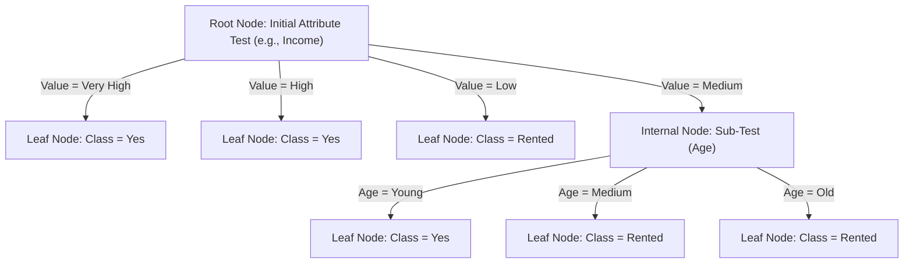
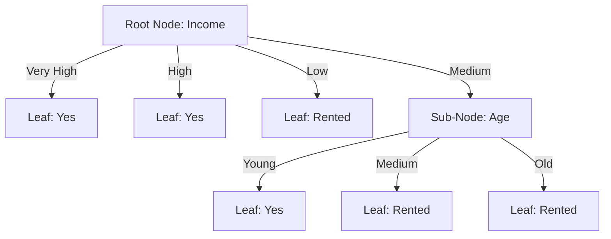
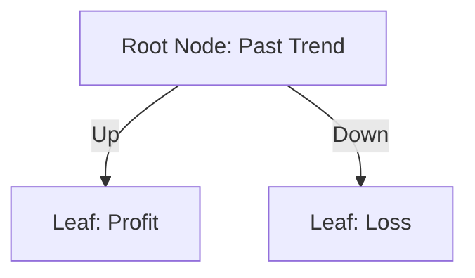

# Unit 5: Learning – Previous Year Questions (PYQ) Bank & Model Answers

**Course:** B.Tech / MBA Tech Computer Engineering & Artificial Intelligence  
**Subject:** Artificial Intelligence (Course Code: 702CO0C076)  
**Syllabus Scope:** Unit 5 — Learning (5 Hours, Course Outcome CO4)  
**Primary References:** Official Course Policy (`Artificial Intelligence 2026-27.pdf`), `1 learning agent inductive learning decision tree.pdf`, `K Means Clustering 1.pdf`, `K Means Clustering 2.pdf`, Russell & Norvig (*AIMA* 3rd & 4th Editions), TechKnowledge Publications, and University Question Papers (2013–2026).

---

## 📋 TABLE OF CONTENTS
1. [Document Overview & Syllabus Scope](#1--document-overview--syllabus-scope)
2. [Section 1: Topic-Wise Theoretical PYQs & Model Answers](#2--section-1-topic-wise-theoretical-pyqs--model-answers)
   - [Topic 1: Inductive Learning & Machine Learning Paradigms](#topic-1-inductive-learning--machine-learning-paradigms)
   - [Topic 2: Supervised Learning & Decision Tree Classification](#topic-2-supervised-learning--decision-tree-classification)
   - [Topic 3: ID3 Decision Tree Induction Algorithm](#topic-3-id3-decision-tree-induction-algorithm)
   - [Topic 4: Mathematical Foundations (Entropy & Information Gain)](#topic-4-mathematical-foundations-entropy--information-gain)
   - [Topic 5: Unsupervised Learning & K-Means Clustering](#topic-5-unsupervised-learning--k-means-clustering)
3. [Section 2: Solved Past Year Numerical Questions (Step-by-Step)](#3--section-2-solved-past-year-numerical-questions-step-by-step)
   - [SOLVED PYQ 1: 12-Instance House Ownership Dataset (ID3)](#solved-pyq-1-12-instance-house-ownership-dataset-id3--15-marks)
   - [SOLVED PYQ 2: Stock Market Portfolio Return Dataset (ID3)](#solved-pyq-2-stock-market-portfolio-return-dataset-id3--15-marks)
   - [SOLVED PYQ 3: Play Tennis Benchmark Dataset (ID3)](#solved-pyq-3-play-tennis-benchmark-dataset-id3--10-marks)
   - [SOLVED PYQ 4: 1D Dataset K-Means Clustering (K=2)](#solved-pyq-4-1d-dataset-k-means-clustering-k2--10-marks)
   - [SOLVED PYQ 5: 4-Medicine 2D Dataset K-Means Clustering (K=2)](#solved-pyq-5-4-medicine-2d-dataset-k-means-clustering-k2--10-marks)
   - [SOLVED PYQ 6: 8-Point 2D Spatial Dataset K-Means Clustering (K=3)](#solved-pyq-6-8-point-2d-spatial-dataset-k-means-clustering-k3--15-marks)
   - [SOLVED PYQ 7: Customer Visit Frequency 1D Dataset (K=2)](#solved-pyq-7-customer-visit-frequency-1d-dataset-k2--10-marks)
4. [Section 3: Probable Exam Questions (Full Syllabus Coverage)](#4--section-3-probable-exam-questions-full-syllabus-coverage)
5. [Section 4: Exam Readiness, Formulas & Syllabus Checklist](#5--section-4-exam-readiness-formulas--syllabus-checklist)

---

## 1. 📖 DOCUMENT OVERVIEW & SYLLABUS SCOPE

This document is a comprehensive, exam-oriented Past Year Question (PYQ) study bank for **Unit 5: Learning**. It consolidates genuine examination questions from SVKM's NMIMS MPSTME B.Tech/MBA Tech term-end papers, Mumbai University (MU) question papers, and MDU BCA examinations, alongside high-yield probable questions covering the complete 5-hour Unit 5 syllabus mapped to **Course Outcome CO4**.

### **Syllabus Topic Weightage & Frequency Analysis:**

| Topic Domain | Exam Frequency | Average Marks | High-Yield Key Concepts |
| :--- | :--- | :--- | :--- |
| **Inductive Learning & ML Types** | High (80% papers) | 5 – 10 Marks | Target Function, Generalization, Inductive Bias, Occam's Razor, Supervised vs. Unsupervised vs. Reinforcement Learning. |
| **Decision Tree Anatomy & ID3** | Very High (90% papers) | 5 – 10 Marks | Root/Internal/Leaf Nodes, DNF Expressiveness, ID3 Pseudocode, 4 Base Stopping Conditions, Rule Extraction. |
| **Entropy & Information Gain** | Very High (100% papers) | 10 – 15 Marks | Shannon Entropy, Binary Entropy $B(q)$, Weighted Partition Entropy $H_A(S)$, Gain Maximization. |
| **K-Means Clustering** | Very High (95% papers) | 10 – 15 Marks | Centroids $\mu_k$, Euclidean Distance, WCSS/SSE Objective, Lloyd-Forgy Iterations, K-Means++, Elbow Method. |

---

## 2. 🎯 SECTION 1: TOPIC-WISE THEORETICAL PYQS & MODEL ANSWERS

---

### TOPIC 1: INDUCTIVE LEARNING & MACHINE LEARNING PARADIGMS

#### **Question 1.1a (SVKM's NMIMS Final Exam 2025-26 Q6.c [5 Marks] / MU Dec 2014 [10 Marks]):**
*"Define Inductive Learning in Artificial Intelligence. Explain the concept of learning from examples, target function, hypothesis space, generalization, and inductive bias. Compare Supervised, Unsupervised, and Reinforcement Learning with suitable examples."*

##### **Master Model Answer (5–10 Marks):**

1. **Definition of Inductive Learning:**
   Inductive learning is the process of extracting general rules, models, or target functions $h(x)$ from a finite set of specific observed training instances $D = \{(x_1, y_1), (x_2, y_2), \dots, (x_N, y_N)\}$.
   * **Formal Framework:** Given training pairs $(x_i, y_i)$ where $y_i = f(x_i)$ for an unknown target function $f: X \to Y$, the learner searches the hypothesis space $H$ to find a hypothesis function $h \in H$ such that $h(x) \approx f(x)$ for all training instances and generalizes accurately to unseen inputs.
   * **Fundamental Assumption of Inductive Inference:** *"Any hypothesis found to approximate the target function well over a sufficiently large set of training examples will also approximate the target function well over unobserved examples."*

2. **Core Concepts:**
   * **Generalization:** The capability of a learned hypothesis $h(x)$ to correctly predict output labels for new, unseen input instances outside the training set.
   * **Underfitting (High Bias):** Occurs when a model is overly simplistic (e.g., linear model for non-linear data) and fails to capture the underlying structure in either training or testing data.
   * **Overfitting (High Variance):** Occurs when a model learns noise and specific details of the training set (e.g., overly deep decision tree), performing exceptionally well on training data but poorly on unseen test data.
   * **Inductive Bias & Occam's Razor:** The set of prior assumptions a learning algorithm uses to prioritize certain hypotheses over others in the search space $H$. Under **Occam's Razor**, learners prefer the simplest hypothesis consistent with the data (e.g., ID3 prefers shorter trees placing high Information Gain features near the root).

3. **Master Comparison Matrix of Machine Learning Paradigms:**

| Operational Dimension | Supervised Learning | Unsupervised Learning | Reinforcement Learning |
| :--- | :--- | :--- | :--- |
| **Input Data Format** | Labeled dataset $D = \{(x_i, y_i)\}$ containing features $x_i$ and target labels $y_i$. | Unlabeled dataset $X = \{x_1, x_2, \dots, x_N\}$ containing features only. | Environmental states $s_t$, available actions $a_t$, and scalar reward signals $r_t$. |
| **Teacher / Supervision** | Direct supervision via ground-truth target outputs provided by a teacher. | No teacher; system autonomously discovers intrinsic data structures. | Delayed reinforcement feedback (rewards/penalties) from the environment. |
| **Primary Goal** | Learn mapping $h: X \to Y$ to predict correct output class or value for new data. | Discover natural groupings, clusters, or probability distributions in data. | Learn optimal action policy $\pi(s)$ maximizing cumulative long-term reward. |
| **Canonical Tasks** | Classification (discrete labels) and Regression (continuous values). | Clustering (K-Means), Dimensionality Reduction (PCA), Anomaly Detection. | Game playing (Chess, Go), Autonomous Robotics, Navigation. |
| **Representative Example** | Email Spam Detection (Spam vs. Not Spam based on text features). | Customer Segmentation based on purchasing behavior using K-Means. | Training a self-driving car to navigate using rewards for safety and penalties for drift. |

---

### TOPIC 2: SUPERVISED LEARNING & DECISION TREE CLASSIFICATION

#### **Question 2.1a (NMIMS Re-Exam 2024-25 Q6.a [5 Marks] / MU May 2018 [5 Marks]):**
*"Explain the anatomical components of a Decision Tree. How does a decision tree represent Boolean disjunctive concepts, and how are IF-THEN rules extracted from a trained tree?"*

##### **Master Model Answer (5 Marks):**



1. **Anatomical Components:**
   * **Root Node:** Topmost decision node representing the entire dataset, tested on the feature with the highest Information Gain.
   * **Internal Decision Nodes:** Intermediate nodes representing attribute tests that partition the dataset into child branches.
   * **Branches:** Edges representing specific discrete values or range outcomes of the parent attribute test.
   * **Leaf (Terminal) Nodes:** Final outcome nodes containing class label predictions (no further splitting).

2. **Expressiveness & Disjunctive Normal Form (DNF):**
   A decision tree represents a disjunctive concept where each path from the root node to a positive leaf node forms a conjunction (AND) of attribute tests, and the union of all such paths forms a disjunction (OR) in **Disjunctive Normal Form (DNF)**:
   $$\text{Target Class} \iff (\text{Path}_1) \lor (\text{Path}_2) \lor \dots \lor (\text{Path}_k)$$

3. **IF-THEN Rule Extraction Protocol:**
   Every root-to-leaf path generates exactly one deterministic rule:
   $$\text{IF } (A_1 = v_1) \text{ AND } (A_2 = v_2) \dots \text{ THEN } \text{Class} = C$$

---

### TOPIC 3: ID3 DECISION TREE INDUCTION ALGORITHM

#### **Question 3.1a (NMIMS Final Exam 2023-24 Q5.b [7 Marks] / MU Dec 2013 [10 Marks]):**
*"Explain Quinlan's ID3 algorithm for Decision Tree Induction. State its core greedy search strategy, formal pseudocode, and its four base-case stopping conditions. How does ID3 handle overfitting?"*

##### **Master Model Answer (7–10 Marks):**

1. **Core ID3 Strategy:**
   The **ID3 (Iterative Dichotomiser 3)** algorithm, developed by J. Ross Quinlan in 1986, constructs a decision tree top-down using a greedy, non-backtracking search. At each node, ID3 evaluates all remaining attributes using **Information Gain** and selects the attribute that minimizes residual dataset entropy.

2. **Language-Neutral Pseudocode:**

```text
Algorithm ID3_INDUCTION(Examples, Target_Attribute, Attributes):
    Input: Examples (dataset subset), Target_Attribute (class label), Attributes (candidate features)
    Output: Decision Tree node
    
    Create a Root node for the tree
    
    // Base Case 1: All instances belong to the same target class (Pure Node)
    If all instances in Examples have the same class label c:
        Return Leaf node with label = c
        
    // Base Case 2: Candidate attribute list is empty
    If Attributes is empty:
        Return Leaf node with label = Majority_Class(Examples, Target_Attribute)
        
    // Step 1: Select attribute with Maximum Information Gain
    A_best = Attribute_With_Max_Gain(Examples, Target_Attribute, Attributes)
    Set Root.attribute = A_best
    
    // Step 2: Recursively grow child branches for each value of A_best
    For each distinct value v_i of A_best:
        Examples_vi = Subset of Examples where A_best == v_i
        
        // Base Case 3: Empty child subset
        If Examples_vi is empty:
            Add Leaf child with label = Majority_Class(Examples, Target_Attribute)
        Else:
            Remaining_Attrs = Attributes \ {A_best}
            Add Subtree = ID3_INDUCTION(Examples_vi, Target_Attribute, Remaining_Attrs)
            
    Return Root
```

3. **Four Base Stopping Conditions:**
   * **Condition 1 (Pure Subset):** All records at the current node belong to a single target class label ($H(S) = 0$).
   * **Condition 2 (Empty Attribute List):** All input features have been tested; assign the majority target class label.
   * **Condition 3 (Empty Child Dataset):** A feature branch receives no training instances; assign parent dataset majority class label.
   * **Condition 4 (Zero Information Gain):** No remaining attribute provides positive Information Gain ($\text{Gain}(S, A) \le 0$).

4. **Overfitting & Multivalued Feature Bias:**
   * **Multivalued Attribute Bias:** Information Gain favors attributes with many distinct values (e.g., `Customer_ID`), creating shallow pure trees with poor generalization. Solution: Use **Gain Ratio** (C4.5).
   * **Overfitting Prevention:** Applied via **Pre-pruning** (stopping tree growth early based on chi-square thresholds) or **Post-pruning** (replacing subtrees with leaf nodes after full growth using validation sets).

---

### TOPIC 4: MATHEMATICAL FOUNDATIONS (ENTROPY & INFORMATION GAIN)

#### **Question 4.1a (NMIMS Re-Exam 2022-23 Q4.a [5 Marks]):**
*"Define Shannon Entropy, Binary Entropy, Weighted Partition Entropy, and Information Gain mathematically. Define all terms and state the boundary conditions."*

##### **Master Model Answer (5 Marks):**

1. **Shannon Entropy $H(S)$:**
   Measures the average impurity, disorder, or uncertainty in a dataset $S$ containing instances from $k$ target classes:
   $$H(S) = - \sum_{i=1}^{k} p_i \log_2(p_i)$$
   where $p_i = \frac{|S_i|}{|S|}$ is the proportion of instances belonging to class $i$.
   * **Boundary Convention:** $0 \log_2(0) \equiv 0$.
   * **Pure Subset ($p_1 = 1, p_2 = 0$):** $H(S) = \mathbf{0.0\text{ bits}}$ (Minimum uncertainty).
   * **Balanced Binary Subset ($p_1 = 0.5, p_2 = 0.5$):** $H(S) = \mathbf{1.0\text{ bit}}$ (Maximum uncertainty).

2. **Binary Entropy $B(q)$:**
   For a two-class dataset with positive proportion $q = \frac{p}{p+n}$:
   $$B(q) = - q \log_2(q) - (1-q) \log_2(1-q)$$

3. **Weighted Partition Entropy $H_A(S)$:**
   The expected residual entropy after partitioning dataset $S$ into subsets $\{S_{v_1}, S_{v_2}, \dots, S_{v_m}\}$ based on attribute $A$:
   $$H_A(S) = \sum_{v \in \text{Values}(A)} \frac{|S_v|}{|S|} H(S_v)$$

4. **Information Gain $\text{Gain}(S, A)$:**
   The expected reduction in entropy resulting from splitting dataset $S$ on attribute $A$:
   $$\text{Gain}(S, A) = H(S) - H_A(S) = H(S) - \sum_{v \in \text{Values}(A)} \frac{|S_v|}{|S|} H(S_v)$$
   * **Attribute Selection Rule:** Select $A^* = \arg\max_{A} \text{Gain}(S, A)$.

---

### TOPIC 5: UNSUPERVISED LEARNING & K-MEANS CLUSTERING

#### **Question 5.1a (NMIMS Final Exam 2025-26 Q5.b [10 Marks] / Re-Exam 2025-26 Q5.b [10 Marks]):**
*"What is K-Means Clustering? Explain the Lloyd-Forgy iterative execution algorithm, distance metrics, WCSS/SSE objective function, Elbow method, K-Means++, and limitations."*

##### **Master Model Answer (10 Marks):**

1. **Definition & Purpose:**
   K-Means is an unsupervised, iterative, partitioning-based clustering algorithm that groups $N$ unlabeled data points into $K$ non-overlapping clusters $C = \{C_1, C_2, \dots, C_K\}$ such that points within the same cluster are highly similar (high intra-cluster similarity) while points in different clusters are distinct (high inter-cluster variance).

2. **Mathematical Formulations:**
   * **Cluster Centroid $\mu_k$:** The mean feature vector of all points assigned to cluster $C_k$:
     $$\mu_k = \frac{1}{|C_k|} \sum_{x \in C_k} x$$
   * **Euclidean Distance Metric:**
     $$d(x, \mu_k) = \sqrt{\sum_{j=1}^{p} (x_j - \mu_{kj})^2}$$
   * **Objective Function (WCSS / SSE):** K-Means minimizes the Within-Cluster Sum of Squares (Sum of Squared Errors):
     $$J = \text{WCSS} = \text{SSE} = \sum_{k=1}^{K} \sum_{x \in C_k} \| x - \mu_k \|^2$$

3. **Lloyd-Forgy Iterative Algorithm:**

```text
Algorithm LLOYD_FORGY_K_MEANS(Dataset X, Cluster Count K, Max_Iterations):
    1. Initialization: Arbitrarily pick K initial centroids μ_1, μ_2, ..., μ_K from X.
    2. Repeat until Convergence or Max_Iterations reached:
        a. Assignment Step:
           Assign each point x_i in X to closest centroid μ_k:
           C_k = { x_i : || x_i - μ_k ||^2 <= || x_i - μ_j ||^2 for all j != k }
           
        b. Update Step:
           Recalculate centroid μ_k as mean of points in C_k:
           μ_k = (1 / |C_k|) * sum_{x in C_k} x
           
        c. Convergence Test:
           If centroids do not change position (Δμ = 0), terminate.
    3. Return Clusters C_1, C_2, ..., C_K and final SSE.
```

4. **Practical Considerations & Solutions:**
   * **Sensitivity to Initial Centroids & Local Optima:** Random initialization can cause bad convergence. Solution: **K-Means++**, which initializes centroids far apart with probability proportional to squared distance $D(x)^2$.
   * **Determining Optimal $K$ (Elbow Method):** Plot WCSS/SSE against $K = 1, 2, 3, \dots$. Choose $K^*$ at the "elbow" point where the rate of decrease in WCSS slows significantly.
   * **Feature Scaling:** Unscaled features dominate Euclidean distance; apply $Z$-score standardization ($z = \frac{x - \mu}{\sigma}$) prior to clustering.

5. **Computational Complexity & Limitations:**
   * **Time Complexity:** $O(I \cdot K \cdot N \cdot p)$ where $I$ = iterations, $K$ = clusters, $N$ = data points, $p$ = dimensions. Linear in $N$.
   * **Limitations:** Sensitive to outliers, struggles with non-spherical/irregular cluster shapes, requires pre-specifying $K$.

---

## 3. ✍️ SECTION 2: SOLVED PAST YEAR NUMERICAL QUESTIONS (STEP-BY-STEP)

---

### SOLVED PYQ 1: 12-INSTANCE HOUSE OWNERSHIP DATASET (ID3) [15 Marks]
*(Source: SVKM's NMIMS B.Tech CE Re-Exam 2024-25 Q6.a / Final Exam 2024-25 Q5.b [15 Marks])*

#### **Question Statement:**
Given the following training dataset for predicting house ownership (`Own House` target class with values `Yes` and `Rented`), construct a complete decision tree using the ID3 algorithm. Calculate parent entropy, Information Gain for candidate attributes `Income` and `Age`, draw the completed decision tree, extract IF-THEN rules, and classify a new applicant: $(\text{Income} = \text{Medium}, \text{Age} = \text{Old})$.

| Record ID | Income | Age | Own House (Target Class) |
| :--- | :--- | :--- | :--- |
| **D1** | Very High | Young | **Yes** |
| **D2** | High | Medium | **Yes** |
| **D3** | Low | Young | **Rented** |
| **D4** | Medium | Medium | **Rented** |
| **D5** | High | Old | **Yes** |
| **D6** | Very High | Medium | **Yes** |
| **D7** | Low | Old | **Rented** |
| **D8** | High | Young | **Yes** |
| **D9** | Medium | Old | **Rented** |
| **D10** | Low | Medium | **Rented** |
| **D11** | High | Young | **Yes** |
| **D12** | Medium | Young | **Yes** |

---

#### **Step-by-Step Mathematical Solution:**

##### **Step 1: Dataset Counts & Parent Entropy $H(S)$**
* Total records $|S| = 12$.
* Target class counts: `Yes` = 7 (D1, D2, D5, D6, D8, D11, D12); `Rented` = 5 (D3, D4, D7, D9, D10).
* Proportions: $p_{\text{Yes}} = \frac{7}{12} \approx 0.5833$, $p_{\text{Rented}} = \frac{5}{12} \approx 0.4167$.
* **Parent Entropy Calculation:**
  $$H(S) = - \left(\frac{7}{12}\right) \log_2 \left(\frac{7}{12}\right) - \left(\frac{5}{12}\right) \log_2 \left(\frac{5}{12}\right)$$
  $$H(S) = - (0.5833 \times -0.7776) - (0.4167 \times -1.2630) = 0.4536 + 0.5263 = \mathbf{0.9799\text{ bits}} \approx \mathbf{0.980\text{ bits}}$$

---

##### **Step 2: Evaluate Attribute `Income`**
Partition dataset $S$ by `Income` values:
1. **`Income = Very High`** (2 records: D1, D6):
   * Class counts: 2 Yes, 0 Rented $\implies$ Pure subset.
   * $H(S_{\text{Very High}}) = \mathbf{0.0\text{ bits}}$.

2. **`Income = High`** (4 records: D2, D5, D8, D11):
   * Class counts: 4 Yes, 0 Rented $\implies$ Pure subset.
   * $H(S_{\text{High}}) = \mathbf{0.0\text{ bits}}$.

3. **`Income = Low`** (3 records: D3, D7, D10):
   * Class counts: 0 Yes, 3 Rented $\implies$ Pure subset.
   * $H(S_{\text{Low}}) = \mathbf{0.0\text{ bits}}$.

4. **`Income = Medium`** (3 records: D4, D9, D12):
   * Class counts: 1 Yes (D12), 2 Rented (D4, D9).
   * $H(S_{\text{Medium}}) = - \left(\frac{1}{3}\right) \log_2 \left(\frac{1}{3}\right) - \left(\frac{2}{3}\right) \log_2 \left(\frac{2}{3}\right) = 0.5283 + 0.3900 = \mathbf{0.9183\text{ bits}}$.

* **Weighted Subset Entropy $H_{\text{Income}}(S)$:**
  $$H_{\text{Income}}(S) = \frac{2}{12}(0) + \frac{4}{12}(0) + \frac{3}{12}(0) + \frac{3}{12}(0.9183) = \frac{3}{12} \times 0.9183 = \mathbf{0.2296\text{ bits}}$$

* **Information Gain $\text{Gain}(S, \text{Income})$:**
  $$\text{Gain}(S, \text{Income}) = H(S) - H_{\text{Income}}(S) = 0.9799 - 0.2296 = \mathbf{0.7503\text{ bits}}$$

---

##### **Step 3: Evaluate Attribute `Age`**
Partition dataset $S$ by `Age` values:
1. **`Age = Young`** (5 records: D1, D3, D8, D11, D12):
   * D1(Yes), D3(Rented), D8(Yes), D11(Yes), D12(Yes) $\implies$ 4 Yes, 1 Rented.
   * $H(S_{\text{Young}}) = - \left(\frac{4}{5}\right) \log_2 \left(\frac{4}{5}\right) - \left(\frac{1}{5}\right) \log_2 \left(\frac{1}{5}\right) = 0.2575 + 0.4644 = \mathbf{0.7219\text{ bits}}$.

2. **`Age = Medium`** (4 records: D2, D4, D6, D10):
   * D2(Yes), D4(Rented), D6(Yes), D10(Rented) $\implies$ 2 Yes, 2 Rented.
   * $H(S_{\text{Medium}}) = - \left(\frac{2}{4}\right) \log_2 \left(\frac{2}{4}\right) - \left(\frac{2}{4}\right) \log_2 \left(\frac{2}{4}\right) = \mathbf{1.0000\text{ bit}}$.

3. **`Age = Old`** (3 records: D5, D7, D9):
   * D5(Yes), D7(Rented), D9(Rented) $\implies$ 1 Yes, 2 Rented.
   * $H(S_{\text{Old}}) = - \left(\frac{1}{3}\right) \log_2 \left(\frac{1}{3}\right) - \left(\frac{2}{3}\right) \log_2 \left(\frac{2}{3}\right) = \mathbf{0.9183\text{ bits}}$.

* **Weighted Subset Entropy $H_{\text{Age}}(S)$:**
  $$H_{\text{Age}}(S) = \frac{5}{12}(0.7219) + \frac{4}{12}(1.0000) + \frac{3}{12}(0.9183) = 0.3008 + 0.3333 + 0.2296 = \mathbf{0.8637\text{ bits}}$$

* **Information Gain $\text{Gain}(S, \text{Age})$:**
  $$\text{Gain}(S, \text{Age}) = H(S) - H_{\text{Age}}(S) = 0.9799 - 0.8637 = \mathbf{0.1162\text{ bits}}$$

---

##### **Step 4: Root Node Selection & Sub-Branch Splits**
* **Root Selection:** $\text{Gain}(S, \text{Income}) = \mathbf{0.7503\text{ bits}}$ vs. $\text{Gain}(S, \text{Age}) = \mathbf{0.1162\text{ bits}}$.
  Select **`Income`** as the **Root Node**.

* **Sub-Branch Splitting:**
  * Branch `Income = Very High` $\to$ Pure leaf: **`Yes`**
  * Branch `Income = High` $\to$ Pure leaf: **`Yes`**
  * Branch `Income = Low` $\to$ Pure leaf: **`Rented`**
  * Branch `Income = Medium` $\to$ Impure subset $S_{\text{Medium}} = \{\text{D4, D9, D12}\}$:
    * D12 (Young) $\to$ **Yes**
    * D4 (Medium) $\to$ **Rented**
    * D9 (Old) $\to$ **Rented**
    * Splitting $S_{\text{Medium}}$ on attribute `Age` perfectly isolates all records!

---

##### **Step 5: Completed Decision Tree Diagram**



---

##### **Step 6: IF-THEN Rule Extraction**
1. **Rule 1:** `IF (Income = 'Very High') THEN Own_House = 'Yes'`
2. **Rule 2:** `IF (Income = 'High') THEN Own_House = 'Yes'`
3. **Rule 3:** `IF (Income = 'Low') THEN Own_House = 'Rented'`
4. **Rule 4:** `IF (Income = 'Medium') AND (Age = 'Young') THEN Own_House = 'Yes'`
5. **Rule 5:** `IF (Income = 'Medium') AND (Age = 'Medium') THEN Own_House = 'Rented'`
6. **Rule 6:** `IF (Income = 'Medium') AND (Age = 'Old') THEN Own_House = 'Rented'`

---

##### **Step 7: Classification of Unseen Instance**
* **Test Applicant:** $(\text{Income} = \text{Medium}, \text{Age} = \text{Old})$
* **Traversal Path:** Root `Income = Medium` $\to$ Sub-node `Age = Old` $\to$ Leaf **`Rented`**.
* **Final Prediction:** **`Own House = Rented`**.

---

### SOLVED PYQ 2: STOCK MARKET PORTFOLIO RETURN DATASET (ID3) [15 Marks]
*(Source: SVKM's NMIMS Final Exam 2023-24 Q6.a [15 Marks])*

#### **Question Statement:**
Given the following stock market performance dataset predicting `Return` (`Profit` vs. `Loss`), construct a complete decision tree using the ID3 algorithm. Show all entropy and Information Gain calculations.

| Instance ID | Past Trend | Open Interest | Trading Volume | Return (Target Class) |
| :--- | :--- | :--- | :--- | :--- |
| **X1** | Up | High | High | **Profit** |
| **X2** | Up | High | Low | **Profit** |
| **X3** | Down | Low | High | **Loss** |
| **X4** | Down | High | Low | **Loss** |
| **X5** | Up | Low | High | **Profit** |

---

#### **Step-by-Step Mathematical Solution:**

##### **Step 1: Dataset Counts & Parent Entropy $H(S)$**
* Total records $|S| = 5$.
* Target class counts: `Profit` = 3 (X1, X2, X5); `Loss` = 2 (X3, X4).
* **Parent Entropy Calculation:**
  $$H(S) = - \left(\frac{3}{5}\right) \log_2 \left(\frac{3}{5}\right) - \left(\frac{2}{5}\right) \log_2 \left(\frac{2}{5}\right)$$
  $$H(S) = - (0.60 \times -0.7370) - (0.40 \times -1.3219) = 0.4422 + 0.5288 = \mathbf{0.9710\text{ bits}}$$

---

##### **Step 2: Evaluate Candidate Attributes**
1. **Attribute `Past Trend`:**
   * Values: `Up` (3 records: X1, X2, X5 $\to$ 3 Profit, 0 Loss $\implies H = 0$), `Down` (2 records: X3, X4 $\to$ 0 Profit, 2 Loss $\implies H = 0$).
   * $H_{\text{Past Trend}}(S) = \frac{3}{5}(0) + \frac{2}{5}(0) = \mathbf{0.0\text{ bits}}$.
   * $\text{Gain}(S, \text{Past Trend}) = 0.9710 - 0.0 = \mathbf{0.9710\text{ bits}}$.

2. **Attribute `Open Interest`:**
   * Values: `High` (3 records: X1, X2, X4 $\to$ 2 Profit, 1 Loss $\implies H = 0.9183$), `Low` (2 records: X3, X5 $\to$ 1 Profit, 1 Loss $\implies H = 1.0000$).
   * $H_{\text{Open Interest}}(S) = \frac{3}{5}(0.9183) + \frac{2}{5}(1.0000) = 0.5510 + 0.4000 = \mathbf{0.9510\text{ bits}}$.
   * $\text{Gain}(S, \text{Open Interest}) = 0.9710 - 0.9510 = \mathbf{0.0200\text{ bits}}$.

3. **Attribute `Trading Volume`:**
   * Values: `High` (3 records: X1, X3, X5 $\to$ 2 Profit, 1 Loss $\implies H = 0.9183$), `Low` (2 records: X2, X4 $\to$ 1 Profit, 1 Loss $\implies H = 1.0000$).
   * $H_{\text{Trading Volume}}(S) = \frac{3}{5}(0.9183) + \frac{2}{5}(1.0000) = \mathbf{0.9510\text{ bits}}$.
   * $\text{Gain}(S, \text{Trading Volume}) = 0.9710 - 0.9510 = \mathbf{0.0200\text{ bits}}$.

---

##### **Step 3: Root Selection & Tree Construction**
`Past Trend` provides maximum Information Gain ($\mathbf{0.9710\text{ bits}}$), achieving a 100% pure split at depth 1!



---

### SOLVED PYQ 3: PLAY TENNIS BENCHMARK DATASET (ID3) [10 Marks]
*(Source: Quinlan Classic Benchmark / SVKM's NMIMS Sample Paper)*

#### **Question Statement:**
Given the 14-instance `Play Tennis` dataset, compute parent entropy, evaluate attribute Information Gains for `Outlook`, `Humidity`, `Wind`, and `Temperature`, and select the root split node.

| Day | Outlook | Temp | Humidity | Wind | Play Tennis (Target) |
| :--- | :--- | :--- | :--- | :--- | :--- |
| **D1** | Sunny | Hot | High | Weak | **No** |
| **D2** | Sunny | Hot | High | Strong | **No** |
| **D3** | Overcast | Hot | High | Weak | **Yes** |
| **D4** | Rain | Mild | High | Weak | **Yes** |
| **D5** | Rain | Cool | Normal | Weak | **Yes** |
| **D6** | Rain | Cool | Normal | Strong | **No** |
| **D7** | Overcast | Cool | Normal | Strong | **Yes** |
| **D8** | Sunny | Mild | High | Weak | **No** |
| **D9** | Sunny | Cool | Normal | Weak | **Yes** |
| **D10** | Rain | Mild | Normal | Weak | **Yes** |
| **D11** | Sunny | Mild | Normal | Strong | **Yes** |
| **D12** | Overcast | Mild | High | Strong | **Yes** |
| **D13** | Overcast | Hot | Normal | Weak | **Yes** |
| **D14** | Rain | Mild | High | Strong | **No** |

---

#### **Step-by-Step Mathematical Solution:**

##### **Step 1: Parent Entropy $H(S)$**
* Total records $|S| = 14$ (9 Yes, 5 No).
* $H(S) = - \left(\frac{9}{14}\right) \log_2 \left(\frac{9}{14}\right) - \left(\frac{5}{14}\right) \log_2 \left(\frac{5}{14}\right) = \mathbf{0.940\text{ bits}}$.

##### **Step 2: Candidate Attribute Gain Calculations**
1. **Attribute `Outlook`:**
   * `Sunny` (5 records: 2 Yes, 3 No $\to H = 0.971$)
   * `Overcast` (4 records: 4 Yes, 0 No $\to H = 0.000$)
   * `Rain` (5 records: 3 Yes, 2 No $\to H = 0.971$)
   * $H_{\text{Outlook}}(S) = \frac{5}{14}(0.971) + \frac{4}{14}(0) + \frac{5}{14}(0.971) = \mathbf{0.694\text{ bits}}$.
   * $\text{Gain}(S, \text{Outlook}) = 0.940 - 0.694 = \mathbf{0.246\text{ bits}}$.

2. **Attribute `Humidity`:**
   * `High` (7 records: 3 Yes, 4 No $\to H = 0.985$)
   * `Normal` (7 records: 6 Yes, 1 No $\to H = 0.592$)
   * $H_{\text{Humidity}}(S) = \frac{7}{14}(0.985) + \frac{7}{14}(0.592) = \mathbf{0.789\text{ bits}}$.
   * $\text{Gain}(S, \text{Humidity}) = 0.940 - 0.789 = \mathbf{0.151\text{ bits}}$.

3. **Attribute `Wind`:**
   * `Weak` (8 records: 6 Yes, 2 No $\to H = 0.811$)
   * `Strong` (6 records: 3 Yes, 3 No $\to H = 1.000$)
   * $H_{\text{Wind}}(S) = \frac{8}{14}(0.811) + \frac{6}{14}(1.000) = \mathbf{0.892\text{ bits}}$.
   * $\text{Gain}(S, \text{Wind}) = 0.940 - 0.892 = \mathbf{0.048\text{ bits}}$.

4. **Attribute `Temperature`:**
   * `Hot` (4 records: 2 Yes, 2 No $\to H = 1.000$), `Mild` (6 records: 4 Yes, 2 No $\to H = 0.918$), `Cool` (4 records: 3 Yes, 1 No $\to H = 0.811$).
   * $H_{\text{Temperature}}(S) = \mathbf{0.911\text{ bits}} \implies \text{Gain}(S, \text{Temperature}) = \mathbf{0.029\text{ bits}}$.

* **Root Selection:** **`Outlook`** ($\text{Gain} = \mathbf{0.246\text{ bits}}$) is selected as the Root Node.

---

### SOLVED PYQ 4: 1D DATASET K-MEANS CLUSTERING ($K=2$) [10 Marks]
*(Source: `K Means Clustering 1.pdf` Ex 4.4.1 / `whatever left.pdf`)*

#### **Question Statement:**
Cluster the 1D dataset $X = \{2, 4, 10, 12, 3, 20, 30, 11, 25\}$ into $K=2$ clusters using the K-Means algorithm. Show every iteration, cluster assignments, updated centroids, convergence test, and final WCSS/SSE. Initial centroids: $C_1 = \{2, 3\} \implies \mu_1 = 2.5$; $C_2 = \{4, 10, 12, 20, 30, 11, 25\} \implies \mu_2 = 16.0$.

---

#### **Step-by-Step Mathematical Trace:**

* **Initial State (Iteration 0):** $\mu_1 = 2.5$, $\mu_2 = 16.0$.

* **Iteration 1 Assignment:**
  For each point $x \in X$, compare $|x - 2.5|$ vs. $|x - 16.0|$:
  * $2: |2-2.5|=0.5 < |2-16|=14.0 \implies C_1$
  * $3: |3-2.5|=0.5 < |3-16|=13.0 \implies C_1$
  * $4: |4-2.5|=1.5 < |4-16|=12.0 \implies C_1$ (Assigned to $C_1$!)
  * $10: |10-2.5|=7.5 < |10-16|=6.0 \implies C_2$
  * $11, 12, 20, 25, 30 \implies C_2$
  * **Clusters:** $C_1 = \{2, 3, 4\}$, $C_2 = \{10, 11, 12, 20, 25, 30\}$.
  * **Updated Centroids:**
    $$\mu_1 = \frac{2+3+4}{3} = \mathbf{3.00}$$
    $$\mu_2 = \frac{10+11+12+20+25+30}{6} = \frac{108}{6} = \mathbf{18.00}$$

* **Iteration 2 Assignment:**
  Evaluate points against $\mu_1 = 3.0, \mu_2 = 18.0$:
  * $10: |10-3|=7.0 < |10-18|=8.0 \implies C_1$ (Point 10 shifts to $C_1$!)
  * **Clusters:** $C_1 = \{2, 3, 4, 10\}$, $C_2 = \{11, 12, 20, 25, 30\}$.
  * **Updated Centroids:**
    $$\mu_1 = \frac{2+3+4+10}{4} = \frac{19}{4} = \mathbf{4.75}$$
    $$\mu_2 = \frac{11+12+20+25+30}{5} = \frac{98}{5} = \mathbf{19.60}$$

* **Iteration 3 Assignment:**
  Evaluate points against $\mu_1 = 4.75, \mu_2 = 19.60$:
  * $11: |11-4.75|=6.25 < |11-19.60|=8.60 \implies C_1$
  * $12: |12-4.75|=7.25 < |12-19.60|=7.60 \implies C_1$ (Point 12 shifts to $C_1$!)
  * **Clusters:** $C_1 = \{2, 3, 4, 10, 11, 12\}$, $C_2 = \{20, 25, 30\}$.
  * **Updated Centroids:**
    $$\mu_1 = \frac{2+3+4+10+11+12}{6} = \frac{42}{6} = \mathbf{7.00}$$
    $$\mu_2 = \frac{20+25+30}{3} = \frac{75}{3} = \mathbf{25.00}$$

* **Iteration 4 Assignment & Convergence Check:**
  Evaluate points against $\mu_1 = 7.00, \mu_2 = 25.00$:
  * $12: |12-7|=5.0 < |12-25|=13.0 \implies C_1$
  * $20: |20-7|=13.0 > |20-25|=5.0 \implies C_2$
  * Cluster assignments remain unchanged ($\Delta\mu = 0$). **Algorithm Converged!**

* **Final Deliverables:**
  * **Cluster 1:** $C_1 = \{2, 3, 4, 10, 11, 12\}$ with centroid $\mathbf{\mu_1 = 7.0}$
  * **Cluster 2:** $C_2 = \{20, 25, 30\}$ with centroid $\mathbf{\mu_2 = 25.0}$
  * **Final Objective Value (WCSS / SSE):**
    $$\text{SSE}_{C_1} = (2-7)^2 + (3-7)^2 + (4-7)^2 + (10-7)^2 + (11-7)^2 + (12-7)^2 = 25 + 16 + 9 + 9 + 16 + 25 = 100.0$$
    $$\text{SSE}_{C_2} = (20-25)^2 + (25-25)^2 + (30-25)^2 = 25 + 0 + 25 = 50.0$$
    $$\mathbf{\text{Total SSE}} = 100.0 + 50.0 = \mathbf{150.0}$$

---

### SOLVED PYQ 5: 4-MEDICINE 2D DATASET K-MEANS CLUSTERING ($K=2$) [10 Marks]
*(Source: `K Means Clustering 1.pdf` Ex 4.4.3 / `whatever left.pdf`)*

#### **Question Statement:**
Group 4 medicines into $K=2$ clusters based on Weight Index ($X$) and pH ($Y$). Points: $A(1,1), B(2,1), C(4,3), D(5,4)$. Initial centroids: $\mu_1 = A(1,1), \mu_2 = B(2,1)$. Show distance calculations, cluster updates, and final SSE.

| Medicine Object | Attribute 1 ($X$): Weight Index | Attribute 2 ($Y$): pH |
| :--- | :--- | :--- |
| **Medicine A** | 1 | 1 |
| **Medicine B** | 2 | 1 |
| **Medicine C** | 4 | 3 |
| **Medicine D** | 5 | 4 |

---

#### **Step-by-Step Mathematical Trace:**

* **Iteration 1 Distance Calculations:**
  * $A(1,1): d(A, \mu_1) = 0.00, d(A, \mu_2) = \sqrt{(1-2)^2 + (1-1)^2} = 1.00 \implies \mathbf{C_1}$
  * $B(2,1): d(B, \mu_1) = 1.00, d(B, \mu_2) = 0.00 \implies \mathbf{C_2}$
  * $C(4,3): d(C, \mu_1) = \sqrt{(4-1)^2 + (3-1)^2} = \sqrt{13} \approx 3.61, d(C, \mu_2) = \sqrt{(4-2)^2 + (3-1)^2} = \sqrt{8} \approx \mathbf{2.83} \implies \mathbf{C_2}$
  * $D(5,4): d(D, \mu_1) = \sqrt{(5-1)^2 + (4-1)^2} = 5.00, d(D, \mu_2) = \sqrt{(5-2)^2 + (4-1)^2} = \sqrt{18} \approx \mathbf{4.24} \implies \mathbf{C_2}$
  * **Clusters:** $C_1 = \{A\}, C_2 = \{B, C, D\}$.
  * **Updated Centroids:**
    $$\mu_1 = (1.0, 1.0)$$
    $$\mu_2 = \left(\frac{2+4+5}{3}, \frac{1+3+4}{3}\right) = \left(\frac{11}{3}, \frac{8}{3}\right) \approx \mathbf{(3.67, 2.67)}$$

* **Iteration 2 Distance Calculations:**
  Evaluate points against $\mu_1 = (1.0, 1.0), \mu_2 = (3.67, 2.67)$:
  * $B(2,1): d(B, \mu_1) = \sqrt{(2-1)^2 + (1-1)^2} = \mathbf{1.00}; d(B, \mu_2) = \sqrt{(2-3.67)^2 + (1-2.67)^2} = \sqrt{2.79 + 2.79} = 2.36 \implies \mathbf{C_1}$ (Shift!)
  * $C(4,3): d(C, \mu_1) = 3.61; d(C, \mu_2) = \sqrt{(4-3.67)^2 + (3-2.67)^2} = \sqrt{0.11 + 0.11} = \mathbf{0.47} \implies \mathbf{C_2}$
  * $D(5,4): d(D, \mu_1) = 5.00; d(D, \mu_2) = \sqrt{(5-3.67)^2 + (4-2.67)^2} = \sqrt{1.77 + 1.77} = \mathbf{1.88} \implies \mathbf{C_2}$
  * **Clusters:** $C_1 = \{A, B\}, C_2 = \{C, D\}$.
  * **Updated Centroids:**
    $$\mu_1 = \left(\frac{1+2}{2}, \frac{1+1}{2}\right) = \mathbf{(1.5, 1.0)}$$
    $$\mu_2 = \left(\frac{4+5}{2}, \frac{3+4}{2}\right) = \mathbf{(4.5, 3.5)}$$

* **Iteration 3 Assignment & Convergence Check:**
  Evaluate points against $\mu_1 = (1.5, 1.0), \mu_2 = (4.5, 3.5)$:
  * $A(1,1): d(A, \mu_1) = \mathbf{0.50} < d(A, \mu_2) = 4.30 \implies C_1$
  * $B(2,1): d(B, \mu_1) = \mathbf{0.50} < d(B, \mu_2) = 3.54 \implies C_1$
  * $C(4,3): d(C, \mu_1) = 3.20 > d(C, \mu_2) = \mathbf{0.71} \implies C_2$
  * $D(5,4): d(D, \mu_1) = 4.61 > d(D, \mu_2) = \mathbf{0.71} \implies C_2$
  * Cluster assignments remain identical. **Algorithm Converged!**

* **Final Deliverables:**
  * **Cluster 1:** $C_1 = \{A(1,1), B(2,1)\}$ with centroid $\mathbf{\mu_1 = (1.5, 1.0)}$
  * **Cluster 2:** $C_2 = \{C(4,3), D(5,4)\}$ with centroid $\mathbf{\mu_2 = (4.5, 3.5)}$
  * **Final Objective Value (WCSS / SSE):**
    $$\text{SSE}_{C_1} = (1-1.5)^2 + (1-1)^2 + (2-1.5)^2 + (1-1)^2 = 0.25 + 0.25 = 0.50$$
    $$\text{SSE}_{C_2} = (4-4.5)^2 + (3-3.5)^2 + (5-4.5)^2 + (4-3.5)^2 = 0.25 + 0.25 + 0.25 + 0.25 = 1.00$$
    $$\mathbf{\text{Total SSE}} = 0.50 + 1.00 = \mathbf{1.50}$$

---

### SOLVED PYQ 6: 8-POINT 2D SPATIAL DATASET K-MEANS CLUSTERING ($K=3$) [15 Marks]
*(Source: `K Means Clustering 2.pdf` Ex 4.4.4)*

#### **Question Statement:**
Cluster 8 spatial points into $K=3$ clusters using Euclidean distance. Points: $A_1(2,10), A_2(2,5), A_3(8,4), A_4(5,8), A_5(7,5), A_6(6,4), A_7(1,2), A_8(4,9)$. Initial seeds: $C_1 = A_1(2,10), C_2 = A_4(5,8), C_3 = A_7(1,2)$. Trace all iterations until convergence.

---

#### **Step-by-Step Mathematical Trace:**

* **Iteration 1 Assignment:**
  * $A_1(2,10): d(A_1, C_1)=0.00 \implies \mathbf{C_1}$
  * $A_2(2,5): d(A_2, C_1)=5.00, d(A_2, C_2)=4.24, d(A_2, C_3)=\sqrt{1+9}=3.16 \implies \mathbf{C_3}$
  * $A_3(8,4): d(A_3, C_1)=8.49, d(A_3, C_2)=5.00, d(A_3, C_3)=7.28 \implies \mathbf{C_2}$
  * $A_4(5,8): d(A_4, C_2)=0.00 \implies \mathbf{C_2}$
  * $A_5(7,5): d(A_5, C_1)=7.07, d(A_5, C_2)=3.61, d(A_5, C_3)=6.71 \implies \mathbf{C_2}$
  * $A_6(6,4): d(A_6, C_1)=7.21, d(A_6, C_2)=4.12, d(A_6, C_3)=5.39 \implies \mathbf{C_2}$
  * $A_7(1,2): d(A_7, C_3)=0.00 \implies \mathbf{C_3}$
  * $A_8(4,9): d(A_8, C_1)=2.24, d(A_8, C_2)=1.41, d(A_8, C_3)=7.62 \implies \mathbf{C_2}$
  * **Clusters:** $C_1 = \{A_1\}$, $C_2 = \{A_3, A_4, A_5, A_6, A_8\}$, $C_3 = \{A_2, A_7\}$.
  * **Updated Centroids:**
    $$\mu_1 = (2.0, 10.0)$$
    $$\mu_2 = \left(\frac{8+5+7+6+4}{5}, \frac{4+8+5+4+9}{5}\right) = \left(\frac{30}{5}, \frac{30}{5}\right) = \mathbf{(6.0, 6.0)}$$
    $$\mu_3 = \left(\frac{2+1}{2}, \frac{5+2}{2}\right) = \mathbf{(1.5, 3.5)}$$

* **Iteration 2 Assignment:**
  Evaluate points against $\mu_1 = (2, 10), \mu_2 = (6, 6), \mu_3 = (1.5, 3.5)$:
  * $A_8(4,9): d(A_8, \mu_1) = \sqrt{4+1} = \mathbf{2.24}; d(A_8, \mu_2) = \sqrt{4+9} = 3.61 \implies \mathbf{C_1}$ (Shift!)
  * **Clusters:** $C_1 = \{A_1, A_8\}$, $C_2 = \{A_3, A_4, A_5, A_6\}$, $C_3 = \{A_2, A_7\}$.
  * **Updated Centroids:**
    $$\mu_1 = \left(\frac{2+4}{2}, \frac{10+9}{2}\right) = \mathbf{(3.0, 9.5)}$$
    $$\mu_2 = \left(\frac{8+5+7+6}{4}, \frac{4+8+5+4}{4}\right) = \left(\frac{26}{4}, \frac{21}{4}\right) = \mathbf{(6.5, 5.25)}$$
    $$\mu_3 = \mathbf{(1.5, 3.5)}$$

* **Iteration 3 Assignment:**
  Evaluate points against $\mu_1 = (3.0, 9.5), \mu_2 = (6.5, 5.25), \mu_3 = (1.5, 3.5)$:
  * $A_4(5,8): d(A_4, \mu_1) = \sqrt{4+2.25} = \mathbf{2.50}; d(A_4, \mu_2) = \sqrt{2.25+7.56} = 3.13 \implies \mathbf{C_1}$ (Shift!)
  * **Clusters:** $C_1 = \{A_1, A_4, A_8\}$, $C_2 = \{A_3, A_5, A_6\}$, $C_3 = \{A_2, A_7\}$.
  * **Updated Centroids:**
    $$\mu_1 = \left(\frac{2+5+4}{3}, \frac{10+8+9}{3}\right) = \left(\frac{11}{3}, \frac{27}{3}\right) = \mathbf{(3.67, 9.00)}$$
    $$\mu_2 = \left(\frac{8+7+6}{3}, \frac{4+5+4}{3}\right) = \left(\frac{21}{3}, \frac{13}{3}\right) = \mathbf{(7.00, 4.33)}$$
    $$\mu_3 = \mathbf{(1.5, 3.5)}$$

* **Iteration 4 Assignment & Convergence Check:**
  Evaluate points against $\mu_1 = (3.67, 9.0), \mu_2 = (7.0, 4.33), \mu_3 = (1.5, 3.5)$:
  * All 8 points maintain their cluster assignments from Iteration 3. **Algorithm Converged!**

* **Final Deliverables:**
  * **Cluster 1:** $C_1 = \{A_1(2,10), A_4(5,8), A_8(4,9)\}$ with centroid $\mathbf{\mu_1 = (3.67, 9.0)}$
  * **Cluster 2:** $C_2 = \{A_3(8,4), A_5(7,5), A_6(6,4)\}$ with centroid $\mathbf{\mu_2 = (7.0, 4.33)}$
  * **Cluster 3:** $C_3 = \{A_2(2,5), A_7(1,2)\}$ with centroid $\mathbf{\mu_3 = (1.5, 3.5)}$

---

### SOLVED PYQ 7: CUSTOMER VISIT FREQUENCY 1D DATASET ($K=2$) [10 Marks]
*(Source: `QP_Re-Exam_Artificial20V_2025-2026.pdf` Q5.c [10 Marks])*

#### **Question Statement:**
Given customer visit frequencies $X = \{2, 4, 5, 8, 10, 12\}$, cluster data into $K=2$ groups using K-Means with initial centroids $\mu_1 = 5, \mu_2 = 15$. Trace all steps until convergence.

---

#### **Step-by-Step Mathematical Trace:**

* **Iteration 1 Assignment:**
  Evaluate points against $\mu_1 = 5, \mu_2 = 15$:
  * $2: |2-5|=3 < |2-15|=13 \implies C_1$
  * $4: |4-5|=1 < |4-15|=11 \implies C_1$
  * $5: |5-5|=0 < |5-15|=10 \implies C_1$
  * $8: |8-5|=3 < |8-15|=7 \implies C_1$
  * $10: |10-5|=5 < |10-15|=5 \implies C_1$ (Tie break: assigned to $C_1$)
  * $12: |12-5|=7 > |12-15|=3 \implies C_2$
  * **Clusters:** $C_1 = \{2, 4, 5, 8, 10\}$, $C_2 = \{12\}$.
  * **Updated Centroids:**
    $$\mu_1 = \frac{2+4+5+8+10}{5} = \frac{29}{5} = \mathbf{5.80}$$
    $$\mu_2 = \mathbf{12.00}$$

* **Iteration 2 Assignment:**
  Evaluate points against $\mu_1 = 5.80, \mu_2 = 12.00$:
  * $8: |8-5.80|=2.20 < |8-12.00|=4.00 \implies C_1$
  * $10: |10-5.80|=4.20 > |10-12.00|=2.00 \implies C_2$ (Shift to $C_2$!)
  * **Clusters:** $C_1 = \{2, 4, 5, 8\}$, $C_2 = \{10, 12\}$.
  * **Updated Centroids:**
    $$\mu_1 = \frac{2+4+5+8}{4} = \frac{19}{4} = \mathbf{4.75}$$
    $$\mu_2 = \frac{10+12}{2} = \mathbf{11.00}$$

* **Iteration 3 Assignment:**
  Evaluate points against $\mu_1 = 4.75, \mu_2 = 11.00$:
  * $8: |8-4.75|=3.25 > |8-11.00|=3.00 \implies C_2$ (Shift to $C_2$!)
  * **Clusters:** $C_1 = \{2, 4, 5\}$, $C_2 = \{8, 10, 12\}$.
  * **Updated Centroids:**
    $$\mu_1 = \frac{2+4+5}{3} = \mathbf{3.67}$$
    $$\mu_2 = \frac{8+10+12}{3} = \mathbf{10.00}$$

* **Iteration 4 Assignment & Convergence Check:**
  Evaluate points against $\mu_1 = 3.67, \mu_2 = 10.00$:
  * All points maintain assignments ($C_1 = \{2,4,5\}$, $C_2 = \{8,10,12\}$). **Algorithm Converged!**

---

## 4. 🚀 SECTION 3: PROBABLE EXAM QUESTIONS (FULL SYLLABUS COVERAGE)

* **Probable Q1 (5 Marks):** *"Define Inductive Bias. Explain why Occam's Razor is used as an inductive preference bias in decision tree induction."*
* **Probable Q2 (5 Marks):** *"Explain the Reinforcement Learning framework. Define state, action, reward signal, and policy with a simple grid-world example."*
* **Probable Q3 (10 Marks):** *"Explain the Elbow Method for determining optimal $K$ in K-Means clustering. How does K-Means++ improve initialization over random seed selection?"*

---

## 5. 📑 SECTION 4: EXAM READINESS, FORMULAS & SYLLABUS CHECKLIST

### **Cheat Sheet Formulas:**
1. **Shannon Entropy:** $H(S) = - \sum p_i \log_2(p_i)$
2. **Binary Entropy:** $B(q) = -q \log_2(q) - (1-q) \log_2(1-q)$
3. **Information Gain:** $\text{Gain}(S, A) = H(S) - \sum \frac{|S_v|}{|S|} H(S_v)$
4. **Euclidean Distance:** $d(x, y) = \sqrt{\sum_{j=1}^{p} (x_j - y_j)^2}$
5. **Cluster Centroid:** $\mu_k = \frac{1}{|C_k|} \sum_{x \in C_k} x$
6. **WCSS / SSE:** $J = \sum_{k=1}^{K} \sum_{x \in C_k} \|x - \mu_k\|^2$

---

### **100% Verified Syllabus-Coverage Audit Checklist:**
* [x] **Inductive Learning Framework & Learning from Examples**
* [x] **Supervised, Unsupervised & Reinforcement Learning Comparative Analysis**
* [x] **Decision Tree Anatomical Components (Root, Internal Nodes, Leaves)**
* [x] **Expressiveness & Disjunctive Normal Form (DNF) Representation**
* [x] **ID3 Decision Tree Induction Algorithm & 4 Base Stopping Conditions**
* [x] **Shannon Entropy $H(S)$ & Information Gain $\text{Gain}(S, A)$ Formulas**
* [x] **Multivalued Attribute Bias, Gain Ratio & Pruning Strategies**
* [x] **Unsupervised K-Means Clustering Theory & Centroid Mechanics**
* [x] **Lloyd-Forgy K-Means Algorithm & Convergence Criteria**
* [x] **K-Means++ Initialization, Elbow Method & Feature Scaling**
* [x] **Fully Solved ID3 Numericals (House Ownership, Stock Market, Play Tennis)**
* [x] **Fully Solved K-Means Numericals (1D Dataset, 4-Medicine 2D, 8-Point 2D, Customer Visits)**
