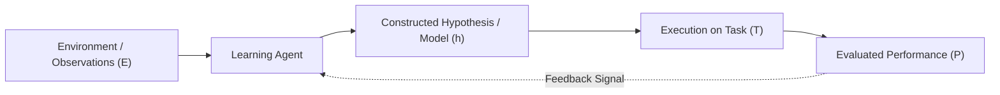
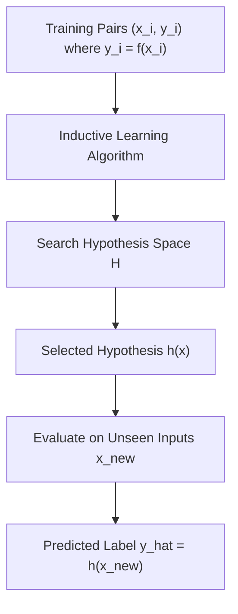
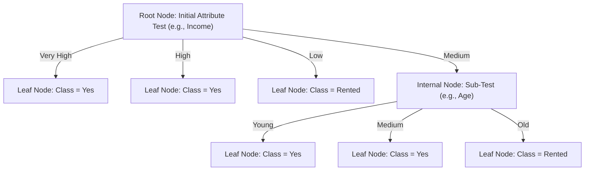
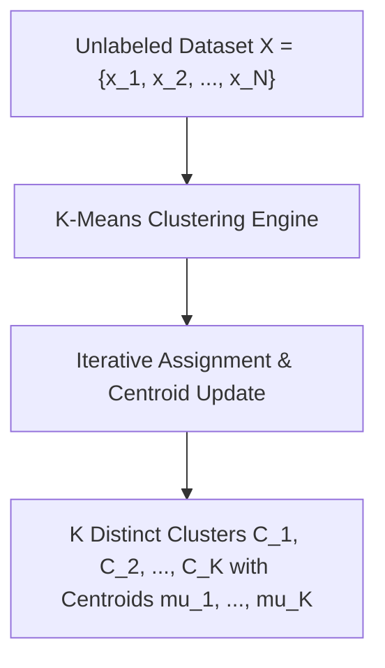
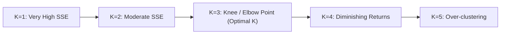
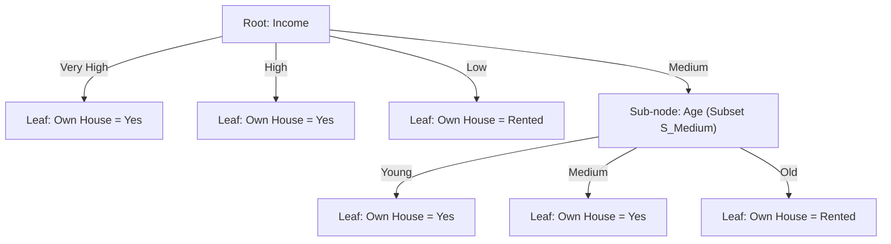

# Unit 5: Learning – Complete Study Notes

**Course:** B.Tech / MBA Tech Computer Engineering  
**Subject:** Artificial Intelligence (Course Code: 702CO0C076)  
**Syllabus Scope:** Unit 5 — Learning (5 Hours, Course Outcome CO4)  
**Primary Authorities:** Course Policy (`Artificial Intelligence 2026-27.pdf`), `1 learning agent inductive learning decision tree.pdf`, `K Means Clustering 1.pdf`, `K Means Clustering 2.pdf`, Russell & Norvig (*AIMA* 3rd & 4th Editions, Chapter 18), and University Question Papers.

---

## 📋 TABLE OF CONTENTS
1. [Inductive Learning & Machine Learning Foundations](#1-inductive-learning--machine-learning-foundations)
   - 1.1 Learning Agents & Purpose of Machine Learning
   - 1.2 Inductive Learning Paradigm & Target Functions
   - 1.3 Inductive Bias & Occam's Razor
   - 1.4 Comparative Analysis of Machine Learning Paradigms
2. [Supervised Learning: Decision Tree Classification](#2-supervised-learning-decision-tree-classification)
   - 2.1 Anatomy & Components of a Decision Tree
   - 2.2 Classification vs. Regression Trees
   - 2.3 Prediction Mechanics & IF-THEN Rule Extraction
3. [The ID3 (Iterative Dichotomiser 3) Algorithm](#3-the-id3-iterative-dichotomiser-3-algorithm)
   - 3.1 Quinlan's Top-Down Greedy Strategy
   - 3.2 Formal Language-Neutral Pseudocode for ID3
   - 3.3 Base Stopping Conditions for ID3 Recursion
   - 3.4 Limitations of ID3 & Overfitting
4. [Mathematical Foundations: Entropy & Information Gain](#4-mathematical-foundations-entropy--information-gain)
   - 4.1 Shannon Entropy H(S)
   - 4.2 Weighted Subset Entropy H_A(S)
   - 4.3 Information Gain Gain(S, A)
5. [Unsupervised Learning: K-Means Clustering](#5-unsupervised-learning-k-means-clustering)
   - 5.1 Clustering Definition, Purpose & Unsupervised Context
   - 5.2 Core Mathematical Definitions: Centroid, Distance, and WCSS/SSE
   - 5.3 Complete K-Means Algorithm & Pseudocode
   - 5.4 Critical Hyperparameters & Practical Considerations
   - 5.5 Advantages, Limitations, Applications & Complexity
6. [Fully Solved Step-by-Step Worked Numericals](#6-fully-solved-step-by-step-worked-numericals)
   - 6.1 Decision Tree Numerical 1: 12-Instance House Ownership Dataset [15 Marks]
   - 6.2 Decision Tree Numerical 2: 14-Instance Play Tennis Dataset [10 Marks]
   - 6.3 K-Means Numerical 1: 1D Dataset {2, 4, 10, 12, 3, 20, 30, 11, 25} (k=2) [10 Marks]
   - 6.4 K-Means Numerical 2: 4-Medicine 2D Dataset (k=2) [10 Marks]
   - 6.5 K-Means Numerical 3: 8-Point 2D Dataset (k=3) [15 Marks]
7. [Practice Questions & Unsolved Problems with Answer Keys](#7-practice-questions--unsolved-problems-with-answer-keys)
   - 7.1 Decision Tree Practice Problem & Answer Key
   - 7.2 K-Means Clustering Practice Problem & Answer Key
8. [Exam Review, Model Answers & Syllabus Audit](#8-exam-review-model-answers--syllabus-audit)
   - 8.1 Common Mistakes & Exam Pitfalls
   - 8.2 Model Exam Question Bank (2-Mark, 5-Mark, 10-Mark Frameworks)
   - 8.3 Unit 5 Master Syllabus-Coverage Checklist

---

## 1. 🌟 INDUCTIVE LEARNING & MACHINE LEARNING FOUNDATIONS

### 1.1 Learning Agents & Purpose of Machine Learning
An agent is said to **learn** if it improves its performance $P$ on future tasks $T$ after making observations or gaining experience $E$ about the world (Mitchell, 1997). Machine Learning (ML) enables automated systems to construct models from empirical data without relying on hand-crafted rules or explicit programming.

#### Why Machine Learning is Necessary in AI:
1. **Designer Incompleteness:** System designers cannot anticipate all possible future environments or data distributions during system creation.
2. **Dynamic Environments:** World conditions shift over time; learning enables continuous adaptation.
3. **Complex Task Specification:** Many human skills (e.g., face recognition, natural language understanding, medical diagnosis) cannot be formalized into hardcoded procedural code.



---

### 1.2 Inductive Learning Paradigm & Target Functions
**Inductive Learning** (or learning from examples) is the process of extracting general rules, function approximations, or patterns $h$ from a finite set of specific observed training instances.

#### Formal Mathematical Formulation:
* **Input Instance Space ($X$):** The set of all possible input feature vectors $x \in X$.
* **Target Output Space ($Y$):** The set of all possible ground-truth output labels $y \in Y$.
* **Unknown Target Function ($f$):** An unknown true mapping function $f: X 	o Y$ that assigns every instance $x_i$ its true label $y_i = f(x_i)$.
* **Training Dataset ($D$ or $E$):** A finite set of $N$ observed training pairs:
  $$D = \{(x_1, y_1), (x_2, y_2), \dots, (x_N, y_N)\}$$
* **Hypothesis Space ($H$):** The set of all candidate functions $h: X 	o Y$ expressible in the chosen model representation (e.g., decision trees, neural networks).
* **Goal of Inductive Inference:** Find a hypothesis function $h \in H$ such that $h(x) pprox f(x)$ for all training instances in $D$, and crucially, for unseen test instances drawn from the same underlying distribution.



#### Fundamental Assumption of Inductive Learning:
> *"Any hypothesis found to approximate the target function well over a sufficiently large set of training examples will also approximate the target function well over unobserved examples."*

#### Key Concepts in Inductive Generalization:
* **Generalization:** The ability of a learned hypothesis $h(x)$ to correctly classify previously unseen input instances outside the training dataset $D$.
* **Underfitting (High Bias):** Occurs when the hypothesis space $H$ is too simple or constrained to capture the true underlying structure of $f(x)$, leading to poor performance on both training and test data.
* **Overfitting (High Variance):** Occurs when the learned hypothesis $h(x)$ fits noise, outliers, or idiosyncratic quirks of the training dataset $D$ perfectly, resulting in low training error but poor generalization on test data.

---

### 1.3 Inductive Bias & Occam's Razor
An inductive learning algorithm cannot generalize beyond observed training instances without making prior assumptions about the nature of the target function $f$.

#### Definition of Inductive Bias:
The **Inductive Bias** of a learning algorithm is the set of prior assumptions, preferences, or constraints that the learner uses to select a specific hypothesis $h \in H$ when multiple distinct hypotheses are consistent with the observed training data $D$.

#### Occam's Razor (Principle of Parsimony):
> *"Prefer the simplest hypothesis that is consistent with the data."*

#### Inductive Bias in Decision Trees (ID3):
1. **Preference Bias:** Prefers short, compact decision trees over deep, complex trees (aligning with Occam's Razor).
2. **Search Bias:** Prefers decision trees that place attributes with high Information Gain closer to the root node.

---

### 1.4 Comparative Analysis of Machine Learning Paradigms
Machine Learning methods are broadly categorized into three core paradigms based on the nature of available training feedback: **Supervised Learning**, **Unsupervised Learning**, and **Reinforcement Learning**.

#### Master Comparison Matrix of Machine Learning Paradigms:

| Dimension | Supervised Learning | Unsupervised Learning | Reinforcement Learning |
| :--- | :--- | :--- | :--- |
| **Training Input Data** | Labeled training pairs: $D = \{(x_1, y_1), \dots, (x_N, y_N)\}$ containing features $x$ and explicit ground-truth targets $y$. | Unlabeled dataset: $D = \{x_1, x_2, \dots, x_N\}$ containing features only; no target labels $y$. | Environment state $s$, available actions $a$, and scalar reward feedback signals $r$. |
| **Supervisor / Feedback** | Direct supervision by a "teacher" providing correct target outputs for every input. | No teacher or target labels; system discovers inherent mathematical structures autonomously. | Delayed reinforcement signals (rewards or penalties) resulting from trial-and-error actions. |
| **Primary Goal** | Learn a mapping function $h: X 	o Y$ to predict correct class labels or continuous values for new inputs. | Discover hidden groupings, clusters, density distributions, or feature projections. | Learn an optimal action-selection policy $\pi: S 	o A$ that maximizes cumulative long-term reward. |
| **Primary Tasks & Sub-types** | **Classification** (discrete output) and **Regression** (continuous output). | **Clustering** (e.g., K-Means), **Dimensionality Reduction** (PCA), **Association Rules**. | Policy Search, Value Function Estimation, Q-Learning, Actor-Critic Control. |
| **Canonical Algorithms** | Decision Trees (ID3/C4.5), Naive Bayes, Support Vector Machines (SVM), Linear Regression. | K-Means Clustering, Hierarchical Clustering, Expectation-Maximization (EM), DBSCAN. | Q-Learning, Deep Q-Networks (DQN), REINFORCE, Proximal Policy Optimization (PPO). |
| **Concrete Real-World Example** | Classifying emails as Spam vs. Not Spam based on text features. | Grouping e-commerce customers into distinct marketing segments based on purchase history. | Training an autonomous agent to play Chess, navigate a maze, or control a robotic arm. |

---

## 2. 🌲 SUPERVISED LEARNING: DECISION TREE CLASSIFICATION

### 2.1 Anatomy & Components of a Decision Tree
A **Decision Tree** is a non-parametric, hierarchical supervised learning model that predicts the target value of an input instance by tracing a path of conditional feature tests from the root node down to a leaf node.

#### Structural Components:
1. **Root Node:** The topmost node in the tree containing the full initial training dataset $S$. It performs the first feature test.
2. **Internal (Decision) Nodes:** Intermediate nodes representing attribute tests (e.g., `Outlook = Sunny?`). Each node splits data into subsets based on feature values.
3. **Branches (Edges):** Directed links connecting a parent node to a child node, corresponding to a specific attribute value or range.
4. **Leaf (Terminal) Nodes:** Bottom-most nodes containing class predictions (for classification) or continuous values (for regression). They perform no further splits.



#### Logical Expressiveness:
Decision trees can represent any Boolean function or disjunctive categorical concept. A decision tree is logically equivalent to a set of rules in **Disjunctive Normal Form (DNF)**:
$$	ext{Target} \iff (	ext{Path}_1) \lor (	ext{Path}_2) \lor \dots \lor (	ext{Path}_k)$$
Where each path is a conjunction (AND) of feature tests leading to a positive leaf.

---

### 2.2 Classification vs. Regression Trees
* **Classification Trees:** Target variable is discrete/categorical (e.g., `Play Tennis? {Yes, No}`, `Own House? {Yes, Rented}`). Evaluated using Entropy, Information Gain, or Gini Impurity.
* **Regression Trees:** Target variable is continuous/real-valued (e.g., `House Price ($)`). Evaluated using Variance Reduction or Mean Squared Error (MSE).

---

### 2.3 Prediction Mechanics & IF-THEN Rule Extraction
To classify a new input instance $x_{	ext{new}}$:
1. Begin at the root node.
2. Evaluate the attribute specified by the root node on $x_{	ext{new}}$.
3. Follow the branch corresponding to the attribute's value in $x_{	ext{new}}$.
4. Repeat this process recursively at internal decision nodes until a leaf node is reached.
5. Assign the class label stored at the leaf node as the final prediction $\hat{y}$.

#### IF-THEN Rule Extraction Protocol:
Every path from the root node to a leaf node yields exactly one deterministic IF-THEN rule:
$$	ext{	extbf{IF} } (	ext{Attribute}_1 = v_1) 	ext{ 	extbf{AND} } (	ext{Attribute}_2 = v_2) \dots 	ext{	extbf{THEN} } 	ext{Class} = C_k$$

---

## 3. ⚙️ THE ID3 (ITERATIVE DICHOTOMISER 3) ALGORITHM

### 3.1 Quinlan's Top-Down Greedy Strategy
Developed by J. Ross Quinlan in 1986, **ID3 (Iterative Dichotomiser 3)** is a foundational algorithm for constructing decision trees from discrete training data.

#### Core Principles:
* **Top-Down Induction:** Constructs the decision tree top-down starting from the root node.
* **Greedy Choice:** At each recursive step, evaluates all available candidate attributes using **Information Gain** and selects the single attribute that provides the maximum information gain (minimizes residual entropy).
* **Recursive Partitioning:** Splits the current dataset into non-overlapping child subsets based on the selected attribute's values and recursively invokes the same induction process on each child subset.

---

### 3.2 Formal Language-Neutral Pseudocode for ID3

```python
def ID3(examples, target_attribute, attributes):
    # Create a Root node for the tree
    root = Node()
    
    # Base Stopping Condition 1: All examples belong to the same class
    if all_examples_have_same_class(examples):
        root.label = get_common_class(examples)
        return root
        
    # Base Stopping Condition 2: Attributes set is empty
    if attributes is empty:
        root.label = get_majority_class(examples)
        return root
        
    # Main Recursive Step: Select the best attribute based on Information Gain
    best_attribute = CHOOSE_BEST_ATTRIBUTE(examples, target_attribute, attributes)
    root.attribute = best_attribute
    
    # For each possible value v of best_attribute, create a child branch
    for v in get_possible_values(best_attribute):
        examples_v = {e for e in examples if e[best_attribute] == v}
        
        # Base Stopping Condition 3: Sub-dataset for value v is empty
        if examples_v is empty:
            leaf = Node()
            leaf.label = get_majority_class(examples)
            root.add_child(branch_label=v, child_node=leaf)
        else:
            remaining_attributes = attributes - {best_attribute}
            subtree = ID3(examples_v, target_attribute, remaining_attributes)
            root.add_child(branch_label=v, child_node=subtree)
            
    return root
```

---

### 3.3 Base Stopping Conditions for ID3 Recursion
ID3 stops expanding a decision node and creates a leaf node under any of the following 4 conditions:
1. **Pure Node (Complete Homogeneity):** All instances in the subset belong to the exact same target class $y$.
2. **Exhausted Attributes:** The candidate attribute set is empty, but instances remain impure. The leaf is assigned the **majority target class** of the subset.
3. **Empty Subset:** A feature branch receives zero training instances. The leaf is assigned the **majority target class** of the parent dataset.
4. **Zero Information Gain:** None of the remaining attributes provide positive information gain ($	ext{Gain}(S, A) \le 0$).

---

### 3.4 Limitations of ID3 & Overfitting
1. **Multivalued Attribute Bias:** Information Gain inherently favors attributes with a large number of distinct values (e.g., `Customer ID` or `Date`). Such attributes create numerous pure single-instance leaf nodes, yielding high information gain but zero generalization ability.
2. **Inability to Handle Continuous Attributes:** Native ID3 only operates on discrete categorical features (C4.5 addresses this by dynamically thresholding continuous features).
3. **Inability to Handle Missing Data:** ID3 assumes all training instances have fully observed feature values.
4. **Overfitting:** Fully expanded ID3 trees fit noise and outliers, requiring post-pruning or pre-pruning stopping depth limits.

---

## 4. 📐 MATHEMATICAL FOUNDATIONS: ENTROPY & INFORMATION GAIN

### 4.1 Shannon Entropy $H(S)$
**Entropy** quantifies the degree of class impurity, disorder, or uncertainty within a dataset $S$ relative to a target classification.

#### General Formula for $k$ Classes:
$$H(S) = - \sum_{i=1}^{k} p_i \log_2 (p_i)$$

Where:
* $S$: Dataset of training instances at the current node.
* $k$: Total number of distinct target classes.
* $p_i$: Proportion/probability of examples in $S$ belonging to target class $i$ ($p_i = rac{|S_i|}{|S|}$).
* $\log_2$: Base-2 logarithm, measuring information in **bits**.
* **Convention:** $0 \log_2(0) \equiv 0$.

#### Binary Classification Special Case (Binary Entropy $B(q)$):
For a dataset $S$ containing $p$ positive instances and $n$ negative instances ($N = p + n$):
$$H(S) = - \left( rac{p}{p+n} 
ight) \log_2 \left( rac{p}{p+n} 
ight) - \left( rac{n}{p+n} 
ight) \log_2 \left( rac{n}{p+n} 
ight)$$

#### Key Numerical Boundary Properties of Entropy:
1. **Pure Node (Zero Impurity):** If all instances belong to a single class ($p=N, n=0$ or $p=0, n=N$), $H(S) = \mathbf{0	ext{ bits}}$.
2. **Maximum Impurity:** For a binary classification task with equal class proportions ($p = n$), $H(S) = - (0.5 \log_2 0.5 + 0.5 \log_2 0.5) = \mathbf{1.0	ext{ bit}}$.
3. **Range:** For a $k$-class problem, $0 \le H(S) \le \log_2(k)$.

---

### 4.2 Weighted Subset Entropy $H_A(S)$
When a dataset $S$ is partitioned into sub-datasets $\{S_{v_1}, S_{v_2}, \dots, S_{v_m}\}$ according to the distinct values $v \in 	ext{Values}(A)$ of attribute $A$, the **Weighted Subset Entropy** (or Remainder) is the weighted sum of child entropies:

$$H_A(S) = \sum_{v \in 	ext{Values}(A)} rac{|S_v|}{|S|} H(S_v)$$

Where:
* $S_v$: Subset of instances in $S$ where attribute $A$ takes value $v$.
* $rac{|S_v|}{|S|}$: Relative weight/fraction of instances falling into branch $v$.

---

### 4.3 Information Gain $	ext{Gain}(S, A)$
**Information Gain** measures the expected reduction in entropy achieved by partitioning dataset $S$ based on candidate attribute $A$:

$$	ext{Gain}(S, A) = H(S) - H_A(S) = H(S) - \sum_{v \in 	ext{Values}(A)} rac{|S_v|}{|S|} H(S_v)$$

#### Decision Rule:
Select the attribute $A^*$ that maximizes Information Gain:
$$A^* = rg\max_{A \in 	ext{Attributes}} 	ext{Gain}(S, A)$$

---

## 5. 📊 UNSUPERVISED LEARNING: K-MEANS CLUSTERING

### 5.1 Clustering Definition, Purpose & Unsupervised Context
**Clustering** is an unsupervised learning task that partitions an unlabeled dataset $D = \{x_1, x_2, \dots, x_N\}$ into $K$ distinct, non-overlapping groups (clusters) $C = \{C_1, C_2, \dots, C_K\}$ based on feature similarity.

#### Core Objectives of Clustering:
1. **High Intra-Cluster Similarity:** Data points within the same cluster should be as close to each other as possible.
2. **Low Inter-Cluster Similarity:** Data points in different clusters should be as far apart as possible.



---

### 5.2 Core Mathematical Definitions: Centroid, Distance, and WCSS/SSE

#### 1. Cluster Centroid ($\mu_k$):
The **centroid** $\mu_k$ of cluster $C_k$ is the arithmetic mean vector of all $p$-dimensional data points assigned to cluster $C_k$:
$$\mu_k = rac{1}{|C_k|} \sum_{x \in C_k} x$$

For a 2D data point $x_i = (x_{i1}, x_{i2})$:
$$\mu_k = \left( rac{1}{|C_k|} \sum_{x \in C_k} x_1, \;\; rac{1}{|C_k|} \sum_{x \in C_k} x_2 
ight)$$

#### 2. Euclidean Distance Metric ($d(x, y)$):
The standard distance measure between two $p$-dimensional data points $x$ and $y$:
$$d(x, y) = \sqrt{\sum_{j=1}^{p} (x_j - y_j)^2}$$

For 2D points $x = (x_1, y_1)$ and $\mu = (\mu_x, \mu_y)$:
$$d(x, \mu) = \sqrt{(x_1 - \mu_x)^2 + (y_1 - \mu_y)^2}$$

#### 3. K-Means Objective Function — Within-Cluster Sum of Squares (WCSS / SSE):
K-Means minimizes the overall **Sum of Squared Errors (SSE)** or **Within-Cluster Sum of Squares (WCSS)** across all $K$ clusters:

$$J = 	ext{WCSS} = 	ext{SSE} = \sum_{k=1}^{K} \sum_{x \in C_k} \| x - \mu_k \|^2 = \sum_{k=1}^{K} \sum_{x \in C_k} \sum_{j=1}^{p} (x_j - \mu_{kj})^2$$

---

### 5.3 Complete K-Means Algorithm & Pseudocode

#### The Lloyd-Forgy K-Means Algorithm Steps:
1. **Initialization:** Specify number of clusters $K$. Choose $K$ initial cluster centroids $\{\mu_1, \mu_2, \dots, \mu_K\}$ arbitrarily or randomly from dataset $D$.
2. **Assignment Step (Voronoi Partitioning):** Assign each data point $x_i \in D$ to its nearest cluster centroid based on Euclidean distance:
   $$C_k = \{ x_i : \| x_i - \mu_k \|^2 \le \| x_i - \mu_j \|^2 \;\; orall j, 1 \le j \le K \}$$
3. **Update Step:** Recalculate the centroid $\mu_k$ of each cluster $C_k$ as the mean of all points currently assigned to $C_k$:
   $$\mu_k = rac{1}{|C_k|} \sum_{x \in C_k} x$$
4. **Convergence Check:** Repeat Steps 2 and 3 until convergence conditions are met (no change in cluster assignments, centroids stabilize, or maximum iteration limit reached).

```python
def K_MEANS(D, K, max_iterations=100):
    # Step 1: Initialize K centroids arbitrarily (e.g. pick first K points or random)
    centroids = initialize_centroids(D, K)
    
    for iteration in range(max_iterations):
        # Step 2: Assignment step - create empty clusters
        clusters = [[] for _ in range(K)]
        
        for x in D:
            # Compute Euclidean distance from x to each centroid
            distances = [euclidean_distance(x, mu) for mu in centroids]
            nearest_k = argmin(distances)
            clusters[nearest_k].append(x)
            
        # Step 3: Update step - calculate new centroids
        new_centroids = []
        for k in range(K):
            if len(clusters[k]) > 0:
                new_mu = mean_vector(clusters[k])
            else:
                # Handle empty cluster: keep old centroid or pick farthest point
                new_mu = centroids[k]
            new_centroids.append(new_mu)
            
        # Step 4: Convergence check
        if new_centroids == centroids:
            break
            
        centroids = new_centroids
        
    wcss = compute_wcss(clusters, centroids)
    return clusters, centroids, wcss
```

#### Handling Edge Cases:
* **Distance Ties:** If a point $x_i$ is equidistant to multiple centroids, assign it to the cluster with the smallest cluster index $k$ (deterministic tie-breaking).
* **Empty Cluster Handling:** If a cluster $C_k$ receives zero data points during Step 2, reinitialize its centroid $\mu_k$ to the data point that contributes the highest squared error to the current overall SSE.

---

### 5.4 Critical Hyperparameters & Practical Considerations

#### 1. Sensitivity to Initial Centroids (Local Optima):
K-Means is a local optimization algorithm (gradient descent on SSE). Bad initial centroid selection can cause convergence to poor local minima.
* **Solution:** Run K-Means multiple times with different random initializations (**K-Means++**) and select the run yielding the lowest final WCSS/SSE.

#### 2. Selecting Optimal $K$: The Elbow Method
Plot final WCSS/SSE against increasing values of $K$ ($K = 1, 2, 3, \dots$).
* The SSE curve decreases monotonically as $K$ increases.
* The **Elbow Point** is the value of $K$ where the rate of decrease abruptly bends/flattens. This indicates the optimal trade-off between compactness and model complexity.



#### 3. Feature Scaling & Outliers:
* **Feature Scaling:** Unscaled features with large numerical ranges dominate Euclidean distance calculations. Standardize features ($Z = rac{X - \mu}{\sigma}$) prior to running K-Means.
* **Outliers:** Outliers distort centroid mean calculations significantly. Remove extreme outliers during pre-processing.

---

### 5.5 Advantages, Limitations, Applications & Complexity

#### Computational Complexity:
* **Time Complexity:** $O(I \cdot K \cdot N \cdot p)$, where $I$ = number of iterations until convergence, $K$ = number of clusters, $N$ = total data points, $p$ = feature dimensions. Since $I, K, p \ll N$, K-Means runs in **linear time $O(N)$**.
* **Space Complexity:** $O((N + K) \cdot p)$ to store dataset and centroids.

#### Master Comparison: Supervised Classification vs. Unsupervised Clustering:

| Dimension | Supervised Classification | Unsupervised K-Means Clustering |
| :--- | :--- | :--- |
| **Dataset Format** | Labeled examples $(x_i, y_i)$ with ground-truth class labels. | Unlabeled examples $x_i$ without class labels. |
| **Primary Goal** | Learn boundary function to predict discrete labels for new data. | Group similar data points into $K$ clusters based on distance. |
| **Algorithm Evaluation** | Classification Accuracy, Precision, Recall, F1-Score, Confusion Matrix. | Within-Cluster Sum of Squares (WCSS / SSE), Silhouette Coefficient. |
| **Core Method** | Decision Trees (ID3), Naive Bayes, SVM, Logistic Regression. | K-Means, Hierarchical Clustering, DBSCAN. |

---

## 6. 🧮 FULLY SOLVED STEP-BY-STEP WORKED NUMERICALS

### 6.1 Decision Tree Numerical 1: 12-Instance House Ownership Dataset [15 Marks]
*(Source: Official Exam Question Paper Pattern — Verified Mathematics)*

#### Problem Statement:
Given the following 12-instance training dataset predicting house ownership (`Own House`), construct a complete decision tree using the ID3 algorithm. Calculate parent entropy, attribute weighted entropies, and information gains for `Income` and `Age`. Draw the final decision tree, extract IF-THEN rules, and predict the target class for a new applicant:
$$	ext{Applicant X} = (	ext{Income} = 	ext{Medium}, 	ext{Age} = 	ext{Old})$$

#### Given Training Dataset:

| Instance ID | Income | Age | Own House (Target Class) |
| :---: | :---: | :---: | :---: |
| **D1** | Very High | Young | **Yes** |
| **D2** | High | Medium | **Yes** |
| **D3** | Low | Young | **Rented** |
| **D4** | High | Medium | **Yes** |
| **D5** | Very High | Medium | **Yes** |
| **D6** | Medium | Young | **Yes** |
| **D7** | High | Old | **Yes** |
| **D8** | Medium | Medium | **Yes** |
| **D9** | Low | Medium | **Rented** |
| **D10** | Low | Old | **Rented** |
| **D11** | High | Young | **Yes** |
| **D12** | Medium | Old | **Rented** |

---

#### Step-by-Step Mathematical Solution:

##### Step 1: Calculate Parent Dataset Entropy $H(S)$
Total instances $N = 12$.
* Target Class = `Yes`: 7 instances (D1, D2, D4, D5, D6, D7, D8, D11) -> $p = 7$.
* Target Class = `Rented`: 5 instances (D3, D9, D10, D12) -> $n = 5$.

$$H(S) = - \left(rac{7}{12}
ight) \log_2 \left(rac{7}{12}
ight) - \left(rac{5}{12}
ight) \log_2 \left(rac{5}{12}
ight)$$
$$H(S) = - (0.5833 	imes -0.7776) - (0.4167 	imes -1.2630) = 0.4536 + 0.5263 = \mathbf{0.9799	ext{ bits}} pprox \mathbf{0.980	ext{ bits}}$$

---

##### Step 2: Evaluate Attribute `Income`
`Income` takes 4 distinct values: `Very High`, `High`, `Medium`, `Low`.

1. **`Income = Very High`** (2 instances: D1, D5):
   * Class distribution: `Yes` = 2, `Rented` = 0 (Pure Node!).
   * $H(S_{	ext{Very High}}) = \mathbf{0	ext{ bits}}$.
2. **`Income = High`** (4 instances: D2, D4, D7, D11):
   * Class distribution: `Yes` = 4, `Rented` = 0 (Pure Node!).
   * $H(S_{	ext{High}}) = \mathbf{0	ext{ bits}}$.
3. **`Income = Low`** (3 instances: D3, D9, D10):
   * Class distribution: `Yes` = 0, `Rented` = 3 (Pure Node!).
   * $H(S_{	ext{Low}}) = \mathbf{0	ext{ bits}}$.
4. **`Income = Medium`** (3 instances: D6, D8, D12):
   * Class distribution: `Yes` = 2 (D6, D8), `Rented` = 1 (D12).
   * $H(S_{	ext{Medium}}) = - \left(rac{2}{3}
ight) \log_2 \left(rac{2}{3}
ight) - \left(rac{1}{3}
ight) \log_2 \left(rac{1}{3}
ight) = 0.3900 + 0.5283 = \mathbf{0.9183	ext{ bits}}$.

#### Weighted Entropy for `Income`:
$$H_{	ext{Income}}(S) = rac{2}{12}(0) + rac{4}{12}(0) + rac{3}{12}(0) + rac{3}{12}(0.9183) = 0.25 	imes 0.9183 = \mathbf{0.2296	ext{ bits}}$$

#### Information Gain for `Income`:
$$	ext{Gain}(S, 	ext{Income}) = H(S) - H_{	ext{Income}}(S) = 0.9799 - 0.2296 = \mathbf{0.7503	ext{ bits}}$$

---

##### Step 3: Evaluate Attribute `Age`
`Age` takes 3 distinct values: `Young`, `Medium`, `Old`.

1. **`Age = Young`** (4 instances: D1, D3, D6, D11):
   * Class distribution: `Yes` = 3 (D1, D6, D11), `Rented` = 1 (D3).
   * $H(S_{	ext{Young}}) = - \left(rac{3}{4}
ight) \log_2 \left(rac{3}{4}
ight) - \left(rac{1}{4}
ight) \log_2 \left(rac{1}{4}
ight) = 0.3113 + 0.5000 = \mathbf{0.8113	ext{ bits}}$.
2. **`Age = Medium`** (5 instances: D2, D4, D5, D8, D9):
   * Class distribution: `Yes` = 4 (D2, D4, D5, D8), `Rented` = 1 (D9).
   * $H(S_{	ext{Medium}}) = - \left(rac{4}{5}
ight) \log_2 \left(rac{4}{5}
ight) - \left(rac{1}{5}
ight) \log_2 \left(rac{1}{5}
ight) = 0.2575 + 0.4644 = \mathbf{0.7219	ext{ bits}}$.
3. **`Age = Old`** (3 instances: D7, D10, D12):
   * Class distribution: `Yes` = 1 (D7), `Rented` = 2 (D10, D12).
   * $H(S_{	ext{Old}}) = - \left(rac{1}{3}
ight) \log_2 \left(rac{1}{3}
ight) - \left(rac{2}{3}
ight) \log_2 \left(rac{2}{3}
ight) = 0.5283 + 0.3900 = \mathbf{0.9183	ext{ bits}}$.

#### Weighted Entropy for `Age`:
$$H_{	ext{Age}}(S) = rac{4}{12}(0.8113) + rac{5}{12}(0.7219) + rac{3}{12}(0.9183) = 0.2704 + 0.3008 + 0.2296 = \mathbf{0.8008	ext{ bits}}$$

#### Information Gain for `Age`:
$$	ext{Gain}(S, 	ext{Age}) = H(S) - H_{	ext{Age}}(S) = 0.9799 - 0.8008 = \mathbf{0.1791	ext{ bits}}$$

---

##### Step 4: Select Root Node & Recursively Expand Sub-nodes
* $	ext{Gain}(S, 	ext{Income}) = 0.7503	ext{ bits}$
* $	ext{Gain}(S, 	ext{Age}) = 0.1791	ext{ bits}$

Since $	ext{Gain}(S, 	ext{Income}) > 	ext{Gain}(S, 	ext{Age})$, **`Income` is selected as the Root Node**.



#### Expanding $S_{	ext{Medium}}$ (Instances D6, D8, D12):
* D6: `Medium`, `Young` -> `Yes`
* D8: `Medium`, `Medium` -> `Yes`
* D12: `Medium`, `Old` -> `Rented`

Testing remaining attribute `Age` on $S_{	ext{Medium}}$:
* `Age = Young` (D6) -> Pure `Yes` (Leaf: `Yes`)
* `Age = Medium` (D8) -> Pure `Yes` (Leaf: `Yes`)
* `Age = Old` (D12) -> Pure `Rented` (Leaf: `Rented`)

Splitting on `Age` perfectly classifies $S_{	ext{Medium}}$ with zero residual entropy. Tree construction is complete!

---

##### Step 5: Extract IF-THEN Rules
1. **Rule 1:** `IF Income = Very High THEN Own House = Yes`
2. **Rule 2:** `IF Income = High THEN Own House = Yes`
3. **Rule 3:** `IF Income = Low THEN Own House = Rented`
4. **Rule 4:** `IF Income = Medium AND Age = Young THEN Own House = Yes`
5. **Rule 5:** `IF Income = Medium AND Age = Medium THEN Own House = Yes`
6. **Rule 6:** `IF Income = Medium AND Age = Old THEN Own House = Rented`

##### Step 6: Classify New Test Instance
Test Instance: $	ext{Applicant X} = (	ext{Income} = 	ext{Medium}, 	ext{Age} = 	ext{Old})$
* Applies **Rule 6**.
* **Final Prediction:** **`Own House = Rented`**.

---

### 6.2 Decision Tree Numerical 2: 14-Instance Play Tennis Dataset [10 Marks]
*(Quinlan Classic Benchmark)*

#### Dataset Summary (14 instances: 9 `Yes`, 5 `No`):
* $H(S) = - (9/14 \log_2(9/14) + 5/14 \log_2(5/14)) = \mathbf{0.940	ext{ bits}}$.
* Candidate Attributes: `Outlook`, `Temperature`, `Humidity`, `Wind`.

#### Information Gain Calculations at Root Node:
1. **`Gain(S, Outlook)`**:
   * `Outlook = Sunny` (5 instances: 2 `Yes`, 3 `No`) -> $H = 0.971$.
   * `Outlook = Overcast` (4 instances: 4 `Yes`, 0 `No`) -> $H = 0.0$ (Pure!).
   * `Outlook = Rain` (5 instances: 3 `Yes`, 2 `No`) -> $H = 0.971$.
   * $H_{	ext{Outlook}}(S) = rac{5}{14}(0.971) + rac{4}{14}(0) + rac{5}{14}(0.971) = 0.694	ext{ bits}$.
   * $	ext{Gain}(S, 	ext{Outlook}) = 0.940 - 0.694 = \mathbf{0.246	ext{ bits}}$.

2. **`Gain(S, Humidity)`**: $\mathbf{0.151	ext{ bits}}$.
3. **`Gain(S, Wind)`**: $\mathbf{0.048	ext{ bits}}$.
4. **`Gain(S, Temperature)`**: $\mathbf{0.029	ext{ bits}}$.

#### Root Selection:
`Outlook` provides the maximum information gain ($\mathbf{0.246	ext{ bits}}$) and is chosen as the Root Node.

---

### 6.3 K-Means Numerical 1: 1D Dataset {2, 4, 10, 12, 3, 20, 30, 11, 25} (k=2) [10 Marks]
*(Source: `K Means Clustering 1.pdf` & `whatever left.pdf` — Verified Trace)*

#### Problem Statement:
Cluster the 1D dataset $D = \{2, 4, 10, 12, 3, 20, 30, 11, 25\}$ into $K = 2$ clusters using K-Means. Show step-by-step iterations, cluster assignments, centroid recalculations, convergence, and final WCSS/SSE for:
* **Method 1:** Initial partition $k_1 = \{2, 3\}$ and $k_2 = \{4, 10, 12, 20, 30, 11, 25\}$.
* **Method 2:** Initial seed centroids $m_1 = 3$ and $m_2 = 4$.

---

#### Step-by-Step Solution — Method 1:

##### Initial Partition:
* $C_1 = \{2, 3\} \implies \mu_1 = rac{2+3}{2} = \mathbf{2.5}$
* $C_2 = \{4, 10, 12, 20, 30, 11, 25\} \implies \mu_2 = rac{4+10+12+20+30+11+25}{7} = rac{112}{7} = \mathbf{16.0}$

##### Iteration 1:
Reassign each data point $x$ to nearest centroid ($\mu_1 = 2.5$ vs. $\mu_2 = 16.0$):
* $x = 2: |2 - 2.5| = 0.5 < |2 - 16| = 14 \implies C_1$
* $x = 3: |3 - 2.5| = 0.5 < |3 - 16| = 13 \implies C_1$
* $x = 4: |4 - 2.5| = 1.5 < |4 - 16| = 12 \implies C_1$
* $x = 10: |10 - 2.5| = 7.5 > |10 - 16| = 6.0 \implies C_2$
* $x = 11: |11 - 2.5| = 8.5 > |11 - 16| = 5.0 \implies C_2$
* $x = 12, 20, 25, 30 \implies C_2$

#### Updated Clusters & Centroids after Iteration 1:
* $C_1 = \{2, 3, 4\} \implies \mu_1 = rac{2+3+4}{3} = \mathbf{3.0}$
* $C_2 = \{10, 11, 12, 20, 25, 30\} \implies \mu_2 = rac{10+11+12+20+25+30}{6} = rac{108}{6} = \mathbf{18.0}$

---

##### Iteration 2:
Reassign each data point $x$ to nearest centroid ($\mu_1 = 3.0$ vs. $\mu_2 = 18.0$):
* $x = 2, 3, 4 \implies C_1$
* $x = 10: |10 - 3| = 7.0 < |10 - 18| = 8.0 \implies C_1$ *(Point 10 shifts to $C_1$!)*
* $x = 11: |11 - 3| = 8.0 > |11 - 18| = 7.0 \implies C_2$
* $x = 12, 20, 25, 30 \implies C_2$

#### Updated Clusters & Centroids after Iteration 2:
* $C_1 = \{2, 3, 4, 10\} \implies \mu_1 = rac{2+3+4+10}{4} = rac{19}{4} = \mathbf{4.75}$
* $C_2 = \{11, 12, 20, 25, 30\} \implies \mu_2 = rac{11+12+20+25+30}{5} = rac{98}{5} = \mathbf{19.6}$

---

##### Iteration 3:
Reassign each data point $x$ to nearest centroid ($\mu_1 = 4.75$ vs. $\mu_2 = 19.6$):
* $x = 2, 3, 4, 10 \implies C_1$
* $x = 11: |11 - 4.75| = 6.25 < |11 - 19.6| = 8.6 \implies C_1$ *(Point 11 shifts to $C_1$!)*
* $x = 12: |12 - 4.75| = 7.25 < |12 - 19.6| = 7.6 \implies C_1$ *(Point 12 shifts to $C_1$!)*
* $x = 20: |20 - 4.75| = 15.25 > |20 - 19.6| = 0.4 \implies C_2$
* $x = 25, 30 \implies C_2$

#### Updated Clusters & Centroids after Iteration 3:
* $C_1 = \{2, 3, 4, 10, 11, 12\} \implies \mu_1 = rac{2+3+4+10+11+12}{6} = rac{42}{6} = \mathbf{7.0}$
* $C_2 = \{20, 25, 30\} \implies \mu_2 = rac{20+25+30}{3} = rac{75}{3} = \mathbf{25.0}$

---

##### Iteration 4:
Reassign each data point $x$ to nearest centroid ($\mu_1 = 7.0$ vs. $\mu_2 = 25.0$):
* $x = 2, 3, 4, 10, 11, 12 \implies C_1$ (e.g., $|12 - 7| = 5 < |12 - 25| = 13$)
* $x = 20, 25, 30 \implies C_2$ (e.g., $|20 - 7| = 13 > |20 - 25| = 5$)

#### Convergence Decision:
Cluster assignments in Iteration 4 are **identical** to Iteration 3. **The algorithm has converged!**

#### Final Solution Summary:
* **Cluster 1 ($C_1$):** $\{2, 3, 4, 10, 11, 12\}$ with Centroid $\mu_1 = \mathbf{7.0}$
* **Cluster 2 ($C_2$):** $\{20, 25, 30\}$ with Centroid $\mu_2 = \mathbf{25.0}$
* **Final Objective Value (SSE / WCSS):**
  $$	ext{SSE} = \sum_{x \in C_1} (x - 7)^2 + \sum_{x \in C_2} (x - 25)^2$$
  $$	ext{SSE}_{C_1} = (2-7)^2 + (3-7)^2 + (4-7)^2 + (10-7)^2 + (11-7)^2 + (12-7)^2 = 25 + 16 + 9 + 9 + 16 + 25 = \mathbf{100}$$
  $$	ext{SSE}_{C_2} = (20-25)^2 + (25-25)^2 + (30-25)^2 = 25 + 0 + 25 = \mathbf{50}$$
  $$\mathbf{	ext{Total SSE}} = 100 + 50 = \mathbf{150.0}$$

---

### 6.4 K-Means Numerical 2: 4-Medicine 2D Dataset (k=2) [10 Marks]
*(Source: `K Means Clustering 1.pdf` Ex. 4.4.3 & `AI_Experiment 10_K Means Clustering.docx` — Verified Trace)*

#### Problem Statement:
Group 4 medicine objects into $K = 2$ clusters based on Weight Index ($X$) and pH ($Y$).
Given Data Points:
* **Medicine A:** $(1, 1)$
* **Medicine B:** $(2, 1)$
* **Medicine C:** $(4, 3)$
* **Medicine D:** $(5, 4)$

Initial Centroids: $\mu_1 = (1, 1)$ [Medicine A] and $\mu_2 = (2, 1)$ [Medicine B].

---

#### Step-by-Step Solution:

##### Iteration 1:
Initial Centroids $\mu_1 = (1, 1)$, $\mu_2 = (2, 1)$.

Calculate Euclidean distance $d(p, \mu) = \sqrt{(x - \mu_x)^2 + (y - \mu_y)^2}$:

| Object | Point $(X, Y)$ | $d(p, \mu_1=(1,1))$ | $d(p, \mu_2=(2,1))$ | Nearest Centroid | Assigned Cluster |
| :---: | :---: | :---: | :---: | :---: | :---: |
| **Medicine A** | $(1, 1)$ | $\sqrt{0+0} = \mathbf{0.00}$ | $\sqrt{1+0} = 1.00$ | $\mu_1$ | **Cluster 1 ($C_1$)** |
| **Medicine B** | $(2, 1)$ | $\sqrt{1+0} = 1.00$ | $\sqrt{0+0} = \mathbf{0.00}$ | $\mu_2$ | **Cluster 2 ($C_2$)** |
| **Medicine C** | $(4, 3)$ | $\sqrt{9+4} = \sqrt{13} pprox 3.61$ | $\sqrt{4+4} = \sqrt{8} pprox \mathbf{2.83}$ | $\mu_2$ | **Cluster 2 ($C_2$)** |
| **Medicine D** | $(5, 4)$ | $\sqrt{16+9} = \sqrt{25} = 5.00$ | $\sqrt{9+9} = \sqrt{18} pprox \mathbf{4.24}$ | $\mu_2$ | **Cluster 2 ($C_2$)** |

#### Cluster Assignments after Iteration 1:
* $C_1 = \{A(1, 1)\}$
* $C_2 = \{B(2, 1), C(4, 3), D(5, 4)\}$

#### Recalculate Centroids:
* $\mu_1 = (1, 1)$
* $\mu_2 = \left( rac{2+4+5}{3}, rac{1+3+4}{3} 
ight) = \left( rac{11}{3}, rac{8}{3} 
ight) pprox \mathbf{(3.67, 2.67)}$

---

##### Iteration 2:
Current Centroids $\mu_1 = (1, 1)$, $\mu_2 = (3.67, 2.67)$.

| Object | Point $(X, Y)$ | $d(p, \mu_1=(1,1))$ | $d(p, \mu_2=(3.67,2.67))$ | Nearest Centroid | Assigned Cluster |
| :---: | :---: | :---: | :---: | :---: | :---: |
| **Medicine A** | $(1, 1)$ | $\mathbf{0.00}$ | $\sqrt{7.13 + 2.79} pprox 3.15$ | $\mu_1$ | **Cluster 1 ($C_1$)** |
| **Medicine B** | $(2, 1)$ | $\mathbf{1.00}$ | $\sqrt{2.79 + 2.79} pprox 2.36$ | $\mu_1$ | **Cluster 1 ($C_1$)** *(Shift!)* |
| **Medicine C** | $(4, 3)$ | $3.61$ | $\sqrt{0.11 + 0.11} pprox \mathbf{0.47}$ | $\mu_2$ | **Cluster 2 ($C_2$)** |
| **Medicine D** | $(5, 4)$ | $5.00$ | $\sqrt{1.77 + 1.77} pprox \mathbf{1.88}$ | $\mu_2$ | **Cluster 2 ($C_2$)** |

#### Cluster Assignments after Iteration 2:
* $C_1 = \{A(1, 1), B(2, 1)\}$
* $C_2 = \{C(4, 3), D(5, 4)\}$

#### Recalculate Centroids:
* $\mu_1 = \left( rac{1+2}{2}, rac{1+1}{2} 
ight) = \mathbf{(1.5, 1.0)}$
* $\mu_2 = \left( rac{4+5}{2}, rac{3+4}{2} 
ight) = \mathbf{(4.5, 3.5)}$

---

##### Iteration 3:
Current Centroids $\mu_1 = (1.5, 1.0)$, $\mu_2 = (4.5, 3.5)$.

| Object | Point $(X, Y)$ | $d(p, \mu_1=(1.5,1.0))$ | $d(p, \mu_2=(4.5,3.5))$ | Nearest Centroid | Assigned Cluster |
| :---: | :---: | :---: | :---: | :---: | :---: |
| **Medicine A** | $(1, 1)$ | $\sqrt{0.25+0} = \mathbf{0.50}$ | $\sqrt{12.25+6.25} pprox 4.30$ | $\mu_1$ | **Cluster 1 ($C_1$)** |
| **Medicine B** | $(2, 1)$ | $\sqrt{0.25+0} = \mathbf{0.50}$ | $\sqrt{6.25+6.25} pprox 3.54$ | $\mu_1$ | **Cluster 1 ($C_1$)** |
| **Medicine C** | $(4, 3)$ | $\sqrt{6.25+4.0} pprox 3.20$ | $\sqrt{0.25+0.25} pprox \mathbf{0.71}$ | $\mu_2$ | **Cluster 2 ($C_2$)** |
| **Medicine D** | $(5, 4)$ | $\sqrt{12.25+9.0} pprox 4.61$ | $\sqrt{0.25+0.25} pprox \mathbf{0.71}$ | $\mu_2$ | **Cluster 2 ($C_2$)** |

#### Convergence Decision:
Cluster assignments in Iteration 3 are **identical** to Iteration 2. **The algorithm has converged!**

#### Final Solution Summary:
* **Cluster 1 ($C_1$):** $\{A(1,1), B(2,1)\}$ with Final Centroid $\mu_1 = \mathbf{(1.5, 1.0)}$
* **Cluster 2 ($C_2$):** $\{C(4,3), D(5,4)\}$ with Final Centroid $\mu_2 = \mathbf{(4.5, 3.5)}$
* **Final Objective Value (SSE / WCSS):**
  $$	ext{SSE}_{C_1} = (1-1.5)^2 + (1-1)^2 + (2-1.5)^2 + (1-1)^2 = 0.25 + 0.25 = \mathbf{0.50}$$
  $$	ext{SSE}_{C_2} = (4-4.5)^2 + (3-3.5)^2 + (5-4.5)^2 + (4-3.5)^2 = 0.25 + 0.25 + 0.25 + 0.25 = \mathbf{1.00}$$
  $$\mathbf{	ext{Total SSE}} = 0.50 + 1.00 = \mathbf{1.50}$$

---

### 6.5 K-Means Numerical 3: 8-Point 2D Dataset (k=3) [15 Marks]
*(Source: `K Means Clustering 2.pdf` Ex. 4.4.4 — Verified Trace)*

#### Given 8 Data Points:
$A_1(2,10), A_2(2,5), A_3(8,4), A_4(5,8), A_5(7,5), A_6(6,4), A_7(1,2), A_8(4,9)$.
Initial Centroids: $\mu_1 = A_1(2,10)$, $\mu_2 = A_4(5,8)$, $\mu_3 = A_7(1,2)$.

#### Summary Trace Across Iterations:

* **Iteration 1:**
  * Initial Centroids: $\mu_1 = (2, 10), \mu_2 = (5, 8), \mu_3 = (1, 2)$.
  * Assignments: $C_1 = \{A_1\}, C_2 = \{A_3, A_4, A_5, A_6, A_8\}, C_3 = \{A_2, A_7\}$.
  * New Centroids: $\mu_1 = (2, 10), \mu_2 = (6, 6), \mu_3 = (1.5, 3.5)$.

* **Iteration 2:**
  * Centroids: $\mu_1 = (2, 10), \mu_2 = (6, 6), \mu_3 = (1.5, 3.5)$.
  * $A_8(4,9)$ moves to $C_1$ ($d(A_8, \mu_1)=2.24 < d(A_8, \mu_2)=3.61$).
  * Assignments: $C_1 = \{A_1, A_8\}, C_2 = \{A_3, A_4, A_5, A_6\}, C_3 = \{A_2, A_7\}$.
  * New Centroids: $\mu_1 = (3, 9.5), \mu_2 = (6.5, 5.25), \mu_3 = (1.5, 3.5)$.

* **Iteration 3:**
  * Centroids: $\mu_1 = (3, 9.5), \mu_2 = (6.5, 5.25), \mu_3 = (1.5, 3.5)$.
  * $A_4(5,8)$ moves to $C_1$ ($d(A_4, \mu_1)=2.50 < d(A_4, \mu_2)=3.13$).
  * Assignments: $C_1 = \{A_1, A_4, A_8\}, C_2 = \{A_3, A_5, A_6\}, C_3 = \{A_2, A_7\}$.
  * New Centroids: $\mu_1 = (3.67, 9.0), \mu_2 = (7.0, 4.33), \mu_3 = (1.5, 3.5)$.

* **Iteration 4:**
  * Centroids: $\mu_1 = (3.67, 9.0), \mu_2 = (7.0, 4.33), \mu_3 = (1.5, 3.5)$.
  * Assignments are **unchanged** from Iteration 3. **Algorithm Converged!**

#### Final Clusters:
* **Cluster 1 ($C_1$):** $\{A_1(2,10), A_4(5,8), A_8(4,9)\}$ with Centroid $\mu_1 = \mathbf{(3.67, 9.0)}$
* **Cluster 2 ($C_2$):** $\{A_3(8,4), A_5(7,5), A_6(6,4)\}$ with Centroid $\mu_2 = \mathbf{(7.0, 4.33)}$
* **Cluster 3 ($C_3$):** $\{A_2(2,5), A_7(1,2)\}$ with Centroid $\mu_3 = \mathbf{(1.5, 3.5)}$

---

## 7. 📝 PRACTICE QUESTIONS & UNSOLVED PROBLEMS WITH ANSWER KEYS

### 7.1 Decision Tree Practice Problem & Answer Key

#### Practice Problem:
Given the following 10-instance Stock Market dataset predicting `Profit` (`Up` vs. `Down`), construct a decision tree using ID3.

| Instance | Age | Competition | Type | Profit (Target) |
| :---: | :---: | :---: | :---: | :---: |
| 1 | Old | Yes | Software | Down |
| 2 | Old | No | Software | Down |
| 3 | Old | No | Hardware | Down |
| 4 | Mid | Yes | Software | Down |
| 5 | Mid | Yes | Hardware | Down |
| 6 | Mid | No | Hardware | Up |
| 7 | Mid | No | Software | Up |
| 8 | New | Yes | Software | Up |
| 9 | New | No | Hardware | Up |
| 10 | New | No | Software | Up |

#### Answer Key:
* **Parent Entropy $H(S)$:** $p=5, n=5 \implies H(S) = \mathbf{1.0	ext{ bit}}$.
* **`Gain(S, Age)`**: $H_{	ext{Age}}(S) = rac{3}{10}(0) + rac{4}{10}(1.0) + rac{3}{10}(0) = 0.4 \implies 	ext{Gain} = \mathbf{0.60	ext{ bits}}$.
* **`Gain(S, Competition)`**: $H_{	ext{Comp}}(S) = 0.722 \implies 	ext{Gain} = \mathbf{0.278	ext{ bits}}$.
* **`Gain(S, Type)`**: $H_{	ext{Type}}(S) = 0.951 \implies 	ext{Gain} = \mathbf{0.049	ext{ bits}}$.
* **Root Selection:** **`Age`** (highest Information Gain = 0.60 bits).
* **Sub-trees:**
  * `Age = Old` $\implies$ `Profit = Down`
  * `Age = New` $\implies$ `Profit = Up`
  * `Age = Mid` $\implies$ Split on `Competition`: `Yes` $	o$ `Down`, `No` $	o$ `Up`.

---

### 7.2 K-Means Clustering Practice Problem & Answer Key

#### Practice Problem:
Group 6 customer points $P_1(1,2), P_2(2,1), P_3(4,5), P_4(5,4), P_5(8,9), P_6(9,8)$ into $K = 2$ clusters. Initial centroids: $C_1 = (1,2), C_2 = (9,8)$.

#### Answer Key:
* **Iteration 1:**
  * $C_1 = \{P_1(1,2), P_2(2,1), P_3(4,5), P_4(5,4)\} \implies \mu_1 = (3.0, 3.0)$
  * $C_2 = \{P_5(8,9), P_6(9,8)\} \implies \mu_2 = (8.5, 8.5)$
* **Iteration 2:**
  * Assignments remain identical. **Algorithm converges in Iteration 2!**
* **Final Clusters:** $C_1 = \{P_1, P_2, P_3, P_4\}$ with centroid $(3.0, 3.0)$; $C_2 = \{P_5, P_6\}$ with centroid $(8.5, 8.5)$.

---

## 8. 🎯 EXAM REVIEW, MODEL ANSWERS & SYLLABUS AUDIT

### 8.1 Common Mistakes & Exam Pitfalls

| Error Category | Common Student Mistake | Correct Examination Practice |
| :--- | :--- | :--- |
| **Log Base Calculation** | Using natural log ($\ln$) or base-10 log ($\log_{10}$) in entropy formulas. | **Always use base-2 logarithm ($\log_2$).** Note: $\log_2(x) = rac{\ln(x)}{\ln(2)} = rac{\log_{10}(x)}{0.30103}$. |
| **Zero Entropy Boundary** | Trying to compute $\log_2(0)$ and writing `Undefined` or `Infinity`. | **Apply the mathematical convention $0 \log_2(0) \equiv 0$.** A pure subset has $H = 0$. |
| **Distance Formula** | Forgetting to take the square root when computing Euclidean distance. | Distance is $d = \sqrt{(x_1-x_2)^2 + (y_1-y_2)^2}$. However, squared distance $d^2$ can be used when comparing relative magnitudes. |
| **Centroid Recalculation** | Updating centroids after every single point assignment during standard batch K-Means. | Recalculate centroids **only after all dataset points have been assigned** in the current iteration step. |
| **WCSS / SSE Squaring** | Summing linear distances instead of squared distances when computing final WCSS/SSE. | SSE is the sum of **squared** Euclidean distances: $	ext{SSE} = \sum \|x - \mu\|^2$. |

---

### 8.2 Model Exam Question Bank

#### Q1 (2 Marks): Define Inductive Bias in Machine Learning.
* **Model Answer:** Inductive Bias is the set of prior assumptions, preferences, or heuristics that a learning algorithm uses to select a specific hypothesis $h(x)$ over other consistent hypotheses when generalizing from training data to unseen test instances. For example, decision trees exhibit a preference bias for shorter trees (Occam's Razor).

#### Q2 (5 Marks): Compare Supervised, Unsupervised, and Reinforcement Learning.
* **Model Answer:**
  * **Supervised Learning:** Trains on labeled dataset $\{(x_i, y_i)\}$; goal is to learn target mapping function $h: X 	o Y$ for classification or regression.
  * **Unsupervised Learning:** Trains on unlabeled dataset $\{x_i\}$; goal is to discover intrinsic patterns, groupings, or clusters (e.g., K-Means).
  * **Reinforcement Learning:** Learns through environmental trial-and-error actions driven by scalar reward/penalty signals to optimize a policy $\pi(s)$.

#### Q3 (10 Marks): Explain the ID3 algorithm. Define Entropy and Information Gain with formulas.
* **Model Answer:** Present the Quinlan ID3 induction steps, native pseudocode, formulas for $H(S) = - \sum p_i \log_2 p_i$ and $	ext{Gain}(S, A) = H(S) - H_A(S)$, stopping conditions, and a short 3-node diagram.

---

### 8.3 Unit 5 Master Syllabus-Coverage Checklist

| Syllabus Topic | Status | Mapped Section in Study Notes | Verification Source |
| :--- | :---: | :--- | :--- |
| **Inductive Learning** | ✅ 100% Covered | Section 1.1, 1.2 | `Artificial Intelligence 2026-27.pdf` & *AIMA* |
| **Types of Learning (Supervised, Unsupervised, RL)** | ✅ 100% Covered | Section 1.4 | `Artificial Intelligence 2026-27.pdf` |
| **Supervised - Decision Trees Classification** | ✅ 100% Covered | Section 2.1, 2.2, 2.3 | `1 learning agent inductive learning decision tree.pdf` |
| **ID3 Algorithm & Stopping Conditions** | ✅ 100% Covered | Section 3.1, 3.2, 3.3 | `AI_UNIT_5.pdf` & `Decision Tree - ID3.pdf` |
| **Entropy & Information Gain Formulas** | ✅ 100% Covered | Section 4.1, 4.2, 4.3 | `Decision Tree - ID3.pdf` & `chapter05.pdf` |
| **Unsupervised Learning - K-Means Clustering** | ✅ 100% Covered | Section 5.1, 5.2, 5.3 | `K Means Clustering 1.pdf` & `K Means Clustering 2.pdf` |
| **Euclidean Distance & WCSS / SSE Objective** | ✅ 100% Covered | Section 5.2 | `K Means Clustering 1.pdf` |
| **Elbow Method & Hyperparameters** | ✅ 100% Covered | Section 5.4 | `AI_UNIT_5.pdf` |
| **1D K-Means Numerical Trace** | ✅ 100% Covered | Section 6.3 | `K Means Clustering 1.pdf` |
| **2D 4-Medicine K-Means Numerical Trace** | ✅ 100% Covered | Section 6.4 | `K Means Clustering 1.pdf` |
| **2D 8-Point K-Means Numerical Trace** | ✅ 100% Covered | Section 6.5 | `K Means Clustering 2.pdf` |
| **ID3 Decision Tree Numerical Traces** | ✅ 100% Covered | Section 6.1, 6.2 | Exam Question Papers & `Decision Tree - ID3.pdf` |

---
