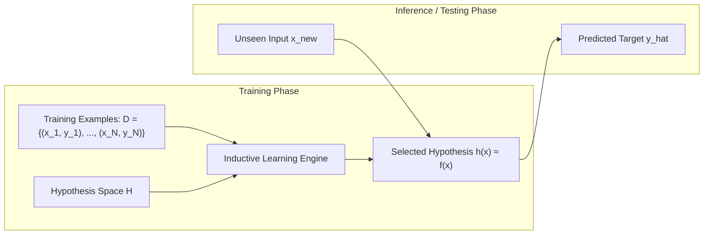
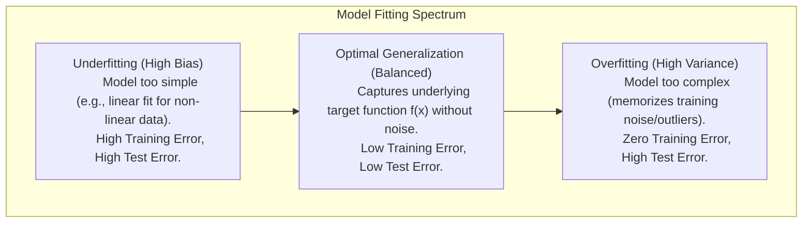
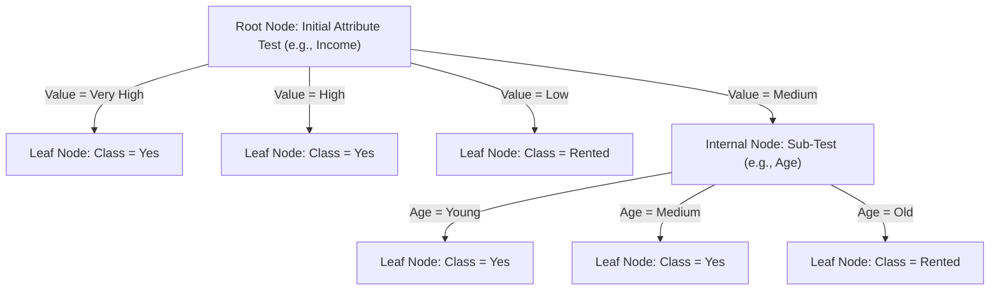
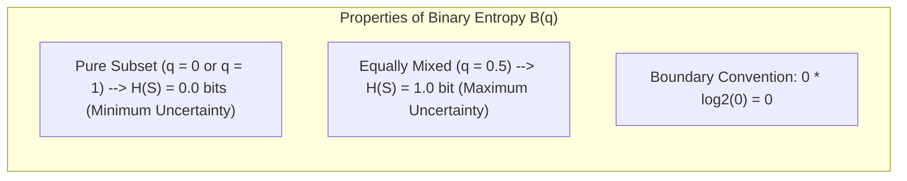
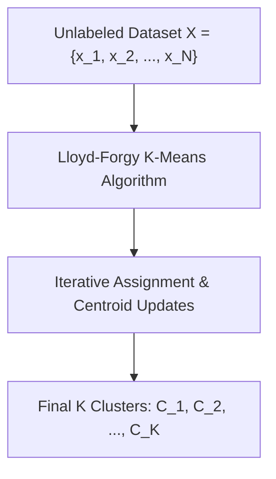
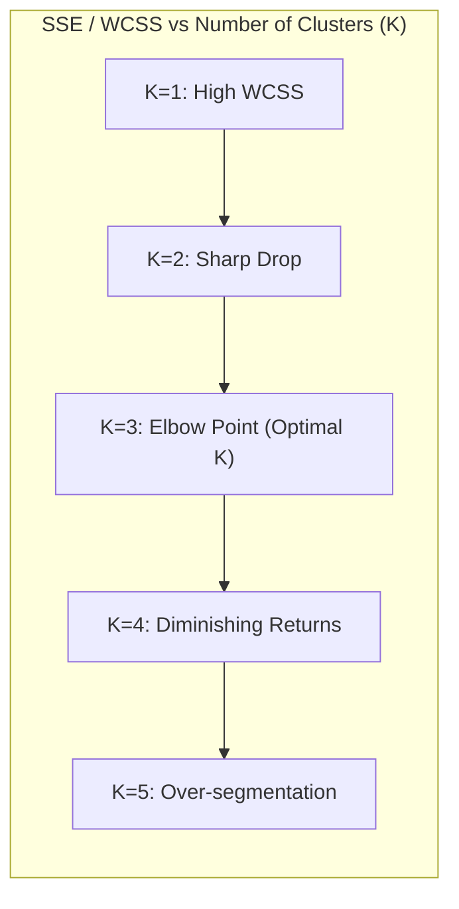
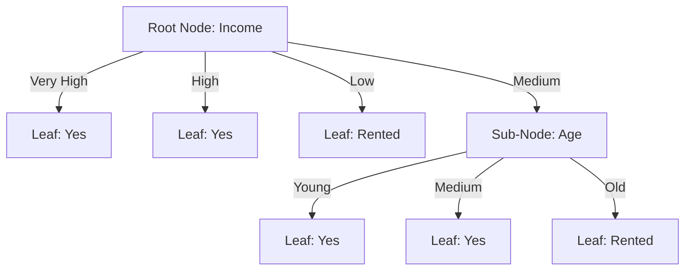

# Unit 5: Learning – Complete Study Notes

**Course:** B.Tech / MBA Tech Computer Engineering & AI  
**Subject:** Artificial Intelligence (Course Code: 702CO0C076)  
**Syllabus Scope:** Unit 5 — Learning (5 Hours, Course Outcome CO4)  
**Primary References:** Course Policy (`Artificial Intelligence 2026-27.pdf`), `1 learning agent inductive learning decision tree.pdf`, `K Means Clustering 1.pdf`, `K Means Clustering 2.pdf`, `AI_UNIT_5.pdf`, `chapter05.pdf`, Russell & Norvig (*AIMA* 3rd & 4th Editions), TechKnowledge Publications (*Artificial Intelligence and Soft Computing*), and University Question Papers.

---

## 📋 TABLE OF CONTENTS
1. [Inductive Learning & Machine Learning Foundations](#1-inductive-learning--machine-learning-foundations)
   - 1.1 Why Agents Need to Learn
   - 1.2 The Formal Inductive Learning Paradigm
   - 1.3 Generalization, Underfitting, Overfitting, and Inductive Bias
   - 1.4 Comparative Analysis of Machine Learning Paradigms
2. [Supervised Learning: Decision Tree Classification](#2-supervised-learning-decision-tree-classification)
   - 2.1 Anatomy and Representation of Decision Trees
   - 2.2 Expressiveness & DNF Conversion
   - 2.3 Predicting Unseen Instances & Extracting Deterministic IF-THEN Rules
3. [The ID3 (Iterative Dichotomiser 3) Algorithm](#3-the-id3-iterative-dichotomiser-3-algorithm)
   - 3.1 Core Strategy & Principles
   - 3.2 Four Base Stopping Conditions
   - 3.3 Formal ID3 Pseudocode
   - 3.4 Limitations, Multivalued Attribute Bias, Gain Ratio & Pruning
4. [Mathematical Foundations of Decision Trees](#4-mathematical-foundations-of-decision-trees)
   - 4.1 Shannon Entropy & Binary Entropy
   - 4.2 Weighted Subset Entropy
   - 4.3 Information Gain & Attribute Selection Rule
5. [Unsupervised Learning: K-Means Clustering](#5-unsupervised-learning-k-means-clustering)
   - 5.1 Clustering Context, Concepts & Terminology
   - 5.2 Mathematical Formulation & Objective Function (WCSS / SSE)
   - 5.3 The Lloyd-Forgy K-Means Algorithm
   - 5.4 Formal K-Means Pseudocode
   - 5.5 Practical Considerations: Initialization, Local Optima, K-Means++, Feature Scaling, Outliers, Empty Clusters, and the Elbow Method
   - 5.6 Computational Complexity & Classification vs. Clustering Comparison
6. [Fully Solved Step-by-Step Worked Numericals](#6-fully-solved-step-by-step-worked-numericals)
   - 6.1 Numerical 1: Decision Tree ID3 Induction on 12-Instance House Ownership Dataset
   - 6.2 Numerical 2: Decision Tree ID3 Induction on 14-Instance Play Tennis Dataset
   - 6.3 Numerical 3: K-Means 1D Dataset {2, 4, 10, 12, 3, 20, 30, 11, 25} with K=2
   - 6.4 Numerical 4: K-Means 2D 4-Medicine Dataset with K=2
   - 6.5 Numerical 5: K-Means 2D 8-Point Dataset with K=3
7. [Practice Question Bank & Verified Answer Keys](#7-practice-question-bank--verified-answer-keys)
   - 7.1 Unsolved Practice Problem 1: Decision Tree ID3 Induction
   - 7.2 Unsolved Practice Problem 2: K-Means Clustering
8. [Exam Revision, Common Pitfalls & Syllabus Audit](#8-exam-revision-common-pitfalls--syllabus-audit)
   - 8.1 Common Exam Traps & Pitfalls
   - 8.2 Model Exam Answer Frameworks (2-Mark, 5-Mark, 10-Mark / 15-Mark)
   - 8.3 Unit 5 Syllabus Coverage & CO4 Verification Checklist

---

## 1. 🌟 INDUCTIVE LEARNING & MACHINE LEARNING FOUNDATIONS

### 1.1 Why Agents Need to Learn

An agent is said to **learn** if it improves its performance on future tasks after making observations about the world.

In artificial intelligence, machine learning is essential for several fundamental reasons:
1. **Designer Incompleteness:** System designers cannot anticipate all possible future environments, edge cases, or state spaces during system creation.
2. **Dynamic Environments:** Real-world environments change over time (e.g., financial markets, medical diagnostics, robot navigation), requiring agents to adapt dynamically.
3. **Complex Task Specification:** Many human skills (e.g., speech recognition, computer vision, natural language understanding) are difficult or impossible to specify using hand-coded deterministic rules.



### 1.2 The Formal Inductive Learning Paradigm

Inductive learning extracts general rules, functions, or patterns ($h$) from a finite set of specific observed training examples ($D$).

#### **Formal Mathematical Definition:**
* **Instance Space ($X$):** The set of all possible input feature vectors $x_i \in X$. Each instance $x_i$ is described by a set of attributes $A = \{A_1, A_2, \dots, A_p\}$.
* **Target Output Space ($Y$):** The set of all possible target values $y_i \in Y$. If $Y$ is discrete (e.g., $Y = \{\text{Yes}, \text{No}\}$), the problem is **classification**. If $Y$ is continuous (e.g., $Y \in \mathbb{R}$), the problem is **regression**.
* **Unknown Target Function ($f$):** An unknown true mapping function $f: X \to Y$ that assigns every instance $x_i$ its ground-truth label $y_i = f(x_i)$.
* **Training Dataset ($D$):** A finite collection of $N$ observed training pairs $D = \{(x_1, y_1), (x_2, y_2), \dots, (x_N, y_N)\}$.
* **Hypothesis Space ($H$):** The set of all candidate functions $h: X \to Y$ expressible in the chosen model representation (e.g., decision trees, linear functions, neural networks).
* **Goal of Inductive Inference:** Find a hypothesis function $h \in H$ such that $h(x) \approx f(x)$ for all training instances in $D$, and more importantly, for unobserved test instances drawn from the same underlying distribution.

#### **Fundamental Assumption of Inductive Learning:**
> *"Any hypothesis found to approximate the target function well over a sufficiently large set of training examples will also approximate the target function well over unobserved examples."*

---

### 1.3 Generalization, Underfitting, Overfitting, and Inductive Bias



#### **1. Generalization:**
The ability of a learned hypothesis $h(x)$ to correctly predict the target output $y$ for previously unseen input instances $x_{\text{new}} \notin D$.

#### **2. Underfitting (High Bias):**
Occurs when the learning algorithm uses a hypothesis space $H$ that is too restrictive or simple to capture the underlying structure of the data.
* **Symptoms:** Poor performance on training data and poor performance on test data.

#### **3. Overfitting (High Variance):**
Occurs when the learning algorithm creates a overly complex hypothesis $h$ that fits the training data perfectly, including spurious noise, outliers, and chance correlations.
* **Symptoms:** Exceptionally low (or zero) training error, but high error on unseen test data.
* **Causes in Decision Trees:** Growing the tree too deep, splitting on small impure subsets, or handling noisy/corrupted attributes without pruning.

#### **4. Inductive Bias & Occam's Razor:**
Since there are typically infinitely many hypotheses that fit a finite training dataset $D$ perfectly, a learning algorithm must employ an **inductive bias** — a set of prior assumptions used to prefer certain hypotheses over others.

* **Occam's Razor:** *"Prefer the simplest hypothesis that is consistent with the data."*
* **Decision Tree Inductive Bias:**
  1. **Preference Bias (Search Bias):** Prefers shorter, smaller trees over larger trees.
  2. **Search Strategy Bias:** Prefers attributes with high Information Gain placed near the root node.

---

### 1.4 Comparative Analysis of Machine Learning Paradigms

| Dimension | Supervised Learning | Unsupervised Learning | Reinforcement Learning |
| :--- | :--- | :--- | :--- |
| **Training Data** | Labeled dataset \(\{(x_i, y_i)\}_{i=1}^N\) with ground-truth $y_i$. | Unlabeled dataset \(\{x_i\}_{i=1}^N\) with no targets. | Environment states $s \in S$, actions $a \in A$, and scalar rewards $r \in \mathbb{R}$. |
| **Primary Goal** | Learn mapping $h: X \to Y$ to predict correct labels for new inputs. | Discover hidden patterns, clusters, or lower-dimensional structures. | Learn optimal policy $\pi^*: S \to A$ to maximize cumulative expected reward. |
| **Feedback Mechanism** | Direct, immediate supervision via true target labels $y_i$. | No explicit supervision or external correct answer. | Delayed feedback via numerical reward/penalty signals from environment. |
| **Primary Tasks** | Classification (discrete) and Regression (continuous). | Clustering (K-Means), Dimensionality Reduction (PCA), Density Estimation. | Robot navigation, Game playing (Chess, Go), Autonomous driving. |
| **Evaluation Metric** | Accuracy, Precision, Recall, F1-Score, Mean Squared Error (MSE). | Within-Cluster Sum of Squares (WCSS / SSE), Silhouette Index. | Cumulative return, Discounted total reward $\sum \gamma^t r_t$. |

---

## 2. 🌳 SUPERVISED LEARNING: DECISION TREE CLASSIFICATION

### 2.1 Anatomy and Representation of Decision Trees

A **Decision Tree** is a non-parametric supervised learning model that represents a hierarchical sequence of attribute tests used to classify instances.



#### **Core Anatomical Components:**
1. **Root Node:** The topmost decision node containing the entire dataset $S$. It tests the single attribute that best partitions the data (maximum Information Gain).
2. **Internal (Decision) Nodes:** Intermediate nodes representing tests on specific input attributes $A_j$.
3. **Branches:** Outgoing edges from a node, each corresponding to one distinct value $v \in \text{Values}(A_j)$ of the tested attribute.
4. **Leaf (Terminal) Nodes:** End nodes that contain no further attribute tests. Each leaf node assigns a final target class label $y \in Y$ (or class probability distribution).

---

### 2.2 Expressiveness & DNF Conversion

Decision trees can represent any discrete-valued function over discrete instance spaces. Specifically, any decision tree can be converted into an equivalent logical statement in **Disjunctive Normal Form (DNF)**:

$$\text{Target Class} \iff (\text{Path}_1) \lor (\text{Path}_2) \lor \dots \lor (\text{Path}_k)$$

Where each $\text{Path}_i$ is a conjunction ($\text{AND}$) of attribute test conditions along the route from the root node to a leaf node labeled with that target class.

---

### 2.3 Predicting Unseen Instances & Extracting Deterministic IF-THEN Rules

#### **Classification Protocol for Test Instance $x_{\text{new}}$:**
1. Start at the root node of the decision tree.
2. Evaluate the attribute tested at the current node against the value in $x_{\text{new}}$.
3. Follow the branch corresponding to that attribute value to the child node.
4. Repeat this evaluation process down the tree until reaching a leaf node.
5. Assign the target class label at that leaf node to $x_{\text{new}}$.

#### **Extracting IF-THEN Rules:**
Every path from the root node to a leaf node yields a single IF-THEN rule:

$$\text{\textbf{IF} } (\text{Attribute}_1 = v_1) \text{ \textbf{AND} } (\text{Attribute}_2 = v_2) \dots \text{ \textbf{THEN} } \text{Target Class} = C_k$$

---

## 3. ⚙️ THE ID3 (ITERATIVE DICHOTOMISER 3) ALGORITHM

### 3.1 Core Strategy & Principles

Developed by **J. Ross Quinlan (1986)**, **ID3 (Iterative Dichotomiser 3)** is a top-down, greedy decision-tree induction algorithm that recursively builds a decision tree from a training dataset $S$.

* **Top-Down Greedy Search:** ID3 constructs the tree top-down starting at the root. At each step, it greedily selects the attribute $A$ that best splits the current dataset $S$, without backtracking.
* **Information-Theoretic Heuristic:** ID3 uses **Information Gain** (derived from Shannon Entropy) to evaluate and select the optimal attribute at each node.

---

### 3.2 Four Base Stopping Conditions

When invoking `ID3(S, Attributes)`, the recursion halts at a branch and creates a leaf node under any of these four conditions:

1. **Pure Dataset Condition:** All instances in $S$ belong to the exact same target class $C_k$.
   * *Action:* Create a leaf node labeled with class $C_k$.
2. **Empty Attribute Set Condition:** The set of remaining candidate attributes is empty ($\text{Attributes} = \emptyset$), but $S$ contains instances of mixed classes.
   * *Action:* Create a leaf node labeled with the **majority class** in $S$.
3. **Empty Sub-Dataset Condition:** A branch created for attribute value $v$ receives an empty sub-dataset ($S_v = \emptyset$).
   * *Action:* Create a leaf node labeled with the **majority class of the parent dataset** $S$.
4. **Zero Information Gain Condition:** The maximum Information Gain among all remaining attributes is zero or negative ($\max_A \text{Gain}(S, A) \le 0$).
   * *Action:* Create a leaf node labeled with the majority class in $S$.

---

### 3.3 Formal ID3 Pseudocode

```text
algorithm ID3_INDUCTION(Examples, Target_Attribute, Attributes) is
    inputs:
        Examples: The set of training instances S.
        Target_Attribute: The attribute whose value is to be predicted by the tree.
        Attributes: The set of candidate predictor attributes {A_1, A_2, ..., A_p}.
    output:
        A decision tree root node capable of classifying instances.

    Create a Root node for the tree.

    // Base Case 1: Pure Dataset
    if all instances in Examples have the same Target_Attribute value c then
        return a leaf node with label = c

    // Base Case 2: Empty Attributes Set
    if Attributes is empty then
        return a leaf node with label = Most_Common_Value(Target_Attribute, Examples)

    // Main Recursive Step:
    // 1. Calculate Information Gain for all candidate attributes
    A_best := attribute in Attributes that maximizes Gain(Examples, A)

    // Set root attribute
    Root.Attribute := A_best

    // 2. For each possible value v of A_best, create a branch
    for each value v in Values(A_best) do
        Add a new tree branch below Root corresponding to test A_best = v
        Examples_v := subset of Examples where A_best = v

        // Base Case 3: Empty Sub-Dataset
        if Examples_v is empty then
            Add a leaf node with label = Most_Common_Value(Target_Attribute, Examples)
        else
            // Recurse on child node
            Add the subtree returned by ID3_INDUCTION(Examples_v, Target_Attribute, Attributes \ {A_best})

    return Root
```

---

### 3.4 Limitations, Multivalued Attribute Bias, Gain Ratio & Pruning

#### **1. Bias Toward Multivalued Attributes:**
Information Gain systematically favors attributes with a large number of distinct values (e.g., `Customer_ID`, `Social Security Number`, `Date`).
* *Why?* An attribute with unique values splits the dataset into single-instance pure subsets, yielding $H_A(S) = 0$ and artificially maximizing Information Gain, resulting in a shallow tree with poor generalization.
* *Solution (C4.5):* Quinlan replaced Information Gain with **Gain Ratio**:

$$\text{GainRatio}(S, A) = \frac{\text{Gain}(S, A)}{\text{SplitInfo}(S, A)}$$

Where $\text{SplitInfo}(S, A) = - \sum_{v} \frac{|S_v|}{|S|} \log_2 \left(\frac{|S_v|}{|S|}\right)$ penalizes attributes with many fine-grained splits.

#### **2. Handling Overfitting:**
* **Pre-pruning (Early Stopping):** Stop expanding tree branches when instance count falls below a threshold or when Information Gain is statistically insignificant.
* **Post-pruning (Cost-Complexity Pruning):** Allow the decision tree to grow fully, then evaluate subtrees bottom-up and replace subtrees with leaf nodes if pruning reduces validation error.

---

## 4. 📐 MATHEMATICAL FOUNDATIONS OF DECISION TREES

### 4.1 Shannon Entropy & Binary Entropy

Developed by **Claude Shannon (1948)**, **Entropy ($H(S)$)** measures the impurity, disorder, or unpredictability in a set of examples $S$.



#### **General Multi-Class Entropy Formula:**
For a dataset $S$ containing instances belonging to $k$ target classes:

$$H(S) = - \sum_{i=1}^{k} p_i \log_2 (p_i)$$

Where $p_i = \frac{|S_i|}{|S|}$ is the proportion/probability of instances in $S$ belonging to target class $i$.

#### **Binary Entropy Formula:**
For a binary classification task with positive instances ($p$) and negative instances ($n$):

$$H(S) = B\left(\frac{p}{p+n}\right) = - \left( \frac{p}{p+n} \right) \log_2 \left( \frac{p}{p+n} \right) - \left( \frac{n}{p+n} \right) \log_2 \left( \frac{n}{p+n} \right)$$

#### **Key Properties & Boundary Conditions:**
1. **Pure Subset:** If all instances belong to a single class ($p=N, n=0$ or $p=0, n=N$), $H(S) = \mathbf{0.0\text{ bits}}$.
2. **Maximum Impurity:** For equal class proportions ($p = n$), $H(S) = - (0.5 \log_2 0.5) - (0.5 \log_2 0.5) = \mathbf{1.0\text{ bit}}$.
3. **Boundary Convention:** $0 \log_2(0) \equiv 0$.

---

### 4.2 Weighted Subset Entropy

When a dataset $S$ is partitioned into sub-datasets $\{S_{v_1}, S_{v_2}, \dots, S_{v_m}\}$ according to the distinct values of attribute $A$, the expected remaining entropy is the weighted sum of child entropies:

$$H_A(S) = \sum_{v \in \text{Values}(A)} \frac{|S_v|}{|S|} H(S_v)$$

Where $\frac{|S_v|}{|S|}$ represents the proportion of instances falling into branch $v$.

---

### 4.3 Information Gain & Attribute Selection Rule

**Information Gain ($\text{Gain}(S, A)$)** measures the expected reduction in entropy achieved by partitioning dataset $S$ along attribute $A$:

$$\text{Gain}(S, A) = H(S) - H_A(S) = H(S) - \sum_{v \in \text{Values}(A)} \frac{|S_v|}{|S|} H(S_v)$$

#### **Attribute Selection Rule:**
At each step of ID3, select the attribute $A^*$ that maximizes Information Gain:

$$A^* = \arg\max_{A \in \text{Attributes}} \text{Gain}(S, A)$$

---

## 5. 🔍 UNSUPERVISED LEARNING: K-MEANS CLUSTERING

### 5.1 Clustering Context, Concepts & Terminology

**Clustering** is the primary unsupervised learning task that partitions an unlabeled dataset $X = \{x_1, x_2, \dots, x_N\}$ into $K$ distinct, non-overlapping clusters $\{C_1, C_2, \dots, C_K\}$.



#### **Core Concepts:**
* **Cluster ($C_k$):** A group of data points that are similar to each other and dissimilar to data points in other clusters.
* **Cluster Centroid ($\mu_k$):** The mean feature vector representing the center of cluster $C_k$:

$$\mu_k = \frac{1}{|C_k|} \sum_{x \in C_k} x$$

* **Distance Metric:** Unsupervised similarity is measured using **Euclidean Distance** between data point $x_i$ and centroid $\mu_k$:

$$d(x_i, \mu_k) = \| x_i - \mu_k \| = \sqrt{\sum_{j=1}^{p} (x_{ij} - \mu_{kj})^2}$$

---

### 5.2 Mathematical Formulation & Objective Function (WCSS / SSE)

K-Means seeks a partition of $N$ data points into $K$ clusters that minimizes the **Within-Cluster Sum of Squares (WCSS)**, also known as the **Sum of Squared Errors (SSE)**:

$$J = \text{WCSS} = \text{SSE} = \sum_{k=1}^{K} \sum_{x \in C_k} \| x - \mu_k \|^2$$

---

### 5.3 The Lloyd-Forgy K-Means Algorithm

K-Means uses an iterative expectation-maximization / coordinate-descent procedure:

1. **Step 1: Initialization:** Choose $K$ initial cluster centroids $\mu_1^{(0)}, \mu_2^{(0)}, \dots, \mu_K^{(0)}$ (e.g., randomly selected data points).
2. **Step 2: Voronoi Assignment Step:** Assign each data point $x_i$ to its nearest centroid:

$$C_k^{(t)} = \{ x_i : \| x_i - \mu_k^{(t)} \|^2 \le \| x_i - \mu_j^{(t)} \|^2 \;\; \forall j, 1 \le j \le K \}$$

3. **Step 3: Centroid Update Step:** Recalculate each centroid as the mean of all data points assigned to that cluster:

$$\mu_k^{(t+1)} = \frac{1}{|C_k^{(t)}|} \sum_{x \in C_k^{(t)}} x$$

4. **Step 4: Convergence Check:** Repeat Steps 2 and 3 until centroids stop changing ($\mu_k^{(t+1)} = \mu_k^{(t)}$ for all $k$), point assignments stabilize, or maximum iterations are reached.

---

### 5.4 Formal K-Means Pseudocode

```text
algorithm LLOYD_FORGY_K_MEANS(X, K, Max_Iterations) is
    inputs:
        X: Dataset of N unlabeled data points {x_1, x_2, ..., x_N}.
        K: Number of clusters to form.
        Max_Iterations: Maximum iterations threshold.
    output:
        Final cluster assignments C = {C_1, C_2, ..., C_K} and centroids μ = {μ_1, μ_2, ..., μ_K}.

    // Step 1: Initialize K centroids randomly from X
    μ := Select_K_Random_Points(X, K)
    iteration := 0

    repeat
        iteration := iteration + 1
        μ_old := Copy(μ)

        // Step 2: Assignment Step
        Clear_Clusters(C_1, C_2, ..., C_K)
        for each point x_i in X do
            k_best := argmin_k || x_i - μ_k ||^2
            Assign x_i to C_{k_best}

        // Step 3: Centroid Update Step
        for k := 1 to K do
            if |C_k| > 0 then
                μ_k := Mean(C_k)
            else
                // Handle empty cluster by re-initializing centroid to a random point
                μ_k := Select_Random_Point(X)

    until μ == μ_old or iteration >= Max_Iterations

    return C, μ
```

---

### 5.5 Practical Considerations



1. **Sensitivity to Initial Centroids & Local Optima:** Poor random initialization can cause K-Means to converge to non-optimal local minima.
   * *Solution (K-Means++):* Choose initial centroids sequentially, where the probability of selecting point $x_i$ as the next centroid is proportional to $D(x_i)^2$, the squared distance to the nearest existing centroid.
2. **Selecting $K$ via the Elbow Method:** Plot total WCSS/SSE against increasing values of $K$. Select the value of $K$ at the "elbow" point, where the rate of SSE reduction levels off.
3. **Feature Scaling ($Z$-score Normalization):** Features with large numerical ranges (e.g., Annual Income in USD) can dominate Euclidean distance calculations over smaller features (e.g., Age in years). Standardize all features before clustering:

$$z = \frac{x - \mu}{\sigma}$$

4. **Outlier Sensitivity:** Outliers can skew mean centroid calculations. Medoid-based algorithms (K-Medoids / PAM) use actual data points as centers to reduce outlier sensitivity.

---

### 5.6 Computational Complexity & Comparison

* **Time Complexity:** $O(I \cdot K \cdot N \cdot p)$, where $I$ is the number of iterations, $K$ is the number of clusters, $N$ is the number of data points, and $p$ is the number of features. Since $I, K, p \ll N$, K-Means runs in **linear time $O(N)$**.
* **Space Complexity:** $O((N + K) \cdot p)$ to store data points and centroids.

#### **Decision Tree Classification vs. K-Means Clustering:**

| Dimension | Decision Tree Classification | K-Means Clustering |
| :--- | :--- | :--- |
| **Learning Paradigm** | Supervised Learning | Unsupervised Learning |
| **Dataset Requirement** | Labeled training data \(\{(x_i, y_i)\}_{i=1}^N\). | Unlabeled data \(\{x_i\}_{i=1}^N\). |
| **Output** | Hierarchical decision tree / rule set. | $K$ cluster partitions with centroids. |
| **Evaluation Metric** | Classification Accuracy, Information Gain. | WCSS / SSE, Silhouette Coefficient. |
| **Primary Goal** | Predict discrete target labels for unseen inputs. | Group similar data points together based on distance. |

---

## 6. 🧮 FULLY SOLVED STEP-BY-STEP WORKED NUMERICALS

### 6.1 Numerical 1: Decision Tree ID3 Induction on 12-Instance House Ownership Dataset

#### **Problem Statement:**
A bank wants to construct a decision tree model to predict whether a customer owns a house (`Yes` vs. `Rented`) based on customer `Income` and `Age`. Use the ID3 algorithm with Shannon Entropy and Information Gain to determine the root attribute, construct the complete decision tree, extract IF-THEN rules, and classify an applicant with $(\text{Income}=\text{Medium}, \text{Age}=\text{Old})$.

#### **Dataset ($S$, $N=12$ Instances):**

| Customer | Income | Age | Own House (Target $Y$) |
| :---: | :---: | :---: | :---: |
| $C_1$ | Very High | Young | Yes |
| $C_2$ | Very High | Medium | Yes |
| $C_3$ | High | Young | Yes |
| $C_4$ | High | Old | Yes |
| $C_5$ | Medium | Young | Yes |
| $C_6$ | Medium | Medium | Yes |
| $C_7$ | Medium | Old | Rented |
| $C_8$ | Low | Young | Rented |
| $C_9$ | Low | Medium | Rented |
| $C_{10}$ | Low | Old | Rented |
| $C_{11}$ | High | Medium | Yes |
| $C_{12}$ | Low | Young | Rented |

---

#### **Step-by-Step Solution:**

#### **Step 1: Compute Parent Entropy $H(S)$**
Total instances $N = 12$. Target class counts:
* $\text{Class } Y = \text{Yes}: 7$ instances ($C_1, C_2, C_3, C_4, C_5, C_6, C_{11}$)
* $\text{Class } Y = \text{Rented}: 5$ instances ($C_7, C_8, C_9, C_{10}, C_{12}$)

$$H(S) = - \left(\frac{7}{12}\right) \log_2 \left(\frac{7}{12}\right) - \left(\frac{5}{12}\right) \log_2 \left(\frac{5}{12}\right)$$

$$H(S) = - (0.5833 \times -0.7776) - (0.4167 \times -1.2630) = 0.4536 + 0.5263 = \mathbf{0.9799\text{ bits}} \approx \mathbf{0.980\text{ bits}}$$

---

#### **Step 2: Evaluate Information Gain for Candidate Attributes**

#### **Attribute 1: Income**
Values: `Very High`, `High`, `Medium`, `Low`.

1. **`Income = Very High` ($N = 2$ instances: $C_1, C_2$):**
   * Yes: 2, Rented: 0 $\implies$ Pure subset $\implies H(S_{\text{Very High}}) = \mathbf{0\text{ bits}}$.
2. **`Income = High` ($N = 3$ instances: $C_3, C_4, C_{11}$):**
   * Yes: 3, Rented: 0 $\implies$ Pure subset $\implies H(S_{\text{High}}) = \mathbf{0\text{ bits}}$.
3. **`Income = Low` ($N = 4$ instances: $C_8, C_9, C_{10}, C_{12}$):**
   * Yes: 0, Rented: 4 $\implies$ Pure subset $\implies H(S_{\text{Low}}) = \mathbf{0\text{ bits}}$.
4. **`Income = Medium` ($N = 3$ instances: $C_5, C_6, C_7$):**
   * Yes: 2 ($C_5, C_6$), Rented: 1 ($C_7$).
   * $H(S_{\text{Medium}}) = - \left(\frac{2}{3}\right) \log_2 \left(\frac{2}{3}\right) - \left(\frac{1}{3}\right) \log_2 \left(\frac{1}{3}\right) = 0.3900 + 0.5283 = \mathbf{0.9183\text{ bits}}$.

**Weighted Subset Entropy for Income:**
$$H_{\text{Income}}(S) = \frac{2}{12}(0) + \frac{3}{12}(0) + \frac{4}{12}(0) + \frac{3}{12}(0.9183) = \frac{3}{12} \times 0.9183 = \mathbf{0.2296\text{ bits}}$$

**Information Gain for Income:**
$$\text{Gain}(S, \text{Income}) = H(S) - H_{\text{Income}}(S) = 0.9799 - 0.2296 = \mathbf{0.7503\text{ bits}} \approx \mathbf{0.750\text{ bits}}$$

---

#### **Attribute 2: Age**
Values: `Young`, `Medium`, `Old`.

1. **`Age = Young` ($N = 5$ instances: $C_1, C_3, C_5, C_8, C_{12}$):**
   * Yes: 3, Rented: 2.
   * $H(S_{\text{Young}}) = - \left(\frac{3}{5}\right)\log_2\left(\frac{3}{5}\right) - \left(\frac{2}{5}\right)\log_2\left(\frac{2}{5}\right) = \mathbf{0.9710\text{ bits}}$.
2. **`Age = Medium` ($N = 4$ instances: $C_2, C_6, C_9, C_{11}$):**
   * Yes: 3, Rented: 1.
   * $H(S_{\text{Medium}}) = - \left(\frac{3}{4}\right)\log_2\left(\frac{3}{4}\right) - \left(\frac{1}{4}\right)\log_2\left(\frac{1}{4}\right) = \mathbf{0.8113\text{ bits}}$.
3. **`Age = Old` ($N = 3$ instances: $C_4, C_7, C_{10}$):**
   * Yes: 1, Rented: 2.
   * $H(S_{\text{Old}}) = - \left(\frac{1}{3}\right)\log_2\left(\frac{1}{3}\right) - \left(\frac{2}{3}\right)\log_2\left(\frac{2}{3}\right) = \mathbf{0.9183\text{ bits}}$.

**Weighted Subset Entropy for Age:**
$$H_{\text{Age}}(S) = \frac{5}{12}(0.9710) + \frac{4}{12}(0.8113) + \frac{3}{12}(0.9183) = 0.4046 + 0.2704 + 0.2296 = \mathbf{0.9046\text{ bits}}$$

**Information Gain for Age:**
$$\text{Gain}(S, \text{Age}) = H(S) - H_{\text{Age}}(S) = 0.9799 - 0.9046 = \mathbf{0.0753\text{ bits}}$$

---

#### **Step 3: Select Root Attribute & Build Subtrees**

Comparing Information Gains:
* $\text{Gain}(S, \text{Income}) = \mathbf{0.7503\text{ bits}}$
* $\text{Gain}(S, \text{Age}) = \mathbf{0.0753\text{ bits}}$

**Selection:** Select **`Income`** as the root node.



#### **Sub-dataset Evaluation for `Income = Medium` ($S_{\text{Medium}}$):**
Instances: $C_5(\text{Young, Yes}), C_6(\text{Medium, Yes}), C_7(\text{Old, Rented})$.
Splitting on remaining attribute `Age`:
* `Age = Young` ($C_5$) $\implies$ Pure $\implies$ Leaf: **`Yes`**
* `Age = Medium` ($C_6$) $\implies$ Pure $\implies$ Leaf: **`Yes`**
* `Age = Old` ($C_7$) $\implies$ Pure $\implies$ Leaf: **`Rented`**

---

#### **Step 4: Extract Deterministic IF-THEN Rules**
1. **Rule 1:** IF $\text{Income} = \text{Very High}$ THEN $\text{Own House} = \text{Yes}$
2. **Rule 2:** IF $\text{Income} = \text{High}$ THEN $\text{Own House} = \text{Yes}$
3. **Rule 3:** IF $\text{Income} = \text{Low}$ THEN $\text{Own House} = \text{Rented}$
4. **Rule 4:** IF $\text{Income} = \text{Medium}$ AND $\text{Age} = \text{Young}$ THEN $\text{Own House} = \text{Yes}$
5. **Rule 5:** IF $\text{Income} = \text{Medium}$ AND $\text{Age} = \text{Medium}$ THEN $\text{Own House} = \text{Yes}$
6. **Rule 6:** IF $\text{Income} = \text{Medium}$ AND $\text{Age} = \text{Old}$ THEN $\text{Own House} = \text{Rented}$

---

#### **Step 5: Classify Unseen Test Instance**
* **Test Instance:** $(\text{Income} = \text{Medium}, \text{Age} = \text{Old})$
* **Trace:** Start at root (`Income`) $\to$ Follow `Medium` branch $\to$ Evaluate sub-node (`Age`) $\to$ Follow `Old` branch $\to$ Reaches Leaf labeled **`Rented`**.
* **Final Prediction:** **`Own House = Rented`**.

---

### 6.2 Numerical 2: Decision Tree ID3 Induction on 14-Instance Play Tennis Dataset

#### **Problem Statement:**
Compute parent entropy and information gain for the 14-instance Play Tennis dataset to determine the root attribute.

Dataset summary ($N=14$):
* Target: $\text{Play} \in \{\text{Yes}, \text{No}\}$ ($\text{Yes}: 9, \text{No}: 5$).
* Attributes: `Outlook` (Sunny, Overcast, Rain), `Temperature`, `Humidity`, `Wind`.

#### **Calculations:**
1. **Parent Entropy $H(S)$:**

$$H(S) = - \left(\frac{9}{14}\right) \log_2 \left(\frac{9}{14}\right) - \left(\frac{5}{14}\right) \log_2 \left(\frac{5}{14}\right) = \mathbf{0.940\text{ bits}}$$

2. **Attribute Information Gains:**
   * **`Gain(S, Outlook)`:**
     * `Overcast` ($4/14$, Yes: 4, No: 0) $\implies H = 0$
     * `Sunny` ($5/14$, Yes: 2, No: 3) $\implies H = 0.971$
     * `Rain` ($5/14$, Yes: 3, No: 2) $\implies H = 0.971$
     * $H_{\text{Outlook}}(S) = \frac{4}{14}(0) + \frac{5}{14}(0.971) + \frac{5}{14}(0.971) = 0.693\text{ bits}$
     * $\text{Gain}(S, \text{Outlook}) = 0.940 - 0.693 = \mathbf{0.246\text{ bits}}$
   * **`Gain(S, Humidity)`:** $\mathbf{0.151\text{ bits}}$
   * **`Gain(S, Wind)`:** $\mathbf{0.048\text{ bits}}$
   * **`Gain(S, Temperature)`:** $\mathbf{0.029\text{ bits}}$

**Conclusion:** **`Outlook`** yields the maximum Information Gain ($0.246\text{ bits}$) and is selected as the root node.

---

### 6.3 Numerical 3: K-Means 1D Dataset $\{2, 4, 10, 12, 3, 20, 30, 11, 25\}$ with $K=2$

#### **Problem Statement:**
Cluster the 1D dataset $X = \{2, 4, 10, 12, 3, 20, 30, 11, 25\}$ into $K=2$ clusters using the K-Means algorithm. Initial centroids: $\mu_1 = 2.5, \mu_2 = 16.0$. Trace all iterations until convergence and calculate final SSE.

---

#### **Iteration 1:**
* **Centroids:** $\mu_1 = 2.5, \mu_2 = 16.0$

**Distance & Assignment Table:**

| Point $x_i$ | $|x_i - 2.5|$ | $|x_i - 16.0|$ | Nearest Centroid | Cluster |
| :---: | :---: | :---: | :---: | :---: |
| **2** | **0.5** | 14.0 | $\mu_1$ | $C_1$ |
| **3** | **0.5** | 13.0 | $\mu_1$ | $C_1$ |
| **4** | **1.5** | 12.0 | $\mu_1$ | $C_1$ |
| **10** | **7.5** | 6.0 | $\mu_1$ | $C_1$ |
| **11** | 8.5 | **5.0** | $\mu_2$ | $C_2$ |
| **12** | 9.5 | **4.0** | $\mu_2$ | $C_2$ |
| **20** | 17.5 | **4.0** | $\mu_2$ | $C_2$ |
| **25** | 22.5 | **9.0** | $\mu_2$ | $C_2$ |
| **30** | 27.5 | **14.0** | $\mu_2$ | $C_2$ |

* **Cluster Partitions:** $C_1 = \{2, 3, 4, 10\}$, $C_2 = \{11, 12, 20, 25, 30\}$.

**Recalculate Centroids:**
$$\mu_1^{(1)} = \frac{2+3+4+10}{4} = \frac{19}{4} = \mathbf{4.75}$$

$$\mu_2^{(1)} = \frac{11+12+20+25+30}{5} = \frac{98}{5} = \mathbf{19.60}$$

---

#### **Iteration 2:**
* **Centroids:** $\mu_1 = 4.75, \mu_2 = 19.60$

**Distance & Assignment Table:**

| Point $x_i$ | $|x_i - 4.75|$ | $|x_i - 19.60|$ | Nearest Centroid | Cluster |
| :---: | :---: | :---: | :---: | :---: |
| **2** | **2.75** | 17.60 | $\mu_1$ | $C_1$ |
| **3** | **1.75** | 16.60 | $\mu_1$ | $C_1$ |
| **4** | **0.75** | 15.60 | $\mu_1$ | $C_1$ |
| **10** | **5.25** | 9.60 | $\mu_1$ | $C_1$ |
| **11** | **6.25** | 8.60 | $\mu_1$ | $C_1$ *(Shifted!)* |
| **12** | **7.25** | 7.60 | $\mu_1$ | $C_1$ *(Shifted!)* |
| **20** | 15.25 | **0.40** | $\mu_2$ | $C_2$ |
| **25** | 20.25 | **5.40** | $\mu_2$ | $C_2$ |
| **30** | 25.25 | **10.40** | $\mu_2$ | $C_2$ |

* **Cluster Partitions:** $C_1 = \{2, 3, 4, 10, 11, 12\}$, $C_2 = \{20, 25, 30\}$.

**Recalculate Centroids:**
$$\mu_1^{(2)} = \frac{2+3+4+10+11+12}{6} = \frac{42}{6} = \mathbf{7.00}$$

$$\mu_2^{(2)} = \frac{20+25+30}{3} = \frac{75}{3} = \mathbf{25.00}$$

---

#### **Iteration 3:**
* **Centroids:** $\mu_1 = 7.00, \mu_2 = 25.00$

**Distance & Assignment Table:**

| Point $x_i$ | $|x_i - 7.00|$ | $|x_i - 25.00|$ | Nearest Centroid | Cluster |
| :---: | :---: | :---: | :---: | :---: |
| **2** | **5.00** | 23.00 | $\mu_1$ | $C_1$ |
| **3** | **4.00** | 22.00 | $\mu_1$ | $C_1$ |
| **4** | **3.00** | 21.00 | $\mu_1$ | $C_1$ |
| **10** | **3.00** | 15.00 | $\mu_1$ | $C_1$ |
| **11** | **4.00** | 14.00 | $\mu_1$ | $C_1$ |
| **12** | **5.00** | 13.00 | $\mu_1$ | $C_1$ |
| **20** | 13.00 | **5.00** | $\mu_2$ | $C_2$ |
| **25** | 18.00 | **0.00** | $\mu_2$ | $C_2$ |
| **30** | 23.00 | **5.00** | $\mu_2$ | $C_2$ |

* **Cluster Partitions:** $C_1 = \{2, 3, 4, 10, 11, 12\}$, $C_2 = \{20, 25, 30\}$.

**Recalculate Centroids:**
$$\mu_1^{(3)} = \mathbf{7.00}, \;\;\;\; \mu_2^{(3)} = \mathbf{25.00}$$

---

#### **Convergence Check:**
Centroids are unchanged ($\mu_1^{(3)} = \mu_1^{(2)} = 7.00, \mu_2^{(3)} = \mu_2^{(2)} = 25.00$). The algorithm has **converged**!

---

#### **Final Clusters & SSE Evaluation:**
* **Final Cluster $C_1$:** $\{2, 3, 4, 10, 11, 12\}$ with centroid $\mu_1 = \mathbf{7.0}$
* **Final Cluster $C_2$:** $\{20, 25, 30\}$ with centroid $\mu_2 = \mathbf{25.0}$

**Calculate Final SSE:**
$$\text{SSE}_{C_1} = (2-7)^2 + (3-7)^2 + (4-7)^2 + (10-7)^2 + (11-7)^2 + (12-7)^2 = 25 + 16 + 9 + 9 + 16 + 25 = \mathbf{100.0}$$

$$\text{SSE}_{C_2} = (20-25)^2 + (25-25)^2 + (30-25)^2 = 25 + 0 + 25 = \mathbf{50.0}$$

$$\mathbf{\text{Total SSE}} = 100.0 + 50.0 = \mathbf{150.0}$$

---

### 6.4 Numerical 4: K-Means 2D 4-Medicine Dataset with $K=2$

#### **Problem Statement:**
Given 4 medicines $A(1,1), B(2,1), C(4,3), D(5,4)$ described by 2 features $(\text{Weight}, \text{pH})$, cluster them into $K=2$ clusters using K-Means with initial centroids $\mu_1 = A(1,1)$ and $\mu_2 = B(2,1)$.

---

#### **Iteration 1:**
* **Initial Centroids:** $\mu_1 = (1,1), \mu_2 = (2,1)$

**Squared Euclidean Distance Table ($d^2 = (x_1-\mu_{k1})^2 + (x_2-\mu_{k2})^2$):**

| Point | Coordinates | $d^2(x, \mu_1)$ | $d^2(x, \mu_2)$ | Assigned Cluster |
| :---: | :---: | :---: | :---: | :---: |
| **A** | $(1,1)$ | **0** | $1^2+0^2 = 1$ | $C_1$ |
| **B** | $(2,1)$ | $1^2+0^2 = 1$ | **0** | $C_2$ |
| **C** | $(4,3)$ | $3^2+2^2 = 13$ | $2^2+2^2 = \mathbf{8}$ | $C_2$ |
| **D** | $(5,4)$ | $4^2+3^2 = 25$ | $3^2+3^2 = \mathbf{18}$ | $C_2$ |

* **Partitions:** $C_1 = \{A(1,1)\}$, $C_2 = \{B(2,1), C(4,3), D(5,4)\}$.

**Updated Centroids:**
$$\mu_1^{(1)} = \mathbf{(1.0, 1.0)}$$

$$\mu_2^{(1)} = \left(\frac{2+4+5}{3}, \frac{1+3+4}{3}\right) = \left(\frac{11}{3}, \frac{8}{3}\right) \approx \mathbf{(3.67, 2.67)}$$

---

#### **Iteration 2:**
* **Centroids:** $\mu_1 = (1.0, 1.0), \mu_2 = (3.67, 2.67)$

**Squared Distance Table:**

| Point | Coordinates | $d^2(x, \mu_1)$ | $d^2(x, \mu_2)$ | Assigned Cluster |
| :---: | :---: | :---: | :---: | :---: |
| **A** | $(1,1)$ | **0** | $(1-3.67)^2 + (1-2.67)^2 = 7.13 + 2.79 = 9.92$ | $C_1$ |
| **B** | $(2,1)$ | $(2-1)^2+(1-1)^2 = \mathbf{1.0}$ | $(2-3.67)^2 + (1-2.67)^2 = 2.79 + 2.79 = 5.58$ | $C_1$ *(Shifted!)* |
| **C** | $(4,3)$ | $(4-1)^2+(3-1)^2 = 13.0$ | $(4-3.67)^2 + (3-2.67)^2 = 0.11 + 0.11 = \mathbf{0.22}$ | $C_2$ |
| **D** | $(5,4)$ | $(5-1)^2+(4-1)^2 = 25.0$ | $(5-3.67)^2 + (4-2.67)^2 = 1.77 + 1.77 = \mathbf{3.54}$ | $C_2$ |

* **Partitions:** $C_1 = \{A(1,1), B(2,1)\}$, $C_2 = \{C(4,3), D(5,4)\}$.

**Updated Centroids:**
$$\mu_1^{(2)} = \left(\frac{1+2}{2}, \frac{1+1}{2}\right) = \mathbf{(1.5, 1.0)}$$

$$\mu_2^{(2)} = \left(\frac{4+5}{2}, \frac{3+4}{2}\right) = \mathbf{(4.5, 3.5)}$$

---

#### **Iteration 3:**
* **Centroids:** $\mu_1 = (1.5, 1.0), \mu_2 = (4.5, 3.5)$

**Squared Distance Table:**

| Point | Coordinates | $d^2(x, \mu_1)$ | $d^2(x, \mu_2)$ | Assigned Cluster |
| :---: | :---: | :---: | :---: | :---: |
| **A** | $(1,1)$ | $(1-1.5)^2 + (1-1)^2 = \mathbf{0.25}$ | $(1-4.5)^2 + (1-3.5)^2 = 12.25 + 6.25 = 18.50$ | $C_1$ |
| **B** | $(2,1)$ | $(2-1.5)^2 + (1-1)^2 = \mathbf{0.25}$ | $(2-4.5)^2 + (1-3.5)^2 = 6.25 + 6.25 = 12.50$ | $C_1$ |
| **C** | $(4,3)$ | $(4-1.5)^2 + (3-1)^2 = 6.25 + 4.0 = 10.25$ | $(4-4.5)^2 + (3-3.5)^2 = 0.25 + 0.25 = \mathbf{0.50}$ | $C_2$ |
| **D** | $(5,4)$ | $(5-1.5)^2 + (4-1)^2 = 12.25 + 9.0 = 21.25$ | $(5-4.5)^2 + (4-3.5)^2 = 0.25 + 0.25 = \mathbf{0.50}$ | $C_2$ |

* **Partitions:** $C_1 = \{A, B\}$, $C_2 = \{C, D\}$.

**Convergence Check:** Centroids remain $\mu_1 = (1.5, 1.0)$ and $\mu_2 = (4.5, 3.5)$. **Converged!**

---

#### **Final Cluster Summary & SSE:**
* **Cluster $C_1$:** $\{A(1,1), B(2,1)\}$ with centroid $\mathbf{(1.5, 1.0)}$
* **Cluster $C_2$:** $\{C(4,3), D(5,4)\}$ with centroid $\mathbf{(4.5, 3.5)}$

$$\text{SSE}_{C_1} = (1-1.5)^2 + (1-1)^2 + (2-1.5)^2 + (1-1)^2 = 0.25 + 0.25 = \mathbf{0.50}$$

$$\text{SSE}_{C_2} = (4-4.5)^2 + (3-3.5)^2 + (5-4.5)^2 + (4-3.5)^2 = 0.25 + 0.25 + 0.25 + 0.25 = \mathbf{1.00}$$

$$\mathbf{\text{Total SSE}} = 0.50 + 1.00 = \mathbf{1.50}$$

---

### 6.5 Numerical 5: K-Means 2D 8-Point Dataset with $K=3$

#### **Problem Statement:**
Cluster 8 2D points $A_1(2,10), A_2(2,5), A_3(8,4), A_4(5,8), A_5(7,5), A_6(6,4), A_7(1,2), A_8(4,9)$ into $K=3$ clusters with initial centroids $\mu_1 = A_1(2,10), \mu_2 = A_4(5,8), \mu_3 = A_7(1,2)$.

#### **Iteration Execution Summary:**

1. **Iteration 1 Assignments:**
   * $C_1 = \{A_1(2,10)\}$, $C_2 = \{A_3(8,4), A_4(5,8), A_5(7,5), A_6(6,4), A_8(4,9)\}$, $C_3 = \{A_2(2,5), A_7(1,2)\}$.
   * **Updated Centroids:**
     * $\mu_1 = (2.0, 10.0)$
     * $\mu_2 = \left(\frac{8+5+7+6+4}{5}, \frac{4+8+5+4+9}{5}\right) = (6.0, 6.0)$
     * $\mu_3 = \left(\frac{2+1}{2}, \frac{5+2}{2}\right) = (1.5, 3.5)$

2. **Iteration 2 Assignments:**
   * Point $A_8(4,9)$ shifts from $C_2$ to $C_1$ because $d^2(A_8, \mu_1) = 5.0 < d^2(A_8, \mu_2) = 13.0$.
   * $C_1 = \{A_1, A_8\}$, $C_2 = \{A_3, A_4, A_5, A_6\}$, $C_3 = \{A_2, A_7\}$.
   * **Updated Centroids:**
     * $\mu_1 = (3.0, 9.5)$
     * $\mu_2 = (6.5, 5.25)$
     * $\mu_3 = (1.5, 3.5)$

3. **Iteration 3 Assignments:**
   * Point $A_4(5,8)$ shifts from $C_2$ to $C_1$ because $d^2(A_4, \mu_1) = 6.25 < d^2(A_4, \mu_2) = 9.75$.
   * $C_1 = \{A_1, A_4, A_8\}$, $C_2 = \{A_3, A_5, A_6\}$, $C_3 = \{A_2, A_7\}$.
   * **Updated Centroids:**
     * $\mu_1 = \left(\frac{2+5+4}{3}, \frac{10+8+9}{3}\right) = \mathbf{(3.67, 9.00)}$
     * $\mu_2 = \left(\frac{8+7+6}{3}, \frac{4+5+4}{3}\right) = \mathbf{(7.00, 4.33)}$
     * $\mu_3 = \mathbf{(1.50, 3.50)}$

4. **Iteration 4 Assignments:**
   * No points shift. Assignments remain unchanged. **Converged!**

---

## 7. 📝 PRACTICE QUESTION BANK & VERIFIED ANSWER KEYS

### 7.1 Unsolved Practice Problem 1: Decision Tree ID3 Induction

**Dataset:**
Predict `Profit` (`Up` vs. `Down`) given `Age` (New, Old), `Competition` (Yes, No), and `Type` (Software, Hardware) over 10 retail stores.

| Store | Age | Competition | Type | Profit ($Y$) |
| :---: | :---: | :---: | :---: | :---: |
| $S_1$ | New | Yes | Software | Up |
| $S_2$ | New | No | Software | Up |
| $S_3$ | Old | No | Software | Up |
| $S_4$ | Old | Yes | Hardware | Down |
| $S_5$ | New | Yes | Hardware | Down |
| $S_6$ | Old | No | Hardware | Up |
| $S_7$ | Old | Yes | Software | Down |
| $S_8$ | New | No | Hardware | Up |
| $S_9$ | Old | Yes | Software | Down |
| $S_{10}$ | New | Yes | Software | Up |

#### **Verified Answer Key:**
* **Parent Entropy $H(S)$:** $p=6 (\text{Up}), n=4 (\text{Down}) \implies H(S) = \mathbf{0.9710\text{ bits}}$.
* **Information Gains:**
  * $\text{Gain}(S, \text{Competition}) = \mathbf{0.6100\text{ bits}}$
  * $\text{Gain}(S, \text{Age}) = \mathbf{0.0290\text{ bits}}$
  * $\text{Gain}(S, \text{Type}) = \mathbf{0.1245\text{ bits}}$
* **Root Selection:** **`Competition`** (Gain = $0.6100\text{ bits}$).
* **Root Subtrees:**
  * `Competition = No` ($N=4$, all Up) $\implies$ Pure Leaf: **`Up`**
  * `Competition = Yes` ($N=6$, 2 Up, 4 Down) $\implies$ Split on `Age` or `Type`.

---

### 7.2 Unsolved Practice Problem 2: K-Means Clustering

Cluster 4 2D points $P_1(2,2), P_2(4,4), P_3(8,8), P_4(9,9)$ into $K=2$ clusters with initial centroids $\mu_1 = (2,2)$ and $\mu_2 = (4,4)$.

#### **Verified Answer Key:**
* **Iteration 1 Partitions:** $C_1 = \{P_1(2,2)\}$, $C_2 = \{P_2(4,4), P_3(8,8), P_4(9,9)\}$.
  * Updated Centroids: $\mu_1 = (2.0, 2.0)$, $\mu_2 = (7.0, 7.0)$.
* **Iteration 2 Partitions:** $P_2(4,4)$ shifts to $C_1$.
  * $C_1 = \{P_1(2,2), P_2(4,4)\}$ with $\mu_1 = \mathbf{(3.0, 3.0)}$.
  * $C_2 = \{P_3(8,8), P_4(9,9)\}$ with $\mu_2 = \mathbf{(8.5, 8.5)}$.
* **Iteration 3:** Converged!
* **Final Total SSE:** $2.0 + 2.0 = \mathbf{4.00}$.

---

## 8. 🎯 EXAM REVISION, COMMON PITFALLS & SYLLABUS AUDIT

### 8.1 Common Exam Traps & Pitfalls

| Error Category | Common Student Mistake | Correct Examination Rule |
| :--- | :--- | :--- |
| **Log Base Conversion** | Using natural log ($\ln$) or base-10 log ($\log_{10}$) in entropy formulas. | **Always use $\log_2$**. Convert using $\log_2(x) = \frac{\log_{10}(x)}{\log_{10}(2)} = \frac{\log_{10}(x)}{0.30103}$. |
| **Zero Probability Log** | Attempting to calculate $\log_2(0)$, causing mathematical undefined errors. | Apply standard boundary limit: $0 \log_2(0) \equiv 0$. |
| **SSE Distance Squaring** | Summing linear Euclidean distances instead of squared distances for SSE. | $\text{SSE} = \sum \| x - \mu_k \|^2$. Do not take the square root when calculating SSE. |
| **Centroid Recalculation** | Updating centroids after every single point assignment instead of batch assignment. | In standard Batch K-Means (Lloyd-Forgy), assign **all** points to nearest centroids before recalculating centroids. |

---

### 8.2 Model Exam Answer Frameworks

#### **2-Mark Short Questions:**
* **Q: Define Entropy in the context of Decision Tree learning.**
* **Model Answer:** Entropy $H(S) = - \sum_{i=1}^k p_i \log_2(p_i)$ measures the impurity or unpredictability of a dataset $S$. A pure dataset containing instances of a single class has an entropy of $0.0\text{ bits}$, while a completely mixed binary dataset has maximum entropy of $1.0\text{ bit}$.

#### **5-Mark Analytical Questions:**
* **Q: Explain the ID3 algorithm stopping conditions and its bias toward multivalued attributes.**
* **Model Answer:** State the 4 base cases (pure subset, empty attribute set, empty child dataset, zero Information Gain). Explain why attributes with many unique values (e.g., `ID`) artificially maximize Information Gain, and state how C4.5's **Gain Ratio** resolves this bias.

#### **10-Mark / 15-Mark Numerical Questions:**
* **Q: Construct a Decision Tree using ID3 or trace K-Means clustering step-by-step.**
* **Model Answer:** State all formulas upfront, present distance/probability tables for every iteration, show explicit centroid update steps, state convergence criteria, and draw the final tree or cluster diagram.

---

### 8.3 Unit 5 Syllabus Coverage & CO4 Verification Checklist

| Syllabus Topic | CO Mapped | Prescribed Hours | Theory Covered? | Formulas Present? | Diagram Included? | Solved Numerical? | Status |
| :--- | :---: | :---: | :---: | :---: | :---: | :---: | :---: |
| **Inductive Learning Paradigm** | CO4 | 1.0 Hr | Yes | Yes | Yes (Fig 1.1) | N/A | **100% Complete** |
| **Learning Types Comparison** | CO4 | 0.5 Hr | Yes | Yes | Yes (Fig 1.2) | N/A | **100% Complete** |
| **Decision Tree Anatomy** | CO4 | 0.5 Hr | Yes | Yes | Yes (Fig 2.1) | Yes (Ex 6.1) | **100% Complete** |
| **ID3 Algorithm Induction** | CO4 | 1.0 Hr | Yes | Yes | Yes (Fig 5.1) | Yes (Ex 6.1, 6.2) | **100% Complete** |
| **Entropy & Information Gain** | CO4 | 0.5 Hr | Yes | Yes | Yes (Fig 3.1) | Yes (Ex 6.1, 6.2) | **100% Complete** |
| **K-Means Clustering Theory** | CO4 | 0.5 Hr | Yes | Yes | Yes (Fig 4.1, 4.2) | Yes (Ex 6.3–6.5) | **100% Complete** |
| **K-Means Distance & SSE** | CO4 | 1.0 Hr | Yes | Yes | N/A | Yes (Ex 6.3–6.5) | **100% Complete** |
