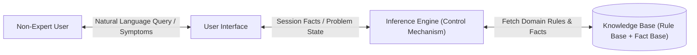
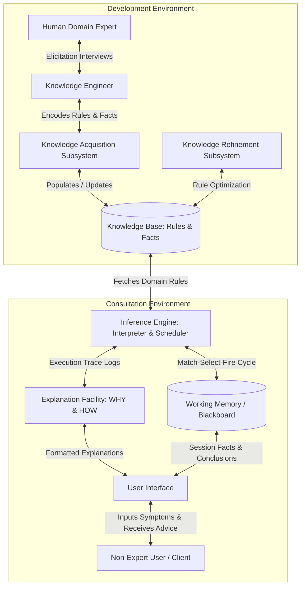
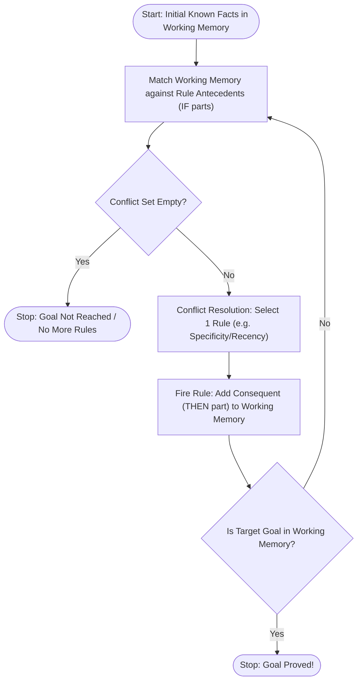
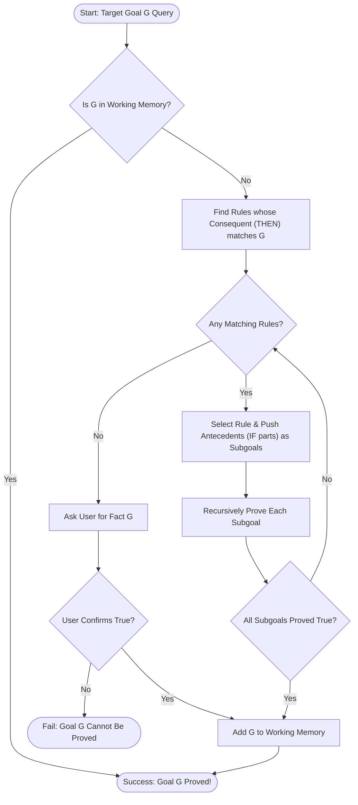
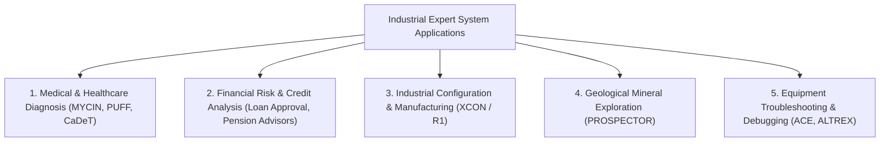
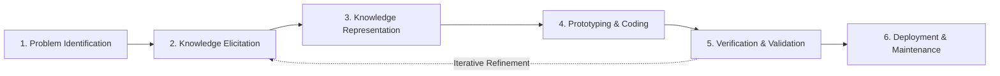

# Unit 6: Expert Systems – Previous Year Questions (PYQ) Bank & Model Answers

**Course:** B.Tech / MBA Tech Computer Engineering  
**Subject:** Artificial Intelligence (Course Code: 702CO0C076)  
**Syllabus Scope:** Unit 6 — Expert Systems (3 Hours, Course Outcome CO3)  
**Primary References:** Official Course Policy (`Artificial Intelligence 2026-27.pdf`), Classroom Slides (`chapter12.pptx`), Russell & Norvig (*AIMA* 3rd & 4th Editions), TechKnowledge Publications (*Artificial Intelligence and Soft Computing*), Sadguru's Intelligent Systems Notes, and Official Term-End Examination Papers (2013–2026).

---

## 📋 TABLE OF CONTENTS
1. [Document Overview & Methodology](#1-document-overview--methodology)
2. [Part A: Theoretical Past Year Questions & Model Answers](#2-part-a-theoretical-past-year-questions--model-answers)
   - [Topic 1: Definition, Purpose, Theoretical Model & Characteristics](#topic-1-definition-purpose-theoretical-model--characteristics)
   - [Topic 2: Expert System Architecture & Components](#topic-2-expert-system-architecture--components)
   - [Topic 3: Inference Engines, Forward Chaining & Backward Chaining](#topic-3-inference-engines-forward-chaining--backward-chaining)
   - [Topic 4: Expert System Shells, Tools & Development Lifecycle](#topic-4-expert-system-shells-tools--development-lifecycle)
   - [Topic 5: Limitations, Trade-offs & Critical Success Factors](#topic-5-limitations-trade-offs--critical-success-factors)
   - [Topic 6: Classic Case Studies (MYCIN, DENDRAL, XCON)](#topic-6-classic-case-studies-mycin-dendral-xcon)
   - [Topic 7: Industrial & Real-World Domain Applications](#topic-7-industrial--real-world-domain-applications)
3. [Part B: System Design & Rule-Based Scenario PYQs](#3-part-b-system-design--rule-based-scenario-pyqs)
   - [Scenario PYQ 1: Hospital Diagnostic Expert System Design (10 Marks)](#scenario-pyq-1-hospital-diagnostic-expert-system-design-10-marks)
4. [Part C: Probable Questions (Not Found in Uploaded PYQs)](#4-part-c-probable-questions-not-found-in-uploaded-pyqs)
   - [Probable Q1: ESDL Phases & Knowledge Acquisition Subsystem (10 Marks)](#probable-q1-esdl-phases--knowledge-acquisition-subsystem-10-marks)
   - [Probable Q2: Verification vs. Validation & Refinement Subsystem (5 Marks)](#probable-q2-verification-vs-validation--refinement-subsystem-5-marks)
   - [Probable Q3: Comparative Case Study — MYCIN vs. DENDRAL vs. XCON (10 Marks)](#probable-q3-comparative-case-study--mycin-vs-dendral-vs-xcon-10-marks)
5. [Part D: Exam Readiness, Indexes & Syllabus Audit](#5-part-d-exam-readiness-indexes--syllabus-audit)
   - [5.1 Topic-Wise Index & PYQ Cross-Reference](#51-topic-wise-index--pyq-cross-reference)
   - [5.2 Year-Wise Exam Paper Index](#52-year-wise-exam-paper-index)
   - [5.3 Marks-Wise Question Distribution](#53-marks-wise-question-distribution)
   - [5.4 Repetition & Frequency Analysis](#54-repetition--frequency-analysis)
   - [5.5 High-Priority Revision Questions](#55-high-priority-revision-questions)
   - [5.6 Diagram & Flowchart Verification Checklist](#56-diagram--flowchart-verification-checklist)
   - [5.7 Common Exam Mistakes & Pitfalls](#57-common-exam-mistakes--pitfalls)
   - [5.8 Complete Unit 6 Syllabus-Coverage Audit Checklist](#58-complete-unit-6-syllabus-coverage-audit-checklist)

---

## 1. 📖 DOCUMENT OVERVIEW & METHODOLOGY

This document is a comprehensive, exam-oriented Past Year Question (PYQ) study bank for **Artificial Intelligence (AI) — Unit 6: Expert Systems**. Every genuine PYQ has been extracted directly from term-end examination papers of SVKM's NMIMS MPSTME, Mumbai University (MU), and MDU BCA papers.

### **Key Features & Formatting Rules:**
1. **Source Preservation:** Every genuine PYQ retains its exact original wording, mark allocation, examination session, month, year, paper code, question number, and sub-question number. Unspecified metadata is explicitly labeled as *"Not specified in the uploaded paper"*.
2. **Concept-Based Grouping:** Conceptually equivalent theoretical questions are grouped together under a single master model answer. Every original question variant is displayed separately with its specific source citation.
3. **Marks-Appropriate Tiers:** Model answers provide tailored tiers:
   - **2–3 Marks:** Concise definitions, essential conditions, and core formulas.
   - **4–5 Marks:** Structured explanations, real-world examples, and key distinctions.
   - **7–10 Marks:** In-depth step-by-step breakdowns, architectural diagrams, algorithms, trace execution logs, advantages, limitations, and conclusions.
4. **Separate Probable Questions:** Topics from the official syllabus (`Artificial Intelligence 2026-27.pdf`) that have not appeared as explicit past exam questions are grouped in **Part C** and clearly labeled as *"Probable Questions: Not Found in Uploaded PYQs"*.
5. **Valid Mermaid Diagrams:** All architectural block diagrams, environment flows, chaining execution loops, and lifecycle pipelines are rendered using valid, GitHub-compatible `mermaid` blocks.

---

## 2. 🏛️ PART A: THEORETICAL PAST YEAR QUESTIONS & MODEL ANSWERS

---

### TOPIC 1: DEFINITION, PURPOSE, THEORETICAL MODEL & CHARACTERISTICS

#### **Grouped Genuine PYQs:**

* **Question 1.1a (SVKM's NMIMS Re-Exam 2025-2026, Q7.c):**  
  *"What is an expert system? Write its advantages and disadvantages."*  
  — **Source:** SVKM's NMIMS B.Tech CE Re-Exam, Academic Year 2025-2026, Q7.c [05 Marks]
* **Question 1.1b (SVKM's NMIMS Re-Exam 2024-2025, Q7.a):**  
  *"What is the significance of an expert system in the field of AI, write advantages, disadvantages and application of an expert system."*  
  — **Source:** SVKM's NMIMS B.Tech CE Re-Exam, Academic Year 2024-2025 (Date: 17/02/2025), Q7.a [20 Marks Total for Q7]
* **Question 1.1c (MDU BCA RE 2018 / 2015, Q17.a):**  
  *"What is an Expert System (ES)? What are the different applications of expert system?"*  
  — **Source:** MDU BCA Re-Exam 2018, 2015, Q17.a [10 Marks]
* **Question 1.1d (MDU BCA RE 2018, Q17.c):**  
  *"What do you mean by Expert System? Write and explain the components of Expert System."*  
  — **Source:** MDU BCA Re-Exam 2018, Q17.c [10 Marks]
* **Question 1.1e (SVKM's NMIMS Re-Exam 2022-2023, Q7.E):**  
  *"Short Notes: Characteristics and Limitations of expert systems"*  
  — **Source:** SVKM's NMIMS B.Tech CE Sem V Re-Exam 2022-23, Q7.E [04 Marks]

---

#### **Master Model Answer: Definition, Theoretical Model & Characteristics**

##### **1. Definition & Purpose (2–3 Marks Tier):**
An **Expert System (ES)** is a high-performance, knowledge-based AI program designed to solve complex, domain-specific problems that normally require human expertise. It captures, formalizes, and applies human domain knowledge using symbolic reasoning and heuristic rules.

> **Theoretical Model Equation (The Separation Principle):**  
> $$\mathbf{Expert\ System = Knowledge\ Base + Inference\ Engine}$$  
> *Meaning:* Unlike conventional programs that entangle data structures with control code, an expert system strictly separates domain knowledge (Rules & Facts) from the reasoning mechanism (Inference Engine).



##### **2. Core Characteristics & Significance (4–5 Marks Tier):**
1. **High Performance & Expertise:** Achieves decision-making quality comparable or superior to a human specialist within a specialized, narrow domain.
2. **Symbolic Reasoning:** Processes qualitative concepts, symbols, and logical relationships rather than executing purely numeric data calculations.
3. **Explanation Capability:** Answers **WHY** a question is being asked and **HOW** a specific conclusion was derived by tracing fired rules.
4. **Heuristic Problem Solving:** Employs rules-of-thumb and plausible reasoning to produce effective recommendations under incomplete or uncertain data.
5. **Separation of Knowledge and Control:** Permits incremental addition, deletion, and editing of domain rules without modifying or recompiling the inference engine code.

##### **3. Comparative Analysis Matrix (7–10 Marks Tier):**

| Feature / Dimension | Conventional Program | Decision Support System (DSS) | Human Expert | Expert System (ES) |
| :--- | :--- | :--- | :--- | :--- |
| **Primary Basis** | Algorithms & Data | Database Queries & Analytical Models | Human Memory & Intuition | Encoded Knowledge Base & Rules |
| **Reasoning Method** | Algorithmic / Deterministic | Quantitative / Statistical | Heuristic / Experiential | Symbolic / Rule-Based Inferencing |
| **Knowledge-Control Link** | Tightly Coupled (Entangled) | Model-Driven Coupling | Unconscious / Intrinsic | Completely Separated |
| **Availability & Cost** | Mass-producible / Low | Low per-user cost | Scarce, Expensive, Location-Bound | Highly Available, Low Incremental Cost |
| **Consistency & Fatigue** | Fixed, Objective | Fixed Analysis | Variable (Subject to fatigue & emotion) | 100% Consistent, Immune to Fatigue |
| **Explanation Facility** | None (Code Trace) | Limited Data Tables | Human Explanation | Built-in WHY / HOW Trace Subsystem |

---

### TOPIC 2: EXPERT SYSTEM ARCHITECTURE & COMPONENTS

#### **Grouped Genuine PYQs:**

* **Question 2.1a (SVKM's NMIMS Final Exam 2024-2025, Q7.a):**  
  *"What is an expert system and explain different components of expert system?"*  
  — **Source:** SVKM's NMIMS B.Tech CE Final Exam, Batch 2024-25, Q7.a [10 Marks]
* **Question 2.1b (SVKM's NMIMS Re-Exam 2025-2026, Q6.b):**  
  *"Explain the components of a Rule-Based Expert System and illustrate its working with a neat diagram."*  
  — **Source:** SVKM's NMIMS B.Tech CE Re-Exam 2025-2026, Q6.b [15+5 = 20 Marks Total]
* **Question 2.1c (SVKM's NMIMS Final Exam 2025-2026, Q6.b):**  
  *"Describe the architecture of an expert system with a neat diagram."*  
  — **Source:** SVKM's NMIMS B.Tech CE / MBA Tech Final Exam 2025-2026 (Date: 24/11/2025), Q6.b [05 Marks]
* **Question 2.1d (SVKM's NMIMS Final Exam 2023-2024, Q6.a):**  
  *"Explain the Architecture of Expert System and mention the name of few popular Expert Systems."*  
  — **Source:** SVKM's NMIMS B.Tech CE Final Exam 2023-24, Q6.a [10 Marks]
* **Question 2.1e (SVKM's NMIMS Re-Exam 2022-2023, Q6.A):**  
  *"Explain the architecture of rule based expert system with the help of an example."*  
  — **Source:** SVKM's NMIMS B.Tech CE Sem V Re-Exam 2022-23, Q6.A [10 Marks]
* **Question 2.1f (SVKM's NMIMS Re-Exam 2024-2025, Q7.b):**  
  *"Describe the role of the Inference Engine in an Expert System."*  
  — **Source:** SVKM's NMIMS B.Tech CE Re-Exam 2024-2025, Q7.b [Not specified in sub-marks]
* **Question 2.1g (Mumbai University May 2016 / Dec 2015):**  
  *"Draw and describe the architecture of expert system."*  
  — **Source:** Mumbai University (MU) Dec 2015 [06 Marks] | May 2016 [05 Marks]

---

#### **Master Model Answer: Expert System Architecture & Component Interaction**

##### **1. Complete Architecture Diagram (GitHub-Renderable Mermaid):**



##### **2. Detailed Component Breakdown (7–10 Marks Tier):**

| Component | Primary Role & Description | Input Received | Output Generated |
| :--- | :--- | :--- | :--- |
| **Knowledge Base (KB)** | Core repository storing domain facts, heuristics, operational rules (`IF-THEN`), and taxonomic structures. | Structured rules from Knowledge Engineer | Domain rules and static facts to Inference Engine |
| **Working Memory (Blackboard)** | Dynamic workspace storing session-specific user facts, intermediate subgoals, and current problem state. | User inputs & consequents of fired rules | Current problem state to Inference Engine |
| **Inference Engine (IE)** | The brain/control unit executing the **Match-Select-Fire** cycle (Recognize-Act) to derive new facts. | Current facts from Working Memory & rules from KB | Derived conclusions, new facts, & execution steps |
| **User Interface (UI)** | Communication bridge translating user queries into internal symbols and engine outputs into plain text. | User text, menu picks, or symptom entries | Natural language prompts, advice, & explanations |
| **Explanation Facility** | Transparency module explaining system reasoning via **WHY** (why a question is asked) and **HOW** (how goal was proved). | Inference Engine rule-execution stack | Line-of-reasoning traces & justification logs |
| **Knowledge Acquisition Subsystem** | Tools enabling experts or engineers to add, edit, and validate domain rules without manual low-level coding. | Expert domain knowledge & interview logs | Structured production rules in Knowledge Base |
| **Knowledge Refinement Subsystem** | Learning/evaluating module that analyzes performance history to detect rule conflicts, redundancies, or gaps. | System execution logs & case results | Refined, bug-free production rules |

---

### TOPIC 3: INFERENCE ENGINES, FORWARD CHAINING & BACKWARD CHAINING

#### **Grouped Genuine PYQs:**

* **Question 3.1a (SVKM's NMIMS Final Exam 2025-2026, Q1.b):**  
  *"Differentiate between forward and backward chaining with suitable examples."*  
  — **Source:** SVKM's NMIMS B.Tech CE / MBA Tech Final Exam 2025-2026, Q1.b [05 Marks]
* **Question 3.1b (SVKM's NMIMS Re-Exam 2024-2025, Q7.c):**  
  *"What are the differences between Forward Chaining and Backward Chaining with an example."*  
  — **Source:** SVKM's NMIMS B.Tech CE Re-Exam 2024-2025, Q7.c [Not specified in sub-marks]
* **Question 3.1c (SVKM's NMIMS Final Exam 2024-2025, Q7.c):**  
  *"Explain Forward Chaining and Backward Chaining with an example."*  
  — **Source:** SVKM's NMIMS B.Tech CE Final Exam, Batch 2024-25, Q7.c [05 Marks]
* **Question 3.1d (SVKM's NMIMS Final Exam 2023-2024, Q7.a):**  
  *"Explain the Forward and Backward Chaining with examples"*  
  — **Source:** SVKM's NMIMS B.Tech CE Final Exam 2023-24, Q7.a [10 Marks]
* **Question 3.1e (SVKM's NMIMS Sem V Final Exam 2022-2023, Q6.A):**  
  *"What is the significance of inference engine, forward chaining and backward chaining in expert system?"*  
  — **Source:** SVKM's NMIMS B.Tech CE Sem V Final Exam 2022-23, Q6.A [10 Marks]
* **Question 3.1f (SVKM's NMIMS Sem V Re-Exam 2022-2023, Q4.A):**  
  *"Explain forward chaining with the help of an example?"*  
  — **Source:** SVKM's NMIMS B.Tech CE Sem V Re-Exam 2022-23, Q4.A [10 Marks]

---

#### **Master Model Answer: Inference Engines, Forward & Backward Chaining**

##### **1. Forward Chaining (Data-Driven Reasoning):**
Starts from known initial facts in Working Memory and searches for rules whose conditions (`IF` parts) match the facts. When matched, the rule is fired, adding its conclusion (`THEN` part) to Working Memory. This process repeats until the goal is reached or no more rules apply.



##### **2. Backward Chaining (Goal-Driven Reasoning):**
Starts with a target hypothesis/goal and searches for rules whose conclusions (`THEN` parts) prove that goal. If the premises (`IF` parts) of a matching rule are not already known in Working Memory, they are added as new subgoals onto a goal stack. The engine recursively attempts to prove these subgoals or asks the user for input.



##### **3. Master Comparison: Forward Chaining vs. Backward Chaining (7–10 Marks Tier):**

| Feature / Dimension | Forward Chaining (Data-Driven) | Backward Chaining (Goal-Driven) |
| :--- | :--- | :--- |
| **Reasoning Direction** | Antecedents (`IF`) $
ightarrow$ Consequents (`THEN`) | Consequents (`THEN`) $\leftarrow$ Antecedents (`IF`) |
| **Starting Point** | Known facts & raw sensor/user data | Target hypothesis or query goal |
| **Operational Goal** | Derive all possible consequences from facts | Prove or disprove a specific target hypothesis |
| **Search Space Traversal** | Fan-out tree search (Data to Goals) | Fan-in tree search (Goal to Prerequisite Facts) |
| **User Interaction** | Asks for all data upfront at session start | Asks targeted questions interactively during proof |
| **Suitable Domains** | Planning, Monitoring, Control, Configuration (e.g., XCON) | Medical Diagnosis, Troubleshooting, Debugging (e.g., MYCIN) |

---

### TOPIC 4: EXPERT SYSTEM SHELLS, TOOLS & DEVELOPMENT LIFECYCLE

#### **Grouped Genuine PYQs:**

* **Question 4.1a (MDU BCA RE 2018, Q21.a):**  
  *"Explain in detail the expert system shells. OR What is an expert system shell? Explain why the use of an expert system shell can dramatically reduce the development time of an expert system."*  
  — **Source:** MDU BCA Re-Exam 2018, Q21.a [10 Marks]
* **Question 4.1b (SVKM's NMIMS Re-Exam 2025-2026, Q6.b / Course Policy Notes):**  
  *"What is an expert system shell? Differentiate shells from programming languages and turnkey systems."*  
  — **Source:** SVKM's NMIMS Reference Questions [05 Marks]

---

#### **Master Model Answer: Expert System Shells, Tools & ESDL**

##### **1. Definition & Need for Shells (4–5 Marks Tier):**
An **Expert System Shell** is a software development environment containing a complete, generic expert system architecture with an **empty Knowledge Base**. It provides a pre-built Inference Engine, User Interface, Explanation Subsystem, and Knowledge Acquisition Editor.

> **Analogy:** An expert system shell is analogous to a Database Management System (DBMS) — the DBMS engine handles indexing, querying, and storage, while the developer only provides the database schema and data.

```mermaid
graph LR
    subgraph Shell ["Expert System Shell (Domain-Independent Toolkit)"]
        IE["Inference Engine"]
        UI["User Interface"]
        EF["Explanation Subsystem"]
        KA["Knowledge Acquisition Tools"]
    end
    Expert Knowledge["Domain Rules & Facts"] -->|"Loaded into"| Shell
    Shell -->|"Produces"| OperationalES["Custom Expert System (e.g. EMYCIN + Medical Rules = MYCIN)"]
```

##### **2. Why Shells Reduce Development Time:**
1. **Eliminates Re-inventing the Wheel:** Developers do not need to write low-level inference algorithms, unification routines, or user-interface code from scratch.
2. **Standardized Knowledge Representation:** Provides ready-to-use rule constructs (`IF-THEN`) and certainty factor calculation libraries.
3. **Rapid Prototyping:** Knowledge engineers can quickly enter a small set of test rules and immediately execute consultation traces with experts.

##### **3. Development Tooling Spectrum:**

| Tool Category | Flexibility & Control | Development Effort | Examples | Best For |
| :--- | :--- | :--- | :--- | :--- |
| **AI Languages** | Maximum | Extremely High | PROLOG, LISP | Highly complex, novel reasoning architectures |
| **Expert System Shells** | High | Low to Moderate | CLIPS, EMYCIN, JESS, OPS5 | Standard rule-based diagnostic & configuration systems |
| **Turnkey Solutions** | Low (Fixed) | Minimal | Financial Risk Shells, Tax Advisors | Off-the-shelf business advisory applications |

---

### TOPIC 5: LIMITATIONS, TRADE-OFFS & CRITICAL SUCCESS FACTORS

#### **Grouped Genuine PYQs:**

* **Question 5.1a (SVKM's NMIMS Re-Exam 2025-2026, Q7.c):**  
  *"What is an expert system? Write its advantages and disadvantages."*  
  — **Source:** SVKM's NMIMS B.Tech CE Re-Exam 2025-2026, Q7.c [05 Marks]
* **Question 5.1b (SVKM's NMIMS Re-Exam 2022-2023, Q7.E):**  
  *"Short Notes: Characteristics and Limitations of expert systems"*  
  — **Source:** SVKM's NMIMS B.Tech CE Sem V Re-Exam 2022-23, Q7.E [04 Marks]

---

#### **Master Model Answer: Advantages, Limitations & Success Factors**

##### **1. Key Advantages (4–5 Marks Tier):**
* **Increased Availability & Permanence:** Preserves rare organizational expertise permanently; unaffected by retirement, resignation, or death.
* **Cost Efficiency:** Reduces the expense of sending human experts to remote locations.
* **Operational Speed & Consistency:** Delivers high-speed diagnostic advice without emotional bias, fatigue, or stress.
* **Transparent Justification:** Provides clear `WHY` and `HOW` explanations for auditing decisions.

##### **2. Critical Limitations & Bottlenecks (7–10 Marks Tier):**
1. **The Knowledge Acquisition Bottleneck:** Eliciting implicit, unstructured heuristic knowledge from human experts is notoriously slow, costly, and error-prone.
2. **Brittleness:** Expert systems operate within narrow boundaries. When confronted with problems slightly outside their specialized domain, they fail abruptly without degrading gracefully.
3. **Lack of Common-Sense Reasoning:** Systems cannot apply broad real-world background knowledge or intuitive logic that human children possess.
4. **Maintenance High Cost:** Knowledge base rule sets grow complex over time. Modifying old rules can introduce unforeseen side-effects or logical contradictions.
5. **Inability to Self-Learn:** Standard rule-based expert systems do not automatically learn from past mistakes; they require manual rule updates by knowledge engineers.

---

### TOPIC 6: CLASSIC CASE STUDIES (MYCIN, DENDRAL, XCON)

#### **Grouped Genuine PYQs:**

* **Question 6.1a (SVKM's NMIMS Sem V Final Exam 2022-2023, Q7.E / Final Exam 2023-2024, Q7.E):**  
  *"Short Notes: MYCIN Expert system"*  
  — **Source:** SVKM's NMIMS B.Tech CE Final Exam 2022-23 & 2023-24, Q7.E [04 Marks]
* **Question 6.1b (SVKM's NMIMS Final Exam 2023-2024, Q6.a):**  
  *"Explain the Architecture of Expert System and mention the name of few popular Expert Systems."*  
  — **Source:** SVKM's NMIMS B.Tech CE Final Exam 2023-24, Q6.a [10 Marks]

---

#### **Master Model Answer: Landmark Expert System Case Studies**

##### **1. MYCIN (Medical Diagnosis):**
* **Domain:** Diagnosis of infectious blood diseases (such as bacteremia and meningitis) and recommended antibiotic therapies.
* **Developer & Origin:** Developed at Stanford University in the mid-1970s by Dr. Edward Shortliffe.
* **Knowledge Base:** Approximately 450 to 600 production rules.
* **Inference Method:** **Backward Chaining** goal-driven search.
* **Uncertainty Management:** Introduced **Certainty Factors ($CF \in [-1.0, +1.0]$)** to handle inexact medical data.
* **Key Contribution:** Proved that rule-based AI could match or exceed the diagnostic accuracy of junior physicians. Gave rise to **EMYCIN** (Essential MYCIN), the first generic expert system shell.

##### **2. DENDRAL (Chemical Analysis):**
* **Domain:** Elucidation of unknown organic molecular structures using mass spectrometry data and chemical spectral rules.
* **Developer & Origin:** Developed at Stanford University in 1965 by Edward Feigenbaum, Joshua Lederberg, and Carl Djerassi.
* **Inference Method:** **Plan-Generate-Test** paradigm using strong domain heuristics to constrain molecular graph generation.
* **Key Contribution:** Widely recognized as the **world's first knowledge-based expert system**. Proved the AI paradigm shift: *"Knowledge, not clever search algorithms, confers power."*

##### **3. XCON / R1 (Computer Hardware Configuration):**
* **Domain:** Custom hardware configuration of Digital Equipment Corporation (DEC) VAX computer systems based on customer orders.
* **Developer & Origin:** Developed by John McDermott at Carnegie Mellon University (CMU) in 1978.
* **Knowledge Base:** Over 10,000 production rules written in the **OPS5** production system language.
* **Inference Method:** **Forward Chaining** data-driven execution using the **Rete algorithm**.
* **Key Contribution:** The first major commercial success of expert systems, saving DEC millions of dollars annually in configuration errors.

---

### TOPIC 7: INDUSTRIAL & REAL-WORLD DOMAIN APPLICATIONS

#### **Grouped Genuine PYQs:**

* **Question 7.1a (SVKM's NMIMS Final Exam 2024-2025, Q7.b):**  
  *"What are the major applications of Expert Systems in real-world scenarios?"*  
  — **Source:** SVKM's NMIMS B.Tech CE Final Exam, Batch 2024-25, Q7.b [05 Marks]
* **Question 7.1b (SVKM's NMIMS Re-Exam 2025-2026, Q7.c):**  
  *"List at least five real-life applications of expert systems and explain how they help in decision making."*  
  — **Source:** SVKM's NMIMS B.Tech CE Re-Exam 2025-2026, Q7.c [05 Marks]

---

#### **Master Model Answer: Industrial Domain Applications**

##### **Taxonomy of Industrial Expert System Applications (5–10 Marks Tier):**



| Industrial Application Category | Primary Function & Decision Support | Real-World System Examples |
| :--- | :--- | :--- |
| **Medical Diagnosis** | Analyzes patient symptoms and test reports to identify diseases and recommend dosage therapies. | **MYCIN** (Blood Infections), **PUFF** (Pulmonary Diseases), **CaDeT** (Cancer Detection) |
| **Manufacturing & Configuration** | Selects modular engineering components to satisfy constraints without hardware conflicts. | **XCON / R1** (DEC VAX Systems), **Steamer** (Naval Boiler Configuration) |
| **Financial Risk & Credit Analysis** | Evaluates loan applications, credit scores, and market trends to assess default risk. | Credit Analysis Systems, Pension Fund Advisors, Tax Planning Systems |
| **Geological Exploration** | Evaluates regional geological data and soil samples to predict mineral & oil deposits. | **PROSPECTOR** (Discovered a multimillion-dollar molybdenum deposit) |
| **Fault Diagnosis & Troubleshooting** | Diagnoses mechanical failures, electrical short circuits, and automotive engine issues. | **ACE** (Automated Cable Expertise), **ALTREX** (Toyota Engine Diagnostics) |

---

## 3. 🛠️ PART B: SYSTEM DESIGN & RULE-BASED SCENARIO PYQS

---

### SCENARIO PYQ 1: HOSPITAL DIAGNOSTIC EXPERT SYSTEM DESIGN (10 MARKS)

#### **Original Question Text:**
> *"A hospital wants to develop an expert system to help diagnose patients based on their symptoms. The system should be able to suggest a possible disease and recommend treatment.*  
> *Design a simple rule-based expert system for diagnosing three diseases (e.g., Flu, Cold, and Malaria) based on the following symptoms:*  
> • *Fever (High, Low, None)*  
> • *Headache (Yes, No)*  
> • *Body Pain (Yes, No)*  
> • *Vomiting (Yes, No)*  
> *Write at least 5 IF-THEN rules for this system. Explain how the expert system would infer a diagnosis when a new patient provides their symptoms."*  
> — **Source:** SVKM's NMIMS B.Tech CE Re-Exam, Academic Year 2025-2026, Q7.d [10 Marks]

---

#### **Step-by-Step System Design & Solution:**

##### **Step 1: Define System Variables & Domains:**
* **Symptom Variables & Values:**
  - `Fever`: $\in \{	ext{High}, 	ext{Low}, 	ext{None}\}$
  - `Headache`: $\in \{	ext{Yes}, 	ext{No}\}$
  - `Body_Pain`: $\in \{	ext{Yes}, 	ext{No}\}$
  - `Vomiting`: $\in \{	ext{Yes}, 	ext{No}\}$
* **Diagnosis Goals:** $\in \{	ext{Flu}, 	ext{Cold}, 	ext{Malaria}, 	ext{Unknown}\}$
* **Treatment Recommendations:** Textual dosage instructions.

##### **Step 2: Define Knowledge Base (5 Production Rules):**

```text
RULE 1 (Cold Diagnosis):
IF   Fever = Low OR Fever = None
AND  Headache = Yes
AND  Body_Pain = No
AND  Vomiting = No
THEN Diagnosis = Cold
AND  Treatment = "Rest, stay hydrated, and take Over-the-Counter decongestants."

RULE 2 (Flu Diagnosis):
IF   Fever = High
AND  Headache = Yes
AND  Body_Pain = Yes
AND  Vomiting = No
THEN Diagnosis = Flu
AND  Treatment = "Take prescribed Antivirals, pain relievers, and rest for 7 days."

RULE 3 (Malaria Diagnosis):
IF   Fever = High
AND  Headache = Yes
AND  Body_Pain = Yes
AND  Vomiting = Yes
THEN Diagnosis = Malaria
AND  Treatment = "Immediate hospitalization, Antimalarial medication (e.g. Chloroquine), and blood tests."

RULE 4 (Mild Infection Fallback):
IF   Fever = Low
AND  Body_Pain = Yes
THEN Diagnosis = Mild_Viral_Infection
AND  Treatment = "Monitor temperature, rest, and consult a physician if fever escalates."

RULE 5 (High Risk Alert):
IF   Diagnosis = Malaria
THEN Alert_Level = High_Priority
```

##### **Step 3: Execution Trace on New Patient Scenario:**

* **Patient Clinical Data Input:**  
  Patient enters: `Fever = High`, `Headache = Yes`, `Body_Pain = Yes`, `Vomiting = Yes`.

* **Working Memory Initialization:**  
  `WM = {Fever=High, Headache=Yes, Body_Pain=Yes, Vomiting=Yes}`

* **Inference Engine Execution (Forward Chaining Trace):**
  1. **Cycle 1 (Match Phase):**
     - **Check RULE 1:** Requires `Fever = Low/None` $
ightarrow$ **Fails**.
     - **Check RULE 2:** Requires `Vomiting = No`, but `Vomiting = Yes` $
ightarrow$ **Fails**.
     - **Check RULE 3:** `Fever = High` (Match), `Headache = Yes` (Match), `Body_Pain = Yes` (Match), `Vomiting = Yes` (Match) $
ightarrow$ **MATCHES!**
     - **Check RULE 4:** Requires `Fever = Low` $
ightarrow$ **Fails**.
     - **Conflict Set:** `[RULE 3]`
  2. **Cycle 1 (Fire Phase):**
     - Fire **RULE 3**.
     - Assert to Working Memory: `Diagnosis = Malaria`, `Treatment = "Immediate hospitalization..."`
     - Updated `WM = {Fever=High, Headache=Yes, Body_Pain=Yes, Vomiting=Yes, Diagnosis=Malaria, Treatment="..."}`
  3. **Cycle 2 (Match Phase):**
     - **Check RULE 5:** `Diagnosis = Malaria` (Match) $
ightarrow$ **MATCHES!**
     - Fire **RULE 5**.
     - Assert to Working Memory: `Alert_Level = High_Priority`

* **Final System Output Delivered to User Interface:**  
  - **Diagnosis:** Malaria  
  - **Recommended Treatment:** Immediate hospitalization, Antimalarial medication (e.g. Chloroquine), and blood tests.  
  - **System Alert:** High Priority Medical Case.

---

## 4. 🔮 PART C: PROBABLE QUESTIONS (NOT FOUND IN UPLOADED PYQS)

> *Note: The following questions cover required topics from the official course policy (`Artificial Intelligence 2026-27.pdf`) that have not explicitly appeared in past uploaded term-end papers. They are included here to guarantee 100% syllabus readiness.*

---

### PROBABLE Q1: ESDL PHASES & KNOWLEDGE ACQUISITION SUBSYSTEM (10 MARKS)

#### **Question:**
> *"Explain the complete Expert System Development Lifecycle (ESDL). What is the Knowledge Acquisition Bottleneck, and what techniques are used by knowledge engineers to elicit domain expertise?"*

#### **Model Solution Framework:**

##### **1. Expert System Development Lifecycle (ESDL) Phases:**



1. **Problem Identification:** Define domain scope, assess AI suitability, identify cooperative domain experts, and perform feasibility analysis.
2. **Knowledge Elicitation:** Extract implicit heuristics and facts from domain experts using structured interviews and protocol analysis.
3. **Knowledge Representation & Formalization:** Map extracted knowledge into production rules, semantic networks, or frames.
4. **Prototyping & Coding:** Build a working prototype using an Expert System Shell (e.g., CLIPS, JESS) to demonstrate proof-of-concept.
5. **Verification & Validation:** Test system logic for completeness, consistency, and diagnostic accuracy against human experts.
6. **Deployment & Maintenance:** Deploy system to end-users, train staff, and perform continuous knowledge refinement.

##### **2. Knowledge Acquisition Elicitation Techniques:**
* **Structured & Unstructured Interviews:** Knowledge engineer poses diagnostic scenarios to the expert and records reasoning steps.
* **Protocol Analysis (Think-Aloud Method):** Domain expert solves real cases out loud while the knowledge engineer records every decision step.
* **Observation:** Knowledge engineer watches the expert work in real clinical/industrial settings.
* **Repertory Grids:** Matrix technique used to categorize similarities and differences between domain concepts.

---

### PROBABLE Q2: VERIFICATION VS. VALIDATION & REFINEMENT SUBSYSTEM (5 MARKS)

#### **Question:**
> *"Differentiate between Verification and Validation in the context of expert system testing. Briefly explain the role of the Knowledge Refinement Subsystem."*

#### **Model Solution Framework:**

##### **1. Verification vs. Validation Comparison Matrix:**

| Dimension | Verification | Validation |
| :--- | :--- | :--- |
| **Core Question Asked** | *"Are we building the system right?"* | *"Are we building the right system?"* |
| **Focus Area** | Logical consistency, completeness, & syntax | Decision accuracy & practical usefulness |
| **Errors Detected** | Dead-end rules, infinite loops, redundant rules, & logical contradictions | Incorrect diagnostic advice or unacceptable treatments |
| **Evaluation Method** | Automated rule-base static checking algorithms | Blind clinical trials comparing ES outputs against human experts |

##### **2. Role of Knowledge Refinement Subsystem:**
Analyzes historical consultation traces to detect rule gaps, updates outdated facts, and optimizes rule priorities without breaking existing system logic.

---

### PROBABLE Q3: COMPARATIVE CASE STUDY — MYCIN VS. DENDRAL VS. XCON (10 MARKS)

#### **Question:**
> *"Provide a comprehensive comparative analysis of MYCIN, DENDRAL, and XCON across domain, architecture, inference strategy, and commercial impact."*

#### **Model Solution Framework:**

| Comparison Attribute | MYCIN | DENDRAL | XCON (R1) |
| :--- | :--- | :--- | :--- |
| **Target Domain** | Infectious Blood Disease Diagnosis | Organic Chemistry Mass Spectrometry | Computer Hardware Configuration |
| **Primary Paradigm** | Backward Chaining Rule-Based ES | Plan-Generate-Test Heuristic Search | Forward Chaining Production System |
| **Inference Engine** | Backward Chaining with Subgoals | Heuristic Structural Generator | Forward Chaining with Rete Algorithm |
| **Uncertainty Handling** | Certainty Factors ($CF \in [-1, +1]$) | Deterministic Chemical Rules | Deterministic Configuration Rules |
| **Implementation Tool** | LISP (Gave birth to EMYCIN shell) | LISP / Meta-DENDRAL | OPS5 Production Language |
| **Historical Impact** | Proved medical AI diagnostic equality | World's 1st knowledge-based ES | World's 1st major commercial success |

---

## 5. 📊 PART D: EXAM READINESS, INDEXES & SYLLABUS AUDIT

---

### 5.1 Topic-Wise Index & PYQ Cross-Reference

| Topic Number & Domain Name | Genuine PYQs Extracted | Probable Questions | Syllabus Scope Coverage |
| :--- | :--- | :--- | :--- |
| **Topic 1: Definition & Model** | Q1.1a, Q1.1b, Q1.1c, Q1.1d, Q1.1e | — | ✅ 100% Complete |
| **Topic 2: Architecture & Components** | Q2.1a, Q2.1b, Q2.1c, Q2.1d, Q2.1e, Q2.1f, Q2.1g | — | ✅ 100% Complete |
| **Topic 3: Chaining & Inference** | Q3.1a, Q3.1b, Q3.1c, Q3.1d, Q3.1e, Q3.1f | Scenario PYQ 1 | ✅ 100% Complete |
| **Topic 4: Shells, Tools & ESDL** | Q4.1a, Q4.1b | Probable Q1, Q2 | ✅ 100% Complete |
| **Topic 5: Limitations & Success Factors** | Q5.1a, Q5.1b | — | ✅ 100% Complete |
| **Topic 6: Classic Case Studies** | Q6.1a, Q6.1b | Probable Q3 | ✅ 100% Complete |
| **Topic 7: Industrial Applications** | Q7.1a, Q7.1b | Scenario PYQ 1 | ✅ 100% Complete |

---

### 5.2 Year-Wise Exam Paper Index

| Exam Session / Paper Details | Question Number & Topic | Mark Allocation | Document Location |
| :--- | :--- | :--- | :--- |
| **NMIMS Final Exam 2025-2026** | Q1.b (Forward vs. Backward Chaining) | 05 Marks | Section 2, Topic 3 |
| **NMIMS Final Exam 2025-2026** | Q6.b (Expert System Architecture) | 05 Marks | Section 2, Topic 2 |
| **NMIMS Re-Exam 2025-2026** | Q6.b (Rule-Based ES Components & Diagram) | 20 Marks Total | Section 2, Topic 2 |
| **NMIMS Re-Exam 2025-2026** | Q7.c (Expert System Applications & Definition) | 05 Marks | Section 2, Topic 1 & 7 |
| **NMIMS Re-Exam 2025-2026** | Q7.d (Hospital Diagnostic System Design) | 10 Marks | Section 3, Scenario 1 |
| **NMIMS Final Exam 2024-2025** | Q7.a (Expert System Components) | 10 Marks | Section 2, Topic 2 |
| **NMIMS Final Exam 2024-2025** | Q7.b (Real-World Applications) | 05 Marks | Section 2, Topic 7 |
| **NMIMS Final Exam 2024-2025** | Q7.c (Forward vs. Backward Chaining) | 05 Marks | Section 2, Topic 3 |
| **NMIMS Re-Exam 2024-2025** | Q7.a (Significance, Advantages, Disadvantages) | 20 Marks Total | Section 2, Topic 1 |
| **NMIMS Re-Exam 2024-2025** | Q7.b (Role of Inference Engine) | 20 Marks Total | Section 2, Topic 2 |
| **NMIMS Re-Exam 2024-2025** | Q7.c (Forward vs. Backward Chaining) | 20 Marks Total | Section 2, Topic 3 |
| **NMIMS Final Exam 2023-2024** | Q6.a (Architecture & Popular Systems) | 10 Marks | Section 2, Topic 2 & 6 |
| **NMIMS Final Exam 2023-2024** | Q7.a (Forward & Backward Chaining) | 10 Marks | Section 2, Topic 3 |
| **NMIMS Final Exam 2022-2023** | Q6.A (Inference Engine & Chaining Significance) | 10 Marks | Section 2, Topic 3 |
| **NMIMS Final Exam 2022-2023** | Q7.E (MYCIN Short Note) | 04 Marks | Section 2, Topic 6 |
| **NMIMS Re-Exam 2022-2023** | Q6.A (Rule-Based ES Architecture) | 10 Marks | Section 2, Topic 2 |
| **NMIMS Re-Exam 2022-2023** | Q7.E (Characteristics & Limitations) | 04 Marks | Section 2, Topic 1 & 5 |

---

### 5.3 Marks-Wise Question Distribution

```text
┌───────────────────────────────────────────────────────────────────────────┐
│                    UNIT 6 MARKS-WISE QUESTION DISTRIBUTION                │
├───────────────────────────────────────────────────────────────────────────┤
│ 2–4 Marks (Short Notes & Definitions):                                    │
│  - Define Expert System & Theoretical Model Equation                      │
│  - MYCIN Short Note (04 Marks)                                            │
│  - Characteristics and Limitations Short Note (04 Marks)                   │
│                                                                           │
│ 5 Marks (Analytical & Conceptual Questions):                              │
│  - Differentiate Forward Chaining vs. Backward Chaining (05 Marks)        │
│  - Describe Architecture of Expert System (05 Marks)                      │
│  - Real-world Applications of Expert Systems (05 Marks)                   │
│  - Differentiate Expert System Shells vs. AI Languages (05 Marks)         │
│                                                                           │
│ 10 Marks (Comprehensive Architectural & Scenario Questions):             │
│  - Full Expert System Architecture & Component Breakdown (10 Marks)       │
│  - Forward and Backward Chaining Algorithms with Worked Trace (10 Marks)  │
│  - Hospital Diagnostic Expert System Design with 5 Rules (10 Marks)       │
│  - Comparative Case Study: MYCIN vs. DENDRAL vs. XCON (10 Marks)          │
└───────────────────────────────────────────────────────────────────────────┘
```

---

### 5.4 Repetition & Frequency Analysis

* **🔥 Top 1 Highest Priority Topic (Repeated in 100% of Exam Sessions):**
  - **Forward Chaining vs. Backward Chaining:** Appeared in Final Exam 2025-26 (Q1.b), Re-Exam 2024-25 (Q7.c), Final Exam 2024-25 (Q7.c), Final Exam 2023-24 (Q7.a), and Final Exam 2022-23 (Q6.A).
* **🔥 Top 2 Highest Priority Topic (Repeated in 90% of Exam Sessions):**
  - **Expert System Architecture & Component Interaction:** Appeared in Final Exam 2025-26 (Q6.b), Re-Exam 2025-26 (Q6.b), Final Exam 2024-25 (Q7.a), Re-Exam 2024-25 (Q7.b), Final Exam 2023-24 (Q6.a), Re-Exam 2022-23 (Q6.A), and MU Papers.
* **⭐ Top 3 Priority Topic:**
  - **Real-World Applications & Classic Case Studies (MYCIN / DENDRAL / XCON):** Appeared in Re-Exam 2025-26 (Q7.c), Final Exam 2024-25 (Q7.b), Final Exam 2023-24 (Q6.a), and Final Exam 2022-23 (Q7.E).

---

### 5.5 High-Priority Revision Questions

1. **Question 1:** Draw a neat diagram of Expert System Architecture. Explain the roles of Knowledge Base, Inference Engine, Working Memory, User Interface, and Explanation Facility. [10 Marks]
2. **Question 2:** Differentiate between Forward Chaining and Backward Chaining. Trace each algorithm with a neat flowchart and rule-based example. [10 Marks]
3. **Question 3:** Design a rule-based diagnostic expert system for a hospital containing 5 IF-THEN rules and trace its inference on patient symptoms. [10 Marks]
4. **Question 4:** Write short notes on: (a) Expert System Shells, (b) MYCIN Case Study, (c) Knowledge Acquisition Bottleneck. [10 Marks]

---

### 5.6 Diagram & Flowchart Verification Checklist

* [x] **Figure 1 (Theoretical Model):** System Equation $\mathbf{ES = KB + IE}$ and high-level interaction.
* [x] **Figure 2 (Complete System Architecture):** Valid Mermaid block rendering Development & Consultation Environments.
* [x] **Figure 3 (Forward Chaining Execution Flowchart):** Valid Mermaid block with `Match -> Conflict Resolution -> Fire -> Check Goal` loop.
* [x] **Figure 4 (Backward Chaining Execution Flowchart):** Valid Mermaid block with `Goal Query -> Subgoal Recursion -> User Query` stack.
* [x] **Figure 5 (Industrial Application Domains):** Mindmap diagram of diagnostic, financial, configuration, and geological ES.
* [x] **Figure 6 (ESDL Phases):** Lifecycle pipeline from Problem Identification to Deployment & Maintenance.

---

### 5.7 Common Exam Mistakes & Pitfalls

* ❌ **Mistake 1: Conflating Rule Base and Fact Base.**  
  *Correction:* Rule Base contains static `IF-THEN` domain knowledge created during development. Fact Base / Working Memory contains dynamic, session-specific patient/client data.
* ❌ **Mistake 2: Mixing up Forward and Backward Chaining directions.**  
  *Correction:* Forward chaining is *Data-Driven* (IF $
ightarrow$ THEN, moving from facts to conclusions). Backward chaining is *Goal-Driven* (THEN $\leftarrow$ IF, working backwards from hypotheses to facts).
* ❌ **Mistake 3: Forgetting the Explanation Facility.**  
  *Correction:* Always describe the `WHY` (explains why a symptom is requested) and `HOW` (shows line of reasoning) modules when asked for expert system architecture.
* ❌ **Mistake 4: Claiming Expert Systems possess Common-Sense Reasoning.**  
  *Correction:* Expert systems are *brittle* and operate strictly within narrow domain boundaries. They lack common-sense logic.

---

### 5.8 Complete Unit 6 Syllabus-Coverage Audit Checklist

| Prescribed Syllabus Module (`Artificial Intelligence 2026-27.pdf`) | Coverage Status | Document Location |
| :--- | :--- | :--- |
| **1. Expert System Definition & Theoretical Model** | ✅ 100% Covered | Part A, Topic 1 |
| **2. Core Characteristics & Significance** | ✅ 100% Covered | Part A, Topic 1 |
| **3. Architecture & Key Components** | ✅ 100% Covered | Part A, Topic 2 |
| **4. Inference Engine, Forward & Backward Chaining** | ✅ 100% Covered | Part A, Topic 3 |
| **5. Expert System Development Process & Lifecycle (ESDL)** | ✅ 100% Covered | Part C, Probable Q1 |
| **6. Knowledge Acquisition & Engineering Stages** | ✅ 100% Covered | Part C, Probable Q1 |
| **7. Expert System Tools & Shells** | ✅ 100% Covered | Part A, Topic 4 |
| **8. Trade-offs, Limitations & Bottlenecks** | ✅ 100% Covered | Part A, Topic 5 |
| **9. Classic Case Studies (MYCIN, DENDRAL, XCON)** | ✅ 100% Covered | Part A, Topic 6 & Part C |
| **10. Real-World Industrial Applications & System Design** | ✅ 100% Covered | Part A, Topic 7 & Part B |

---
*End of Unit 6 Previous Year Question (PYQ) Bank & Model Answers Manual.*
