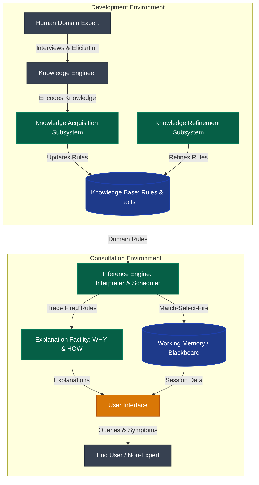
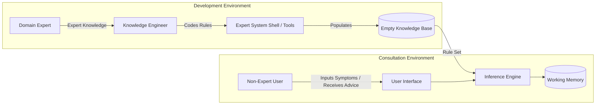
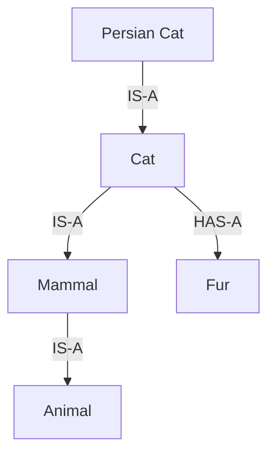
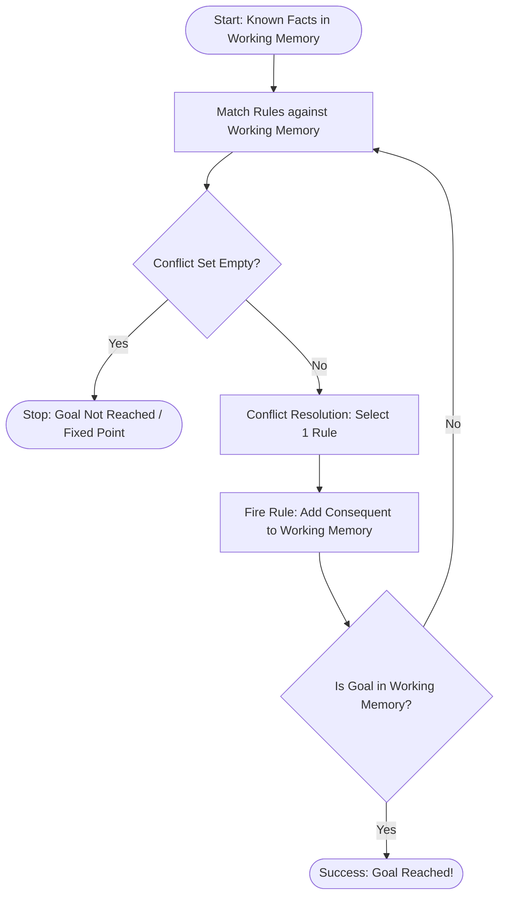
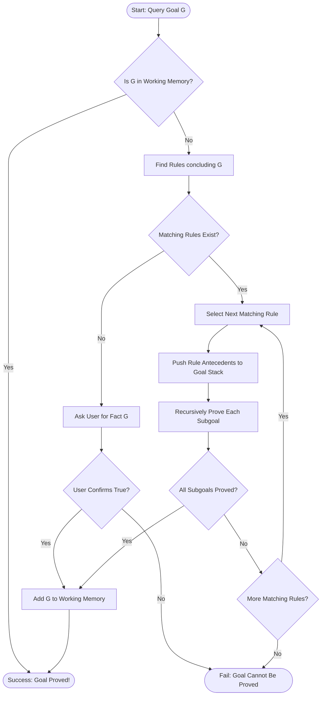
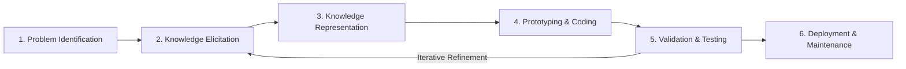

# Unit 6: Expert Systems – Complete Study Notes

**Course:** B.Tech / MBA Tech Computer Engineering  
**Subject:** Artificial Intelligence (Course Code: 702CO0C076)  
**Syllabus Scope:** Unit 6 — Expert Systems (3 Hours, Course Outcome CO3)  
**Primary References:** Course Policy (`Artificial Intelligence 2026-27.pdf`), `chapter12.pptx`, Russell & Norvig (*AIMA* 3rd & 4th Editions), TechKnowledge Publications (*Artificial Intelligence and Soft Computing*), Sadguru's Intelligent Systems Notes, and University Question Papers (2013–2026).

---

## 📋 TABLE OF CONTENTS
1. [Introduction to Expert Systems & Foundational Concepts](#1-introduction-to-expert-systems--foundational-concepts)
   - 1.1 Definition, Purpose & Theoretical Model
   - 1.2 Core Terminology & Building Concepts
   - 1.3 Core Characteristics of Expert Systems
   - 1.4 Comparative Analysis Tables
2. [Architecture & Components of Expert Systems](#2-architecture--components-of-expert-systems)
   - 2.1 Complete Architectural Breakdown
   - 2.2 GitHub-Renderable Mermaid Architecture Diagrams
3. [Knowledge Representation in Expert Systems](#3-knowledge-representation-in-expert-systems)
   - 3.1 Production Rules (IF-THEN Architecture)
   - 3.2 Semantic Networks & Associative Networks
   - 3.3 Logical Statements & Frame Representations
4. [Inference Mechanisms: Forward Chaining & Backward Chaining](#4-inference-mechanisms-forward-chaining--backward-chaining)
   - 4.1 Forward Chaining (Data-Driven Reasoning)
   - 4.2 Backward Chaining (Goal-Driven Reasoning)
   - 4.3 Master Comparison: Forward vs. Backward Chaining
5. [Expert System Development Lifecycle (ESDL) & Tooling](#5-expert-system-development-lifecycle-esdl--tooling)
   - 5.1 ESDL Phases (Identification to Maintenance)
   - 5.2 Key Stakeholder Roles
   - 5.3 Development Tools: Languages, Shells, and Turnkey Systems
6. [Benefits, Suitable Problem Traits, Trade-offs & Limitations](#6-benefits-suitable-problem-traits-trade-offs--limitations)
   - 6.1 Key Benefits & Suitable Problem Domains
   - 6.2 Critical Success Factors
   - 6.3 Limitations & Bottlenecks
7. [Classic Case Studies & Industrial Applications](#7-classic-case-studies--industrial-applications)
   - 7.1 Classic Systems: MYCIN, DENDRAL, and XCON (R1)
   - 7.2 Industrial Domain Applications
8. [Exam Review, PYQ Bank & Model Answers](#8-exam-review-pyq-bank--model-answers)
   - 8.1 Frequently Confused Concepts & Common Pitfalls
   - 8.2 Model Exam Question Bank (2-Mark, 5-Mark, 10-Mark Frameworks)
   - 8.3 Unit 6 Syllabus-Coverage & CO3 Verification Checklist

---

## 1. 🌟 INTRODUCTION TO EXPERT SYSTEMS & FOUNDATIONAL CONCEPTS

### 1.1 Definition, Purpose & Theoretical Model

#### **Definitions:**
*   **Peter Jackson (1999):** *"An expert system is a computer program that represents and reasons with knowledge of some specialist subject with a view to solving problems or giving advice."*
*   **Edward Feigenbaum (Stanford University, Father of Expert Systems):** *"An intelligent computer program that uses knowledge and inference procedures to solve problems that are difficult enough to require significant human expertise for their solution."*
*   **AIMA (Russell & Norvig):** A domain-specific, knowledge-intensive system that cleanly separates domain knowledge (rules and facts) from the general reasoning mechanism (inference engine).

#### **Core Purpose:**
The fundamental purpose of an expert system is to **capture, codify, preserve, and scale human expertise**. It provides high-level problem-solving and decision-making capabilities to non-expert users in specialized, narrow domains where human experts are scarce, expensive, or geographically distant.

#### **Theoretical Model of Expert Systems:**
The classic theoretical model of an expert system relies on the **Separation Principle**:
$$\mathbf{Expert\ System = Knowledge\ Base + Inference\ Engine}$$

Unlike traditional computer programs where domain logic and control flow are intertwined in code, an expert system strictly isolates domain knowledge from the execution control:

```
┌──────────────────────────────────────────────────────────┐
│                      EXPERT SYSTEM                       │
│                                                          │
│   ┌────────────────────────┐    ┌────────────────────┐   │
│   │     KNOWLEDGE BASE     │    │  INFERENCE ENGINE  │   │
│   │  (Declarative Rules &  │ ◄─►│  (Procedural Control│   │
│   │   Facts about Domain)  │    │   & Logic Solver)  │   │
│   └────────────────────────┘    └────────────────────┘   │
└──────────────────────────────────────────────────────────┘
```

---

### 1.2 Core Terminology & Building Concepts

To understand Expert Systems, key foundational concepts must be mastered:

1.  **Human Expert:** A person who possesses specialized knowledge, judgment, skill, and extensive experience in a specific domain (e.g., a senior cardiologist or a geologist).
2.  **Expertise:** The specialized domain knowledge, heuristics, pattern-matching abilities, intuition, and procedural skills that enable an expert to solve complex problems efficiently.
3.  **Knowledge-Based Systems (KBS):** Any computer system that uses explicit representations of knowledge to perform complex reasoning tasks. Expert systems represent a major subfield of KBS.
4.  **Rule-Based Systems (RBS):** Systems in which domain knowledge is represented explicitly in the form of production rules (`IF [antecedent/condition] THEN [consequent/action]`).
5.  **Domain Knowledge:** Specialized facts, procedures, relationships, and heuristics specific to a narrow problem field (e.g., blood infection diagnosis in MYCIN).
6.  **Symbolic Reasoning:** Reasoning performed over symbolic representations of human knowledge (words, concepts, logic, objects) rather than purely numerical data computations.
7.  **Deep Knowledge vs. Surface (Shallow) Knowledge:**
    *   *Deep Knowledge:* Structural, causal, and fundamental theoretical principles of a domain (e.g., physiological laws of blood circulation).
    *   *Surface Knowledge:* Empirical, heuristic rules-of-thumb gained through practical experience (e.g., *"IF patient has high fever AND rash THEN suspect measles"*).
8.  **Self-Knowledge (Metaknowledge):** Knowledge about the system's own knowledge and limits, allowing it to explain *why* it is asking a question or *how* it reached a conclusion.
9.  **Facts, Rules, and Procedures:**
    *   *Facts:* Static or dynamic statements of truth within the domain (e.g., `Patient_Fever = True`).
    *   *Rules:* Conditional assertions linking facts to new facts or actions.
    *   *Procedures:* Algorithmic subroutines attached to knowledge structures (e.g., calculating a dosage based on weight).

---

### 1.3 Core Characteristics of Expert Systems

An expert system exhibits seven distinct architectural and functional characteristics:

1.  **High Performance:** Capable of solving complex domain problems with accuracy equal to or exceeding that of human experts.
2.  **Understandability (Explanation Capability):** Explains its line of reasoning to the user via **WHY** (why a question is being asked) and **HOW** (how a conclusion was reached) modules.
3.  **Reliability & Consistency:** Always yields consistent, unbiased conclusions from the same input data, unaffected by fatigue, stress, or emotion.
4.  **High Responsiveness:** Provides fast, interactive, real-time responses to user queries.
5.  **Symbol Processing:** Operates primarily on symbolic structures and logical statements rather than traditional numeric algorithms.
6.  **Heuristic Reasoning:** Employs heuristics (rules of thumb) to narrow search spaces and handle imprecise or incomplete real-world data.
7.  **Separation of Knowledge and Control:** The knowledge base is modular and independent from the inference engine, allowing easy updates without altering program code.

---

### 1.4 Comparative Analysis Tables

#### **Table 1.1: Expert Systems vs. Conventional Programs**

| Feature / Parameter | Expert System (ES) | Conventional Program (CP) |
| :--- | :--- | :--- |
| **Knowledge & Control** | Cleanly separated (Knowledge Base + Inference Engine) | Intertwined into monolithic code (Data Structures + Algorithms) |
| **Primary Processing** | Symbolic processing & logical inference | Numerical data manipulation & procedural processing |
| **Problem Domain** | Heuristic, incomplete, or uncertain domains | Algorithmic, deterministic, well-defined domains |
| **Changes & Updates** | Easy — add/edit rules in KB without changing engine | Difficult — requires modifying program source code & recompiling |
| **Explanation Ability** | Inherent — provides "HOW" and "WHY" justifications | Absent — outputs results without reasoning traces |
| **Execution Path** | Dynamic — dictated by current facts and fired rules | Fixed — sequential, conditional (`if-else`), or iterative loops |
| **Error Toleration** | High — can function with missing or probabilistic inputs | Low — fails or crashes if required input variables are missing |

#### **Table 1.2: Expert Systems vs. Decision Support Systems (DSS)**

| Feature / Parameter | Expert System (ES) | Decision Support System (DSS) |
| :--- | :--- | :--- |
| **Primary Goal** | Replaces or automates expert decision-making | Assists human decision-makers by organizing data/models |
| **Decision Ownership** | System makes the recommendation/decision directly | Human user retains full responsibility for the decision |
| **Core Mechanism** | Rule-based symbolic reasoning and inference engines | Mathematical modeling, database queries, and statistical analysis |
| **Domain Scope** | Narrow, highly specialized expert domain | Broad managerial, financial, or operational analysis |
| **Query Type** | *"What is the diagnosis/action?"* | *"What if we change this parameter?"* |

#### **Table 1.3: Expert Systems vs. Human Experts**

| Attribute | Expert System (ES) | Human Expert |
| :--- | :--- | :--- |
| **Availability** | 24/7 continuous availability, globally accessible | Limited availability, geographically localized |
| **Perishability** | Permanent — digital knowledge does not age or forget | Perishable — knowledge lost due to retirement, illness, death |
| **Consistency** | 100% consistent; unaffected by fatigue, emotion, or bias | Subject to fatigue, stress, emotional bias, and inconsistency |
| **Cost** | High initial development cost, negligible operational cost | High ongoing cost (salaries, consulting fees) |
| **Adaptability** | Rigid — requires manual knowledge engineering updates | Flexible — naturally learns and adapts to novel situations |
| **Common Sense** | Zero common-sense reasoning outside narrow domain | Possesses extensive general world knowledge and intuition |

#### **Table 1.4: Expert Systems vs. General AI Systems**

| Feature | Expert System (ES) | General AI System (AGI / LLMs) |
| :--- | :--- | :--- |
| **Knowledge Depth** | Deep, narrow, verified expert domain knowledge | Broad, general world knowledge across many domains |
| **Reasoning Method** | Deterministic rule-matching & formal logic chains | Statistical pattern recognition & probabilistic generation |
| **Explainability** | High — exact audit trail of fired rules | Low — "black box" neural network weights |
| **Hallucination Risk**| Zero — outputs only what knowledge base rules entail | Non-zero — susceptible to hallucinating factual errors |

---

## 2. 🏛️ ARCHITECTURE & COMPONENTS OF EXPERT SYSTEMS

### 2.1 Complete Architectural Breakdown

An expert system consists of two major operational environments: the **Development Environment** (used by knowledge engineers to build the KB) and the **Consultation Environment** (used by non-expert users to obtain advice).

```
┌───────────────────────────────────────────────────────────────────────────┐
│                          EXPERT SYSTEM ARCHITECTURE                      │
├───────────────────────────────────────────────────────────────────────────┤
│                                                                           │
│  ┌──────────────────────┐               ┌──────────────────────────────┐  │
│  │ KNOWLEDGE ACQUISITION│ ◄───────────► │      KNOWLEDGE BASE          │  │
│  │      SUBSYSTEM       │               │ (Fact Base + Production Rules│  │
│  └──────────▲───────────┘               └──────────────▲───────────────┘  │
│             │                                          │                  │
│             │ Knowledge                                │ Domain Rules     │
│             v                                          v                  │
│  ┌──────────────────────┐               ┌──────────────────────────────┐  │
│  │ KNOWLEDGE ENGINEER   │               │       INFERENCE ENGINE       │  │
│  └──────────▲───────────┘               │ (Interpreter, Scheduler,     │  │
│             │ Interviews                │  Conflict Resolver)          │  │
│             v                           └──────────────▲───────────────┘  │
│  ┌──────────────────────┐                              │                  │
│  │     HUMAN EXPERT     │                              │ Interacts        │
│  └──────────────────────┘                              v                  │
│                                         ┌──────────────────────────────┐  │
│  ┌──────────────────────┐               │   WORKING MEMORY / BLACKBOARD│  │
│  │ EXPLANATION FACILITY │ ◄───────────► │ (Current Facts, Subgoals,    │  │
│  │ (WHY & HOW Modules)  │               │  Agenda & Intermediate State)│  │
│  └──────────▲───────────┘               └──────────────▲───────────────┘  │
│             │                                          │                  │
│             │ Explanations                             │ User Input       │
│             v                                          v                  │
│  ┌─────────────────────────────────────────────────────────────────────┐  │
│  │                            USER INTERFACE                           │  │
│  └──────────────────────────────────▲──────────────────────────────────┘  │
│                                     │ Queries & Answers                   │
│                                     v                                     │
│  ┌─────────────────────────────────────────────────────────────────────┐  │
│  │                        END USER (NON-EXPERT)                        │  │
│  └─────────────────────────────────────────────────────────────────────┘  │
└───────────────────────────────────────────────────────────────────────────┘
```

#### **Detailed Components Breakdown:**

1.  **Knowledge Base (KB):**
    *   *Role:* The central repository storing domain-specific factual and heuristic knowledge.
    *   *Contents:* Factual knowledge (static assertions, constants) and Heuristic knowledge (IF-THEN rules, domain constraints).
    *   *Input:* Structured knowledge from the Knowledge Acquisition Subsystem.
    *   *Output:* Domain rules and assertions supplied to the Inference Engine.
2.  **Inference Engine (The "Brain"):**
    *   *Role:* The processing unit that executes logical reasoning by applying inference rules to the facts stored in Working Memory.
    *   *Sub-components:*
        *   *Pattern Matcher / Interpreter:* Matches rules against facts.
        *   *Conflict Resolver:* Selects which rule to fire when multiple rules match.
        *   *Execution Engine:* Fires the chosen rule and updates Working Memory.
    *   *Modes:* Forward Chaining (data-driven) and Backward Chaining (goal-driven).
3.  **Working Memory (Blackboard / Fact Base):**
    *   *Role:* The dynamic global workspace that stores temporary facts about the current case session.
    *   *Contents:* Initial problem inputs, intermediate subgoals, triggered rules agenda, and final conclusions.
    *   *Input:* Initial data from User Interface and deduced facts from Inference Engine.
4.  **User Interface:**
    *   *Role:* Enables seamless, natural language or menu-driven interaction between the end user and the system.
    *   *Input:* Case-specific user inputs, answers to diagnostic prompts.
    *   *Output:* Recommended advice, action plans, and explanations.
5.  **Explanation Subsystem (Justifier):**
    *   *Role:* Provides transparency by answering user questions regarding the reasoning path.
    *   *Modes:*
        *   *WHY Question:* Explains why the system needs a specific piece of input data.
        *   *HOW Question:* Displays the sequence of fired rules that led to a specific conclusion.
6.  **Knowledge Acquisition Subsystem:**
    *   *Role:* Allows knowledge engineers to add, edit, or refine rules in the KB without rewriting system code.
7.  **Knowledge Refinement Subsystem:**
    *   *Role:* Analyzes system performance on past cases to refine rule weights, certainty factors, or detect rule conflicts.

---

### 2.2 GitHub-Renderable Mermaid Architecture Diagrams

#### **Figure 2.1: Main Expert System Architecture Diagram**



#### **Figure 2.2: Dual Environment Interaction (Development vs. Consultation)**



---

## 3. 🧠 KNOWLEDGE REPRESENTATION IN EXPERT SYSTEMS

### 3.1 Production Rules (IF-THEN Architecture)

Production rules are the most widely used representation format in expert systems.

#### **Formal Structure:**
$$\text{IF } \langle\text{Condition}_1 \text{ AND/OR } \text{Condition}_2 \dots\rangle \text{ THEN } \langle\text{Action / Conclusion / Fact}\rangle$$

*   **Premise (LHS / Antecedent):** Evaluates facts in Working Memory.
*   **Action (RHS / Consequent):** Adds new facts to Working Memory or triggers external actions.

#### **Example Rule with Certainty Factor (CF):**
```text
RULE 104 (Medical Diagnostic Rule):
IF   Patient_Has_Fever = True
AND  Blood_Culture_Gram_Stain = Gram_Negative
AND  Patient_Is_Compromised_Host = True
THEN Cause_Is_Bacteremia = True [Certainty Factor: 0.85]
```

---

### 3.2 Semantic Networks & Associative Networks

A **Semantic Network** represents domain knowledge as a graph of nodes (representing objects, concepts, or situations) connected by directed arcs (representing relationships like `IS-A`, `HAS-A`, or `PART-OF`).

#### **Properties:**
*   **Inheritance:** Lower-level nodes automatically inherit properties from higher-level category nodes.
*   **Example Application:** CASNET (Causal Associative Network) used in glaucoma diagnosis.



---

### 3.3 Logical Statements & Frame Representations

1.  **First-Order Predicate Logic (FOL):** Uses predicates, quantifiers ($\forall, \exists$), and logical connectives to represent declarative facts deterministically (e.g., $\forall x \text{ Fever}(x) \land \text{Rash}(x) \implies \text{Measles}(x)$).
2.  **Frame Representation:** Captures structured knowledge using object-oriented entities consisting of **Slots** (attributes) and **Facets** (values or attached procedures).
    *   *Procedural Attachments in Frames:*
        *   `if-added`: Triggered when a slot value is modified.
        *   `if-needed`: Triggered when a slot value is requested but missing.
        *   `if-removed`: Triggered when a slot value is cleared.

---

## 4. ⚙️ INFERENCE MECHANISMS: FORWARD CHAINING & BACKWARD CHAINING

### 4.1 Forward Chaining (Data-Driven Reasoning)

#### **Definition & Intuition:**
Forward Chaining is a **data-driven, bottom-up** reasoning method. It starts with known facts in Working Memory and applies IF-THEN rules iteratively to derive new facts until a goal condition is met or no further rules can fire.

#### **Operational Sequence:**
1.  **Match:** Find all rules whose antecedent (IF part) matches current Working Memory facts (**Conflict Set / Agenda**).
2.  **Select (Conflict Resolution):** Apply a strategy to pick one rule from the Conflict Set.
3.  **Fire:** Execute the selected rule's consequent (THEN part), adding new facts to Working Memory.
4.  **Repeat:** Iterate until goal is reached or agenda is empty.

#### **Conflict Resolution Strategies:**
When multiple rules trigger simultaneously, the engine resolves conflict using:
1.  **Specificity (Maximal Specialization):** Select the rule with the most specific antecedents (most conditions).
2.  **Recency:** Select the rule that matches the most recently added facts in Working Memory.
3.  **Refractoriness:** Never fire the exact same rule on the exact same set of facts twice.
4.  **Rule Priority:** Fire the rule assigned the highest explicit weight by the knowledge engineer.

#### **Forward Chaining Pseudocode:**

```python
def FORWARD_CHAINING_ENGINE(KnowledgeBase, WorkingMemory, Goal):
    Agenda = []
    
    while True:
        # Step 1: Match rules against current Working Memory
        ConflictSet = []
        for rule in KnowledgeBase.rules:
            if rule.antecedent_satisfied(WorkingMemory) and not rule.has_fired:
                ConflictSet.append(rule)
        
        # Step 2: Stopping condition - no new rules can fire
        if not ConflictSet:
            return "Goal Not Reached / No More Inferences"
        
        # Step 3: Conflict Resolution
        selected_rule = CONFLICT_RESOLUTION(ConflictSet, strategy="Specificity")
        
        # Step 4: Fire selected rule
        new_fact = selected_rule.consequent
        WorkingMemory.add(new_fact)
        selected_rule.has_fired = True
        
        # Step 5: Check Goal
        if Goal in WorkingMemory:
            return f"Goal '{Goal}' Successfully Derived!"
```

#### **Forward Chaining Flowchart:**



#### **Solved Forward Chaining Trace Example:**
*   **Knowledge Base Rules:**
    *   Rule 1: IF $A$ AND $B$ THEN $C$
    *   Rule 2: IF $C$ AND $D$ THEN $E$
    *   Rule 3: IF $E$ THEN $G$ (Goal)
*   **Initial Working Memory Facts:** $\{A, B, D\}$
*   **Trace Log:**
    *   *Iteration 1:* Rule 1 antecedent satisfied ($A, B \in \text{WM}$). Fire Rule 1. Add $C$ to WM. $\text{WM} = \{A, B, D, C\}$.
    *   *Iteration 2:* Rule 2 antecedent satisfied ($C, D \in \text{WM}$). Fire Rule 2. Add $E$ to WM. $\text{WM} = \{A, B, D, C, E\}$.
    *   *Iteration 3:* Rule 3 antecedent satisfied ($E \in \text{WM}$). Fire Rule 3. Add $G$ to WM. $\text{WM} = \{A, B, D, C, E, G\}$.
    *   *Result:* Goal $G$ is in WM. **Goal Proved!**

---

### 4.2 Backward Chaining (Goal-Driven Reasoning)

#### **Definition & Intuition:**
Backward Chaining is a **goal-driven, top-down** reasoning method. It starts with a hypothesis/goal query and works backward through rules to check if supporting facts exist in Working Memory or can be derived from other subgoals.

#### **Operational Sequence:**
1.  Push the query goal onto the **Goal Stack**.
2.  Pop top goal $G$. If $G$ is in Working Memory, mark $G$ as proved.
3.  If $G$ is not in Working Memory, find all rules whose consequent (THEN part) concludes $G$.
4.  Push the rule antecedents (premises) onto the Goal Stack as new **subgoals**.
5.  If a subgoal cannot be proved by rules, query the user via User Interface.
6.  Repeat until Goal Stack is empty or all subgoals fail.

#### **Backward Chaining Pseudocode:**

```python
def BACKWARD_CHAINING_ENGINE(KnowledgeBase, WorkingMemory, CurrentGoal):
    # Base Case 1: Goal is already a known fact
    if CurrentGoal in WorkingMemory:
        return True
    
    # Find rules that conclude CurrentGoal
    matching_rules = [r for r in KnowledgeBase.rules if r.consequent == CurrentGoal]
    
    # Base Case 2: No rules conclude this goal -> Ask User
    if not matching_rules:
        user_response = ASK_USER(f"Is {CurrentGoal} true?")
        if user_response == True:
            WorkingMemory.add(CurrentGoal)
            return True
        return False
    
    # Recursive Case: Try proving antecedents of matching rules
    for rule in matching_rules:
        all_antecedents_proved = True
        for antecedent in rule.antecedents:
            if not BACKWARD_CHAINING_ENGINE(KnowledgeBase, WorkingMemory, antecedent):
                all_antecedents_proved = False
                break
        
        if all_antecedents_proved:
            WorkingMemory.add(CurrentGoal)
            return True
            
    return False
```

#### **Backward Chaining Flowchart:**



---

### 4.3 Master Comparison: Forward vs. Backward Chaining

| Feature / Attribute | Forward Chaining | Backward Chaining |
| :--- | :--- | :--- |
| **Reasoning Direction** | Data-driven (Bottom-Up: Facts $\to$ Goals) | Goal-driven (Top-Down: Goal $\to$ Facts) |
| **Starting Point** | Known initial facts in Working Memory | Target hypothesis / goal query |
| **Search Approach** | Opportunistic — derives all possible consequences | Conservative — explores only goal-relevant paths |
| **Working Memory** | Expands continuously as new facts are added | Uses a Goal Stack for subgoals |
| **User Interaction** | Low — operates autonomously on supplied data | High — asks target questions to confirm subgoals |
| **Best Suited For** | Planning, monitoring, control, and synthesis | Diagnosis, troubleshooting, and classification |
| **Limitation** | May infer many irrelevant facts | Can re-verify subgoals without indexing |
| **Example Systems** | XCON (R1), OPS5, Production Systems | MYCIN, PROLOG Inference Engines |

---

## 5. 🛠️ EXPERT SYSTEM DEVELOPMENT LIFECYCLE (ESDL) & TOOLING

### 5.1 ESDL Phases (Identification to Maintenance)

The development of an Expert System follows a structured, iterative 6-stage lifecycle:



1.  **Problem Identification & Feasibility Study:** Define domain boundaries, verify that human experts exist, and confirm that the problem is suitable (non-algorithmic, bounded domain).
2.  **Knowledge Acquisition & Elicitation:** Extract domain knowledge from human experts through interviews, protocol analysis, and observation.
3.  **Knowledge Representation & Structuring:** Formalize raw expert knowledge into production rules, frames, or decision trees.
4.  **Prototyping & Coding:** Build a rapid skeletal prototype using an Expert System Shell (e.g., CLIPS) to test rule validity.
5.  **Validation, Verification & Testing:**
    *   *Verification:* Ensure the system is built right (no syntax errors, contradictory rules, or dead-end paths).
    *   *Validation:* Ensure the right system is built (compare ES decisions against human expert benchmarks on test cases).
6.  **Deployment, Refinement & Maintenance:** Deploy to end users and continually refine the KB as domain knowledge evolves.

---

### 5.2 Key Stakeholder Roles

1.  **Domain Expert:** The human specialist who provides the expertise, heuristics, and diagnostic shortcuts.
2.  **Knowledge Engineer:** The AI specialist who interviews the domain expert, translates knowledge into formal rules, selects tools, and constructs the system.
3.  **System Developer / Programmer:** Implements user interfaces, database connectors, and custom inference tools.
4.  **End User:** The non-expert worker who uses the completed system for decision support.

---

### 5.3 Development Tools: Languages, Shells, and Turnkey Systems

1.  **General-Purpose AI Languages:** LISP, PROLOG, C++, Python. High flexibility, but requires building the inference engine and user interface from scratch.
2.  **Expert System Shells:** Pre-built skeletal environments containing an inference engine, user interface, and explanation facility, but **no domain knowledge** (e.g., CLIPS, EMYCIN, OPS5, Personal Consultant Plus).
3.  **Tailored Turnkey Systems:** Complete commercial off-the-shelf expert hardware/software packages designed for specific industries.

---

## 6. ⚖️ BENEFITS, SUITABLE PROBLEM TRAITS, TRADE-OFFS & LIMITATIONS

### 6.1 Key Benefits & Suitable Problem Domains

#### **Major Benefits:**
*   **Increased Availability & Scalability:** Expert knowledge is replicated digitally across multiple locations.
*   **Permanent Knowledge Retention:** Prevents corporate memory loss when experts retire.
*   **Unbiased Decisions:** Delivers consistent decisions free from emotional stress or fatigue.
*   **Training Tool:** Functions as an educational platform for junior staff via explanation modules.

#### **Suitable Problem Traits:**
*   Problem requires human expertise and heuristic reasoning (not closed-form mathematics).
*   Domain is narrow, well-bounded, and stable.
*   Human experts are scarce, expensive, or needed in hazardous environments.

---

### 6.2 Critical Success Factors
1.  Strong executive sponsorship and user acceptance.
2.  Active cooperation from acknowledged, communicative domain experts.
3.  Selection of a narrow, well-defined problem domain.
4.  Modular knowledge base design using proven expert system shells.

---

### 6.3 Limitations & Bottlenecks

1.  **Knowledge Acquisition Bottleneck:** Extracting tacit, intuitive human knowledge and translating it into crisp rules is notoriously slow, difficult, and expensive.
2.  **Brittleness:** Expert systems lack common sense and degrade abruptly ("fall off a cliff") when presented with cases outside their narrow domain.
3.  **Lack of Learning Capacity:** Standard rule-based systems do not automatically learn from past mistakes; rules must be manually updated by knowledge engineers.
4.  **Conflicting Expert Knowledge:** Different human experts frequently disagree on diagnostic heuristics, creating rule conflicts.
5.  **High Maintenance Costs:** Evolving business rules require continuous manual knowledge engineering.

---

## 7. 📚 CLASSIC CASE STUDIES & INDUSTRIAL APPLICATIONS

### 7.1 Classic Systems: MYCIN, DENDRAL, and XCON (R1)

```
┌─────────────────────────────────────────────────────────────────────────┐
│                    CLASSIC MILESTONE EXPERT SYSTEMS                     │
├──────────────┬────────────────────────┬───────────────────┬─────────────┤
│ System Name  │ Domain Field           │ Knowledge Size    │ Strategy    │
├──────────────┼────────────────────────┼───────────────────┼─────────────┤
│ MYCIN        │ Blood Infectious       │ ~600 Production   │ Backward    │
│              │ Diseases Diagnosis     │ Rules + CFs       │ Chaining    │
├──────────────┼────────────────────────┼───────────────────┼─────────────┤
│ DENDRAL      │ Organic Molecular      │ Thousands of      │ Plan-Gen-   │
│              │ Mass Spectrometry      │ Chemistry Rules   │ Test        │
├──────────────┼────────────────────────┼───────────────────┼─────────────┤
│ XCON (R1)    │ DEC VAX Computer       │ 12,000+ OPS5      │ Forward     │
│              │ Hardware Configuration │ Rules             │ Chaining    │
└──────────────┴────────────────────────┴───────────────────┴─────────────┘
```

#### **1. MYCIN (Medical Diagnosis):**
*   **Developer & Year:** Edward Shortliffe at Stanford University (1972).
*   **Domain:** Diagnosis of bacterial blood infections (bacteremia and meningitis) and recommending antibiotic therapy.
*   **Knowledge Size & Representation:** ~600 production rules with **Certainty Factors (CF)** handling medical uncertainty.
*   **Inference Method:** Backward Chaining.
*   **Key Contributions:** Proved that AI could match human specialists; established the concept of EMYCIN (Essential MYCIN - the first expert system shell) and explanation facilities.
*   **Limitations:** Never used in clinical practice due to ethical/legal liability concerns and slow computing hardware of the 1970s.

#### **2. DENDRAL (Chemical Analysis):**
*   **Developer & Year:** Edward Feigenbaum, Joshua Lederberg, and Bruce Buchanan at Stanford (1965).
*   **Domain:** Identifying the 3D molecular structure of unknown organic chemical compounds from mass spectrometry data.
*   **Methodology:** Plan-Generate-Test paradigm using heuristic rules of chemistry to restrict candidate molecular graphs.
*   **Contribution:** Recognized as the **world's first knowledge-based expert system**. Spawned Meta-DENDRAL (an early rule-learning system).

#### **3. XCON / R1 (Industrial Configuration):**
*   **Developer & Year:** John McDermott at Carnegie Mellon University for Digital Equipment Corporation (DEC) (1978).
*   **Domain:** Automated configuration of VAX computer hardware component orders based on customer requirements.
*   **Knowledge Size & Architecture:** Expanded to over 12,000 production rules written in OPS5.
*   **Inference Method:** Forward Chaining using the Rete pattern-matching algorithm.
*   **Impact:** Saved DEC an estimated $40 million annually by eliminating configuration errors; established the commercial viability of AI.

---

### 7.2 Industrial Domain Applications

1.  **Healthcare & Medicine:** Diagnostic decision support (MYCIN, CaDeT for early cancer detection, PXDES for lung cancer analysis).
2.  **Finance & Banking:** Automated credit scoring, mortgage risk assessment, algorithmic fraud detection.
3.  **Manufacturing & Engineering:** Product configuration (XCON), factory scheduling, quality control.
4.  **Troubleshooting & Maintenance:** Locomotive diagnostic advisors, auto-engine repair troubleshooting (Altrex).
5.  **Geological Exploration:** Mineral deposit location advice (PROSPECTOR discovered a $100M molybdenum deposit).

---

## 8. 🎯 EXAM REVIEW, PYQ BANK & MODEL ANSWERS

### 8.1 Frequently Confused Concepts & Common Pitfalls

*   **Forward Chaining vs. Backward Chaining Goal Tests:** Forward chaining adds facts until no new rules fire or the goal appears in Working Memory. Backward chaining tests goals against Working Memory, making subgoals recursive queries.
*   **Rule Base vs. Inference Engine:** The Rule Base contains *what* the system knows (static domain rules); the Inference Engine controls *how* the system reasons (procedural execution loop).
*   **Verification vs. Validation:** Verification checks logic syntax and structural consistency; Validation checks correctness against human expert benchmarks.

---

### 8.2 Model Exam Question Bank (2-Mark, 5-Mark, 10-Mark Frameworks)

#### **2-MARK SHORT QUESTIONS**

##### **Q1. Define an Expert System.**
**Model Answer:**  
An **Expert System** is a domain-specific computer application that captures and applies human expert knowledge to solve complex diagnostic, planning, or classification problems using a knowledge base and an inference engine (*Jackson, 1999*).

##### **Q2. State the primary difference between Forward Chaining and Backward Chaining.**
**Model Answer:**  
Forward Chaining is a **data-driven (bottom-up)** approach that reasons from known facts to derive new conclusions, whereas Backward Chaining is a **goal-driven (top-down)** approach that starts from a target hypothesis and works backward to find supporting facts.

##### **Q3. What is an Expert System Shell? Give an example.**
**Model Answer:**  
An **Expert System Shell** is a skeletal development tool containing an inference engine, user interface, and explanation facility, but devoid of domain-specific rules (e.g., **EMYCIN** or **CLIPS**).

##### **Q4. Define Knowledge Acquisition Bottleneck.**
**Model Answer:**  
The **Knowledge Acquisition Bottleneck** refers to the slow, complex, and costly process of extracting tacit, intuitive domain knowledge from human experts and formalizing it into machine-readable rules.

##### **Q5. Name two classic expert systems and their domains.**
**Model Answer:**  
1.  **MYCIN:** Medical diagnosis of bacterial blood infections.
2.  **XCON (R1):** Industrial configuration of DEC VAX computer hardware.

---

#### **5-MARK ANALYTICAL QUESTIONS**

##### **Q6. Draw and explain the architecture of an Expert System.**
*Source: SVKM's NMIMS MPSTME Final Exam 2023-24, Q6.a [10 Marks] / MU Dec-15 [6M] / May-16 [5M]*

**Model Answer Structure:**
1.  **Diagram:** Draw Figure 2.1 (showing Knowledge Base, Inference Engine, Working Memory, User Interface, Explanation Facility, and Knowledge Acquisition Subsystem).
2.  **Core Components:**
    *   *Knowledge Base:* Stores facts and IF-THEN production rules.
    *   *Inference Engine:* Brain of the system; performs pattern matching, conflict resolution, and rule firing (Forward/Backward Chaining).
    *   *Working Memory:* Temporary blackboard storing current session facts and intermediate results.
    *   *User Interface:* Accepts natural language/menu queries from non-expert users and outputs advice.
    *   *Explanation Facility:* Provides transparency by answering WHY a question is asked and HOW a conclusion was reached.

---

#### **10-MARK COMPREHENSIVE QUESTIONS**

##### **Q7. Explain Forward Chaining and Backward Chaining with step-by-step algorithms, flowcharts, and a numerical rule-trace example.**
*Source: SVKM's NMIMS Re-Exam 2022-23 Q6.A [10M] / Final Exam 2023-24 Q7.a [10M]*

**Model Answer Structure:**
1.  **Definitions:** Define Forward Chaining (data-driven, facts-to-goals) and Backward Chaining (goal-driven, hypothesis-to-facts).
2.  **Forward Chaining Engine:**
    *   *Pseudocode / Steps:* Match antecedents against WM $\to$ Build Conflict Set $\to$ Resolve Conflict (Specificity/Recency) $\to$ Fire Rule $\to$ Update WM.
    *   *Flowchart:* Draw Mermaid Forward Chaining Flowchart.
3.  **Backward Chaining Engine:**
    *   *Pseudocode / Steps:* Push Goal to Stack $\to$ Match Consequents $\to$ Push Antecedents as Subgoals $\to$ Recurse or Query User.
    *   *Flowchart:* Draw Mermaid Backward Chaining Flowchart.
4.  **Trace Example:** Provide a 3-rule trace for facts $\{A, B, D\}$ demonstrating both reasoning modes step-by-step.
5.  **Comparison Table:** Include the master comparison table highlighting approach, search space, user interaction, and suitable domains.

---

### 8.3 Unit 6 Syllabus-Coverage & CO3 Verification Checklist

- [x] **Definition, Model & Characteristics of Expert Systems** (Jackson, Feigenbaum, Separation Principle)
- [x] **Expert System Architecture** (KB, Inference Engine, Working Memory, User Interface, Explanation Facility, KA Subsystem)
- [x] **Mermaid Diagrams** (Full Architecture, Consultation Environment, Development Environment)
- [x] **Knowledge Representation** (Production Rules, Certainty Factors, Semantic Networks, Frames)
- [x] **Inference Mechanisms** (Forward Chaining & Backward Chaining Pseudocode, Flowcharts, Traces, Conflict Resolution)
- [x] **Development Lifecycle & Tools** (6 ESDL Phases, Roles, General Languages vs. Shells vs. Turnkey Systems)
- [x] **Benefits, Trade-offs & Limitations** (KA Bottleneck, Brittleness, Lack of Common Sense)
- [x] **Classic Case Studies** (MYCIN, DENDRAL, XCON)
- [x] **Industrial Applications** (Healthcare, Finance, Manufacturing, Diagnosis, Control)
- [x] **PYQ Model Answers & Checklist** (2-Mark, 5-Mark, and 10-Mark Exam Solutions)

---
