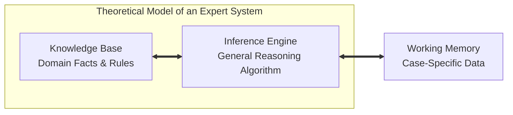
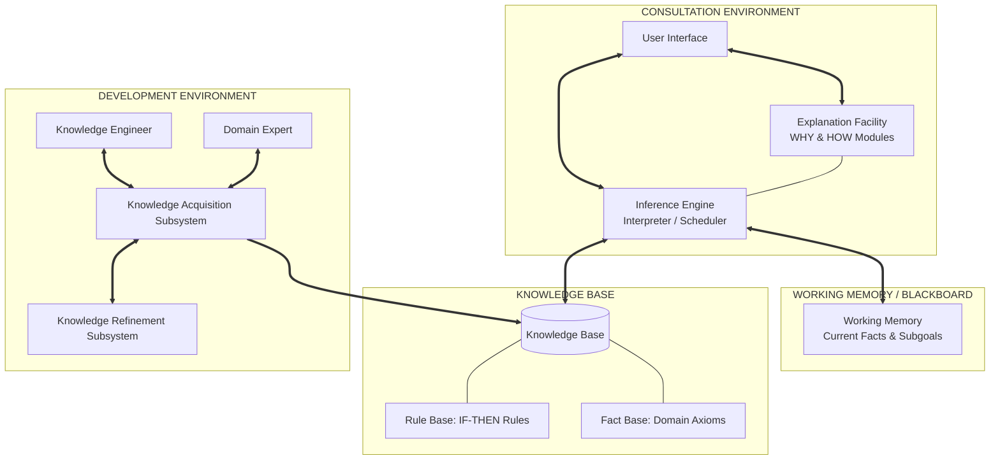
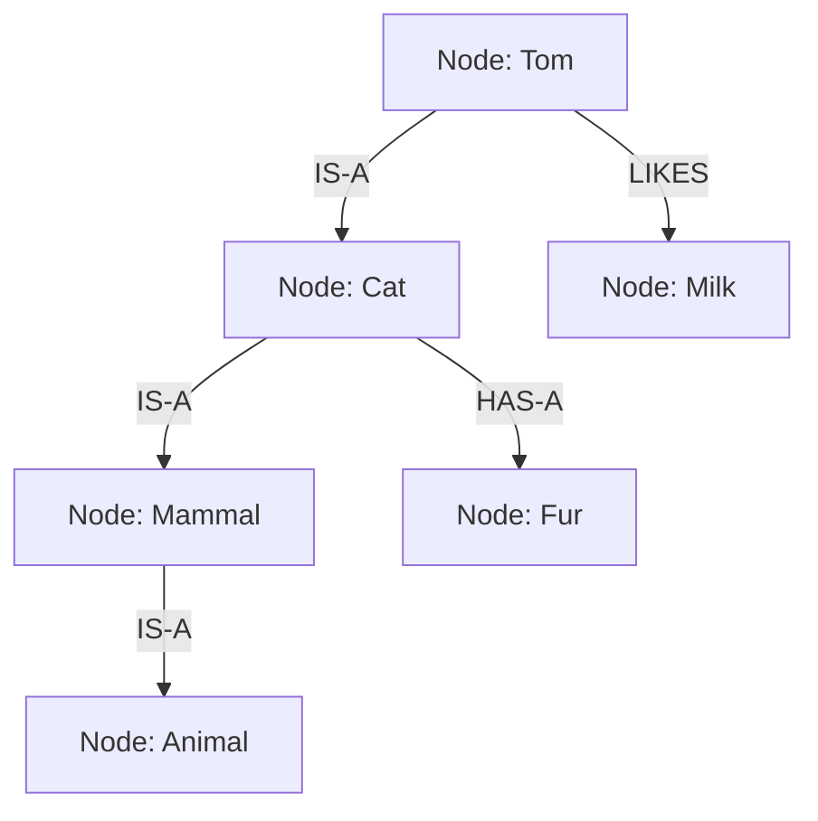
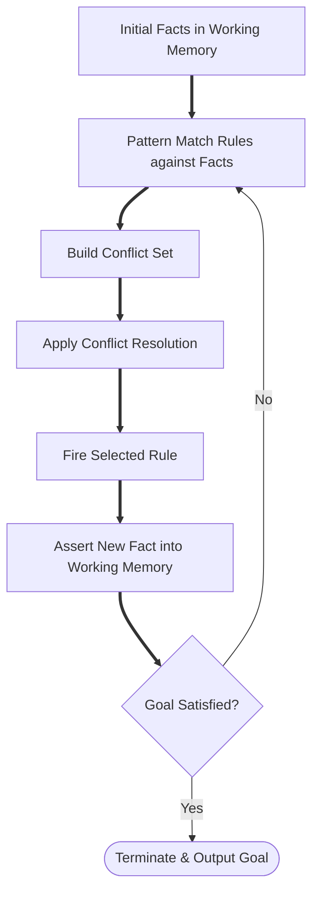
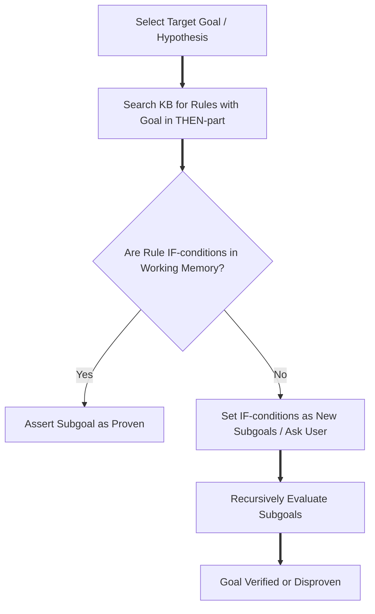
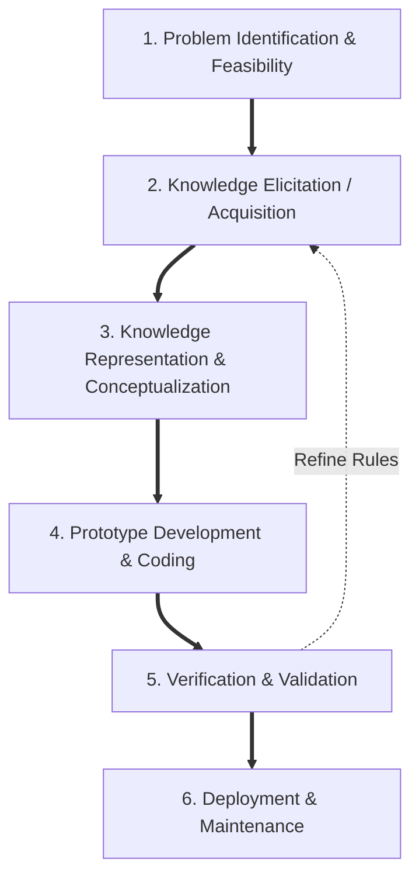
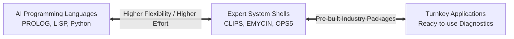
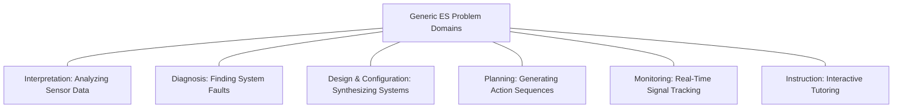

# Unit 6: Expert Systems – Complete Study Notes

**Course:** B.Tech Computer Engineering / Artificial Intelligence  
**Syllabus Authority:** Course Policy (`Artificial Intelligence 2026-27.pdf`)  
**Primary Classroom Reference:** `chapter12.pptx`  
**Supporting References:** *Artificial Intelligence: A Modern Approach (AIMA)* & *Intelligent Systems* Notes  
**Course Outcome Mapped:** CO3 — Design and implement Expert Systems for real-world decision-making domains.  
**Prescribed Weightage:** 3 Hours / Core Examination Module  

---

## 📋 TABLE OF CONTENTS
1. [Module 1: Fundamentals & Conceptual Framework](#module-1-fundamentals--conceptual-framework)
2. [Module 2: Complete Expert System Architecture](#module-2-complete-expert-system-architecture)
3. [Module 3: Knowledge Representation Paradigms](#module-3-knowledge-representation-paradigms)
4. [Module 4: Inference Engine & Reasoning Mechanisms](#module-4-inference-engine--reasoning-mechanisms)
5. [Module 5: Expert System Development Lifecycle (ESDL)](#module-5-expert-system-development-lifecycle-esdl)
6. [Module 6: Classic Landmark Case Studies](#module-6-classic-landmark-case-studies)
7. [Module 7: Industrial Applications & Problem Domains](#module-7-industrial-applications--problem-domains)
8. [Module 8: Benefits, Trade-offs & Limitations](#module-8-benefits-trade-offs--limitations)
9. [Module 9: Exam-Oriented Question Bank & Model Answers](#module-9-exam-oriented-question-bank--model-answers)
10. [Module 10: Course Outcome CO3 Syllabus Coverage Checklist](#module-10-course-outcome-co3-syllabus-coverage-checklist)

---

## MODULE 1: FUNDAMENTALS & CONCEPTUAL FRAMEWORK

### 1.1 Definition & Core Purpose
An **Expert System (ES)** is a computer program designed to emulate the decision-making ability of a human expert in a specific, narrow domain. It represents a major application area of Artificial Intelligence, shifting the focus from general-purpose problem-solving algorithms to **knowledge-intensive systems**.

> **Formal Definition (Edward Feigenbaum, 1977):**  
> *"An expert system is an intelligent computer program that uses knowledge and inference procedures to solve problems that are difficult enough to require significant human expertise for their solution."*

#### Core Purpose of Expert Systems:
* **Knowledge Preservation:** Capturing scarce, perishable human expertise before specialists retire or leave an organization.
* **Knowledge Mass Distribution:** Multiplying human expertise and making it simultaneously available across geographically distributed locations.
* **Consistency & Objectivity:** Providing unbiased, repeatable, and logical decision-making that is free from emotional bias, fatigue, or cognitive overload.
* **Real-Time Guidance:** Assisting human operators in complex, high-stakes environments like ICU patient monitoring, nuclear power plant control, and financial fraud detection.

---

### 1.2 Theoretical Model & Separation Principle
The defining architectural breakthrough of Expert Systems is the **Separation Principle**. In conventional software, domain knowledge and control logic are inextricably intertwined in the source code. In an Expert System, the domain knowledge is completely decoupled from the reasoning engine.



$$\mathbf{Expert\ System = Knowledge\ Base + Inference\ Engine}$$

#### Why Decoupling Matters:
1. **Maintainability:** Modifying or adding a rule in the Knowledge Base does not require modifying or recompiling the Inference Engine logic.
2. **Reusability:** The same Inference Engine shell (e.g., EMYCIN, CLIPS) can be paired with different Knowledge Bases to create distinct expert systems across medical, geological, or financial domains.
3. **Incremental Growth:** Knowledge can be added incrementally as new domain insights emerge.

---

### 1.3 Key Concepts & Terminology

* **Human Expert:** A person who possesses specialized knowledge, judgment, experience, and heuristics within a specific domain (e.g., a senior physician, structural engineer, or tax lawyer).
* **Expertise:** The specialized domain-specific body of knowledge, practical skills, shortcuts, intuition, and rules of thumb that enable an expert to solve complex problems efficiently.
* **Knowledge-Based System (KBS):** Any AI system whose performance depends primarily on explicit symbolic representations of domain knowledge rather than general algorithmic tricks.
* **Rule-Based System:** A specific subclass of KBS that represents knowledge primarily as a collection of **IF-THEN production rules**.
* **Domain Knowledge:** Information, facts, models, and heuristics restricted to a specific problem area (e.g., blood disease diagnosis).
* **Symbolic Reasoning:** Manipulating explicit symbolic structures (words, rules, relations, logic) to draw conclusions, as opposed to numerical or sub-symbolic processing (like neural network weights).
* **Deep Knowledge vs. Surface Knowledge:**
  * **Surface (Shallow) Knowledge:** Empirical, heuristic IF-THEN associations derived from experience. Fast but brittle when faced with novel situations.
  * **Deep Knowledge:** First-principles knowledge based on underlying physics, causal models, anatomical structure, or mathematical laws. Robust but computationally expensive.
* **Self-Knowledge (Metaknowledge):** Knowledge *about* knowledge. Enables the system to evaluate the validity of its own reasoning, know when a problem lies outside its domain, and explain how a conclusion was reached.
* **Heuristics:** Practical "rules of thumb", empirical tricks, or educated guesses that prune search spaces and produce good-enough solutions quickly under uncertainty.

---

### 1.4 Comprehensive Comparison Matrices

#### Table 1.1: Expert Systems vs. Conventional Programs

| Feature | Expert System (ES) | Conventional Program |
| :--- | :--- | :--- |
| **Primary Focus** | Knowledge-intensive symbolic reasoning | Data-intensive algorithmic processing |
| **Separation Principle** | Knowledge Base is strictly separated from Inference Engine | Data structures and control algorithms are tightly coupled |
| **Handling Uncertainty** | High capability (uses Certainty Factors, Fuzzy Logic, Probability) | Poor capability (requires exact, deterministic binary inputs) |
| **Explanation Facility** | Native capability (explains **WHY** and **HOW** conclusions were made) | Non-existent (outputs final numeric/text results without reasoning traces) |
| **Modification / Maintenance** | Simple (add/edit rules in Knowledge Base without changing code) | Complex (requires re-engineering source code and re-compiling) |
| **Execution Flow** | Dynamic, heuristic-driven (guided by rules firing) | Sequential, deterministic (if-else, loops, procedural functions) |

#### Table 1.2: Expert Systems vs. Decision Support Systems (DSS)

| Parameter | Expert System (ES) | Decision Support System (DSS) |
| :--- | :--- | :--- |
| **Primary Goal** | Replaces or automates human expert decision-making | Assists human decision-makers by organizing data/models |
| **Decision Authority** | Recommends or makes the final decision autonomously | Leaves final decision authority entirely to the human manager |
| **Reasoning Model** | Emulates human expert reasoning via symbolic inference | Uses statistical models, database queries, and spreadsheet analysis |
| **Problem Type** | Heuristic, qualitative, unstructured problems | Semi-structured problems requiring data analysis |

#### Table 1.3: Expert Systems vs. Human Experts

| Factor | Expert System (ES) | Human Expert |
| :--- | :--- | :--- |
| **Availability** | Continuous (24/7/365, multi-location simultaneous access) | Perishable, geographically restricted, limited working hours |
| **Consistency** | 100% logical consistency (unaffected by fatigue, emotion, stress) | Variable (subject to fatigue, stress, emotional bias, oversight) |
| **Transferability** | Instantaneous (copy digital files or clone rule bases) | Slow, laborious (requires years of education, training, apprenticeship) |
| **Common Sense & Intuition** | Lacks general common sense; bounded strictly by rule base | Broad common-sense reasoning, sensory intuition, adaptive learning |
| **Domain Scope** | Highly narrow and specialized | Narrow expertise combined with general world knowledge |

#### Table 1.4: Expert Systems vs. General AI / Large Language Models (LLMs)

| Feature | Expert System (ES) | General AI / LLMs |
| :--- | :--- | :--- |
| **Knowledge Origin** | Hand-crafted by Knowledge Engineers from human experts | Learned statistical associations from massive web corpora |
| **Reasoning Transparency** | Fully transparent, deterministic, step-by-step rule trace | Black-box / probabilistic next-token generation |
| **Determinism & Accuracy** | 100% deterministic given the same rule set and facts | Probabilistic (susceptible to hallucinations and non-determinism) |
| **Adaptability** | Rigid; fails gracefully or breaks outside specific rule boundaries | Highly flexible; handles creative, multi-domain conversational tasks |

---

## MODULE 2: COMPLETE EXPERT SYSTEM ARCHITECTURE

An Expert System operates in two distinct operational modes: the **Development Environment** (used by Knowledge Engineers and Experts to build the system) and the **Consultation Environment** (used by End-Users to obtain advice).

### 2.1 Complete Architectural Diagram



---

### 2.2 Component Analysis: Roles, Inputs, Outputs & Interactions

#### 1. Knowledge Base (KB)
* **Definition:** The centralized repository containing domain-specific expert knowledge.
* **Role:** Stores both static declarative facts and procedural heuristic rules governing the domain.
* **Sub-Components:**
  * **Rule Base:** Collection of production rules ($	ext{IF } \langle	ext{antecedent}
angle 	ext{ THEN } \langle	ext{consequent}
angle$).
  * **Fact Base:** Set of permanent, static domain facts and axioms that are universally true in the domain.
* **Inputs:** Formatted symbolic rules and facts from the Knowledge Acquisition Subsystem.
* **Outputs:** Matching rules and structural knowledge supplied to the Inference Engine.

#### 2. Working Memory (Blackboard)
* **Definition:** A volatile memory workspace used to store the dynamic facts of the current consultation session.
* **Role:** Tracks the initial user-supplied inputs, intermediate conclusions, current active subgoals, and final diagnostic results.
* **Inputs:** Percepts/answers entered by the User Interface; dynamic facts asserted during rule firing by the Inference Engine.
* **Outputs:** Current state facts evaluated by the Inference Engine during pattern matching.

#### 3. Inference Engine (IE)
* **Definition:** The "brain" of the expert system that executes reasoning algorithms to draw conclusions.
* **Role:** Applies logical rules to working memory facts to derive new information or satisfy goals.
* **Core Sub-Modules:**
  1. **Pattern Matcher (Interpreter):** Compares rule IF-conditions against working memory facts.
  2. **Conflict Resolver (Scheduler):** Selects which rule to fire when multiple rules match working memory simultaneously (Conflict Set).
  3. **Execution Engine:** Fires the selected rule, updating working memory with its THEN-consequent.
* **Inputs:** Rules from Knowledge Base; dynamic facts from Working Memory.
* **Outputs:** Inferred conclusions asserted into Working Memory; queries dispatched to User Interface.

#### 4. User Interface (UI)
* **Definition:** The communication bridge between the non-expert user and the expert system.
* **Role:** Translates user responses into internal symbolic representations and displays diagnostic questions, explanations, and final recommendations in natural language or menu-driven forms.
* **Inputs:** User keystrokes, selected options, and answers.
* **Outputs:** Diagnostic questions, advice, probability scores, and explanation screens.

#### 5. Explanation Facility
* **Definition:** The module responsible for providing transparency into the system's reasoning chain.
* **Role:** Answers user inquiries during or after a consultation session.
* **Core Modules:**
  * **WHY Module:** Explains *why* the system is asking a specific diagnostic question (displays the active rule being evaluated).
  * **HOW Module:** Explains *how* a specific conclusion was reached (displays the step-by-step chain of fired rules and asserted facts).
* **Inputs:** Execution history logs and rule firing sequences from the Inference Engine.
* **Outputs:** Step-by-step natural language reasoning traces.

#### 6. Knowledge Acquisition Subsystem
* **Definition:** The environment that facilitates capturing expertise from human experts or documents and converting it into structured rules.
* **Role:** Allows Knowledge Engineers and Domain Experts to inspect, edit, add, and test rules in the Knowledge Base without writing low-level code.
* **Inputs:** Elicited human expertise, interview records, protocol logs.
* **Outputs:** Structured, syntax-checked production rules stored in the Knowledge Base.

#### 7. Knowledge Refinement Subsystem
* **Definition:** An advanced subsystem (often incorporating machine learning or rule-checking heuristics) that evaluates system performance over time.
* **Role:** Detects redundant rules, conflicting rules, missing subconditions, and updates Certainty Factor weights based on empirical feedback.

---

### 2.3 Component Disambiguation: Knowledge Base vs. Rule Base vs. Fact Base vs. Working Memory vs. Blackboard

| Component | Nature | Lifetime | Contents | Primary User / Accessor |
| :--- | :--- | :--- | :--- | :--- |
| **Knowledge Base (KB)** | Permanent / Static | Long-term (persists across all sessions) | Complete domain rules, structural models, and static axioms | Knowledge Engineer & Domain Expert |
| **Rule Base** | Sub-component of KB | Long-term | Procedural IF-THEN heuristic rules | Inference Engine Pattern Matcher |
| **Fact Base** | Sub-component of KB | Long-term | Permanent, non-changing domain truths (e.g., "Boiling point of water is 100°C") | Inference Engine |
| **Working Memory** | Dynamic / Volatile | Session-scoped (cleared after consultation) | Current case facts, user inputs, intermediate conclusions | Inference Engine & User Interface |
| **Blackboard** | Shared Memory Workspace | Session / Problem-scoped | Shared workspace where multiple independent expert modules post sub-solutions | Opportunistic Multi-Agent / Expert Systems |

---

## MODULE 3: KNOWLEDGE REPRESENTATION PARADIGMS

Knowledge representation is the formal formalization of domain knowledge into symbolic structures that computer inference algorithms can manipulate.

### 3.1 Production Rules
Production rules are the most widely used representation paradigm in Expert Systems.

$$\mathbf{IF \ \langle Condition_1 	ext{ AND } Condition_2 \dots 
angle \ 	ext{THEN} \ \langle Action_1 / Conclusion_1 
angle \ [	ext{Certainty Factor } CF = w]}$$

#### Structure & Components:
* **Antecedent (Premise / IF-part):** Consists of one or more conditions connected by logical operators (`AND`, `OR`, `NOT`). Evaluated against Working Memory.
* **Consequent (Conclusion / Action / THEN-part):** The action to be taken or new fact to be asserted into Working Memory if the antecedent evaluates to TRUE.
* **Certainty Factor (CF):** An optional numerical weight (typically $[-1.0, +1.0]$ or $[0, 100]$) measuring belief confidence.

#### Example:
```text
RULE 104:
IF   Patient_Temperature > 38.5 C
AND  Patient_Blood_Culture IS Gram_Negative_Rod
AND  Patient_Is_Compromised_Host IS True
THEN Assert Diagnosis = Pseudomonas_Aeruginosa_Infection (CF = 0.8)
```

---

### 3.2 Semantic Networks
A **Semantic Network** is a graphic knowledge representation structure consisting of **nodes** (representing objects, concepts, or states) connected by **directed labeled arcs** (representing relations between nodes).



#### Key Characteristics:
* **Inheritance:** Sub-nodes automatically inherit properties from parent nodes along `IS-A` taxonomic links (e.g., Tom inherits `HAS-A Fur` from Cat).
* **Expressiveness:** Excellent for representing structural, hierarchical domain relationships.

---

### 3.3 Frames
A **Frame** is a structured data representation format designed by Marvin Minsky for representing stereotypical concepts, physical objects, or situations.

#### Structure of a Frame:
A frame consists of a name and a collection of **slots**. Each slot can contain **values**, **default settings**, **constraints**, or attached procedures (**facets**).

```text
FRAME: Commercial_Aircraft
  SUPERCLASS: Aircraft
  SLOTS:
    Manufacturer:  (Value: Boeing)
    Wings:         (Default: 2)
    Engines:       (Type: Integer, Constraint: > 0)
    Status:        (Value: In-Flight)
  PROCEDURAL ATTACHMENTS (FACETS):
    If-Needed:     Calculate_Fuel_Burn_Rate()
    If-Added:      Update_Air_Traffic_Control_Log()
```

#### Procedural Attachments (Demons):
* **`if-needed`:** Triggered when the system requires a slot value that is currently missing.
* **`if-added`:** Triggered when a new value is inserted into a slot (e.g., firing validation checks).
* **`if-removed`:** Triggered when a slot value is deleted.

---

### 3.4 Logic (Propositional & First-Order Predicate Logic)

#### Propositional Logic:
Uses atomic propositions ($P, Q, R$) connected by logical connectives ($\land, \lor, 
eg, \implies, \iff$).
* *Example:* $P: 	ext{Fever}$, $Q: 	ext{Infection}$. $P \implies Q$.

#### First-Order Logic (FOL):
Extends propositional logic by incorporating **predicates**, **functions**, **constants**, **variables**, and **quantifiers** ($orall$: Universal, $\exists$: Existential).
* *Example:* "All humans are mortal."
  $$orall x \ (	ext{Human}(x) \implies 	ext{Mortal}(x))$$
* *Example:* "Socrates is a human."
  $$	ext{Human}(	ext{Socrates})$$
* *Inference via Modus Ponens:*
  $$	ext{Mortal}(	ext{Socrates})$$

---

## MODULE 4: INFERENCE ENGINE & REASONING MECHANISMS

The Inference Engine operates by continuously matching rule antecedents against working memory facts. When multiple rules match simultaneously, they form a **Conflict Set**. The system uses a **Conflict Resolution Strategy** to select exactly one rule to fire.

### 4.1 Conflict Resolution Strategies
1. **Specificity (Maximal Match):** Selects the rule with the most specific IF-conditions (longest premise list), as specific rules are more detailed than general rules.
2. **Recency:** Selects the rule matching the most recently asserted facts in Working Memory.
3. **Refractoriness:** Prevents a rule from firing twice on the exact same set of facts, avoiding infinite loops.
4. **Rule Priority (Salience):** Fires the rule assigned the highest explicit priority weight by the Knowledge Engineer.

---

### 4.2 Forward Chaining (Data-Driven Reasoning)

#### Concept & Direction:
Forward chaining starts from the **known initial facts** in Working Memory and applies rules repeatedly to derive new conclusions until a goal state is satisfied or no further rules can fire.

* **Direction:** Bottom-up / Data $\implies$ Goal.
* **Best Used When:**
  * All initial facts are readily available at the start.
  * There are many potential goals, but few initial facts.
  * The application requires real-world monitoring, planning, or control.



#### Forward Chaining Algorithm (Pseudocode):

```text
Algorithm FORWARD-CHAINING(KnowledgeBase, WorkingMemory, Goal):
    Loop:
        ConflictSet <- EmptySet
        For each Rule in KnowledgeBase:
            If Rule.IF_Conditions are satisfied by WorkingMemory
               AND Rule has NOT fired on current facts:
                Add Rule to ConflictSet
        
        If ConflictSet is Empty:
            Return "Goal Not Proven / No Further Inferences"
            
        SelectedRule <- RESOLVE-CONFLICTS(ConflictSet) // Apply Specificity/Recency
        
        NewFacts <- SelectedRule.THEN_Actions
        Assert NewFacts into WorkingMemory
        Mark SelectedRule as Fired
        
        If Goal is in WorkingMemory:
            Return "Goal Successfully Proven: " + Goal
```

---

#### Fully Solved Forward Chaining Numerical / Rule Trace

**Given Knowledge Base (Rules):**
* **R1:** IF $A$ AND $B$ THEN $C$
* **R2:** IF $C$ AND $D$ THEN $E$
* **R3:** IF $E$ AND $F$ THEN $G$
* **R4:** IF $A$ AND $H$ THEN $I$
* **R5:** IF $I$ AND $D$ THEN $F$

**Given Working Memory (Initial Facts):**
* Working Memory $WM_0 = \{A, B, D, H\}$
* **Target Goal:** Prove whether $G$ is TRUE.

#### Step-by-Step Rule Firing Log:

| Iteration | Active Working Memory Facts | Matching Rules (Conflict Set) | Conflict Resolution Decision | Rule Fired | New Fact Asserted | Updated Working Memory |
| :---: | :--- | :--- | :--- | :--- | :--- | :--- |
| **1** | $\{A, B, D, H\}$ | R1 (needs $A,B$), R4 (needs $A,H$) | Select R1 (higher rule order) | R1 | $C$ | $\{A, B, D, H, C\}$ |
| **2** | $\{A, B, D, H, C\}$ | R2 (needs $C,D$), R4 (needs $A,H$) | Select R2 (higher specificity/order) | R2 | $E$ | $\{A, B, D, H, C, E\}$ |
| **3** | $\{A, B, D, H, C, E\}$ | R4 (needs $A,H$) | Select R4 (only matching rule) | R4 | $I$ | $\{A, B, D, H, C, E, I\}$ |
| **4** | $\{A, B, D, H, C, E, I\}$ | R5 (needs $I,D$) | Select R5 | R5 | $F$ | $\{A, B, D, H, C, E, I, F\}$ |
| **5** | $\{A, B, D, H, C, E, I, F\}$ | R3 (needs $E,F$) | Select R3 | R3 | $G$ | $\{A, B, D, H, C, E, I, F, G\}$ |

**Termination:** Fact $G$ is now asserted into Working Memory. Goal $G$ is **PROVEN TRUE**.  
**Firing Sequence:** $\langle R1 \implies R2 \implies R4 \implies R5 \implies R3 
angle$.

---

### 4.3 Backward Chaining (Goal-Driven Reasoning)

#### Concept & Direction:
Backward chaining starts with a **hypothesized goal** and works backward, looking for rules that conclude the goal. The IF-conditions of these rules become new **subgoals** to be proven recursively.

* **Direction:** Top-down / Goal $\impliedby$ Data.
* **Best Used When:**
  * A specific hypothesis needs verification (e.g., "Does patient have Typhoid?").
  * There are vast numbers of facts, but few target hypotheses.
  * Diagnostic systems (like MYCIN).



#### Backward Chaining Algorithm (Pseudocode):

```text
Algorithm BACKWARD-CHAINING(Goal, KnowledgeBase, WorkingMemory):
    If Goal is in WorkingMemory:
        Return True
        
    MatchingRules <- Find Rules in KB where Goal is in THEN-consequent
    
    If MatchingRules is Empty:
        Ask User: "Is " + Goal + " true?"
        If User answers Yes:
            Assert Goal into WorkingMemory
            Return True
        Else:
            Return False
            
    For each Rule in MatchingRules:
        RuleSuccess <- True
        For each Condition in Rule.IF_Conditions:
            SubGoalResult <- BACKWARD-CHAINING(Condition, KnowledgeBase, WorkingMemory)
            If SubGoalResult is False:
                RuleSuccess <- False
                Break // Try next rule
        
        If RuleSuccess is True:
            Assert Goal into WorkingMemory
            Return True
            
    Return False
```

---

#### Fully Solved Backward Chaining Numerical / Rule Trace

**Given Knowledge Base (Rules):**
* **R1:** IF $A$ AND $B$ THEN $G$
* **R2:** IF $C$ AND $D$ THEN $A$
* **R3:** IF $E$ THEN $B$
* **R4:** IF $F$ THEN $C$

**Given Working Memory (Initial Known Facts):**
* Working Memory $WM_0 = \{D, E, F\}$
* **Target Goal:** Prove Hypothesis $G$.

#### Step-by-Step Goal Stack Execution Log:

1. **Goal Stack:** $[G]$. Search KB for rules concluding $G \implies$ Found **R1**.
2. **Subgoals for R1:** Must prove $A$ and $B$.
   * Push $A$ onto Goal Stack: $[G, A]$.
3. **Evaluate Subgoal $A$:** Search KB for rules concluding $A \implies$ Found **R2** (IF $C 	ext{ AND } D$).
   * Must prove $C$ and $D$.
   * Check $D$: $D \in WM_0 \implies$ **$D$ is TRUE**.
   * Push $C$ onto Goal Stack: $[G, A, C]$.
4. **Evaluate Subgoal $C$:** Search KB for rules concluding $C \implies$ Found **R4** (IF $F$).
   * Check $F$: $F \in WM_0 \implies$ **$F$ is TRUE**.
   * Therefore, Rule R4 fires $\implies$ **$C$ is PROVEN TRUE** and added to $WM$.
5. **Backtrack to R2:** Both conditions $C$ (proven) and $D$ (known) are TRUE.
   * Rule R2 fires $\implies$ **$A$ is PROVEN TRUE** and added to $WM$.
6. **Backtrack to R1:** Condition $A$ is proven. Now evaluate condition $B$.
   * Push $B$ onto Goal Stack: $[G, B]$.
7. **Evaluate Subgoal $B$:** Search KB for rules concluding $B \implies$ Found **R3** (IF $E$).
   * Check $E$: $E \in WM_0 \implies$ **$E$ is TRUE**.
   * Rule R3 fires $\implies$ **$B$ is PROVEN TRUE** and added to $WM$.
8. **Complete R1:** Both conditions $A$ (proven) and $B$ (proven) are TRUE.
   * Rule R1 fires $\implies$ **Goal $G$ is PROVEN TRUE**.

**Final Result:** Hypothesis $G$ is **VERIFIED TRUE**.  
**Execution Subgoal Chain:** $G 	o A 	o C 	o (F 	ext{ verified}) 	o (D 	ext{ verified}) 	o B 	o (E 	ext{ verified}) \implies G 	ext{ holds}$.

---

### 4.4 Comparison Matrix: Forward Chaining vs. Backward Chaining

| Feature | Forward Chaining | Backward Chaining |
| :--- | :--- | :--- |
| **Reasoning Direction** | Data-driven (Bottom-up: Facts $\implies$ Goals) | Goal-driven (Top-down: Goals $\implies$ Facts) |
| **Starting Point** | Given initial facts in Working Memory | Target hypothesis / goal to prove |
| **Search Approach** | Explores all possible inferences from facts | Explores only rules relevant to the goal |
| **User Querying** | Passive (asks for facts at the start) | Active (asks user targeted questions during search) |
| **Best Application** | Planning, monitoring, control, synthesis | Medical diagnosis, fault troubleshooting, debugging |
| **Risk / Drawback** | May derive many irrelevant facts | May explore subgoals that fail repeatedly |

---

## MODULE 5: EXPERT SYSTEM DEVELOPMENT LIFECYCLE (ESDL)

Building an Expert System is an iterative engineering process known as **Knowledge Engineering**.



### 5.1 The Six ESDL Phases

1. **Problem Identification & Feasibility Analysis:**
   * Determine if the problem is suitable for ES technology (must be non-algorithmic, heuristic, bounded, and high-value).
   * Verify that committed human experts exist and are willing to share knowledge.
2. **Knowledge Acquisition & Elicitation:**
   * The Knowledge Engineer extracts expertise from human experts, manuals, and case records.
3. **Knowledge Representation (Conceptualization):**
   * Structuring raw facts and rules into formal representations (Production Rules, Semantic Nets, Frames).
4. **Prototype Development & Tool Selection:**
   * Selecting an appropriate Expert System Shell (e.g., CLIPS) or language (PROLOG).
   * Building a rapid prototype containing a core subset of rules (50–100 rules) to test feasibility.
5. **Verification & Validation (Testing):**
   * **Verification:** Checking structural consistency ("Are we building the system right?"). Checks for redundant, contradictory, or dead-end rules.
   * **Validation:** Checking performance accuracy ("Are we building the right system?"). Evaluates system decisions against benchmark human expert decisions.
6. **Deployment & Maintenance:**
   * Integrating the system into end-user workflows and continuously updating the Knowledge Base as domain rules evolve.

---

### 5.2 Key Stakeholders & Roles

* **Domain Expert:** The human specialist who possesses the expertise, heuristics, and domain shortcuts.
* **Knowledge Engineer:** The AI specialist who interviews experts, uncovers hidden heuristics, formalizes knowledge into rules, and implements the system.
* **System Developer:** Builds user interfaces, database connectors, and integrates the shell.
* **End-User:** The non-expert operator who relies on the Expert System for advice.

---

### 5.3 Knowledge Acquisition Techniques

* **Structured / Unstructured Interviews:** Direct question-and-answer sessions between Knowledge Engineer and Expert.
* **Protocol Analysis (Think-Aloud Technique):** Recording the expert as they solve an actual real-world case out loud.
* **Observation:** Watching the expert work in their natural operational environment.
* **Repertory Grid Analysis:** A psychological technique used to identify subtle distinctions experts make between domain entities.

---

### 5.4 Tooling Spectrum: Languages vs. Shells vs. Turnkey Solutions



* **AI Programming Languages (LISP, PROLOG, Python):** Maximum flexibility; requires building the Inference Engine and Knowledge Base from scratch.
* **Expert System Shells (CLIPS, EMYCIN, OPS5):** Pre-packaged expert system environments containing a built-in Inference Engine, User Interface, and Explanation Facility. The developer only needs to supply the domain **Rules**.
* **Turnkey Solutions:** Complete, pre-configured expert systems ready for immediate deployment in specific commercial domains.

---

## MODULE 6: CLASSIC LANDMARK CASE STUDIES

### 6.1 MYCIN
* **Domain:** Infectious blood disease and meningitis diagnosis and antimicrobial therapy selection.
* **Developer / Institution:** Stanford University (Shortliffe et al., 1970s).
* **Knowledge Representation:** ~600 Production Rules.
* **Inference Mechanism:** **Backward Chaining** with **Certainty Factors (CF)**.
* **Core Contribution:**
  * First system to handle **reasoning under uncertainty** using Certainty Factors ($CF \in [-1, +1]$).
  * Introduced the **WHY/HOW Explanation Facility**.
  * Separated into **EMYCIN** (Empty MYCIN), creating the world's first Expert System Shell.
* **Limitations:** Never deployed clinically due to legal liability concerns and computational latency on 1970s hardware.

---

### 6.2 DENDRAL
* **Domain:** Organic chemical structure elucidation from mass spectrometry and NMR data.
* **Developer / Institution:** Stanford University (Feigenbaum, Lederberg, Djerassi, 1960s).
* **Architecture / Paradigm:** **Plan-Generate-Test** paradigm using heuristic state-space search.
* **Core Contribution:** The world's **first operational Expert System**. Demonstrated that domain-specific knowledge, rather than general search algorithms, is the key to high AI performance.

---

### 6.3 XCON (R1)
* **Domain:** Automated configuration of Digital Equipment Corporation (DEC) VAX computer systems.
* **Developer / Institution:** Carnegie Mellon University (John McDermott) & DEC (1980s).
* **Knowledge Representation:** 10,000+ Production Rules written in **OPS5**.
* **Inference Mechanism:** **Forward Chaining** using the **Rete Algorithm**.
* **Core Contribution:** First major commercial expert system success, saving DEC an estimated $40M annually by preventing component shipping errors.
* **Limitations:** High maintenance cost due to frequent hardware updates, illustrating the "Knowledge Maintenance Bottleneck."

---

## MODULE 7: INDUSTRIAL APPLICATIONS & PROBLEM DOMAINS

Expert systems are categorized into distinct operational generic problem categories:



### Table 7.1: Application Domains Summary

| Category | Primary Objective | Representative Landmark System |
| :--- | :--- | :--- |
| **Diagnosis** | Inferring system malfunctions from observed symptoms | MYCIN (Medical), CADUCEUS |
| **Interpretation** | Analyzing raw sensor data to infer state | DENDRAL (Chemistry), PROSPECTOR (Geology) |
| **Configuration / Design** | Assembling complex systems subject to constraints | XCON / R1 (Computer Hardware) |
| **Planning** | Designing action sequences to achieve goals | MOLGEN (Molecular Biology Planning) |
| **Monitoring** | Comparing real-time signals against safety thresholds | NAVEX (Space Shuttle Radar Tracking) |
| **Instruction** | Diagnosis and remediation of student learning | GUIDON (Medical Education) |

---

## MODULE 8: BENEFITS, TRADE-OFFS & LIMITATIONS

### 8.1 Success Factors & Benefits
* **Increased Productivity & Speed:** Computes complex diagnostic chains in seconds.
* **Preservation of Expertise:** Institutional memory remains intact despite personnel turnover.
* **Operation in Hazardous Environments:** Deployed in radioactive, deep-sea, or high-risk industrial zones.
* **Multi-Domain Access:** Multiple non-experts can query the system simultaneously.

---

### 8.2 Bottlenecks & Strategic Limitations
* **Knowledge Acquisition Bottleneck:** Extracting tacit, unwritten knowledge from human experts is slow, difficult, and prone to communication breakdowns.
* **Brittleness:** Expert systems operate extremely well inside their narrow domain, but fail catastrophically (brittle failure) when faced with edge cases outside their rule base.
* **Lack of Common Sense:** Systems possess zero general-world knowledge and cannot recognize absurd inputs that a human child would spot instantly.
* **High Maintenance Costs:** Domain rules change continuously, requiring ongoing manual rule updating to prevent rule obsolescence or contradiction.
* **Conflict Between Experts:** Disagreements among multiple human experts make rule formulation difficult.

---

## MODULE 9: EXAM-ORIENTED QUESTION BANK & MODEL ANSWERS

### 9.1 Short Answer Questions (2 Marks Each)

#### Q1: Define an Expert System according to Edward Feigenbaum.
**Model Answer:**  
An Expert System is an intelligent computer program that uses domain-specific knowledge and inference procedures to solve problems that are difficult enough to require significant human expertise for their solution.

#### Q2: What is the Separation Principle in Expert System Architecture?
**Model Answer:**  
The Separation Principle is the architectural decoupling of domain knowledge (stored in the Knowledge Base) from the general reasoning mechanism (the Inference Engine). This allows the rule base to be updated without modifying the underlying engine code.

#### Q3: Differentiate between Surface Knowledge and Deep Knowledge.
**Model Answer:**  
Surface (shallow) knowledge consists of empirical, heuristic IF-THEN associations learned through experience. Deep knowledge is based on first-principles, causal models, fundamental physics, or anatomical structures.

#### Q4: Define the Knowledge Acquisition Bottleneck.
**Model Answer:**  
It refers to the difficulty and delay in extracting tacit, unwritten heuristic knowledge from human experts and translating it into formal symbolic rules. It is considered the primary bottleneck in building expert systems.

---

### 9.2 Medium Analytical Questions (5 Marks Each)

#### Q5: Differentiate between Forward Chaining and Backward Chaining inference mechanisms.
**Model Answer Framework:**
* Define direction: Data-driven (bottom-up) vs. Goal-driven (top-down).
* Contrast starting points: Initial facts vs. Target hypotheses.
* Compare user interaction: Passive initial collection vs. Active, targeted diagnostic queries.
* Include a neat comparison table (refer to Table 4.4).
* Mention suitable domains: Planning/Monitoring for Forward Chaining; Diagnosis/Debugging for Backward Chaining.

#### Q6: Explain the roles and interactions of the Explanation Facility (WHY and HOW modules).
**Model Answer Framework:**
* **Role:** Provides transparency by explaining the reasoning process.
* **WHY Module:** Displays the current active rule being evaluated when asking a user for input, explaining *why* the data is necessary.
* **HOW Module:** Traces back through the chain of fired rules and asserted facts to explain *how* a final conclusion was derived.
* **Significance:** Builds user trust, assists in debugging rules, and ensures accountability.

---

### 9.3 Long Comprehensive Questions (10 Marks Each)

#### Q7: Draw and explain the complete architecture of an Expert System. Clearly distinguish between the Development and Consultation Environments.
**Model Answer Framework:**
* **Architecture Diagram:** Draw a complete, clear block diagram (refer to Section 2.1) showing KB, WM, IE, UI, EF, KAS, and KRS.
* **Detailed Explanation:** Describe each component's definition, role, input, and output:
  1. Knowledge Base (Rule Base + Fact Base).
  2. Working Memory (Current facts, goals).
  3. Inference Engine (Pattern Matcher, Conflict Resolver, Execution Engine).
  4. User Interface & Explanation Facility.
  5. Knowledge Acquisition & Refinement Subsystems.
* **Environment Differentiation:**
  * **Development Environment:** Used by Knowledge Engineers and Experts to build, test, and edit rules via KAS.
  * **Consultation Environment:** Used by End-Users to input facts, answer diagnostic queries, and receive advice via UI, IE, and EF.

#### Q8: Trace Forward Chaining and Backward Chaining using a given set of rules and initial facts.
*(Use the fully solved step-by-step numerical examples provided in Section 4.2 and Section 4.3 as the exact blueprint for full marks).*

---

## MODULE 10: COURSE OUTCOME CO3 SYLLABUS COVERAGE CHECKLIST

| Syllabus Topic | Coverage Status | Section Mapping |
| :--- | :---: | :---: |
| **Definition, Purpose & Theoretical Model** | ✅ Fully Covered | Section 1.1, 1.2 |
| **Core Characteristics & Terminology** | ✅ Fully Covered | Section 1.3 |
| **Comparison Tables (Conventional, DSS, Human, LLMs)** | ✅ Fully Covered | Section 1.4 |
| **Expert System Architecture & Components** | ✅ Fully Covered | Section 2.1, 2.2 |
| **Disambiguation: KB, Rule Base, Fact Base, WM, Blackboard** | ✅ Fully Covered | Section 2.3 |
| **Knowledge Representation (Rules, Nets, Frames, Logic)** | ✅ Fully Covered | Section 3.1 – 3.4 |
| **Conflict Resolution Strategies** | ✅ Fully Covered | Section 4.1 |
| **Forward Chaining (Algorithm, Pseudocode, Worked Trace)** | ✅ Fully Covered | Section 4.2 |
| **Backward Chaining (Algorithm, Pseudocode, Worked Trace)** | ✅ Fully Covered | Section 4.3 |
| **Forward vs. Backward Chaining Comparison** | ✅ Fully Covered | Section 4.4 |
| **Expert System Development Lifecycle (ESDL & Stakeholders)**| ✅ Fully Covered | Section 5.1, 5.2 |
| **Knowledge Acquisition Techniques** | ✅ Fully Covered | Section 5.3 |
| **Tooling Spectrum (Languages, Shells, Turnkey)** | ✅ Fully Covered | Section 5.4 |
| **Landmark Case Studies (MYCIN, DENDRAL, XCON)** | ✅ Fully Covered | Section 6.1 – 6.3 |
| **Industrial Application Domains** | ✅ Fully Covered | Section 7.1 |
| **Benefits, Bottlenecks & Limitations** | ✅ Fully Covered | Section 8.1, 8.2 |
| **Exam Question Bank & Model Answers** | ✅ Fully Covered | Section 9.1 – 9.3 |

---
