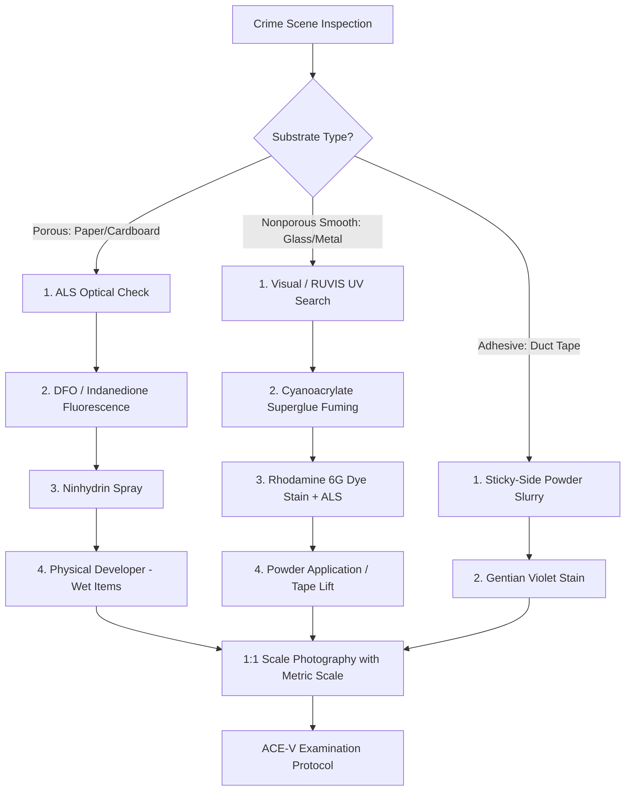

# Unit 3: Forensic Dermatoglyphics — Comprehensive Study Notes

This comprehensive, exam-oriented study notes document covers **Unit 3: Forensic Dermatoglyphics** as outlined in the NMIMS Course Policy (`IFS Course policy 2026-27 (1).docx`). It is grounded primarily in the lecture slide deck **`Unit - 3 (2).pdf`** (129 slides/pages) and enriched with authoritative reference texts including *THE FINGERPRINT SOURCEBOOK* (OJP/FBI), Saferstein's *Criminalistics: An Introduction to Forensic Science*, Gautam Biswas's *Review of Forensic Medicine and Toxicology*, Parikh's *Textbook of Medical Jurisprudence*, and B.R. Sharma's *Forensic Science in Criminal Investigation and Trials*.

---

## Course Policy & Learning Objective Alignment

* **Course Outcome (CO):** **CO3** — Interpret fingerprint patterns and evaluate latent prints using appropriate forensic dermatoglyphic techniques.
* **Bloom's Taxonomy Level:** **K3 (Apply)** — Demonstration of theoretical comprehension and practical application of physical, chemical, and optical techniques for detection, documentation, classification, and individualization.

---

## Section 1: Biological Foundations & Friction Ridge Anatomy

### 1.1 Definition & Etymology of Dermatoglyphics
* **Etymology:** Derived from two Greek words: *derma* (skin) and *glyphe* (carve, engrave, or carve out). Literally translated, it means "skin carvings."
* **Scientific Definition:** Dermatoglyphics is the scientific study of the complex configurations, patterns, and arrangements of friction skin ridges on the palmar surfaces of the hands (fingers and palms) and the plantar surfaces of the feet (toes and soles).
* **Forensic Synonymy:** In medicolegal and criminalistic literature, the discipline is also referred to as **Dactylography** (study of fingerprints for identification), **Dactyloscopy** (inspection and comparison of fingerprints), or the **Galton System**.

### 1.2 Structure & Anatomy of Friction Ridge Skin
Friction ridge skin is specialized, hairless (glabrous) skin that covers the palmar aspect of the hands and plantar aspect of the feet. Unlike non-friction skin, it lacks hair follicles, sebaceous (oil) glands, and arrector pili muscles, but possesses an extraordinarily high density of **eccrine sweat glands**.

```
                   CROSS-SECTION OF FRICTION RIDGE SKIN
  
  ┌─────────────────────────────────────────────────────────────┐ ◄── Surface
  │   Ridge        Valley       Ridge        Valley     Pore    │     Epidermis
  │  ┌──────┐     ┌──────┐     ┌──────┐     ┌──────┐     │      │
  │  │ PORE │     │      │     │ PORE │     │      │   ┌─┴─┐    │
  ├──┴──────┴─────┴──────┴─────┴──────┴─────┴──────┴───┴───┴────┤ ◄── Stratum Basale
  │     ▲            ▲            ▲            ▲                │
  │  Primary      Secondary    Primary      Secondary           │
  │   Ridge        Ridge        Ridge        Ridge              │
  ├─────────────────────────────────────────────────────────────┤ ◄── Epidermal-Dermal
  │    ┌──┐         ┌──┐         ┌──┐         ┌──┐              │     Junction
  │    │  │         │  │         │  │         │  │              │
  │  Dermal       Dermal       Dermal       Dermal              │
  │  Papillae     Papillae     Papillae     Papillae            │
  │  (Pegs)       (Pegs)       (Pegs)       (Pegs)              │
  │                                                             │
  │            ┌─────────┐                                      │ ◄── Dermis
  │            │ Eccrine │                                      │
  │            │ Sweat   │ ═════════════════════════════════════╪═══ Duct to surface
  │            │ Gland   │                                      │
  └────────────┴─────────┴──────────────────────────────────────┘
```

#### Key Anatomical Layers:
1. **Epidermis (Outer Layer):** Composed of stratified squamous epithelium divided into five structural strata:
   * *Stratum corneum* (outermost desquamating cornified layer)
   * *Stratum lucidum*
   * *Stratum granulosum*
   * *Stratum spinosum*
   * *Stratum basale / germinativum* (innermost generating layer resting on the basement membrane).
2. **Dermis (Inner Corium Layer):** Thick vascular connective tissue layer containing blood vessels, cutaneous nerves, Meissner's tactile corpuscles, collagen/elastin fibers, and the coiled bases of eccrine sudoriferous glands.
3. **Dermal Papillae (Papillary Pegs):** Malleable, double-row peglike projections of the papillary dermis that project upward into the underside of the epidermis. The specific arrangement and shape of these dermal papillae determine the exact form, contour, and flow of the friction ridges on the epidermal surface.
4. **Primary and Secondary Ridges:**
   * *Primary Ridges:* Under-the-surface epidermal folds located directly beneath the surface ridges; contain the openings for sweat ducts.
   * *Secondary Ridges:* Epidermal folds under the surface furrows (valleys).
   * *Anastomoses:* Transverse sheets of epidermal tissue bridging primary and secondary ridges, interlocking the dermis and epidermis to withstand severe shearing stress.

### 1.3 Prenatal Development & Morphogenesis
Friction ridge patterns are determined by genetic and environmental forces acting on the fetus during early intrauterine life:
* **Weeks 4–5 EGA (Estimated Gestational Age):** Volar pads form as localized swellings of mesenchyme on the embryonic hands and feet.
* **Weeks 10–10.5 EGA:** Volar pads begin to regression/flatten. Rapid mitotic cell division in the basal layer of the epidermis initiates the formation of **primary ridges** as continuous undulations folding downward into the dermis.
* **Weeks 14–16 EGA:** Primary ridge development ceases; **secondary ridges** begin forming between primary ridges. Sweat glands begin sprouting from the primary ridges.
* **Weeks 23–24 EGA:** Anastomoses bridge primary and secondary ridges, molding the upper dermis into permanent **dermal papillae**. Ridge pattern configurations are now fully established and permanently set.
* **Volar Pad Influence:** High, symmetric volar pads typically produce whorls; low or asymmetrical volar pads produce arches or loops. Physical stresses across the developing 3D volar surface dictate the exact ridge flow.

### 1.4 Exudate Composition & Latent Residue Transfer
When friction ridge skin touches a surface, matrix material is transferred from the raised ridges onto the substrate:

| Residue Component | Origin Gland | Chemical Constituents | Forensic Target / Chemical Reagent |
| :--- | :--- | :--- | :--- |
| **Eccrine Secretions** | Sudoriferous glands (located directly on friction ridges) | 99.0–99.5% Water; Inorganic salts (Sodium Chloride - NaCl, Potassium); Organic compounds (Amino acids, Urea, Lactate, Uric acid, Creatinine, Sugars). | • Amino acids $
ightarrow$ **Ninhydrin, DFO, 1,2-Indanedione**<br>• Chloride ions ($Cl^-$) $
ightarrow$ **Silver Nitrate, Physical Developer** |
| **Sebaceous Secretions** | Sebaceous glands (transferred to hands by touching face/hair) | Lipids, Fatty acids, Triglycerides, Wax esters, Squalene, Cholesterol. | • Lipids/Fats $
ightarrow$ **Iodine Fuming, Gentian Violet, Powder Adhesion** |
| **Apocrine Secretions** | Axillary/genital sweat glands (transferred via contact) | Water, Proteins, Carbohydrates, Lipids, Ferruginous materials. | • Secondary organic targets for fuming and physical powders. |

---

## Section 2: Fundamental Principles of Fingerprinting

Forensic fingerprint identification rests upon two fundamental, biologically validated principles:

```
               THE TWO PILLARS OF FINGERPRINT IDENTIFICATION
  
  ┌─────────────────────────────────┐   ┌─────────────────────────────────┐
  │         INDIVIDUALITY           │   │      RELATIVE PERMANENCY        │
  │    (Uniqueness / Variation)     │   │         (Persistence)           │
  ├─────────────────────────────────┤   ├─────────────────────────────────┤
  │ No two fingers share identical  │   │ Friction ridge configurations    │
  │ minutiae arrangements.           │   │ remain unchanged from pre-birth │
  │ Mathematical probability of a    │   │ until postmortem decomposition. │
  │ coincidental match is practically│   │ Scars require damage deeper     │
  │ zero (~1 in 10^60).             │   │ than 1–2 mm into dermal papillae│
  └─────────────────────────────────┘   └─────────────────────────────────┘
```

### 2.1 Principle 1: Individuality (Uniqueness)
* **Statement:** No two fingerprints have ever been found to be identical in all details, whether on different fingers of the same individual, between different individuals, or between genetically identical (monozygotic) twins.
* **Biological Cause:** Minute random physical stress vectors, localized cellular proliferation rates, and fluid forces during embryological ridge formation create infinite, unrepeatable minutiae arrangements.
* **Twins Phenomenon:** Identical twins share identical DNA and general pattern types (class characteristics), but possess completely distinct Level 2 and Level 3 minutiae details due to micro-environmental variations during fetal development.

### 2.2 Principle 2: Relative Permanency (Persistence)
* **Statement:** Friction ridge patterns and details persist unchanged in their structural arrangement from their formation at 10–24 weeks EGA throughout life until postmortem skin decomposition.
* **Dermal Damage & Scarring:**
  * *Superficial Damage:* Cuts, abrasions, or burns affecting only the outer epidermis heal completely without altering the underlying ridge design.
  * *Permanent Scarring:* Injury must penetrate through the stratum basale into the **dermal papillae** (typically deeper than 1–2 mm). Healing results in fibrous scar tissue that permanently interrupts the ridge flow. The scar itself becomes a unique, permanent Level 2/3 characteristic.
  * *Occupational Wear:* Heavy manual labor can cause flattening or temporary wear of ridges, but the underlying template remains intact in the dermis.

### 2.3 Class Characteristics vs. Individual Characteristics

```
  LEVEL 1 DETAILS                     LEVEL 2 DETAILS                     LEVEL 3 DETAILS
  (Class Characteristic)              (Individual Characteristic)         (Individual Characteristic)
  
      Loop / Whorl / Arch                 Ridge Endings / Bifurcations        Pores & Edge Contours
     ┌───────────────────┐               ┌───────────────────────────┐       ┌───────────────────┐
     │   Overall Flow    │ ────────────► │   Minutiae Arrangements   │ ────► │ Pore Placement,   │
     │   Pattern Class   │               │   Point-by-Point Match    │       │ Ridge Widths/Edges│
     └───────────────────┘               └───────────────────────────┘       └───────────────────┘
     Cannot individualize                Sufficient for Individualization     Confirmatory Detail
```

1. **Class Characteristics (Level 1):** General overall ridge flow, pattern type (Loop, Whorl, Arch), and focal point locations (Core, Delta). Useful for indexing and excluding non-matching donors, but **cannot effect individualization**.
2. **Individual Characteristics (Level 2 & Level 3):**
   * *Level 2 Details:* Specific minutiae events along a ridge path (bifurcations, ending ridges, dots, islands). The spatial orientation and sequence of Level 2 details enable positive individualization.
   * *Level 3 Details:* Dimensional attributes of individual ridges—poroscopy (pore location, size, shape) and edgeoscopy (ridge edge contours, incipient ridges). Used in high-clarity impressions as confirmatory individualizing details.

---

## Section 3: Fingerprint Types & Impression Categories

Fingerprint evidence recovered from crime scenes is classified into three distinct physical types based on visibility and deposition mechanics:

```
                  CRIME SCENE FINGERPRINT CLASSIFICATION
                                    │
         ┌──────────────────────────┼──────────────────────────┐
         ▼                          ▼                          ▼
   PATENT PRINTS              PLASTIC PRINTS             LATENT PRINTS
 (Visible 2D Marks)         (Molded 3D Impressions)    (Invisible Deposits)
 • Smeared in ink, blood,   • Pressed into soft,       • Sweat/lipid residue
   grease, dirt, oil.         pliable surfaces.          invisible to eye.
 • Direct visual check.     • 3D mold of skin ridges.  • Requires physical/
 • Photographed 1:1.        • Photographed + casted.     chemical enhancement.
```

### 3.1 Comparative Summary Matrix

| Characteristic | Patent Print | Plastic Print | Latent Print |
| :--- | :--- | :--- | :--- |
| **Visibility** | Immediately visible to unaided eye. | Visible via 3D topography and shadows. | Invisible or barely visible to unaided eye. |
| **Deposition Medium** | Foreign color matrix (blood, ink, paint, dirt, grease). | Soft, pliable substrate (putty, soap, wax, butter, wet paint, tar, melted plastic). | Natural body sweat (eccrine/sebaceous) or invisible oily film. |
| **Dimension** | Two-Dimensional (2D) transfer. | Three-Dimensional (3D) impression/mold. | Two-Dimensional (2D) invisible residue film. |
| **Primary Recovery Method** | High-contrast 1:1 scale photography. | Oblique light photography; silicone casting (e.g., Mikrosil). | Optical (ALS/UV), Physical powders, or Chemical development. |

---

## Section 4: Pattern Classification & Structural Features

### 4.1 Approximate Pattern Frequencies
Empirical global population averages classify fingerprints into three primary pattern families (plus composite variations):
* **Loops:** ~60–65% (Most common pattern)
* **Whorls:** ~30–35%
* **Arches:** ~5% (Least common pattern)
* **Composites:** ~2–3%

*Note on Frequencies:* These values represent population-wide statistical averages and must not be treated as absolute rules for individual subjects or specific hand configurations.

### 4.2 Structural Focal Points & Pattern Definitions

```
                     MAJOR PATTERN FOCAL POINTS
  
            ┌─────────────────────────────────────────┐
            │                  CORE                   │
            │      (Approximate pattern center)       │
            │                    ∩                    │
            │                   │ │                   │
            │                  /   \                  │
            │  TYPE-LINE ─────/     \───── TYPE-LINE  │
            │                /   ▲   \                │
            │               /  DELTA  \               │
            └───────────────┴─────────┴───────────────┘
```

1. **Type-Lines:** Two innermost friction ridges that run parallel, diverge, and surround or tend to surround the pattern area.
2. **Pattern Area:** The enclosed region within the type-lines containing the focal points and ridges used for pattern classification.
3. **Delta:** The ridge point located at or directly in front of the point of divergence of the type-lines. It resembles the triangular silt formation at the mouth of a river.
4. **Core:** The approximate center of the pattern, located on or within the innermost recurving ridge loop or whorl center.

### 4.3 Pattern Family Breakdown

#### A. Loop Patterns
* **Definition:** A pattern in which one or more ridges enter from one side, recurve, touch or pass an imaginary line between delta and core, and exit (or tend to exit) on the same side as entry.
* **Essential Requirements:** Must have **at least one delta**, **one core**, a **sufficient recurve**, and a **ridge count of at least one**.
* **Subtypes:**
  * **Ulnar Loop:** Loop opening flows toward the **little finger** (ulna bone).
  * **Radial Loop:** Loop opening flows toward the **thumb** (radius bone).
  * *Critical Qualification:* Distinguishing ulnar from radial loops requires knowing which hand (left or right) produced the print.

```
                      ULNAR vs. RADIAL LOOP FLOW
  
       ULNAR LOOP (Right Hand)                  RADIAL LOOP (Right Hand)
  Opening flows toward Little Finger       Opening flows toward Thumb
        (Ulnar Direction)                       (Radial Direction)
            ◄───────                                  ───────►
          ┌─────────┐                               ┌─────────┐
          │  ∩  ∩   │ ◄── Core                      │   ∩  ∩  │ ◄── Core
          │ │ │ │ │ │                               │ │ │ │ │ │
        ▲ │ │ │ │ │ │                             ▲ │ │ │ │ │ │
  Delta └───┴─┴─┴─┴─┘                         Delta └───┴─┴─┴─┴─┘
```

#### B. Whorl Patterns
* **Definition:** Patterns containing **at least two deltas** and type-lines, with a ridge flow that completes a circuit (circular, spiral, or oval).
* **Subtypes:**
  1. **Plain Whorl:** Possesses two deltas and at least one ridge making a complete circuit. An imaginary line drawn between the two deltas **crosses or touches** at least one recurving spiral ridge.
  2. **Central Pocket Loop Whorl:** Possesses two deltas and at least one recurving ridge. An imaginary line drawn between the two deltas **does not touch or cross** any recurving ridge within the inner pattern area.
  3. **Double Loop Whorl:** Consists of two separate loop formations with two distinct sets of shoulders and two deltas ("S" or interlocking loop shape).
  4. **Accidental Whorl:** A pattern that either contains two or more different pattern types (excluding the plain arch) or fails to conform to standard whorl definitions.

```
                         WHORL PATTERN SUBTYPES
  
        PLAIN WHORL                        CENTRAL POCKET LOOP WHORL
  Line connects deltas; TOUCHES             Line connects deltas; DOES NOT
  inner recurving ridges.                   touch inner recurving ridges.
  
        ▲───────────────▲                         ▲               ▲
      Delta  ( @@@ )  Delta                     Delta   ( @ )   Delta
        └───────┼───────┘                         └───────┼───────┘
            Line Crosses                              No Contact
```

#### C. Arch Patterns
* **Definition:** Patterns in which ridges enter from one side of the print and flow out the opposite side, making a rise or wave in the center.
* **Essential Requirement:** Arches **lack deltas, true cores, and type-lines**, and have **no ridge count**.
* **Subtypes:**
  1. **Plain Arch:** Ridges enter on one side, rise smoothly in the center, and exit on the other side.
  2. **Tented Arch:** Possesses an abrupt central spike, upthrust, or an angle of 90° or less, resembling a tent pole.

```
                          ARCH PATTERN SUBTYPES
  
            PLAIN ARCH                              TENTED ARCH
  Smooth, wave-like ridge flow.           Central vertical spike / upthrust.
  
         ──────────┐                             ──────────┬──────────
                   │                                       │ ◄── Spike
         ──────────┴──────────                   ──────────┴──────────
```

---

## Section 5: Minutiae, Ridge Details, & ACE-V Methodology

### 5.1 Level 2 Ridge Characteristics (Minutiae / Galton Details)
Minutiae are local interruptions or events along a friction ridge path. They form the primary basis for individualizing a fingerprint match:

```
                       COMMON MINUTIAE TYPES
  
  1. Ridge Ending:      ────────────────────┐
  
  2. Bifurcation:       ───────────┬────────
                                   └────────
  
  3. Dot / Island:      ──────────  •  ─────
  
  4. Short Ridge:       ────────── ──── ────
  
  5. Enclosure / Lake:  ───────┬──────┬─────
                               └──────┘
  
  6. Spur / Hook:       ───────────┬────────
                                      
  7. Trifurcation:      ───────────┼────────
                                  / ```

### 5.2 ACE-V Examination Methodology
The **ACE-V** protocol (Analysis, Comparison, Evaluation, Verification) is the standard scientific framework for friction ridge examination:

```
                         THE ACE-V METHODOLOGY
  
  ┌──────────────┐     ┌──────────────┐     ┌──────────────┐     ┌──────────────┐
  │   ANALYSIS   │ ──► │  COMPARISON  │ ──► │  EVALUATION  │ ──► │ VERIFICATION │
  └──────────────┘     └──────────────┘     └──────────────┘     └──────────────┘
   Assess clarity,      Side-by-side         Formulate           Independent
   substrate, matrix,   comparison of        conclusion:          re-examination
   Level 1-3 details.   Level 1-3 features   Individualization,   by a qualified
   Determine suitability between latent &    Exclusion, or        second examiner.
   for comparison.      exemplar prints.     Inconclusive.
```

1. **Analysis:** The independent assessment of the unknown impression to determine substrate, matrix, development method, distortion, Level 1–3 details, and overall suitability for comparison ("of value").
2. **Comparison:** The side-by-side comparative observation of unknown and known exemplar impressions to observe similarities and differences in ridge flow, minutiae sequence, and ridge structures.
3. **Evaluation:** The formulation of a scientific conclusion based on comparison data:
   * *Individualization (Identification):* Sufficient quality and quantity of friction ridge detail in agreement between unknown and known prints, with no unexplainable differences.
   * *Exclusion:* Definitive disagreement between unknown and known impressions.
   * *Inconclusive:* Insufficient clarity or detail to individualize or exclude.
4. **Verification:** The independent evaluation of the impressions by a second, qualified friction ridge examiner following the same ACE-V process.

### 5.3 Qualifications on Matching Point Thresholds & Infallibility
* **Point Standard Exclusion:** Modern forensic science (SWGFAST/OSAC guidelines) **rejects mandatory numerical point thresholds** (e.g., "12-point rule"). Friction ridge examination is based on a holistic *quantitative-qualitative framework* (clarity vs. quantity of details).
* **Expert Opinion:** Fingerprint identification represents a scientifically grounded **expert opinion**, not an infallible, automated fact. Methodological errors, cognitive bias, distortion, and partial impressions necessitate rigorous verification and uncertainty reporting.

---

## Section 6: Surface-Dependent Detection & Physical Methods

### 6.1 Substrate Classification Matrix

| Substrate Category | Examples | Recommended Sequential Processing Flow |
| :--- | :--- | :--- |
| **Porous** | Paper, cardboard, wood, untreated currency | 1. Visual/ALS $
ightarrow$ 2. DFO / 1,2-Indanedione $
ightarrow$ 3. Ninhydrin $
ightarrow$ 4. Physical Developer (PD) |
| **Nonporous Smooth** | Glass, polished metal, smooth plastic, glazed ceramics | 1. Visual/ALS/RUVIS $
ightarrow$ 2. Powders (Black/Magnetic) OR Cyanoacrylate Fuming $
ightarrow$ 3. Dye Staining |
| **Nonporous Rough** | Grained plastic, leather, textured dashboards | 1. Visual/ALS $
ightarrow$ 2. Cyanoacrylate Fuming $
ightarrow$ 3. Fluorescent Dye Stain $
ightarrow$ 4. Magna Brush / Vacuum Deposition |
| **Adhesive Surfaces** | Duct tape, electrical tape, masking tape, packing tape | 1. Visual/ALS $
ightarrow$ 2. Sticky-Side Powder / Gentian Violet / Crystal Violet / Wet Powder |
| **Blood-Stained Items** | Any surface with bloody impressions | 1. Visual/ALS $
ightarrow$ 2. Protein Stains (Amido Black, LCV, Hungarian Red, Acid Yellow 7) |

### 6.2 Physical & Optical Visualization Techniques
1. **Reflected Ultraviolet Imaging System (RUVIS / SceneScope):**
   * *Mechanism:* Uses shortwave UV light (254 nm) emitted onto nonporous surfaces; reflected UV light is intensified through an image intensifier tube without damaging or altering the latent residue.
   * *Application:* Detects untreated latent prints on smooth nonporous surfaces prior to powdering or chemical fuming.
2. **Alternate Light Source (ALS) / Forensic Light Source (FLS):**
   * *Mechanism:* Uses high-intensity monochromatic or tuned light wavelengths (UV, blue, green) combined with barrier filter goggles (yellow, orange, red) to induce inherent fluorescence of trace perspiration components or chemical dyes.
3. **Fingerprint Powders:**
   * *Standard/Ordinary Powders:* Finely milled black (carbon), white (zinc/titanium oxide), or gray powders applied gently with camel hair, squirrel hair, or fiberglass brushes. Powders adhere physically to moist, oily perspiration residue.
   * *Magnetic Powders (Magna Brush):* Ferrous iron particles mixed with pigment, applied using a handheld magnetic wand. Eliminates brush-bristle contact damage to delicate latent ridges. Highly effective on non-magnetic smooth and textured surfaces.
   * *Fluorescent Powders:* Formulated to fluoresce under ALS illumination; ideal for multi-colored, patterned, or dark backgrounds.
4. **Sticky-Side Powder / Wet Powder:** A dark slurry of powder and surfactant (detergent) solution painted onto the adhesive side of tape, allowed to set, and rinsed with water. Uniquely adheres to epithelial cells and fatty residues trapped in the adhesive matrix.

---

## Section 7: Chemical Detection Methods

```
                          CHEMICAL DEVELOPMENT ROADMAP
  
       POROUS SUBSTRATE                               NONPOROUS SUBSTRATE
   (Paper, Cardboard, Currency)                   (Metals, Plastic, Glass)
              │                                              │
              ▼                                              ▼
    1. DFO / Indanedione                           1. Cyanoacrylate Fuming
    (Fluorescent, Amino Acids)                     (Superglue Polymerization)
              │                                              │
              ▼                                              ▼
       2. NINHYDRIN                                  2. Dye Staining
    (Ruhemann's Purple, Amino)                     (Rhodamine 6G / RAM)
              │                                              │
              ▼                                              ▼
   3. PHYSICAL DEVELOPER (PD)                         3. ALS Fluorescence
   (Silver-based, Wet Porous)                       (High-contrast imaging)
```

### 7.1 Detailed Chemical Reagent Profile

| Chemical Reagent | Target Residue Component | Suitable Substrate / Surface | Reaction Product / Visual Appearance | Core Benefits & Key Limitations |
| :--- | :--- | :--- | :--- | :--- |
| **Ninhydrin** | Amino acids in eccrine sweat | Porous items (paper, cardboard, currency) | **Ruhemann's Purple** (deep blue-purple adduct) | • Highly cost-effective; develops very old prints.<br>• Reaction is slow (24–48 hrs; accelerated by 80–100°C heat/humidity). |
| **Cyanoacrylate (Superglue) Fuming** | Water, amines, and lipid residues | Nonporous items (metals, plastic, glass, leather) | Hard, white **polycyanoacrylate** polymer along ridges | • Stabilizes fragile latent prints; allows repeated powdering.<br>• Requires fuming chamber; over-fuming masks minutiae. |
| **Iodine Fuming** | Lipids, fats, and oils (physical absorption) | Porous and select nonporous items | Temporary **yellowish-brown** trace | • Non-destructive; first step in sequential porous testing.<br>• **Fades rapidly**; must photograph immediately or fix with starch. |
| **Silver Nitrate** | Chloride ions ($Cl^-$ / $NaCl$) in sweat | Porous items (paper, wood) | Dark brown/black **metallic silver** | • Effective on dry old prints when ninhydrin fails.<br>• **Destructive**; causes paper to darken upon exposure to light. |
| **Physical Developer (PD)** | Lipid/fatty residue matrix | Porous items (paper, currency, cardboard) | Dark gray/black silver deposit | • Silver-based liquid reagent.<br>• **Only technique effective on wet porous paper**. |
| **DFO (1,8-Diazafluoren-9-one)** | Amino acids | Porous items | Highly fluorescent red-orange product under ALS | • **2.5x more sensitive than ninhydrin**.<br>• Must precede ninhydrin in sequential testing. |
| **Gentian / Crystal Violet** | Lipids/oils in adhesives | Adhesive side of tapes | Deep purple/blue stain | • Highly specific for adhesive matrices.<br>• Toxic dye; requires careful handling. |
| **Amido Black & LCV** | Proteins / Hemoglobin | Blood-contaminated impressions | Blue-black stain (Amido) / Clear-to-purple (LCV) | • Specifically enhances bloody latent/patent prints.<br>• LCV contains hydrogen peroxide for catalytic oxidation. |

### 7.2 Chemical Safety & Corrective Qualifications
* **Laboratory Safety:** Chemical enhancement must occur within certified chemical fume hoods. Operators must wear personal protective equipment (nitrile gloves, lab coat, safety goggles). Solvents (acetone, petroleum ether) must be stored in explosion-proof cabinets.
* **Correction of Common Slide Claims:**
  * *Slide Claim 1 (Superglue Cyanide Danger):* Standard cyanoacrylate fuming heats glue to 80–100°C, producing cyanoacrylate monomer vapors, **not lethal hydrogen cyanide gas** (cyanide gas requires thermal combustion above 400°C). Fuming chambers are exhausted through activated charcoal filters.
  * *Slide Claim 2 (Fuming Duration):* Modern fuming cabinets with humidity controls (70–80% RH) complete polymerization in **15–30 minutes**, not 6 hours.
  * *Slide Claim 3 (Iodine Fixation):* Starch solution turns iodine prints blue-violet; modern laboratories prefer $lpha$-naphthoflavone (7,8-benzoflavone) for stable fixation.

---

## Section 8: Evidence Documentation, Collection, & Digital Integrity

### 8.1 Crime Scene Documentation & Photography
1. **Initial In-Situ Photography:** Photograph the overall scene, medium range, and close-up views showing the location of the print relative to the substrate before any physical contact or chemical processing.
2. **Forensic Scale & Orientation:** All latent print photographs intended for comparison must include a rigid millimeter scale placed parallel and on the same plane as the print.
3. **Lighting Setup:** Utilize perpendicular (90°) lighting for flat prints, oblique (side) lighting to highlight 3D plastic impression relief, or ALS fluorescence lighting with barrier filters.
4. **1:1 Scale Representation:** Photographic capture must yield a 1:1 (life-size) uncompressed image file (RAW or uncompressed TIFF) with high resolution ($\ge 1000$ ppi).

### 8.2 Evidence Handling & Contamination Prevention
* **Packaging:** Porous evidence must be secured inside breathable paper bags or cardboard boxes to prevent moisture condensation and fungal decay. Nonporous items must be immobilized at the edges inside rigid containers to avoid surface friction and ridge smudging.
* **Digital Image Integrity:** The original, unedited raw digital image must be permanently archived on read-only media as the primary image. All contrast adjustments, channel separations, or digital enhancements must be performed strictly on working copies, with every step logged in an automated audit trail.
* **Chain of Custody:** Meticulous documentation tracking every individual who collected, transported, processed, or examined the evidence file.

---

## Section 9: Automated Fingerprint Identification Systems (AFIS / IAFIS / NGI)

```
                       AFIS PROCESSING WORKFLOW
  
  ┌─────────────────┐     ┌─────────────────┐     ┌─────────────────┐
  │   DIGITIZATION  │ ──► │ FEATURE EXTRACTION│ ──►│   DATABASE SEARCH│
  └─────────────────┘     └─────────────────┘     └─────────────────┘
   High-res scanning       Automated detection     Mathematical vector
   of tenprint/latent.     of minutiae (ends,     matching against millions
                           bifurcations, core/delta) of stored records.
                                                           │
                                                           ▼
  ┌─────────────────┐                             ┌─────────────────┐
  │ FINAL DECISION  │ ◄────────────────────────── │ CANDIDATE RANKING│
  └─────────────────┘     HUMAN EXAMINER          └─────────────────┘
   ACE-V Evaluation       VERIFICATION             Ranked candidate list
   by certified examiner  (Crucial Step)           returned to examiner.
```

1. **Database Architecture:**
   * **AFIS:** Automated Fingerprint Identification System (local/state level).
   * **IAFIS:** Integrated Automated Fingerprint Identification System (FBI national database launched in 1999).
   * **NGI:** Next Generation Identification system (FBI's modern multimodal biometric system incorporating fingerprints, palm prints, iris, and facial recognition).
2. **Operational Function:** AFIS digitizes fingerprint images, automatically maps minutiae locations and ridge vectors, and compares them against millions of stored tenprint cards and unsolved latent impressions.
3. **The Human Verification Principle:** **AFIS does not make a final identification match.** The system generates a ranked list of candidate matches. A certified human friction ridge examiner must perform a complete, independent **ACE-V evaluation** on the candidate prints to make an official identification decision.

---

## Section 10: Other Dermatoglyphic & Impression Evidence

### 10.1 Footprints & Podoscopy
* **Definition:** Podoscopy is the forensic study and comparison of friction ridge patterns, sole contours, and footprints from the plantar surface of the feet.
* **Evidential Features:**
  * *Bare Footprints:* Plantar friction ridge patterns (loops, whorls, arches), toe placement, creasing, and ridge minutiae.
  * *Insole Wear Marks:* Darkened sweat and pressure indentations inside shoes corresponding to weight-bearing areas (ball of foot, heel, big toe).
  * *Gait Analysis:* Step length, stride width, foot angle, and walking dynamics recorded in tracking evidence or CCTV footage.
* **Applications:** Infant identification in maternity hospitals, crime scenes involving barefoot perpetrators, and matching shoes to suspects.

### 10.2 Palm Prints (Palmar Dermatoglyphics)
* **Definition:** The analysis of friction ridge skin impressions from the palmar surface of the hand.
* **Palmar Regions:**
  1. **Thenar Region:** Base of the thumb; characterized by longitudinal and transverse flexion creases, fine ridges, and low incidence of pattern units.
  2. **Hypothenar Region:** Ulnar side of palm opposite the thumb; rich in whorl, loop, and tented arch patterns.
  3. **Interdigital Region:** Area beneath the fingers (digital pads I, II, III, IV); contains digital deltas and interdigital loop/whorl patterns.
  4. **Flexion Creases:** Major lines (head line, heart line, life line) and minor wrinkles caused by joint movement.

```
                          PALMAR SURFACE REGIONS
  
                     ┌───┬───┬───┬───┐
                     │ I │ II│III│ IV│ ◄── Digital Pads
                     └───┴───┴───┴───┘
                     │  INTERDIGITAL │
                     │    REGION     │
                     ├───────────────┤
          THENAR     │               │     HYPOTHENAR
          REGION     │   PALMAR      │       REGION
      (Thumb Base)   │   CENTRAL     │   (Ulnar Side)
          ┌───┐      │   CREASES     │
          │   │      │               │
          └───┘      └───────────────┘
                            │
                            ▼
                      CARPAL DELTA
```

### 10.3 Lip Prints (Cheiloscopy)
* **Definition:** Cheiloscopy is the forensic study and identification of the unique biological grooves and wrinkles located on the labial mucosa (red part of the lips).
* **Biological Basis:** Lip grooves (*sulci labiorum*) form during intrauterine life, remain persistent throughout life, and are unique to an individual (even in monozygotic twins).
* **Suzuki & Tsuchihashi Classification System (1970):**

```
                      CHEILOSCOPY PATTERN TYPES
  
   Type I:      │ │ │ │   (Complete Vertical Grooves)
   Type I':     ┆ ┆ ┆ ┆   (Incomplete Vertical Grooves)
   Type II:     Y Y Y Y   (Forked / Branched Grooves)
   Type III:    X X X X   (Intersected / Crossed Grooves)
   Type IV:     # # # #   (Reticular / Grid Grooves)
   Type V:      * ~ * ~   (Undifferentiated / Irregular Grooves)
```

* **Forensic Recovery:** Latent or patent lip prints are recovered from drinking glasses, coffee cups, cutlery, cigarette butts, love notes, napkins, clothing, or skin. Developed using powder dusting or cyanoacrylate fuming.
* **Limitations:** Lip prints can be distorted by pressure, facial expression, windburn, or lipstick smudging; database systems for automated cheiloscopic searching are not globally standardized.

### 10.4 Supplementary Impression Types (Absent from Primary PPT)
* **Ear Prints (Auriculoscopy):** Impressions left by the outer ear (pinna/auricle) when pressed against doors or windows while listening; analyzed by anatomical dimensions (helix, antihelix, tragus, antitragus, concha).
* **Rugoscopy (Palatal Rugae):** Study of the unique asymmetric mucosal folds located on the anterior hard palate behind upper incisors; highly useful in forensic odontology for victim identification in mass disasters.

---

## Section 11: Source-Qualified Fingerprint History

| Historical Pioneer | Approximate Era | Core Scientific Contribution & Historical Significance |
| :--- | :--- | :--- |
| **Marcello Malpighi** | 1686 | Italian anatomist who used a microscope to describe the layers of skin; noted ridges, spirals, and loops on fingertips. The *Stratum Malpighi* (epidermal basale layer) is named in his honor. |
| **Jan Evangelista Purkinje** | 1823 | Czech physiologist who published the first systematic classification of fingerprint patterns, dividing them into **nine specific pattern categories**. |
| **Sir William Herschel** | 1858–1870s | British administrator in Hooghly, India; first to require native citizens to sign contracts with palm/finger impressions; demonstrated the **permanency/persistence** of fingerprints over 20+ years. |
| **Dr. Henry Faulds** | 1880 | Scottish missionary doctor in Japan; published a letter in *Nature* suggesting the use of latent fingerprints at crime scenes to identify criminals and exonerate the innocent. |
| **Sir Francis Galton** | 1892 | British scientist who published the landmark book *Finger Prints*; established the biological individuality and permanency of prints; defined Level 2 minutiae (**Galton Details**). |
| **Juan Vucetich** | 1891–1892 | Argentine police official who developed the first practical fingerprint classification system; effected the world's first criminal homicide conviction using fingerprint evidence (Rojas murder case, 1892). |
| **Sir Edward Richard Henry** | 1897–1901 | Inspector General of Police in Bengal, India; collaborated with Indian sub-inspectors **Azizul Haque** and **Hem Chandra Bose** to create the **Henry Classification System**. Established Scotland Yard's Fingerprint Bureau (1901). |
| **First Fingerprint Bureau** | 1897 | World's first official government Fingerprint Bureau established in **Kolkata (Calcutta), India** in June 1897. |

---

## Section 12: Visual Diagrams & Fenced Code Illustrations

### 12.1 Fenced Mermaid Diagrams



### 12.2 Fenced ASCII Minutiae Reference Chart

```
===================================================================
                  FINGERPRINT MINUTIAE (GALTON DETAILS)
===================================================================

[1] RIDGE ENDING                   [2] BIFURCATION
    ──────────────┐                    ──────────────┬─────────────
                  │                                  └─────────────
    (Ridge stops abruptly)             (Single ridge splits into two)

[3] DOT / ISLAND                   [4] SHORT RIDGE
    ─────────  •  ─────────            ───────── ─────── ──────────
    (Isolated ridge unit)              (Independent ridge of limited length)

[5] ENCLOSURE / LAKE               [6] SPUR / HOOK
    ─────────┬──────┬──────            ──────────────┬─────────────
             └──────┘                                     (Ridge splits & reunites)          (Branch ending in a short dead-end)

[7] TRIFURCATION                   [8] BRIDGE / CROSSING
    ─────────┼─────────────            ──────────────┬─────────────
            / \                                      │
    (Splits into three ridges)         ───────┴──────┘
===================================================================
```

---

## Section 13: Practice Questions & Model Answers

### 13.1 Short-Answer Questions (3–5 Marks)

#### Question 1 (3 Marks): Distinguish between Patent, Plastic, and Latent fingerprints with one example each.
**Model Answer:**
* **Patent Print:** A visible 2D friction ridge impression formed by the transfer of a colored foreign substance (e.g., blood, ink, dirt, or grease) from the finger onto a surface. *Example:* A bloody fingerprint left on a white door frame.
* **Plastic Print:** A visible 3D molded indentation formed when friction ridges are pressed into a soft, pliable material. *Example:* A shoe/finger impression molded into wet putty, candle wax, or soap.
* **Latent Print:** An invisible 2D impression formed by the transfer of natural eccrine sweat and sebaceous oil deposits. It requires optical, physical, or chemical enhancement to be rendered visible. *Example:* An invisible perspiration print on a clean glass bottle.

#### Question 2 (5 Marks): Explain the principle and chemical reaction involved in Ninhydrin development.
**Model Answer:**
* **Principle:** Ninhydrin (triketohydrindene hydrate) is a chemical reagent used to visualize latent fingerprints on porous substrates (paper, cardboard) by reacting with the amino acids present in eccrine perspiration residue.
* **Chemical Reaction:** Ninhydrin reacts with the primary amino group of amino acids in the presence of heat and humidity, undergoing oxidative decarboxylation to form a deep blue-purple reaction product known as **Ruhemann's Purple** (diketohydrindylidene-diketohydrindamine).
* **Application & Limitations:** Applied by dipping, painting, or spraying from a solution (dissolved in non-polar solvents like petroleum ether or ethanol). Reaction takes 24–48 hours at room temperature, accelerated by heating at 80–100°C. Highly effective on old paper evidence, but destructive to water-soluble inks.

---

### 13.2 Long-Answer Questions (7–10 Marks)

#### Question 3 (10 Marks): Describe the ACE-V methodology in detail. Explain why modern forensic science rejects a fixed mandatory point threshold for individualization.
**Model Answer:**
* **Introduction:** The **ACE-V methodology** (Analysis, Comparison, Evaluation, Verification) is the standardized, scientific process used by friction ridge examiners to analyze, compare, and individualize fingerprints.

* **Detailed ACE-V Stages:**
  1. **Analysis:** The objective examination of the unknown latent print prior to looking at exemplar prints. The examiner assesses substrate properties, deposition matrix, development technique, distortion factors, and evaluates the clarity/quantity of Level 1 (ridge flow), Level 2 (minutiae), and Level 3 (pores/edge details) features to determine if the print is "of value for comparison."
  2. **Comparison:** The side-by-side comparative observation of the unknown impression against a known exemplar print. The examiner traces ridges, comparing minutiae sequence, spatial orientation, and structural relationships starting from a focal point (core/delta).
  3. **Evaluation:** The formulation of a definitive scientific conclusion based on the comparison data:
     * *Individualization:* Agreement of sufficient quality and quantity of Level 1, 2, and 3 details in sequence, with no unexplainable differences, leading the examiner to conclude both prints originated from the same source.
     * *Exclusion:* Unexplainable structural disagreement indicating different sources.
     * *Inconclusive:* Insufficient clarity or detail to establish identification or exclusion.
  4. **Verification:** An independent re-examination of the unknown and known impressions by a second qualified examiner following the complete ACE-V protocol to confirm or challenge the initial conclusion.

* **Rejection of Mandatory Point Thresholds:**
  * Historically, jurisdictions enforced rigid "numerical point standards" (e.g., requiring 8, 12, or 16 matching points).
  * Modern forensic science (guided by SWGFAST/OSAC) **rejects mandatory point thresholds** in favor of a holistic **Quantitative-Qualitative Framework**.
  * *Reasoning:* A single, rare Level 3 detail or complex cluster of Level 2 minutiae in an area of pristine clarity carries far higher discriminating value than 12 common, low-clarity ridge endings. Minutiae rarity, spatial relationship, and ridge clarity dictate individualization power—not a crude numerical count.

---

## Section 14: Glossary of Technical Terms

* **ACE-V:** Acronym for Analysis, Comparison, Evaluation, and Verification—the standard scientific method for friction ridge examination.
* **AFIS:** Automated Fingerprint Identification System; a computerized database system that stores, searches, and ranks friction ridge impressions.
* **Cheiloscopy:** The forensic study and identification of human lip prints based on labial mucosal grooves (*sulci labiorum*).
* **Core:** The approximate center of a loop or whorl fingerprint pattern.
* **Delta:** A triangular focal point in a fingerprint located at or in front of the divergence of the type-lines.
* **Dermatoglyphics:** The scientific study of friction ridge patterns on the skin of the fingers, palms, toes, and soles.
* **Dermal Papillae:** Peglike projections of the papillary dermis that project into the epidermis, determining the surface ridge pattern.
* **DFO (1,8-Diazafluoren-9-one):** An amino-acid-reactive chemical reagent used on porous items that produces highly fluorescent reaction products under green light.
* **Galton Details:** Generic term for Level 2 friction ridge characteristics or minutiae (named after Sir Francis Galton).
* **Latent Print:** An invisible friction ridge impression deposited by sweat/oil residue requiring optical, physical, or chemical visualization.
* **Minutiae:** Friction ridge events (ridge endings, bifurcations, dots) used to individualize a fingerprint.
* **Ninhydrin:** A chemical reagent that reacts with amino acids in perspiration to produce a purple-blue color (Ruhemann's Purple).
* **Patent Print:** A visible 2D fingerprint formed by a foreign substance (blood, ink, dirt) transferred onto a surface.
* **Plastic Print:** A 3D molded fingerprint impression left in a soft, pliable material (wax, putty, soap).
* **Podoscopy:** The forensic study and comparison of friction ridge details and impressions from the soles of the feet.
* **Poroscopy:** The microscopic study of the size, shape, alignment, and distribution of sweat pores along friction ridges (Level 3 detail).
* **Ruhemann's Purple:** The blue-purple chemical product formed by the reaction of ninhydrin with primary amino acids.
* **Type-lines:** The two innermost ridges that run parallel, diverge, and surround the pattern area of loops and whorls.

---

## Section 15: Revision Sheet & High-Yield Summary Tables

### 15.1 Quick Chemical Reagent Cheat Sheet

```
┌─────────────────┬──────────────────────┬──────────────────────┬───────────────────────────────┐
│ REAGENT         │ TARGET RESIDUE       │ SUBSTRATE TYPE       │ COLOR / VISUAL RESULT         │
├─────────────────┼──────────────────────┼──────────────────────┼───────────────────────────────┤
│ Ninhydrin       │ Amino Acids          │ Porous (Paper)       │ Ruhemann's Purple (Blue-Violet│
│ DFO             │ Amino Acids          │ Porous (Paper)       │ Fluorescent Red-Orange (ALS)  │
│ Superglue (CA)  │ Water / Amine / Oils │ Nonporous (Plastics) │ Hard White Polycyanoacrylate  │
│ Iodine Fuming   │ Lipids / Fats / Oils │ Porous / Nonporous   │ Temporary Brown (Fades!)      │
│ Silver Nitrate  │ Chloride Ions (Salt) │ Porous (Paper/Wood)  │ Dark Brown / Black Silver     │
│ Sticky-Side Pdr │ Epithelial / Lipids  │ Tape Adhesives       │ Dark Gray / Black             │
│ Physical Dev.   │ Lipids / Fats        │ WET Porous Items     │ Dark Silver Deposit           │
└─────────────────┴──────────────────────┴──────────────────────┴───────────────────────────────┘
```

### 15.2 Fingerprint Pattern Quick Rules

```
┌──────────────────────┬──────────────┬──────────────┬──────────────────────────────────────────┐
│ PATTERN TYPE         │ DELTA COUNT  │ CORE COUNT   │ RIDGE COUNT / TRACING                    │
├──────────────────────┼──────────────┼──────────────┼──────────────────────────────────────────┤
│ Plain Arch           │ 0            │ 0            │ None (0)                                 │
│ Tented Arch          │ 0 (or 1)     │ 0 (or 1)     │ None (or Spike)                          │
│ Ulnar Loop           │ 1            │ 1            │ $\ge 1$ (Flows to Little Finger)         │
│ Radial Loop          │ 1            │ 1            │ $\ge 1$ (Flows to Thumb)                 │
│ Plain Whorl          │ 2            │ $\ge 1$      │ Tracing line TOUCHES recurve             │
│ Central Pocket Whorl │ 2            │ $\ge 1$      │ Tracing line DOES NOT touch recurve      │
│ Double Loop Whorl    │ 2            │ 2            │ 2 Separate Loop Shoulders                │
│ Accidental Whorl     │ $\ge 2$      │ $\ge 2$      │ Combination of 2+ distinct patterns      │
└──────────────────────┴──────────────┴──────────────┴──────────────────────────────────────────┘
```

---

## Section 16: Syllabus-to-Slide & Source Coverage Matrix

| Course Policy Syllabus Topic | Primary Lecture Slide (`Unit - 3 (2).pdf`) | Supplementary Textbook References | Coverage Status |
| :--- | :--- | :--- | :--- |
| **Dermatoglyphics & Friction Ridge Anatomy** | Pages/Slides 1, 12, 13, 22, 23 | *Fingerprint Sourcebook* Ch. 2–3; Saferstein Ch. 6 (pp. 132–134) | ✅ Fully Covered |
| **Fundamental Principles (Individuality & Permanency)** | Pages/Slides 2, 3, 14, 15 | Saferstein Ch. 6 (pp. 131–134); Parikh Ch. 3 (p. 72) | ✅ Fully Covered |
| **Fingerprint Types (Patent, Plastic, Latent)** | Pages/Slides 16, 17, 18 | Gautam Biswas Ch. 6 (p. 86); Saferstein Ch. 6 (p. 141) | ✅ Fully Covered |
| **Pattern Classification (Loops, Whorls, Arches, Composites)** | Pages/Slides 4, 5, 6, 7, 8, 9, 10, 11 | Saferstein Ch. 6 (pp. 135–137); N.G. Rao Ch. 11 (pp. 72–73) | ✅ Fully Covered |
| **Focal Points (Core, Delta, Type-Lines, Pattern Area)** | Pages/Slides 5, 6, 7 | Saferstein Ch. 6 (p. 135); *Fingerprint Sourcebook* Ch. 5 | ✅ Fully Covered |
| **Minutiae Details & ACE-V Methodology** | Pages/Slides 19, 20, 21 | *Fingerprint Sourcebook* Ch. 9; B.R. Sharma Ch. 5 (pp. 156–159) | ✅ Fully Covered |
| **Surface Detection (Porous vs. Nonporous)** | Pages/Slides 24, 25, 26, 27 | Saferstein Ch. 6 (pp. 142–144); Lab Manual Ch. 3 | ✅ Fully Covered |
| **Optical Methods (RUVIS, ALS, FLS)** | Pages/Slides 28, 29, 30 | Saferstein Ch. 6 (p. 144); *Fingerprint Sourcebook* Ch. 7 | ✅ Fully Covered |
| **Powder Techniques (Ordinary, Magnetic, Sticky-Side)** | Pages/Slides 31, 32, 33, 34 | Saferstein Ch. 6 (p. 142); Lab Manual Ch. 3 (pp. 101–116) | ✅ Fully Covered |
| **Chemical Methods (Ninhydrin, Superglue, Iodine, Silver Nitrate)**| Pages/Slides 35, 36, 37, 38, 39, 40, 41, 42 | Saferstein Ch. 6 (pp. 142–144); *Fingerprint Sourcebook* Ch. 7 | ✅ Fully Covered |
| **Evidence Collection, Packaging, & Photography** | Pages/Slides 43, 44, 45 | *Fingerprint Sourcebook* Ch. 8 & 10 | ✅ Fully Covered |
| **Automated Identification Systems (AFIS / IAFIS / NGI)** | Pages/Slides 46, 47, 48 | Saferstein Ch. 6 (pp. 138–140); *Fingerprint Sourcebook* Ch. 6 | ✅ Fully Covered |
| **Footprints & Podoscopy** | Pages/Slides 49, 50, 51 | Gautam Biswas Ch. 6 (p. 86); N.G. Rao Ch. 11 (p. 70) | ✅ Fully Covered (Suppressed PPT gaps filled) |
| **Palm Prints (Palmar Regions & Creases)** | Pages/Slides 52, 53 | *Fingerprint Sourcebook* Ch. 5; B.R. Sharma Ch. 6 | ✅ Fully Covered (Suppressed PPT gaps filled) |
| **Lip Prints (Cheiloscopy & Suzuki/Tsuchihashi)** | Pages/Slides 54, 55 | N.G. Rao Ch. 11 (p. 71); Gautam Biswas Ch. 6 (p. 87) | ✅ Fully Covered (Suppressed PPT gaps filled) |
| **Fingerprint History (Galton, Henry, Vucetich, Herschel)** | Pages/Slides 56, 57, 58 | Saferstein Ch. 6 (pp. 130–131); *Fingerprint Sourcebook* Ch. 1 | ✅ Fully Covered |

---
*End of Unit 3 Study Notes.*
