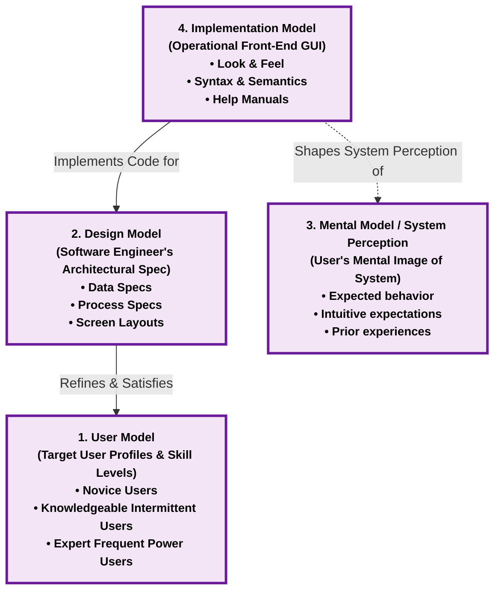
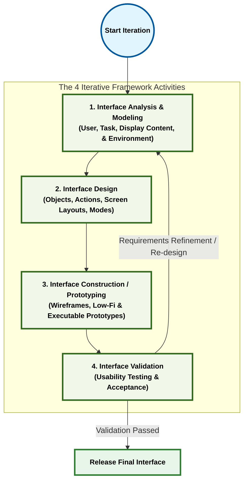
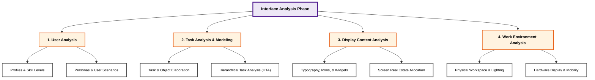
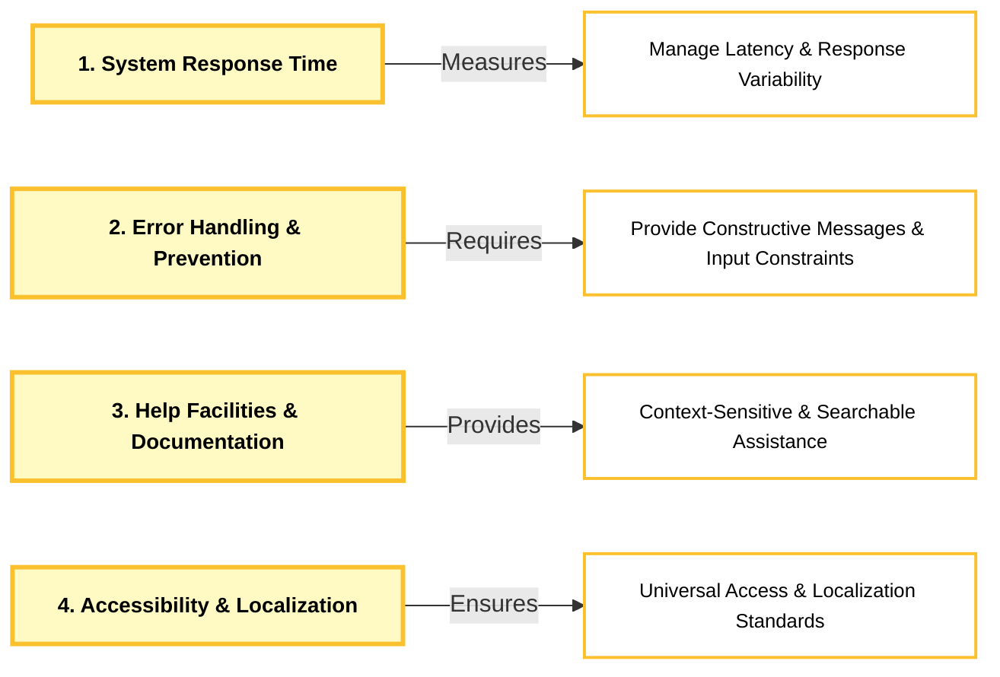
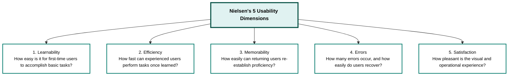
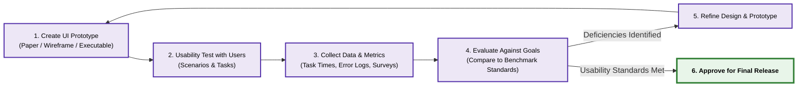

# 📗 Software Engineering: Unit 6 — User Interface Design (Comprehensive Study Notes)

> **Course:** B.Tech / MBATech / BTI Computer Engineering & Information Technology  
> **Subject:** Software Engineering (702IT0C016 / SE)  
> **Unit:** Unit VI — User Interface Design  
> **Primary Reference Textbooks:**
> 1. *Software Engineering: A Practitioner's Approach* (8th & 9th Eds.) — Roger S. Pressman & Bruce R. Maxim  
> 2. *Software Engineering* (10th Ed.) — Ian Sommerville  
> 3. *The Elements of User Interface Design* — Theo Mandel  

---

## 📌 Executive Summary & Unit Syllabus Map

User Interface (UI) design creates an effective communication medium between human users and computer software. This document provides an exhaustive, exam-oriented synthesis of **Unit 6: User Interface Design**, covering foundational principles, golden design rules, architectural models, spiral process frameworks, task analysis techniques, critical design issues, and usability evaluation metrics.

```mermaid
graph TD
    classDef root fill:#311b92,stroke:#1a237e,stroke-width:3px,color:#ffffff,font-weight:bold,font-size:16px;
    classDef topic fill:#0d47a1,stroke:#01579b,stroke-width:2px,color:#ffffff,font-weight:bold,font-size:14px;
    classDef sub fill:#004d40,stroke:#00251a,stroke-width:2px,color:#ffffff,font-size:13px;

    Root["Unit 6: User Interface Design"]

    Root --> T1["1. Golden Rules (Theo Mandel)"]
    T1 --> T1A["Place User in Control"]
    T1 --> T1B["Reduce Memory Load"]
    T1 --> T1C["Make Interface Consistent"]

    Root --> T2["2. UI Models"]
    T2 --> T2A["User Model"]
    T2 --> T2B["Design Model"]
    T2 --> T2C["Mental Model"]
    T2 --> T2D["Implementation Model"]

    Root --> T3["3. Process Framework"]
    T3 --> T3A["Iterative Spiral"]
    T3 --> T3B["Interface Analysis"]
    T3 --> T3C["Interface Design"]
    T3 --> T3D["Interface Construction"]
    T3 --> T3E["Interface Validation"]

    Root --> T4["4. Analysis Phase"]
    T4 --> T4A["User Analysis"]
    T4 --> T4B["Task Analysis"]
    T4 --> T4C["Display Content Analysis"]
    T4 --> T4D["Work Environment Analysis"]

    Root --> T5["5. Critical Design Issues"]
    T5 --> T5A["System Response Time"]
    T5 --> T5B["Error Handling & Prevention"]
    T5 --> T5C["Help Facilities"]
    T5 --> T5D["Accessibility & Localization"]

    Root --> T6["6. Usability Evaluation"]
    T6 --> T6A["Nielsen Usability Heuristics"]
    T6 --> T6B["Quantitative Metrics"]
    T6 --> T6C["Design Evaluation Cycle"]

    class Root root;
    class T1,T2,T3,T4,T5,T6 topic;
    class T1A,T1B,T1C,T2A,T2B,T2C,T2D,T3A,T3B,T3C,T3D,T3E,T4A,T4B,T4C,T4D,T5A,T5B,T5C,T5D,T6A,T6B,T6C sub;
```

---

## 1. Introduction to User Interface Design

### 1.1 What is User Interface Design?
User Interface (UI) design is the software engineering discipline focused on specifying, structuring, and constructing the interactive front-end medium through which human beings communicate with a computer-based system. 

Regardless of the backend computational power, data structure complexity, or algorithmic sophistication of a software product, **the user interface molds the user's perception of the entire system**. If an interface is cumbersome, confusing, error-prone, or unforgiving, users will reject the software.

### 1.2 Evolution: Command Line Interface (CLI) vs. Graphical User Interface (GUI)

| Metric / Attribute | Command Line Interface (CLI) | Graphical User Interface (GUI) |
| :--- | :--- | :--- |
| **Primary Interaction Medium** | Text-based prompt requiring typed command strings. | Visual medium using Windows, Icons, Menus, and Pointers (WIMP). |
| **Cognitive Paradigm** | **Recall-based:** User must memorize command syntax and switches. | **Recognition-based:** User selects visual objects and options directly. |
| **Skill Requirement** | High initial learning curve; aimed at expert/system administrators. | Low initial learning curve; intuitive for novice, casual, and expert users. |
| **Flexibility & Speed** | Very high for expert power-users scripting complex batch pipelines. | High for interactive tasks; customizable via shortcuts and macros. |
| **Error Rate** | High due to syntax typos (`rm -rf`, misplaced flags). | Low due to constrained input mechanisms (dialogs, dropdowns, buttons). |

### 1.3 Key Attributes of Quality User Interfaces
According to course specifications, a successful user interface must satisfy five fundamental operational attributes:
1. **Attractiveness:** Visual aesthetics, balanced layout grid, readable typography, and harmonious color schemes that put the user at ease.
2. **Simplicity:** Uncluttered screen real estate focusing strictly on essential user tasks without cognitive noise.
3. **Responsiveness:** Rapid, predictable system feedback acknowledging user inputs in real time.
4. **Clarity:** Unambiguous visual icons, self-explanatory menu labeling, and clear system status indication.
5. **Consistency:** Standardized behavior, workflows, and visual styling across all windows and application modules.

---

## 2. The Three Golden Rules of UI Design (Theo Mandel)

In his seminal work *The Elements of User Interface Design*, Theo Mandel formulated **Three Golden Rules** that serve as the foundational principles for human-computer interaction (HCI).

```mermaid
graph TD
    classDef rule1 fill:#e3f2fd,stroke:#1565c0,stroke-width:3px,color:#000000,font-weight:bold,font-size:15px;
    classDef rule2 fill:#fff3e0,stroke:#e65100,stroke-width:3px,color:#000000,font-weight:bold,font-size:15px;
    classDef rule3 fill:#e8f5e9,stroke:#2e7d32,stroke-width:3px,color:#000000,font-weight:bold,font-size:15px;
    classDef sub1 fill:#ffffff,stroke:#1565c0,stroke-width:2px,color:#000000,font-size:13px;
    classDef sub2 fill:#ffffff,stroke:#e65100,stroke-width:2px,color:#000000,font-size:13px;
    classDef sub3 fill:#ffffff,stroke:#2e7d32,stroke-width:2px,color:#000000,font-size:13px;

    subgraph GoldenRules["Theo Mandel's Three Golden Rules"]
        R1["1. Place the User in Control"]
        R2["2. Reduce the User's Memory Load"]
        R3["3. Make the Interface Consistent"]
    end

    P1["Define non-forcing interaction modes"]
    P2["Provide flexible interaction mechanisms"]
    P3["Allow interruptible & undoable actions"]
    P4["Streamline & allow customization macros"]
    P5["Hide technical internals from casual users"]
    P6["Design for direct object manipulation"]

    M1["Reduce demand on short-term memory (7 ± 2 Rule)"]
    M2["Establish meaningful system defaults"]
    M3["Define intuitive shortcuts & mnemonics"]
    M4["Use real-world visual metaphors"]
    M5["Disclose information progressively"]

    C1["Maintain task context visually"]
    C2["Maintain consistency across product family"]
    C3["Preserve established de-facto standards"]

    R1 --> P1
    R1 --> P2
    R1 --> P3
    R1 --> P4
    R1 --> P5
    R1 --> P6

    R2 --> M1
    R2 --> M2
    R2 --> M3
    R2 --> M4
    R2 --> M5

    R3 --> C1
    R3 --> C2
    R3 --> C3

    class R1 rule1;
    class R2 rule2;
    class R3 rule3;
    class P1,P2,P3,P4,P5,P6 sub1;
    class M1,M2,M3,M4,M5 sub2;
    class C1,C2,C3 sub3;
```

---

### 2.1 Golden Rule #1: Place the User in Control
Users want software that reacts to their needs and empowers them to accomplish tasks. The software must serve the user, rather than forcing the user to adapt to rigid system constraints.

#### The 6 Operating Principles:
1. **Define interaction modes in a way that does not force unwanted actions:** An interaction mode is the current operational state of the interface. Users should be able to enter and exit modes (e.g., spell-checking, modal dialogs) with minimal effort and no forced side-effects.
2. **Provide flexible interaction:** Accommodate diverse user preferences by supporting mouse clicks, keyboard navigation, touch gestures, and voice commands.
3. **Allow user interaction to be interruptible and undoable:** Users must be able to halt long-running tasks or revert accidental operations without losing existing work (e.g., multi-level `Undo` / `Redo` history).
4. **Streamline interaction as skill levels advance:** Provide "power-user" capabilities such as custom keyboard macros, hotkeys, and configurable toolbars so advanced users can bypass multi-step wizard dialogs.
5. **Hide technical internals from casual users:** Users operate in the application domain (e.g., editing a document, booking a ticket). They should never be exposed to low-level system internals like memory addresses, database connection strings, or unhandled stack traces.
6. **Design for direct interaction with on-screen objects:** Implement direct manipulation paradigms where users directly drag, drop, resize, or stretch objects (e.g., dragging a file to the Trash canvas or resizing an image handle).

---

### 2.2 Golden Rule #2: Reduce the User's Memory Load
Human short-term cognitive memory is strictly limited (typically holding 7 ± 2 chunks of information). An interface that taxes human memory increases error rates and user frustration.

#### The 5 Operating Principles:
1. **Reduce demand on short-term memory:** System design should prioritize **recognition over recall**. Users should not be required to remember data entered on a previous screen to complete a task on the current screen.
2. **Establish meaningful defaults:** Provide intelligent, context-aware initial default values (e.g., auto-filling current date, standard print margins, or default shipping address). Always provide a 1-click reset option.
3. **Define intuitive shortcuts and mnemonics:** Use standardized key combinations (e.g., `Ctrl+S` for Save, `Ctrl+P` for Print, `Ctrl+Z` for Undo) that build on established muscle memory.
4. **Use real-world visual metaphors:** Base visual layouts on familiar physical domain objects (e.g., a digital checkbook layout for online bill payment, a shopping cart icon for e-commerce, or a folder tab structure for navigation).
5. **Disclose information in a progressive fashion:** Organize information hierarchically (Progressive Disclosure). Present high-level overview abstractions first, revealing deeper granular details only when the user requests them.

---

### 2.3 Golden Rule #3: Make the Interface Consistent
Information must be acquired, processed, and presented in a uniform, predictable manner across all application screens.

#### The 3 Operating Principles:
1. **Allow the user to put the current task into a meaningful context:** Provide persistent visual indicators (window titles, breadcrumbs, progress steppers, active tab highlights) so users know their exact location within a complex multi-screen navigation hierarchy.
2. **Maintain consistency across a family of applications:** Standardize visual guidelines, layout grids, icon sets, and interaction rules across all products within an enterprise suite (e.g., Microsoft Office suite layout consistency).
3. **Preserve established user expectations:** Do not alter de-facto interactive standards unless there is a compelling, proven usability benefit. Changing a universal standard (e.g., reassigning `Ctrl+S` from "Save" to "Search") creates mass confusion and user error.

---

### 2.4 Shneiderman's 10 Golden Rules vs. Theo Mandel's Rules

Ben Shneiderman and Catherine Plaisant (*Designing the User Interface*) expanded interface principles into **8 to 10 Golden Rules**. The table below maps Shneiderman's rules to Mandel's 3-rule taxonomy:

| Shneiderman's Golden Rule | Primary Mandate | Corresponding Mandel Rule Category |
| :--- | :--- | :--- |
| **1. Strive for Consistency** | Uniform terminology, layouts, fonts, and action sequences. | **Rule 3:** Make Interface Consistent |
| **2. Offer Informative Feedback** | Prompt visual feedback for every user action. | **Rule 1:** Place User in Control |
| **3. Design Dialogs to Yield Closure** | Group action sequences into beginning, middle, and end. | **Rule 1:** Place User in Control |
| **4. Offer Error Prevention & Handling** | Eliminate error-prone conditions; clear error alerts. | **Rule 1 & 2:** Control & Memory Load |
| **5. Permit Easy Reversal of Actions** | Single/multi-action Undo to relieve anxiety. | **Rule 1:** Place User in Control |
| **6. Support Internal Locus of Control** | Make users initiators of actions rather than responders. | **Rule 1:** Place User in Control |
| **7. Reduce Short-Term Memory Load** | Keep displays simple; multi-page consolidation. | **Rule 2:** Reduce Memory Load |
| **8. Enable Frequent Users to Use Shortcuts** | Hotkeys, macros, and hidden command accelerators. | **Rule 1 & 2:** Control & Memory Load |
| **9. Aesthetic and Minimalist Design** | Remove redundant data that competes with vital content. | **Rule 2:** Reduce Memory Load |
| **10. Provide Help & Documentation** | Task-focused, searchable, concrete help facilities. | All Categories |

---

## 3. User Interface Analysis and Design Models

Designing an effective user interface requires aligning **four distinct behavioral and architectural models**.

---

### 3.1 The 4 UI Design Models

#### 1. The User Model
* **Created By:** Human Factors Engineer / Systems Analyst.
* **Definition:** A formal behavioral profile of all target end-users of the system.
* **Key Elements:** Categorizes users by domain knowledge, technical experience, frequency of use, and cognitive skills (e.g., Novice Users, Knowledgeable Intermittent Users, Knowledgeable Frequent/Power Users).

#### 2. The DesignModel
* **Created By:** Software Engineer / UI Designer.
* **Definition:** The architectural realization of the User Model.
* **Key Elements:** Combines data structure design, architectural component representations, interface object definitions, and screen navigation flowcharts that fulfill user requirements.

#### 3. The Mental Model (System Perception)
* **Created By:** The End-User (cognitively).
* **Definition:** The user's internal mental image of how the interface operates, what data it holds, and how it will respond to actions.
* **Key Elements:** Shaped entirely by the user's prior software experiences, real-world analogies, and initial visual feedback. A user's satisfaction depends on how closely their Mental Model aligns with reality.

#### 4. The Implementation Model
* **Created By:** Software Developers / Build Team.
* **Definition:** The actual operational software interface ("look and feel") along with supporting documentation, online help files, and manuals.
* **Key Elements:** Syntax, widget behavior, color palettes, screen layout geometries, and interaction latencies.

---

### 3.2 Harmonization and Alignment of UI Models

> **The Core UI Design Goal:**  
> A user interface is successful **ONLY when the Implementation Model and the Mental Model coincide completely**. 

To achieve this alignment:
1. The Software Engineer must build the **Design Model** based strictly on a accurate **User Model**.
2. The team creates the **Implementation Model** directly from the **Design Model**.
3. When the user interacts with the **Implementation Model**, their resulting **Mental Model** matches reality—eliminating surprises, confusion, and operational errors.

---

## 4. The UI Analysis and Design Process Framework

User interface engineering is not a single-pass task; it follows an **Iterative Spiral Model Framework**.

---

### 4.1 The Four Framework Activities

1. **Interface Analysis & Modeling:**  
   Focuses on understanding the human profile, user tasks, screen display content, and physical working environment. Elaborates user scenarios and requirements.
2. **Interface Design:**  
   Defines interface objects, control mechanisms, action sequences (user scenarios), screen layouts, and state transitions. Applies Mandel's Golden Rules.
3. **Interface Construction / Implementation:**  
   Begins with rapid interactive prototypes (low-fidelity wireframes progressing to high-fidelity code prototypes) created using GUI toolkits and widget libraries.
4. **Interface Validation:**  
   Evaluates prototype usability, task correctness, error rates, response times, and user acceptance. Feedback feeds directly into the next spiral iteration.

---

## 5. Interface Analysis Phase (Deep Dive)

Interface analysis focuses on four major areas: **Users**, **Tasks**, **Display Content**, and **Work Environment**.

---

### 5.1 User Analysis
Software engineers must profile target audiences to tailor interaction mechanisms:
* **Novice Users:** Possess little domain or software knowledge. Require simple, step-by-step wizard dialogs, explicit instructions, and high guidance.
* **Knowledgeable Intermittent Users:** Understand domain tasks well but use the software infrequently. Require clear menu hierarchies, recognition-based cues, and consistent context indicators.
* **Knowledgeable Frequent (Power) Users:** Possess deep domain and software knowledge. Seek rapid task execution via hotkeys, macros, customizable toolbars, and streamlined command modes.

---

### 5.2 Task Analysis and Modeling
Task analysis explores the tasks users must perform to accomplish system goals.

#### Techniques for Task Decomposition:
1. **Task Elaboration (Step Breakdown):** Decomposes top-level user goals into step-by-step subtasks.
2. **Object Elaboration:** Identifies all physical and digital objects manipulated during a task, mapping them to GUI widgets.
3. **Workflow Analysis:** Traces task flow across multiple user roles and system boundaries (e.g., using Swimlane Activity Diagrams).
4. **Hierarchical Task Representation (HTA):** Recursively decomposes high-level tasks into numbered sub-task hierarchies:
   * `1.0 Print Document`
     * `1.1 Open Print Dialog`
     * `1.2 Select Target Printer`
     * `1.3 Set Page Range & Copies`
     * `1.4 Click 'Print' Button`

---

### 5.3 Analysis of Display Content
Examines all information presented to and collected from the user:
* **Format Categories:** Textual prompts, numeric data fields, graphical charts, status icons, and audio signals.
* **Screen Real Estate Layout:** Important summary information and primary navigation should occupy high-priority screen regions (e.g., upper-left scanning zone for left-to-right languages).

---

### 5.4 Analysis of the Work Environment
Evaluates physical, environmental, and ergonomic factors:
* **Physical Space:** Is the user sitting at a desktop desk, standing on a factory floor, or holding a mobile tablet on the move?
* **Noise & Lighting:** High noise levels make audio alerts ineffective; outdoor glare requires high-contrast screen themes.
* **Hardware Constraints:** Screen resolution, aspect ratio, touch capability, keyboard access, and pointing device accuracy.

---

## 6. Critical Design Issues & Human Factors

During interface design, four major implementation issues must be systematically addressed.

---

### 6.1 System Response Time
System response time is the elapsed time between a user initiating an action and the GUI presenting visible output/feedback.

* **Two Key Parameters:**
  1. **Length (Duration):** Overall execution time. Sub-second response (< 0.1s to 1.0s) feels instantaneous; 1.0s to 10.0s requires visual progress feedback.
  2. **Variability (Consistency):** Deviation from average response time. Users prefer a consistent 2-second delay over an erratic delay that varies unpredictably between 0.2s and 8.0s.
* **Visual Progress Feedback:** For operations exceeding 2 seconds, display animated progress bars, status spinners, or percentage counters to assure users the system is processing.

---

### 6.2 Error Handling & Error Prevention
Errors are inevitable in human-computer interaction, but poor error handling exacerbates user frustration.

#### Guidelines for Effective Error Messages:
1. **Plain Language:** Use clear, non-technical language (e.g., *"Unable to save file. The disk is full."* instead of *"Error Code 0x80070070: HRESULT EXCEPTION"*).
2. **Constructive Guidance:** Don't just state what went wrong—explain how to fix it.
3. **Non-Judgmental Tone:** Avoid accusatory language (e.g., avoid *"Invalid input entered by user"*).
4. **Visual Context:** Highlight the exact text box or field containing the error in red with an inline callout.

#### Error Prevention Strategies:
* **Disable Invalid Controls:** Gray out or disable buttons (e.g., `Submit`) until required fields are correctly filled.
* **Input Masks:** Format phone numbers, dates, and credit card fields automatically as the user types.
* **Confirmation Dialogs:** Require explicit confirmation before destructive, non-undoable operations (e.g., *"Permanently delete this project?"*).

---

### 6.3 Help Facilities & Documentation Design
Even intuitive interfaces require online assistance.

* **Help Facility Types:**
  * **Context-Sensitive Help:** Displays relevant tips based on the user's current screen location or active task (e.g., tooltips, info icons).
  * **Searchable Knowledge Base:** Indexed, keyword-searchable online documentation.
* **Design Guidelines:** Help facilities should be searchable, task-focused, concrete, concise, and easy to exit without losing current task context.

---

### 6.4 Accessibility & Internationalization (i18n)
* **Accessibility (a11y):** Ensures software can be navigated by individuals with visual, auditory, motor, or cognitive disabilities (e.g., high-contrast modes, keyboard screen-reader navigation, alt text for images).
* **Internationalization (i18n) & Localization (l10n):** Designing interfaces to support multi-language text expansion, right-to-left (RTL) reading directions, local date/currency formatting, and culturally appropriate imagery.

---

## 7. Usability Engineering & Design Evaluation

### 7.1 Usability Attributes (Nielsen & Tognozzi)
Usability measures how effectively, efficiently, and satisfactorily users can achieve their goals using the interface.

---

### 7.2 Quantitative UI Evaluation Metrics
To move beyond subjective opinions, software engineers collect quantitative UI metrics during usability testing:

| Metric | Formula / Measurement Basis | Objective / Target |
| :--- | :--- | :--- |
| **Typing Effort** | Average number of keystrokes per completed task. | Minimize key presses via auto-fill and dropdowns. |
| **Mouse Pick Effort** | Average number of mouse clicks / picks per function. | Minimize unnecessary clicking and navigation depth. |
| **Selection Complexity** | Average number of available menu links per screen page. | Prevent choice paralysis by grouping items logically. |
| **Content Acquisition Time** | Average time taken to locate and read key information. | Optimize visual visual hierarchy and typography. |
| **Memory Load Index** | Average number of distinct data items user must remember. | Keep memory load near zero by presenting context. |

---

### 7.3 The UI Design Evaluation Cycle

Usability evaluation follows a continuous feedback loop:

---

## 8. University Exam Practice Questions (Sourced PYQs & Model Answers)

### Question 8.1 (5 Marks) [Verified PYQ]
> **"Explain Theo Mandel's Three Golden Rules of User Interface Design with suitable examples."**

#### Model Answer Summary:
1. **Place the User in Control:** Software must empower the user rather than forcing rigid sequences. *Examples:* Flexible interaction modes (mouse/keyboard/touch), multi-level `Undo` / `Redo` history, hiding internal database stack traces, and direct object manipulation (dragging files to folders).
2. **Reduce the User's Memory Load:** Interface should favor **recognition over recall**. *Examples:* Populating smart default shipping addresses, using standard shortcuts (`Ctrl+S`), visual real-world metaphors (shopping cart icon), and progressive disclosure of advanced settings.
3. **Make the Interface Consistent:** Uniform visual presentation and workflow logic across all screens. *Examples:* Persistent navigation breadcrumbs, standard button styling across product suites (MS Office), and preserving de-facto OS key bindings.

---

### Question 8.2 (10 Marks) [Verified PYQ]
> **"Explain the User Interface Analysis and Design Process using the Iterative Spiral Model. Detail the four framework activities and the four UI design models."**

#### Model Answer Summary:
* **Introduction:** UI design is an iterative process modeled as a spiral framework where each pass elaborates requirements and refines prototypes.
* **Part 1: The Four Framework Activities:**
  1. *Interface Analysis & Modeling:* Analyzes users (profiles/personas), tasks (task elaboration & HTA), display content, and physical work environment.
  2. *Interface Design:* Specifies interface objects, action sequences, screen layouts, and state transitions adhering to Mandel's Golden Rules.
  3. *Interface Construction:* Builds low-to-high fidelity interactive prototypes using GUI toolkits.
  4. *Interface Validation:* Tests prototypes with real users for task correctness, error rates, and usability satisfaction.
* **Part 2: The Four UI Design Models:**
  1. *User Model:* Profile of target end-user skill levels and expectations.
  2. *Design Model:* Software engineer's architectural realization of the UI.
  3. *Mental Model (System Perception):* End-user's cognitive expectation of system behavior.
  4. *Implementation Model:* Operational GUI "look and feel" with supporting documentation.
* **Conclusion:** Usability is achieved when the **Implementation Model** successfully aligns with the user's **Mental Model**.

---

### Question 8.3 (5 Marks) [Verified PYQ]
> **"Discuss the critical design issues encountered during User Interface Design: System Response Time, Error Handling, Help Facilities, and Accessibility."**

#### Model Answer Summary:
* **System Response Time:** Evaluates length (duration) and variability (consistency). Long tasks (>2s) require animated progress indicators.
* **Error Handling:** Errors must be presented in plain non-technical language with constructive recovery advice. Systems should employ error prevention strategies (disabling invalid buttons, input masks).
* **Help Facilities:** Must be context-sensitive (tooltips), task-focused, searchable, and easy to exit.
* **Accessibility:** Ensures usability for visually/physically impaired individuals via screen-reader support, high-contrast modes, and keyboard navigation.

---
*End of Study Notes — Generated for Software Engineering Unit 6 (User Interface Design)*
