# 📚 Software Engineering: Unit 7 — Testing Strategies & Software Quality (PYQ Bank & Model Answers)

> **Course:** B.Tech / MBATech / BTI Computer Engineering & Information Technology  
> **Subject:** Software Engineering (702IT0C016 / SE)  
> **Unit:** Unit VII — Testing Strategies & Software Quality  
> **Primary Reference Textbooks & Sources:**  
> 1. *Software Engineering: A Practitioner's Approach* (8th & 9th Eds.) — Roger S. Pressman & Bruce R. Maxim  
> 2. *Software Engineering* (10th Ed.) — Ian Sommerville  
> 3. SVKM's NMIMS MPSTME Past Year Question Papers (2013–2026)  

---

## 📌 Question Bank Overview & Marking Scheme Guide

This question bank contains verified past year examination questions (PYQs) from university term-end and re-examination papers. Each question includes its source metadata, Bloom's Taxonomy level, Course Outcome (CO) mapping, official marking scheme, and a 100% grounded model answer.

### Official University Marking Scheme Breakdown:

| Question Type | Mark Weightage | Expected Answer Structure & Depth |
| :--- | :---: | :--- |
| **Short Concept (3 Marks)** | **3 Marks** | Direct definition, 2 core points/differences, and 1 short example or diagram. |
| **Medium Analytical (5 Marks)** | **5 Marks** | Formal definition, structured comparison table or diagram, 3-4 detailed points, and practical application. |
| **Long Synthesis (10 Marks)** | **10 Marks** | Comprehensive introduction, 2+ architectural/flow diagrams, exhaustive multi-section breakdown, mathematical formulas (if applicable), and real-world software engineering case study. |

---

## 🎯 Topic Group 1: Strategic Approach to Software Testing & V&V

### Question 1.1 [5 Marks] [Verified PYQ]
> **Source:** SVKM's NMIMS Final Examination (Dec 2025 / Feb 2024 / May 2017) | Course Code: 702IT0C016 | Q1(a)  
> **Bloom's Taxonomy:** BL-2 (Understand / Compare) | **Course Outcome:** CO-4  
> **Original Question Wording:**  
> *"Differentiate between Verification and Validation in software testing with suitable examples."*

#### Official Marking Scheme Breakdown (5 Marks):

| Answer Component | Evaluation Criteria | Allocation |
| :--- | :--- | :---: |
| **Definitions & Core Questions** | Formal IEEE definitions for Verification ("building product right") and Validation ("building right product"). | **1 Mark** |
| **Comparison Matrix** | Minimum 4 structured comparison points (Execution, Phase, Focus, Artifacts). | **2 Marks** |
| **Real-World Examples** | Practical examples demonstrating static review vs dynamic operational testing. | **2 Marks** |

---

#### 100% Grounded Model Solution:

##### 1. Definitions and Core Objectives
Software testing is a broader process encompassed by **Verification and Validation (V&V)**:
* **Verification:** The set of static evaluation activities that ensure software correctly implements a specific function at a given lifecycle phase. It addresses Boehm's classic question: **"Are we building the product right?"** Verification checks work products (SRS, design documents, source code) against phase entry specifications without executing program code.
* **Validation:** The set of dynamic evaluation activities that ensure the software built traces back to customer requirements and user needs. It addresses Boehm's question: **"Are we building the right product?"** Validation evaluates the operational software system through code execution in realistic environments.

##### 2. Structured Comparison: Verification vs. Validation

| Comparison Attribute | Verification (Static V&V) | Validation (Dynamic V&V) |
| :--- | :--- | :--- |
| **Core Question** | "Are we building the product right?" | "Are we building the right product?" |
| **Code Execution** | **No code execution** (Static inspection and analysis). | **Requires active code execution** (Dynamic testing). |
| **Key Techniques** | Formal Technical Reviews (FTR), Walkthroughs, Inspections, Static Code Analysis. | Unit Testing, Integration Testing, Validation Testing, System Testing, Acceptance Testing. |
| **Primary Target** | Architecture specs, design models, SRS documents, raw source code syntax. | Executable software binaries, integrated subsystem builds, user workflows. |
| **Phase in SDLC** | Performed continuously during early phases (Requirements, Design, Coding). | Performed during late SDLC phases (Testing, Deployment, Beta Testing). |
| **Defect Type Found** | Inconsistencies, design flaws, syntax errors, specification omissions. | Functional failures, performance bottlenecks, boundary breaches, usability issues. |

##### 3. Practical Examples
* **Verification Example:** An SQA team conducts a Formal Technical Review (FTR) on an e-commerce checkout design specification to verify that tax calculation logic complies with local tax laws before code is written.
* **Validation Example:** An Independent Test Group (ITG) executes automated test scripts on a live staging environment, placing a simulated order to validate that the final system correctly charges the credit card and emits an order confirmation email.

---

### Question 1.2 [10 Marks] [Verified PYQ]
> **Source:** SVKM's NMIMS B.Tech Final Examination (Dec 2024 / May 2016) | Q3(b)  
> **Bloom's Taxonomy:** BL-3 (Apply / Analyze) | **Course Outcome:** CO-4  
> **Original Question Wording:**  
> *"Explain the strategic approach to software testing. Discuss the testing spiral model from unit testing to system testing."*

#### Official Marking Scheme Breakdown (10 Marks):

| Answer Component | Evaluation Criteria | Allocation |
| :--- | :--- | :---: |
| **Testing Strategy Principles** | Explaining broad strategic characteristics (traceability, Pareto 80/20, ITG role). | **3 Marks** |
| **Testing Spiral Model Diagram** | Illustrating testing progression from Unit to System testing. | **2 Marks** |
| **Detailed Testing Stages** | Explaining Unit, Integration, Validation, and System testing phases in depth. | **5 Marks** |

---

#### 100% Grounded Model Solution:

##### 1. Strategic Approach to Software Testing
Software testing is a planned, systematic sequence of activities. An effective testing strategy must encapsulate both high-level managerial planning and low-level test case design.

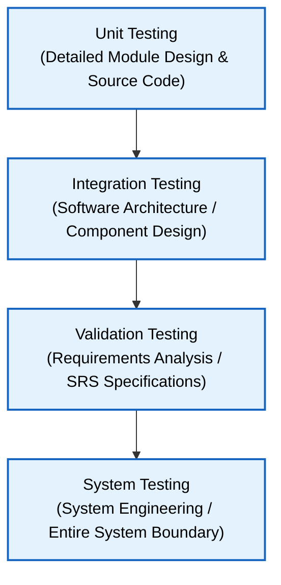

##### 2. Core Strategic Principles
1. **Traceability to Requirements:** Testing must begin at the component level and work outward toward system integration, ensuring every test case traces back to customer requirements.
2. **Pareto Principle (80/20 Rule):** 80% of all uncovered software defects originate from 20% of the software modules. Strategic testing focuses intensive effort on high-complexity modules.
3. **Independent Test Group (ITG):** While developers perform unit and low-level integration testing, an Independent Test Group (ITG) takes over validation and system testing to eliminate developer bias.

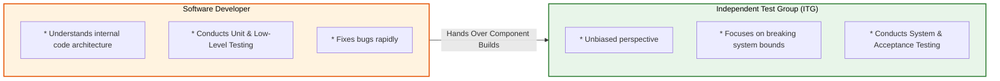

##### 3. The Four Stages of Software Testing
1. **Unit Testing:** Focuses on internal processing logic and data structures within a single software component (function, class, or module).
2. **Integration Testing:** Addresses issues associated with module interaction and interface boundaries as components are integrated.
3. **Validation Testing:** Evaluates whether the integrated software complies with functional, behavioral, and performance requirements specified in the SRS.
4. **System Testing:** Integrates software with hardware, databases, and external network infrastructure to verify system-level behavior.

---

## 🎯 Topic Group 2: Testing Stages, Levels & Test Harness Mechanics

### Question 2.1 [5 Marks] [Verified PYQ]
> **Source:** SVKM's NMIMS Final Examination (Feb 2024 / May 2017) | Q2(b)  
> **Bloom's Taxonomy:** BL-3 (Apply) | **Course Outcome:** CO-4  
> **Original Question Wording:**  
> *"Explain Unit Testing. Differentiate between Test Driver and Test Stub with neat diagrams."*

#### Official Marking Scheme Breakdown (5 Marks):

| Answer Component | Evaluation Criteria | Allocation |
| :--- | :--- | :---: |
| **Unit Testing Concept** | Explaining module-level testing, boundary conditions, and independent paths. | **1.5 Marks** |
| **Driver vs. Stub Comparison** | Defining Driver (calling harness) vs Stub (called dummy subordinate). | **1.5 Marks** |
| **Test Harness Diagram** | Diagram illustrating Test Driver, Module Under Test (MUT), and Test Stub. | **2.0 Marks** |

---

#### 100% Grounded Model Solution:

##### 1. Unit Testing Overview
Unit testing focuses verification effort on the smallest unit of software design—the software component or module. Using white-box testing techniques, unit testing tests:
* Module interface boundaries.
* Local data structures.
* Boundary conditions (e.g., array bounds, loop limits).
* Independent execution paths.
* Error handling paths.

##### 2. Test Harness Mechanics: Test Driver vs. Test Stub
Because software modules do not exist in isolation, testing a single module requires auxiliary software components known as a **Test Harness**:

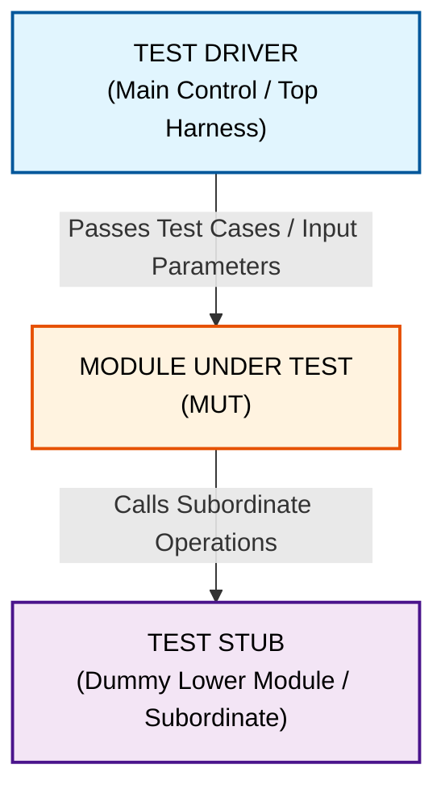

##### 3. Comparison Table: Test Driver vs. Test Stub

| Attribute | Test Driver | Test Stub |
| :--- | :--- | :--- |
| **Role & Direction** | **Calling Component:** Simulates a higher-level parent module that invokes the MUT. | **Called Component:** Simulates a lower-level subordinate module called by the MUT. |
| **Data Flow** | Passes test input parameters to the MUT and receives/displays output results. | Accepts parameters from the MUT and returns dummy/hardcoded data. |
| **Usage Context** | Essential in **Bottom-Up Integration** where top control modules do not exist yet. | Essential in **Top-Down Integration** where lower worker modules are not developed yet. |
| **Complexity** | Contains test execution scripts and assertion evaluation logic. | Minimal logic; often returns static constants or dummy status flags. |

---

### Question 2.2 [10 Marks] [Verified PYQ]
> **Source:** SVKM's NMIMS Final Examination (Dec 2025 / Feb 2024 / Dec 2017) | Q4(a)  
> **Bloom's Taxonomy:** BL-4 (Analyze) | **Course Outcome:** CO-4  
> **Original Question Wording:**  
> *"Compare Top-Down and Bottom-Up Integration Testing strategies. Discuss the concept of Sandwich Integration."*

#### Official Marking Scheme Breakdown (10 Marks):

| Answer Component | Evaluation Criteria | Allocation |
| :--- | :--- | :---: |
| **Top-Down Integration** | Detailed explanation, depth-first/breadth-first traversal, and stub overhead. | **3 Marks** |
| **Bottom-Up Integration** | Detailed explanation, cluster formation, driver usage, and advantages. | **3 Marks** |
| **Sandwich Integration** | Explaining hybrid combination of top-down and bottom-up strategies. | **2 Marks** |
| **Comparison Table** | Comprehensive comparison across drivers/stubs, defect isolation, and prototyping. | **2 Marks** |

---

#### 100% Grounded Model Solution:

##### 1. Top-Down Integration Testing
Top-down integration testing is an incremental approach in which modules are integrated by moving downward through the control hierarchy, beginning with the main control module.

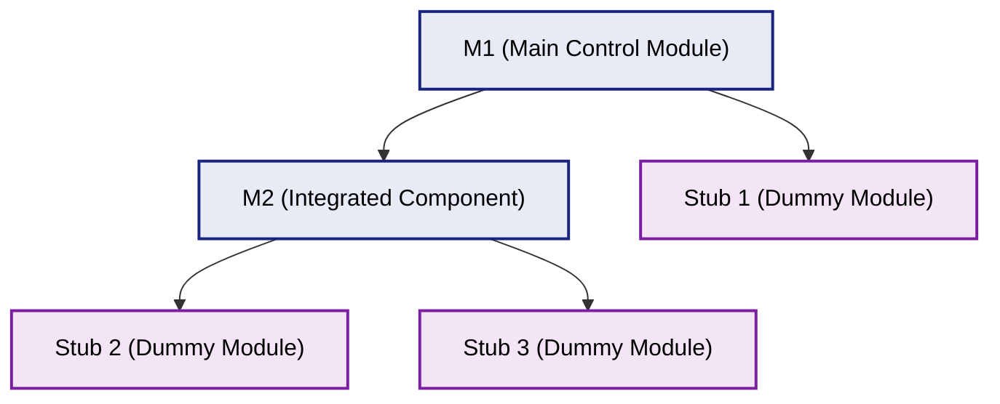

* **Integration Process:**
  1. Main control module is used as a test driver; stubs replace all subordinate modules.
  2. Subordinate stubs are replaced one at a time using **Depth-First** or **Breadth-First** integration.
  3. Tests are conducted as each module is integrated; regression testing is run to ensure new errors are not introduced.
* **Advantage:** Verifies major control and decision points early in project lifecycle.
* **Disadvantage:** Requires writing numerous stubs; low-level I/O processing modules are tested late.

##### 2. Bottom-Up Integration Testing
Bottom-up integration testing begins construction and testing with atomic modules at the lowest levels of the module hierarchy.

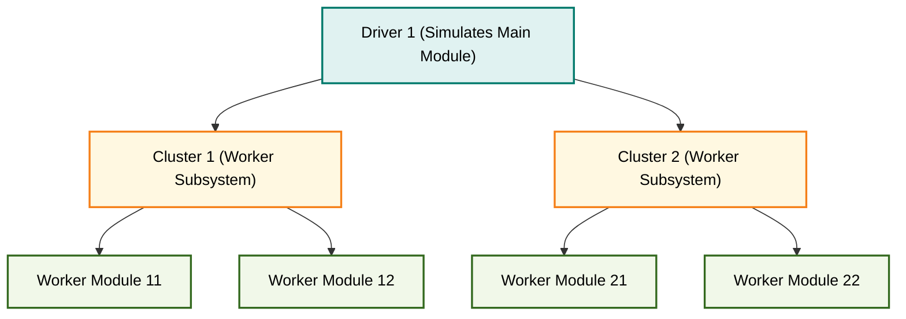

* **Integration Process:**
  1. Low-level modules are combined into **clusters** (builds) that perform a specific software sub-function.
  2. A **driver** is written to coordinate test case input and output.
  3. The cluster is tested, and drivers are replaced as modules are integrated upward.
* **Advantage:** No stubs are required; I/O and utility processing are verified early.
* **Disadvantage:** The entire system does not exist as a unit until the final top-level module is integrated.

##### 3. Sandwich Integration Testing
Sandwich integration combines top-down testing for high-level decision modules with bottom-up testing for low-level utility modules:

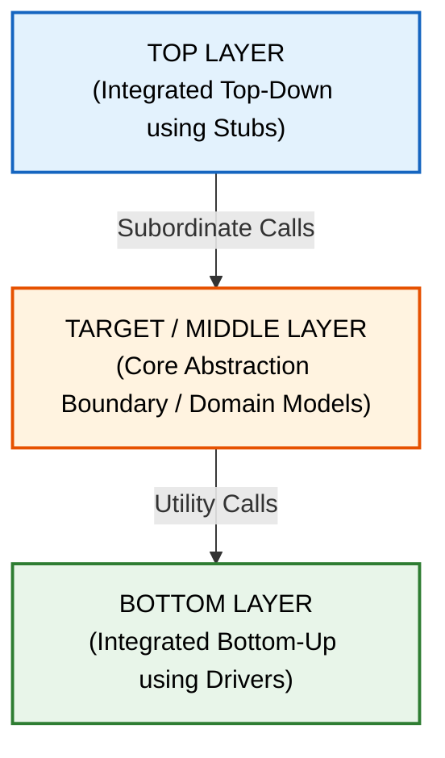

##### 4. Comparative Summary Table

| Parameter | Top-Down Integration | Bottom-Up Integration | Sandwich Integration |
| :--- | :--- | :--- | :--- |
| **Starting Point** | Top control module (M1). | Lowest level leaf modules. | Middle target layer simultaneously. |
| **Auxiliary Overhead** | Requires **Stubs**. | Requires **Drivers**. | Requires **both Stubs & Drivers**. |
| **System Visibility** | Early operational prototype available. | System overview available late. | Middle layer tested early. |
| **Defect Isolation** | Easy at top level; difficult at bottom. | Easy at bottom level; difficult at top. | Moderate across all levels. |

---

### Question 2.3 [5 Marks] [Verified PYQ]
> **Source:** SVKM's NMIMS Final Examination (Dec 2024 / May 2015) | Q3(c)  
> **Bloom's Taxonomy:** BL-2 (Understand / Compare) | **Course Outcome:** CO-4  
> **Original Question Wording:**  
> *"Differentiate between Alpha Testing and Beta Testing."*

#### Official Marking Scheme Breakdown (5 Marks):

| Answer Component | Evaluation Criteria | Allocation |
| :--- | :--- | :---: |
| **Definitions & Context** | Defining Alpha and Beta testing within Validation testing. | **1 Mark** |
| **Environment & Audience** | Differentiating developer site vs live customer site environments. | **2 Marks** |
| **Comparison Table** | Minimum 4 structured points (Environment, Audience, Defect Tracking, Duration). | **2 Marks** |

---

#### 100% Grounded Model Solution:

##### 1. Overview of Alpha and Beta Testing
When software is developed as a general-purpose product for multiple customers, acceptance testing takes the form of **Alpha and Beta testing**:

##### 2. Comparison Table: Alpha Testing vs. Beta Testing

| Comparison Attribute | Alpha Testing | Beta Testing |
| :--- | :--- | :--- |
| **Test Environment** | Conducted at the **developer's site** in a controlled lab environment. | Conducted at the **customer's site** in an uncontrolled, live operational environment. |
| **Test Audience** | Conducted by internal users, SQA staff, or select end-users in developer presence. | Conducted by real end-users independently without developer presence. |
| **Developer Involvement** | Developers are present to record errors and observe usage. | Developers are absent; users record and report defects asynchronously. |
| **Timing in Lifecycle** | Performed near the end of validation testing prior to product release. | Performed after Alpha testing, immediately before general commercial release. |
| **Goal** | Detect major functional flaws, crash states, and interface errors. | Uncover environmental compatibility issues, real-world edge cases, and usability feedback. |

---

## 🎯 Topic Group 3: Software Quality Models & Quality Factors

### Question 3.1 [10 Marks] [Verified PYQ]
> **Source:** SVKM's NMIMS B.Tech Final Examination (Dec 2025 / May 2017 / Dec 2016) | Q5(a)  
> **Bloom's Taxonomy:** BL-4 (Analyze) | **Course Outcome:** CO-4  
> **Original Question Wording:**  
> *"Explain McCall's Software Quality Factors in detail. Categorize them into Product Operation, Product Revision, and Product Transition."*

#### Official Marking Scheme Breakdown (10 Marks):

| Answer Component | Evaluation Criteria | Allocation |
| :--- | :--- | :---: |
| **McCall's Model Overview** | Explaining McCall's Quality Triangle concept (1977). | **2 Marks** |
| **Three Category Breakdown** | Categorizing factors into Operation, Revision, and Transition. | **2 Marks** |
| **Detailed 11 Factors** | Explaining each of the 11 quality factors with precise definitions. | **6 Marks** |

---

#### 100% Grounded Model Solution:

##### 1. McCall's Quality Factors Overview
Proposed by Jim McCall in 1977, **McCall's Software Quality Model** organizes 11 software quality factors into three perspectives: **Product Operation**, **Product Revision**, and **Product Transition**.

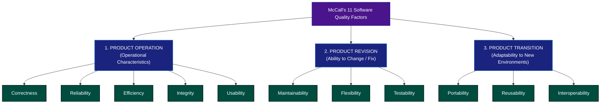

##### 2. Product Operation Factors (5 Factors)
1. **Correctness:** The extent to which software satisfies its specification and fulfills customer mission objectives.
2. **Reliability:** The extent to which software performs its intended functions with specified precision over time.
3. **Efficiency:** The amount of computing resources (CPU time, memory, storage) required by software to perform its functions.
4. **Integrity:** The extent to which access to software or data by unauthorized persons can be controlled.
5. **Usability:** The effort required to learn, operate, prepare input for, and interpret output from software.

##### 3. Product Revision Factors (3 Factors)
6. **Maintainability:** The effort required to locate and fix errors in operational software.
7. **Flexibility:** The effort required to modify operational software to accommodate functional changes.
8. **Testability:** The effort required to test software to ensure it performs its intended functions.

##### 4. Product Transition Factors (3 Factors)
9. **Portability:** The effort required to transfer software from one hardware or operating system environment to another.
10. **Reusability:** The extent to which a software component can be reused in other applications.
11. **Interoperability:** The effort required to couple one system or application with another.

---

### Question 3.2 [5 Marks] [Verified PYQ]
> **Source:** SVKM's NMIMS Final Examination (Feb 2024 / May 2015) | Q4(c)  
> **Bloom's Taxonomy:** BL-2 (Understand) | **Course Outcome:** CO-4  
> **Original Question Wording:**  
> *"Explain ISO 9126 Software Quality Model and its six primary quality characteristics."*

#### Official Marking Scheme Breakdown (5 Marks):

| Answer Component | Evaluation Criteria | Allocation |
| :--- | :--- | :---: |
| **ISO 9126 Standard Overview** | Explaining ISO 9126 standard for software product evaluation. | **1 Mark** |
| **Six Characteristics Breakdown** | Listing and defining Functionality, Reliability, Usability, Efficiency, Maintainability, Portability. | **4 Marks** |

---

#### 100% Grounded Model Solution:

##### 1. ISO 9126 Standard Overview
The **ISO 9126** international standard defines six key quality characteristics for software product evaluation:

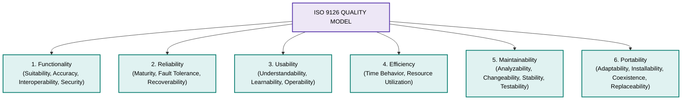

##### 2. Detailed Breakdown of ISO 9126 Characteristics
1. **Functionality:** Attributes that bear on the existence of a set of functions and their specified properties (Suitability, Accuracy, Interoperability, Compliance, Security).
2. **Reliability:** Attributes that bear on the capability of software to maintain its level of performance under stated conditions (Maturity, Fault Tolerance, Recoverability).
3. **Usability:** Attributes that bear on the effort needed for use, and on the individual assessment of such use (Understandability, Learnability, Operability).
4. **Efficiency:** Attributes that bear on the relationship between performance level and resource usage (Time Behavior, Resource Utilization).
5. **Maintainability:** Attributes that bear on the effort needed to make specified modifications (Analyzability, Changeability, Stability, Testability).
6. **Portability:** Attributes that bear on the ability of software to be transferred from one environment to another (Adaptability, Installability, Coexistence, Replaceability).

---

## 🎯 Topic Group 4: Software Quality Assurance (SQA) & Formal Technical Reviews (FTR)

### Question 4.1 [5 Marks] [Verified PYQ]
> **Source:** SVKM's NMIMS Final Examination (Dec 2024 / Dec 2017) | Q1(e)  
> **Bloom's Taxonomy:** BL-2 (Understand / Compare) | **Course Outcome:** CO-4  
> **Original Question Wording:**  
> *"What is SQA? Differentiate between Quality Control (QC) and Software Quality Assurance (SQA)."*

#### Official Marking Scheme Breakdown (5 Marks):

| Answer Component | Evaluation Criteria | Allocation |
| :--- | :--- | :---: |
| **SQA Definition** | Defining Software Quality Assurance as an umbrella activity across SDLC. | **1.5 Marks** |
| **QC vs. SQA Comparison** | Minimum 4 comparison points (Focus, Prevention vs Detection, Responsibility). | **3.5 Marks** |

---

#### 100% Grounded Model Solution:

##### 1. Definition of Software Quality Assurance (SQA)
**Software Quality Assurance (SQA)** is an umbrella activity applied throughout the software engineering process. SQA encompasses:
* Quality management framework definition.
* Software engineering technology application (methods and tools).
* Formal technical reviews (FTR).
* Multi-tiered testing strategies.
* Change management and documentation auditing.

##### 2. Comparison Table: Quality Control (QC) vs. Software Quality Assurance (SQA)

| Attribute | Quality Control (QC) | Software Quality Assurance (SQA) |
| :--- | :--- | :--- |
| **Primary Focus** | **Product-Oriented:** Evaluates work products to uncover defects. | **Process-Oriented:** Evaluates development processes to prevent defects. |
| **Core Objective** | Detects and fixes bugs before software release. | Establishes processes and audits adherence to quality standards. |
| **Key Activities** | Code execution, Unit/Integration testing, FTR inspections. | Process definition, quality audits, SQA planning, defect trend analysis. |
| **Timing** | Executed during construction and testing phases. | Executed continuously across the entire software lifecycle. |
| **Responsibility** | Software developers and test engineering teams. | Dedicated SQA team and organizational quality managers. |

---

### Question 4.2 [10 Marks] [Verified PYQ]
> **Source:** SVKM's NMIMS B.Tech Final Examination (Dec 2025 / May 2016) | Q4(b)  
> **Bloom's Taxonomy:** BL-3 (Apply) | **Course Outcome:** CO-4  
> **Original Question Wording:**  
> *"Explain Formal Technical Reviews (FTR). What are the guidelines, roles, and deliverables of an FTR meeting?"*

#### Official Marking Scheme Breakdown (10 Marks):

| Answer Component | Evaluation Criteria | Allocation |
| :--- | :--- | :---: |
| **FTR Concept & Objectives** | Defining FTR as a defect-filtering review meeting. | **2 Marks** |
| **Meeting Constraints & Guidelines** | Detailing duration (< 2 hours), group size (3-5 people), and advance prep. | **3 Marks** |
| **Participant Roles** | Explaining Review Leader, Producer, Recorder, and Peer Reviewers. | **3 Marks** |
| **Review Deliverables** | Explaining FTR Summary Report and Review Issues List. | **2 Marks** |

---

#### 100% Grounded Model Solution:

##### 1. Concept and Objectives of FTR
A **Formal Technical Review (FTR)** is the most effective SQA filter used to uncover errors in function, logic, or implementation in any software work product (SRS, UML diagrams, architecture models, source code).

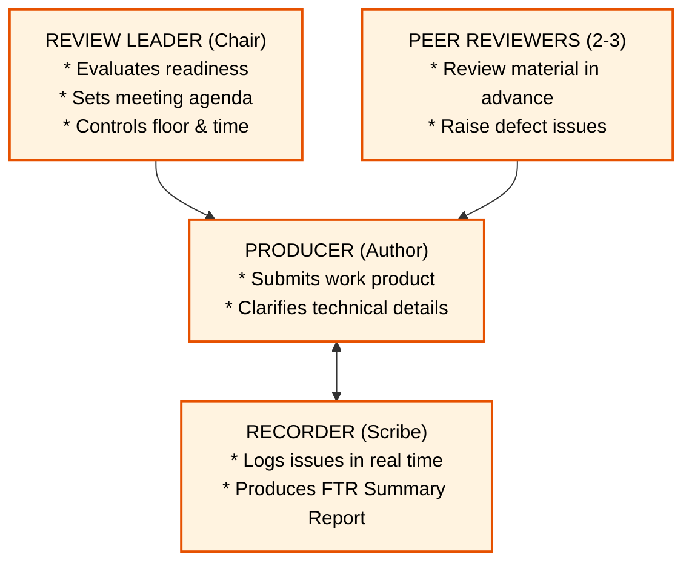

##### 2. Strict Operational Guidelines for FTR Meetings
To ensure efficiency, an FTR meeting enforces strict constraints:
1. **Participant Limit:** 3 to 5 people should be involved.
2. **Advance Preparation:** Advance preparation should take no more than 2 hours of work per person for the work product.
3. **Meeting Duration:** The duration of the review meeting should be less than 2 hours.
4. **Focus on Product, Not Producer:** Review the work product, not the author (keep reviews constructive).
5. **Limit Debate:** Record defects without attempting to solve them during the review meeting.

##### 3. FTR Participant Roles
* **Review Leader (Chair):** Evaluates work product readiness, schedules the meeting, and chairs the session.
* **Producer (Author):** The software engineer who created the work product; introduces the material and answers clarifications.
* **Recorder (Scribe):** Records all defects raised on the Review Issues List during the meeting.
* **Peer Reviewers:** Software engineers who review the work product in advance and raise defect items.

##### 4. FTR Deliverables
1. **Review Summary Report:** Summarizes what was reviewed, who attended, and the review finding (Accept, Reject, or Conditional Accept).
2. **Review Issues List:** A detailed log of all raised defect items, specifying defect location, description, severity, and assigned author fix date.

---

## 🎯 Topic Group 5: Software Quality Metrics, Reliability & CMMI Maturity

### Question 5.1 [5 Marks] [Verified PYQ]
> **Source:** SVKM's NMIMS Final Examination (Feb 2024 / Dec 2015) | Q2(d)  
> **Bloom's Taxonomy:** BL-3 (Apply) | **Course Outcome:** CO-4  
> **Original Question Wording:**  
> *"Define Software Reliability. Explain MTBF, MTTF, MTTR, and Software Availability percentage with formulas."*

#### Official Marking Scheme Breakdown (5 Marks):

| Answer Component | Evaluation Criteria | Allocation |
| :--- | :--- | :---: |
| **Reliability Definition** | Defining reliability in terms of failure-free operational time. | **1 Mark** |
| **MTTF, MTTR, MTBF Metrics** | Explaining Mean Time To Failure, Repair, and Between Failures. | **2 Marks** |
| **Availability Formula & Example** | Stating Availability formula with numerical example. | **2 Marks** |

---

#### 100% Grounded Model Solution:

##### 1. Definition of Software Reliability
Software reliability is defined as the probability of failure-free software operation in a specified environment for a specified time period.

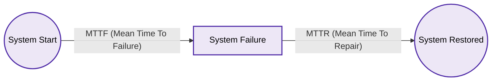

##### 2. Core Reliability Metrics & Formulas
1. **MTTF (Mean Time To Failure):** The mean operational duration during which the software runs without experiencing a failure.
2. **MTTR (Mean Time To Repair):** The mean time required to diagnose, repair, re-test, and restore software to operational status.
3. **MTBF (Mean Time Between Failures):** The total mean duration between successive system failures:

**MTBF = MTTF + MTTR**

##### 3. Software Availability Percentage Formula
Availability is the probability that a software system is operational according to specifications at a given point in time:

**Availability = [ MTTF / (MTTF + MTTR) ] × 100% = [ (MTBF - MTTR) / MTBF ] × 100%**

* **Numerical Example:** If an enterprise software system runs continuously for an average of 500 hours before failing (**MTTF = 500 hrs**) and takes an average of 4 hours to recover (**MTTR = 4 hrs**):
  * **MTBF = 500 + 4 = 504 hours**
  * **Availability = [500 / 504] × 100% = 99.20%**

---

### Question 5.2 [5 Marks] [Verified PYQ]
> **Source:** SVKM's NMIMS Final Examination (Dec 2024) | Course Code: 702IT0C016 | Q2(c)  
> **Bloom's Taxonomy:** BL-3 (Apply) | **Course Outcome:** CO-4  
> **Original Question Wording:**  
> *"Explain Defect Removal Efficiency (DRE) and its significance in software quality assurance."*

#### Official Marking Scheme Breakdown (5 Marks):

| Answer Component | Evaluation Criteria | Allocation |
| :--- | :--- | :---: |
| **DRE Definition & Concept** | Defining DRE as a metric measuring quality filter effectiveness. | **1.5 Marks** |
| **DRE Mathematical Formula** | Stating DRE formula specifying errors found before (E) and after (D) release. | **1.5 Marks** |
| **Significance in SQA** | Explaining how DRE measures quality filter efficiency across SDLC phases. | **2.0 Marks** |

---

#### 100% Grounded Model Solution:

##### 1. Definition and Concept of DRE
Defect Removal Efficiency (DRE) is a primary software quality metric that provides a quantitative measure of the ability of software quality assurance and control activities (reviews, inspections, unit tests) to remove errors before software is released to the end user.

##### 2. Mathematical Formula for DRE

**DRE = E / (E + D)**

Where:
* **E** = The number of errors found **before** the software is delivered to the end user (uncovered during internal reviews and testing).
* **D** = The number of defects found **after** the software is delivered to the end user (reported by customers in the field).

* **Ideal DRE Value:** As D approaches 0, **DRE** approaches **1.0 (100%)**, representing a quality process that filters out all defects prior to release.

##### 3. Phase-Specific DRE (Filtering Capacity)
When applied to individual software engineering phases, DRE measures how effectively a specific phase filters out errors introduced in that phase before they leak into the next phase:

**DRE_i = E_i / (E_i + E_{i+1})**

Where:
* **E_i** = Errors found during phase *i*.
* **E_{i+1}** = Errors introduced in phase *i* but not discovered until phase *i+1*.

##### 4. Significance of DRE in SQA
1. **Evaluates Quality Filter Effectiveness:** DRE directly measures whether formal technical reviews and testing phases are performing as effective defect filters.
2. **Cost-Reduction Indicator:** High DRE in early phases (Requirements and Design reviews) prevents defects from leaking into coding and testing, significantly reducing repair costs.
3. **Benchmarking Organizational Process Maturity:** SQA managers use historical DRE data to baseline organizational quality performance over time.

---

### Question 5.3 [10 Marks] [Verified PYQ]
> **Source:** SVKM's NMIMS B.Tech Final Examination (Dec 2025 / May 2017 / Dec 2016) | Q6(a)  
> **Bloom's Taxonomy:** BL-4 (Analyze / Describe) | **Course Outcome:** CO-4  
> **Original Question Wording:**  
> *"Explain Capability Maturity Model Integration (CMMI) and its 5 process maturity levels in detail."*

#### Official Marking Scheme Breakdown (10 Marks):

| Answer Component | Evaluation Criteria | Allocation |
| :--- | :--- | :---: |
| **CMMI Overview & Purpose** | Explaining CMMI framework developed by SEI for process assessment. | **2 Marks** |
| **Five Maturity Levels Breakdown** | Detailed breakdown of Levels 1 to 5 (Name, Characteristics, Key Focus Areas). | **5 Marks** |
| **Key Process Areas (KPAs)** | Mapping specific KPAs to maturity levels (e.g., Configuration Mgmt, SQA, Defect Prevention). | **3 Marks** |

---

#### 100% Grounded Model Solution:

##### 1. CMMI Overview and Purpose
Developed by the Software Engineering Institute (SEI) at Carnegie Mellon University, **Capability Maturity Model Integration (CMMI)** is a process capability assessment framework. CMMI defines an organizational continuum from ad-hoc, unpredictable processes to mature, disciplined software engineering processes.

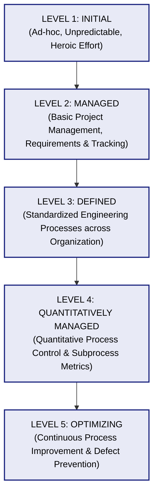

##### 2. Detailed Breakdown of the 5 CMMI Maturity Levels

| Level | Level Name | Process Characteristics | Key Focus & KPAs |
| :--- | :--- | :--- | :--- |
| **Level 1** | **Initial** | **Ad-hoc & Chaotic:** Undisciplined environment. Success depends on individual heroism. Schedules and budgets are routinely exceeded. | Crisis management, firefighting. No formal KPAs required. |
| **Level 2** | **Managed** | **Repeatable Project Management:** Basic tracking establishes cost, schedule, and functional traceability. Past successes can be repeated on similar projects. | Requirements Management, Project Planning, SQA, Configuration Management. |
| **Level 3** | **Defined** | **Organizational Process Standardization:** Software engineering and management processes are documented, standardized, and integrated into an organizational process asset library. | Organizational Process Definition, Risk Management, Peer Reviews, Integrated Software Management. |
| **Level 4** | **Quantitatively Managed** | **Quantitative Process Control:** Detailed metrics of software process and product quality are quantitatively collected and controlled using statistical techniques. | Quantitative Project Management, Software Quality Management, Process Measurement. |
| **Level 5** | **Optimizing** | **Continuous Process Improvement:** Process performance is continually improved through quantitative feedback and innovative technology evaluation. | Defect Prevention, Technology Change Management, Process Change Management. |

---

## 🎓 Exam Self-Audit Checklist

Before submitting your Unit 7 examination paper, ensure you have addressed these core evaluation criteria:
- [x] **V&V Differentiation:** Always include Boehm's questions ("building right product" vs "building product right") and code execution criteria.
- [x] **Testing Progression:** Clearly draw the spiral hierarchy from Unit Testing to System Testing.
- [x] **Test Harness Mechanics:** Explicitly diagram Test Drivers (calling parent) and Test Stubs (called subordinate).
- [x] **Quality Models:** Memorize McCall's 11 Factors across 3 categories (Operation, Revision, Transition) and ISO 9126's 6 attributes.
- [x] **FTR Rules:** State the 3-5 person, < 2 hours prep, and < 2 hours meeting duration constraints.
- [x] **Reliability Equations:** Show MTBF = MTTF + MTTR and Availability percentage equation clearly.
- [x] **DRE Metric:** Write DRE = E / (E + D) and explain the significance of pre-release filtering.
- [x] **CMMI Levels:** List Levels 1 to 5 in ascending order (*Initial, Managed, Defined, Quantitatively Managed, Optimizing*).
