# 📗 Software Engineering: Unit 7 — Testing Strategies & Software Quality (Comprehensive Study Notes)

> **Course:** B.Tech / MBATech / BTI Computer Engineering & Information Technology  
> **Subject:** Software Engineering (702IT0C016 / SE)  
> **Unit:** Unit VII — Testing Strategies & Software Quality  
> **Primary Reference Textbooks:**
> 1. *Software Engineering: A Practitioner's Approach* (8th & 9th Eds.) — Roger S. Pressman & Bruce R. Maxim  
> 2. *Software Engineering* (10th Ed.) — Ian Sommerville  
> 3. *Software Engineering Quality Factors & Models* — John McCall & ISO 9126 Standards  

---

## 📌 Executive Summary & Unit Syllabus Map

Software testing and quality assurance represent the critical verification and validation (V&V) mechanisms in the software engineering lifecycle. This comprehensive study guide provides an exhaustive, exam-oriented synthesis of **Unit 7**, covering testing strategies, testing levels, quality factor models, SQA activities, formal technical reviews, software metrics, and the Capability Maturity Model Integration (CMMI).

```mermaid
graph TD
    classDef root fill:#1a237e,stroke:#0d47a1,stroke-width:2px,color:#fff;
    classDef topic fill:#004d40,stroke:#00251a,stroke-width:2px,color:#fff;
    classDef sub fill:#37474f,stroke:#263238,stroke-width:2px,color:#fff;

    Root["Unit 7: Testing Strategies & Software Quality"]

    Root --> T1["1. Strategic Testing Approach"]
    T1 --> T1A["Verification vs Validation"]
    T1 --> T1B["Testing Spiral Model"]
    T1 --> T1C["Strategic Principles"]

    Root --> T2["2. Levels / Stages of Testing"]
    T2 --> T2A["Unit Testing (Drivers & Stubs)"]
    T2 --> T2B["Integration Testing (Top-Down, Bottom-Up, Sandwich)"]
    T2 --> T2C["Validation Testing (Alpha & Beta)"]
    T2 --> T2D["System Testing (Recovery, Security, Stress, Performance)"]

    Root --> T3["3. Software Quality Models"]
    T3 --> T3A["McCall's 11 Quality Factors"]
    T3 --> T3B["ISO 9126 Quality Standard"]
    T3 --> T3C["FURPS / FURPS+ Attributes"]

    Root --> T4["4. SQA & Technical Reviews"]
    T4 --> T4A["SQA Tasks & Responsibilities"]
    T4 --> T4B["Formal Technical Reviews (FTR)"]
    T4 --> T4C["Walkthroughs vs Inspections"]

    Root --> T5["5. Software Metrics & CMMI"]
    T5 --> T5A["Process & Project Metrics (DRE, MTBF, Availability)"]
    T5 --> T5B["CMMI 5 Maturity Levels"]

    class Root root;
    class T1,T2,T3,T4,T5 topic;
    class T1A,T1B,T1C,T2A,T2B,T2C,T2D,T3A,T3B,T3C,T3D,T4A,T4B,T4C,T5A,T5B sub;
```

---

## 1. Strategic Approach to Software Testing

### 1.1 Definition and Core Purpose of Software Testing
Software testing is a planned sequence of activities designed to exercise a software application with the explicit intent of **uncovering errors, defects, and discrepancies** between actual operational behavior and specified requirements.

* **Glenford Myers' Axiom:** *"Testing is the process of executing a program with the intent of finding an error."* A successful test is one that uncovers an undiscovered error, not one that merely executes without crashing.
* **Testing Economics:** Detecting and resolving errors during requirements or design phase costs **1x**. Resolving that same defect during integration testing costs **10x**, and fixing it post-deployment costs **100x** (Boehm's Cost of Quality Curve).

### 1.2 Verification vs. Validation (V&V)
Verification and Validation encompass all Software Quality Assurance (SQA) activities across the software development lifecycle.

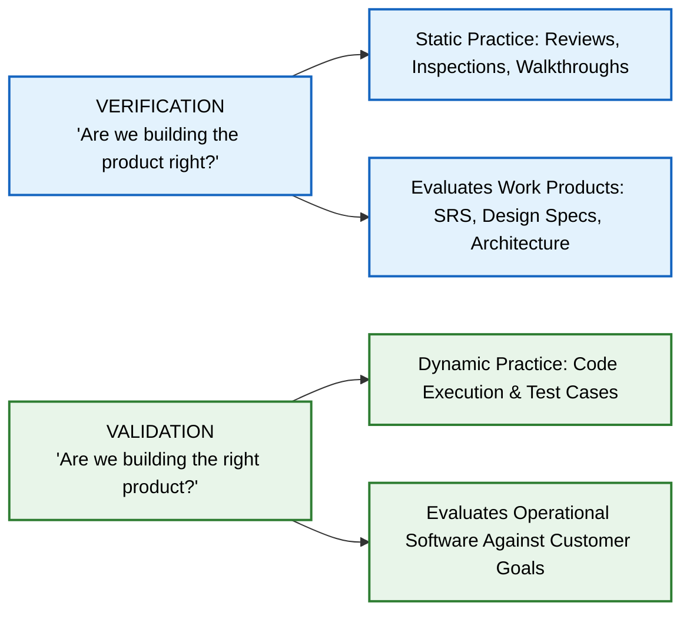

#### Detailed Comparison Matrix: Verification vs. Validation

| Comparison Parameter | Verification | Validation |
| :--- | :--- | :--- |
| **Core Question** | *"Are we building the product right?"* | *"Are we building the right product?"* |
| **Focus & Scope** | Evaluates intermediary work products (SRS, design docs, code structure) against specified inputs. | Evaluates the completed operational software package against actual customer requirements. |
| **Execution Mode** | **Static Practice:** Does not involve running or executing the executable code. | **Dynamic Practice:** Always involves executing software binaries under specific test data inputs. |
| **Primary Techniques** | Formal Technical Reviews (FTR), Code Inspections, Walkthroughs, Static Code Analysis. | Unit Testing, Integration Testing, System Testing, Alpha/Beta Acceptance Testing. |
| **Performing Entity** | Quality Assurance (QA) engineers, peer reviewers, and software architects. | Independent Testing Group (ITG), QA testers, and actual end-users / clients. |
| **Phase in SDLC** | Conducted continuously during early development stages (Requirements, Architecture, Design). | Conducted during late development and deployment stages (Post-coding). |
| **Error Category Caught** | Catches requirement ambiguities, architectural flaws, logic errors, and standard violations. | Catches functional gaps, performance bottlenecks, usability issues, and system integration failures. |

---

### 1.3 The Software Testing Spiral Model
A strategy for software testing can be viewed in the context of an **outwardly expanding spiral**:

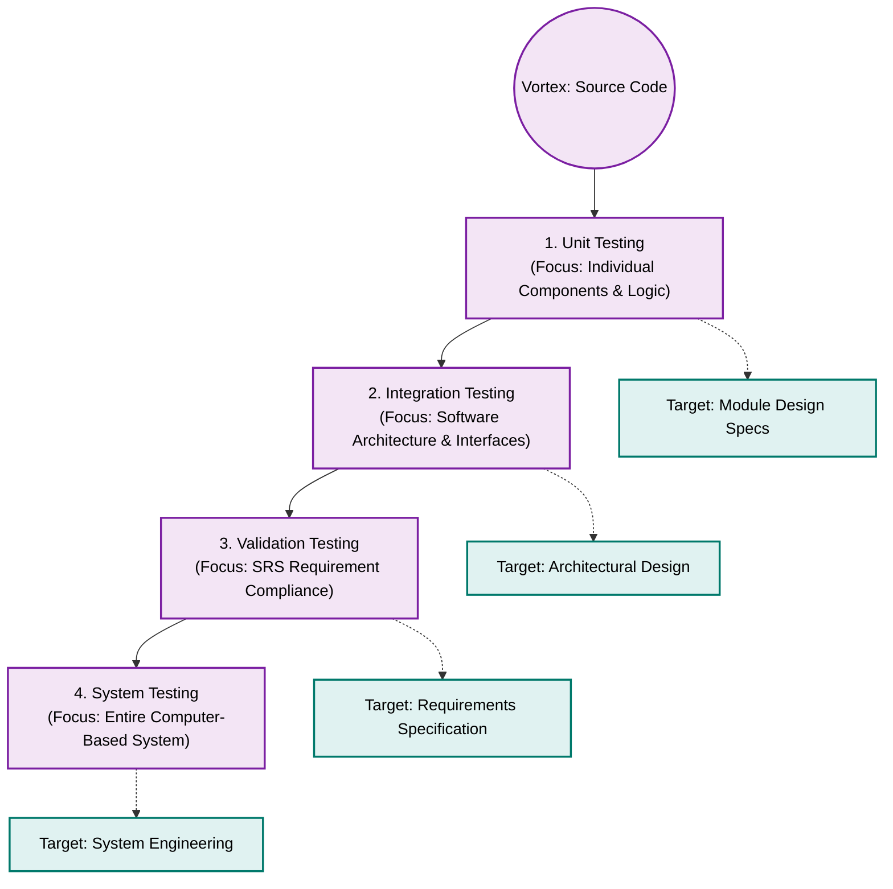

1. **Unit Testing:** Begins at the vortex of the spiral and concentrates on each individual software component/class implemented in source code.
2. **Integration Testing:** Moves outward along the spiral, focusing on architectural design and module inter-connections.
3. **Validation Testing:** Takes another turn outward, validating assembled software against SRS requirements.
4. **System Testing:** Arrives at the outermost boundary, testing the software alongside external hardware, databases, and network environments.

---

### 1.4 Strategic Principles for Software Testing
1. **Traceability to Requirements:** All tests should be traceable directly to customer requirements to prevent unrequested features from consuming test budgets.
2. **Test Early ("Testing in the Small" to "Testing in the Large"):** Test planning should begin long before code execution starts (e.g., test cases derived during requirements modeling).
3. **Pareto 80/20 Principle:** Approximately **80% of all software defects** discovered during testing are concentrated in **20% of the software modules**.
4. **Independent Testing Group (ITG):** While developers unit-test their own code, high-order integration and system testing should be conducted by an independent test team to eliminate developer bias.
5. **Non-Exhaustive Testing:** Exhaustive input path testing is mathematically impossible for non-trivial software. Testing strategies must use boundary value analysis and equivalence partitioning to maximize defect coverage.

---

## 2. Levels and Stages of Software Testing

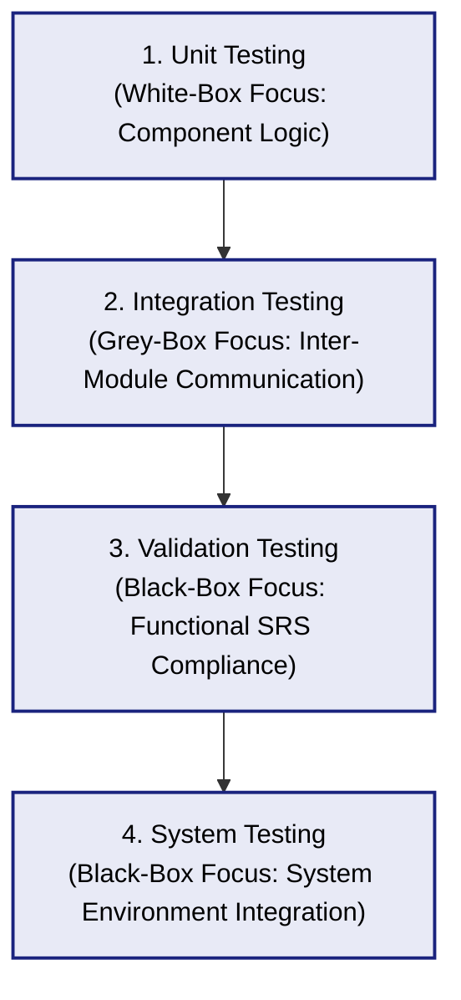

---

### 2.1 Unit Testing
Unit testing focuses verification efforts on the smallest testable unit of software design—the **software module or component**.

#### Core Focus Areas in Unit Testing:
1. **Module Interface:** Ensures information flows correctly into and out of the program unit.
2. **Local Data Structures:** Ensures data stored temporarily maintains integrity during execution.
3. **Boundary Conditions:** Checks that the module operates correctly at precise lower and upper numerical limits.
4. **Independent Paths:** Ensures all basic control paths (e.g., cyclomatic complexity paths) are executed at least once.
5. **Error Handling Paths:** Verifies that exception handling routines correctly capture and log errors.

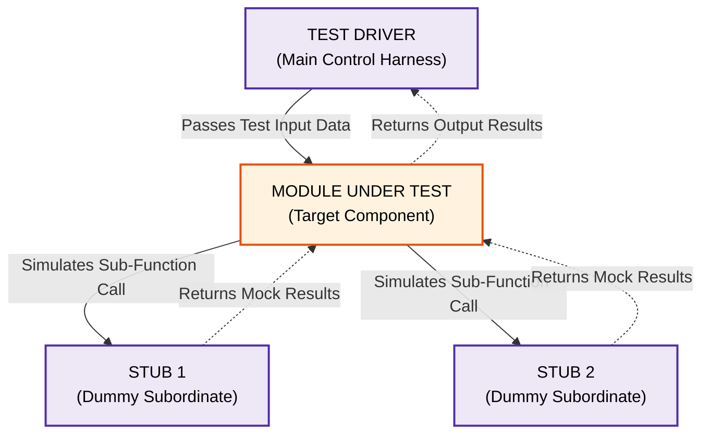

#### Test Drivers vs. Test Stubs:
* **Test Driver:** A main control module written specifically to pass test case data to the module under test, execute it, and print/evaluate output results.
* **Test Stub:** A "dummy sub-program" written to replace lower-level modules called by the module under test. It receives parameters, performs minimal/mock processing, and returns hardcoded control values.

---

### 2.2 Integration Testing
Integration testing is a systematic technique for constructing software architecture while conducting tests to uncover errors associated with **module interfaces**.

#### Non-Incremental ("Big Bang") vs. Incremental Integration:
* **Non-Incremental / Big Bang:** All modules are combined at once and the entire system is tested as a whole. **Disadvantage:** Severe difficulty in isolating errors, chaotic debugging, and missed interface paths.
* **Incremental Integration:** The program is constructed and tested in small, manageable increments.

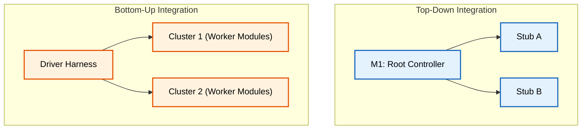

#### Integration Strategies Summary:

| Integration Strategy | Mechanics & Steps | Key Advantages | Disadvantages / Drawbacks |
| :--- | :--- | :--- | :--- |
| **Top-Down Integration** | Moves downward through control hierarchy from main root module. Subordinates replaced by **Stubs**. Can be Depth-First or Breadth-First. | Verifies major control and decision points early in the development lifecycle. | Requires writing numerous stubs; low-level I/O processing modules tested late. |
| **Bottom-Up Integration** | Begins construction and testing with atomic low-level worker modules. Combined into **Clusters / Builds** using **Drivers**. | Easy test case design; no stubs required; low-level utility modules thoroughly exercised. | Entire system program entity does not exist until the final top-level module is added. |
| **Sandwich Integration** | **Hybrid Approach:** Uses top-down integration for upper architectural control layers and bottom-up integration for lower utility layers. | Combines early control verification with early low-level module testing; minimizes total stubs/drivers. | Requires careful management to balance upper and lower integration workflows. |
| **Regression Testing** | Re-executes a subset of existing tests whenever new modules are added or modified. | Prevents unintended side-effects and bug propagation in previously working modules. | High execution time overhead; requires automated test execution scripts. |
| **Smoke Testing** | Daily integration strategy for time-critical projects. Assembles daily build and runs basic operational tests. | Uncovers fatal integration "show-stoppers" early before scheduled detailed testing. | Focuses strictly on high-level breadth, not deep component path coverage. |

---

### 2.3 Validation Testing
Validation testing provides final assurance that software meets all functional, behavioral, and performance requirements specified in the SRS.

* **Configuration Review (Software Audit):** Ensures that all elements of the software configuration (code, design docs, user manuals, test suites) are properly cataloged and maintained.
* **Alpha and Beta Testing:**

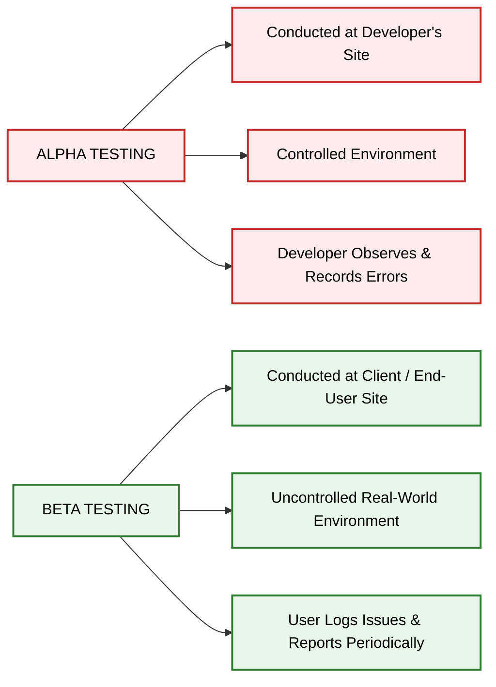

#### Comparison: Alpha Testing vs. Beta Testing

| Parameter | Alpha Testing | Beta Testing |
| :--- | :--- | :--- |
| **Test Location** | Conducted at the **developer’s site / laboratory**. | Conducted at **end-user / customer sites**. |
| **Environment** | Controlled testing environment simulating user activity. | Uncontrolled, live operational real-world environment. |
| **Developer Presence** | Developers are present to observe, record errors, and assist. | Developers are absent; end-users execute tests independently. |
| **Timing** | Performed near the end of internal system validation. | Performed prior to full commercial production release. |
| **Primary Goal** | Catch major internal defects and system crashes before external delivery. | Evaluate real-world usability, hardware compatibility, and user acceptance. |

---

### 2.4 System Testing
System testing verifies that all software elements mesh properly with hardware, external databases, and network environments.

1. **Recovery Testing:** Forces software to fail in various ways and verifies that system recovery is performed correctly and securely (fault tolerance & auto-restore).
2. **Security Testing:** Verifies that protection mechanisms built into the system will protect it from unauthorized penetration or data breaches.
3. **Stress Testing:** Executes the system in a manner that demands resources in abnormal quantities, frequencies, or volumes (e.g., 10x peak transaction volume).
4. **Performance Testing:** Measures runtime performance, throughput, response times, and memory utilization under varied operational workloads.
5. **Deployment / Installation Testing:** Exercises installation procedures and automated setup scripts across diverse target hardware configurations.

---

## 3. Software Quality Models and Factors

### 3.1 What is Software Quality?
Software Quality is defined as **conformance to explicitly stated functional and performance requirements, explicitly documented development standards, and implicit characteristics expected of all professionally developed software**.

---

### 3.2 McCall's Software Quality Factors (1977)
John McCall categorized 11 software quality factors across **three operational perspectives**:

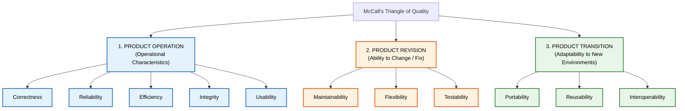

#### Detailed Breakdown of McCall's 11 Quality Factors:

| Perspective Category | Quality Factor | Operational Definition |
| :--- | :--- | :--- |
| **Product Operation** | **1. Correctness** | Extent to which a program satisfies its specification and fulfills customer mission objectives. |
| | **2. Reliability** | Extent to which a program performs its intended function with required precision over time. |
| | **3. Efficiency** | Amount of computing resources (CPU time, memory, disk I/O) required to execute a function. |
| | **4. Integrity** | Extent to which access to software or data by unauthorized persons can be controlled/prevented. |
| | **5. Usability** | Effort required to learn, operate, prepare input for, and interpret output from a program. |
| **Product Revision** | **6. Maintainability** | Effort required to locate, diagnose, and fix an error in an operational program. |
| | **7. Flexibility** | Effort required to modify an operational program to adapt to new user requirements. |
| | **8. Testability** | Effort required to test a program to ensure it performs its intended function without errors. |
| **Product Transition**| **9. Portability** | Effort required to transfer the software program from one hardware/OS environment to another. |
| | **10. Reusability** | Extent to which a program or component can be reused in other application developments. |
| | **11. Interoperability**| Effort required to couple one system to another external system or database. |

---

### 3.3 ISO 9126 Quality Standard
The ISO 9126 standard defines **6 key quality attributes** and their associated sub-attributes:

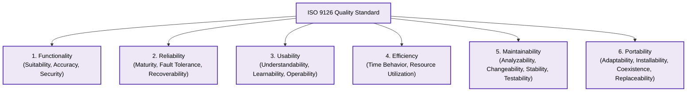

---

### 3.4 Hewlett-Packard's FURPS / FURPS+ Quality Model
Hewlett-Packard developed the **FURPS** quality framework:
* **F — Functionality:** Feature set, capabilities, generality, and system security.
* **U — Usability:** Human factors, aesthetics, consistency, and user documentation.
* **R — Reliability:** Frequency and severity of failure, predictability, and recoverability.
* **P — Performance:** Processing speed, response time, throughput, resource usage, and efficiency.
* **S — Supportability:** Maintainability, testability, flexibility, extensibility, and installability.
* **`+` (FURPS+ Extension):** Incorporates design constraints, implementation requirements, interface rules, and physical limits.

---

## 4. Software Quality Assurance (SQA) and Reviews

### 4.1 SQA Activities & Tasks
Software Quality Assurance (SQA) is a planned and systematic pattern of organizational activities necessary to ensure high software quality.

#### Core SQA Responsibilities:
1. **SQA Plan Development:** Establishing quality assurance plans, audit schedules, and designated standards for each project.
2. **Process Definition & Verification:** Reviewing software engineering processes to ensure organizational policy compliance.
3. **Auditing Work Products:** Reviewing technical work products (SRS, design docs, code, test suites) for standards compliance.
4. **Deviations Management:** Documenting non-compliance issues and reporting deviations to senior management.
5. **Defect Tracking & Metrics:** Recording defect metrics to analyze root causes and improve organizational processes.

#### Quality Control (QC) vs. Quality Assurance (SQA):

| Parameter | Quality Control (QC) | Software Quality Assurance (SQA) |
| :--- | :--- | :--- |
| **Definition** | A series of inspections, reviews, and tests used throughout the SDLC to uncover defects. | A systematic pattern of management actions providing confidence that quality standards are met. |
| **Focus** | **Product-Oriented:** Focuses on detecting defects in specific work products. | **Process-Oriented:** Focuses on improving processes to prevent defects. |
| **Execution** | Reactive technique (executing test cases, finding code bugs). | Proactive technique (process audits, establishing coding standards, training). |
| **Performer** | Development team, peer reviewers, and software testers. | Dedicated SQA team and organizational quality managers. |

---

### 4.2 Formal Technical Reviews (FTR)
A Formal Technical Review (FTR) is an SQA activity performed by software engineers to **uncover errors in logic, function, or implementation** before they propagate to testing.

#### FTR Review Meeting Rules & Constraints:
* **Participant Limit:** Exactly **3 to 5 people** should be involved in the review meeting.
* **Advance Preparation:** Work products must be distributed in advance; reviewers spend **no more than 2 hours** preparing prior to the meeting.
* **Short Duration:** The review meeting duration must be **less than 2 hours** (typically 60–90 minutes).
* **Focus:** Review the **work product, not the producer**. Focus on defect discovery, not defect resolution.

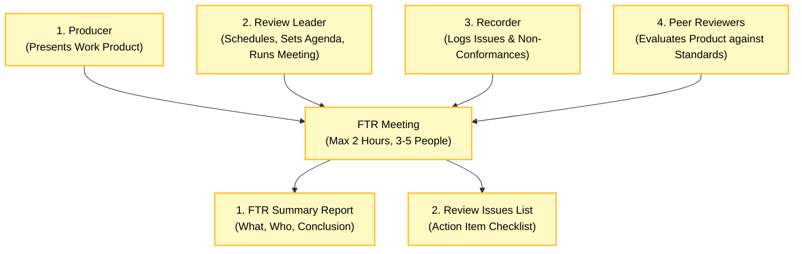

#### FTR Output Deliverables:
1. **FTR Summary Report:** A single-page document answering: *What was reviewed?*, *Who reviewed it?*, and *What were the findings and conclusions?*
2. **Review Issues List:** An action-item checklist guiding the producer to fix identified errors before final sign-off.

---

## 5. Software Metrics for Process, Project, and Quality

### 5.1 Key Software Quality Metrics
* **Defect Density:** Number of defects discovered per unit size of work product (e.g., `Defects / KLOC` or `Defects / Function Point`).
* **Defect Removal Efficiency (DRE):** A measure of the error-filtering ability of quality assurance activities:
  ```text
  DRE = E / (E + D)
  ```
  *(Where E = Errors found before delivery during reviews/testing, and D = Defects found by customer after delivery).*  
  *Ideal DRE approaches 1.0 (100%).*

* **Mean Time Between Failures (MTBF):**
  ```text
  MTBF = MTTF + MTTR
  ```
  *(Where MTTF = Mean Time To Failure, and MTTR = Mean Time To Repair).*

* **Software Availability:**
  ```text
  Availability = [ MTBF / (MTBF + MTTR) ] * 100%
  ```

---

## 6. Capability Maturity Model Integration (CMMI)

The Capability Maturity Model Integration (CMMI), developed by the Software Engineering Institute (SEI) at Carnegie Mellon University, evaluates organizational process capability and maturity across **5 distinct levels**:

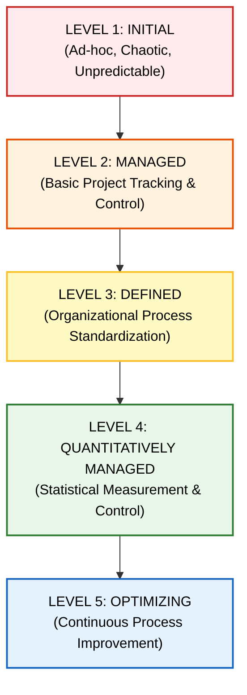

#### Detailed Breakdown of the 5 CMMI Maturity Levels:

| Maturity Level | Characteristics & Focus Area | Key Process Areas (KPAs) |
| :--- | :--- | :--- |
| **Level 1: Initial** | Process is ad-hoc, chaotic, and reactive. Success depends on individual heroism rather than documented procedures. | No formal KPAs at this baseline level. |
| **Level 2: Managed** | Basic project management discipline is established to track cost, schedule, and functionality. Discipline is repeatable across similar projects. | Requirements Management, Project Planning, Project Monitoring & Control, Supplier Agreement Management, Measurement & Analysis. |
| **Level 3: Defined** | Organizational processes are standardized, documented, and integrated into a standard software process for the entire company. | Organizational Process Definition, Integrated Software Management, Software Product Engineering, Peer Reviews, Risk Management. |
| **Level 4: Quantitatively Managed** | Detailed quantitative measures of software process and product quality are collected and statistically controlled. | Quantitative Project Management, Software Quality Management, Statistical Process Control. |
| **Level 5: Optimizing** | Focuses on continuous process improvement through quantitative feedback, defect prevention, and innovative technology adoption. | Defect Prevention, Technology Change Management, Process Change Management. |

---

## 7. Sourced Past Year Examination Questions (PYQs) & Model Solutions

### Question 7.1 (10 Marks) [Verified PYQ]
> **"Differentiate between Verification and Validation. Explain the levels of software testing in detail."**  
> — **Source:** NMIMS Final Exam 2022–23 (`A0TOfN1Qvp`), Q7b / Re-Exam 2023–24 (`yyq6EyhsfX`), Q7b | **Marks:** 10 Marks | **BL:** BL-Understand

#### Model Answer Outline:
1. **Verification vs. Validation Definition & Comparison Table:** (Refer to Section 1.2 for the comparison matrix covering definition, static/dynamic nature, scope, and performers).
2. **Four Levels of Testing:**
   * **Unit Testing:** Explain module-level white-box testing, local data structures, and the role of **Test Drivers** and **Test Stubs** with a diagram (Refer to Section 2.1).
   * **Integration Testing:** Explain incremental strategies (**Top-Down**, **Bottom-Up**, and **Sandwich Integration**) along with Regression Testing (Refer to Section 2.2).
   * **Validation Testing:** Explain requirement compliance, configuration audit, and **Alpha vs. Beta Testing** (Refer to Section 2.3).
   * **System Testing:** Explain high-order testing (**Recovery, Security, Stress, and Performance Testing**) (Refer to Section 2.4).

---

### Question 7.2 (10 Marks) [Verified PYQ]
> **"Describe McCall's Software Quality Factors in detail. How are they categorized?"**  
> — **Source:** NMIMS Final Exam 2022–23 (`A0TOfN1Qvp`), Q7b / Re-Exam 2022–23 (`JFJNM3vEUk`), Q4b | **Marks:** 10 Marks | **BL:** BL-Understand

#### Model Answer Outline:
1. **Definition of Software Quality:** Conformance to explicit functional requirements, documented standards, and implicit characteristics.
2. **McCall's Three Operational Perspectives:** Draw McCall's Quality Triangle diagram (Refer to Section 3.2).
3. **Detailing All 11 Factors Across 3 Categories:**
   * **Product Operation (5):** Correctness, Reliability, Efficiency, Integrity, Usability.
   * **Product Revision (3):** Maintainability, Flexibility, Testability.
   * **Product Transition (3):** Portability, Reusability, Interoperability.

---

### Question 7.3 (10 Marks) [Verified PYQ]
> **"Explain the 5 maturity levels of the Capability Maturity Model Integration (CMMI)."**  
> — **Source:** NMIMS Final Exam 2022–23 (`A0TOfN1Qvp`), Q5a / B.Tech 2014–15 (`3sY25zknIp`), Q7a | **Marks:** 10 Marks | **BL:** BL-Understand

#### Model Answer Outline:
1. **Introduction to CMMI:** Process capability meta-model developed by SEI at Carnegie Mellon University.
2. **5 Maturity Levels Diagram:** Draw the 5-tier escalation diagram (Refer to Section 6.0).
3. **Detailed Explanation of Each Level:**
   * **Level 1 (Initial):** Ad-hoc, chaotic.
   * **Level 2 (Managed):** Repeatable project management, requirements tracking.
   * **Level 3 (Defined):** Organizational process standardization.
   * **Level 4 (Quantitatively Managed):** Statistical metrics & quantitative quality management.
   * **Level 5 (Optimizing):** Continuous process improvement & defect prevention.

---
